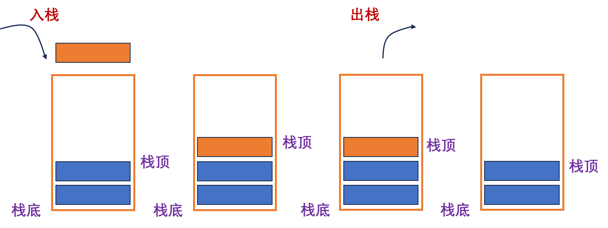
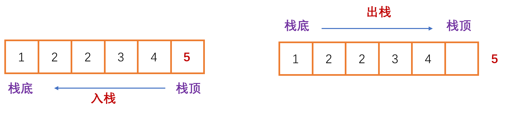
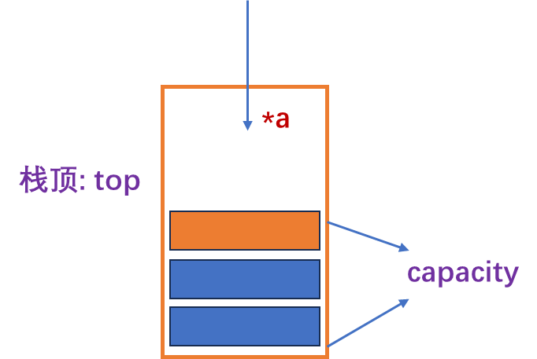
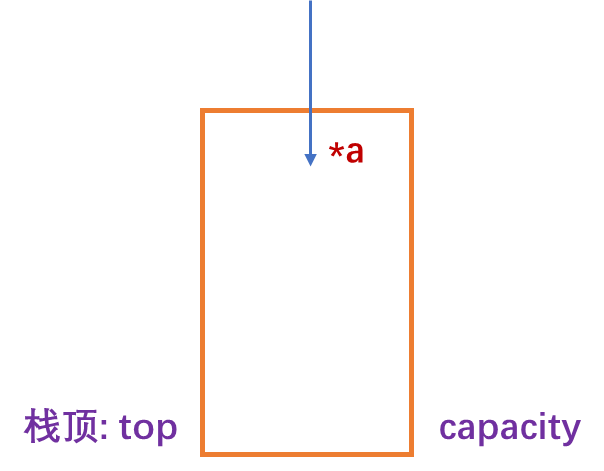
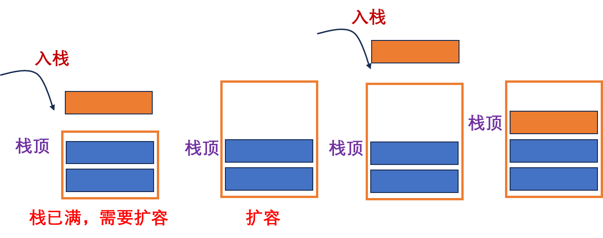
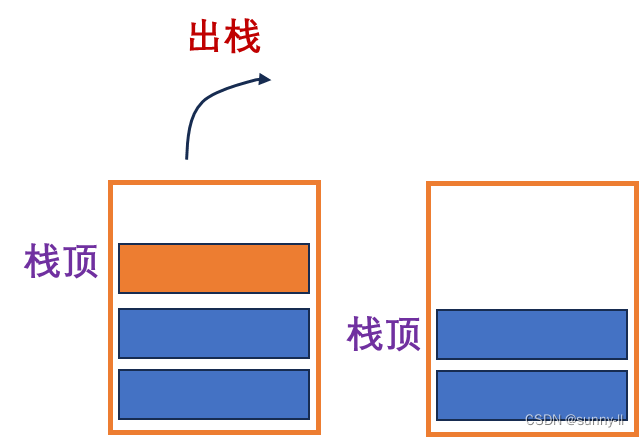
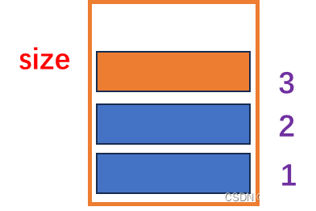
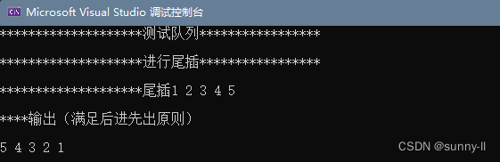

# 【C语言】栈（Stack）的实现（定义、入栈、出栈、销毁）

## 一、前言

## 二、栈

### 🍎 栈的概念

1️⃣ **栈**：一种特殊的线性表，其中只允许在固定的一端进行插入和删除元素的操作。

2️⃣ **栈的组成**：其中进行数据插入的和删除操作的一端称为栈顶，另一端称为栈底。

3️⃣ **栈的原则**：栈中的数据元素遵守 **后进先出（LIFO）** 的原则   

### 🔑 栈的两个经典操作

- **压栈**：栈的插入操作叫做 进栈 / 压栈 / 入栈 （入数据在栈顶）
- **出栈**：栈的删除操作叫做出栈。（出数据也在栈顶）

### 🍐 栈的结构





### 🍉 栈的实现

💦 针对栈的实现，我们可以使用之前学习过的 **链表**、**顺序表**都可以实现栈，但是我们需要考虑的是，之前学习的哪一种结构可以更高效的实现栈呢？

1️⃣ **链表**：空间的利用率高，不用扩容，头插头删高效

2️⃣ **顺序表**：空间利用率低，需要扩容，但是尾插尾删效率高

针对 **栈的结构** 我们不难看出 栈不管是插入数据，还是删除数据都是从栈顶进行操作（进行尾插，和尾删）。

🔑 **尾插和尾删** 在目前来看，顺序表的效率是最高的，所以我们选择使用顺序表来进行 栈的实现。

### 🍊 栈各个接口的实现

这里先建立三个文件：

- **1️⃣：Stack.h 文件**，用于函数声明
- **2️⃣：Stack.c 文件**，用于函数的定义
- **3️⃣：Test.c 文件**，用于测试函数

**建立三个文件的目的**：将 栈 作为一个项目来进行书写，方便我们的学习和观察。

#### ⭕ 定义一个栈结构体

🔑 **栈的结构体由三个部分组成**：

- **第一部分**：动态数组 用来存储数据
- **第二部分**：下标值 用来确定栈顶元素位置  
- **第三部分**：容量值 用来确定栈的元素个数



```c
typedef int STDataType;   // 定义数据类型
typedef struct Stack
{
	STDataType* a;   // 定义一个动态数组
	STDataType top;  // 用来确定栈顶位置（指向栈顶元素的下一个位置）
	STDataType capacity;  // 栈的容量
}ST;               // ST 为结构体的缩写名
```

#### ⭕ 栈的初始化

🔑 **栈的初始化**：主要是给 栈 一个地址空间，将栈中的数据全部清空，便于后续的操作方便。



```C
// 初始化栈
void STInit(ST* ps)
{
	assert(ps); // 这里一定要断言，如果是空指针的话，就无法找到整个数组 
 
	ps->a = NULL;
	ps->capacity = 0;
	// 这里需要注意的是当 top=0 时指向的是栈顶元素的下一个位置
	//                   top=-1 时指向的是栈顶元素
	// 这里也可以理解为顺序表中 size 有效数据的意思
	ps->top = 0;
}
```

#### ⭕ 栈的尾插

🔑 **栈的尾插**，需要判断 栈的容量是否已满，满了就需要扩容，没满，则向栈顶插入数据即可



```C
// 栈的尾插
void STPush(ST* ps, STDataType x)
{
	// 此时需要保证传入的栈，不是空
	assert(ps);
 
	// 扩容
	// 判断是否需要扩容
	if (ps->top == ps->capacity)
	{
		int newcapacity = ps->capacity == 0 ? 4 : ps->capacity * 2;
		STDataType* temp = (STDataType*)realloc(ps->a, sizeof(STDataType) * newcapacity);
		// 防止返回的是空指针
		if (temp == NULL)
		{
			perror("realloc fail!");
			exit(-1);
		}
		ps->a = temp;
		ps->capacity = newcapacity;
	}
	// 进行尾插数据
	ps->a[ps->top] = x;
	ps->top++;
}
```

#### ⭕ 栈的尾删

🔑 **栈的尾删**，只需要将栈顶的数据移除即可。

**注意：一定要保证栈顶有数据**



```C
// 栈的删除
void STPop(ST* ps)
{
	assert(ps);
	// 只需要删除栈顶的数据即可
 
	// 需要判断栈内是否还有数据
	assert(ps->top > 0);
	ps->top--;
 
}
```

#### ⭕ 栈内数据个数

🔑 统计 栈 内个数即可



```C
// 栈内数据的个数
int STSize(ST* ps)
{
	assert(ps);
 
	return ps->top;
}
```

#### ⭕ 获取栈顶元素

🔑 返回栈顶元素即可

```C
// 获取栈顶元素
STDataType STTop(ST* ps)
{
	assert(ps);
	assert(ps->top > 0);
 
	return ps->a[ps->top - 1];
}
```

#### ⭕ 判断栈是否为空

🔑 栈为空（栈顶的top是否等于0）

```C
// 判断栈是否为空
bool STEmpty(ST* ps)
{
	assert(ps);
 
	return ps->top == 0;
}
```

#### ⭕ 栈的销毁

🔑 **栈的销毁**，需要将动态数组的头指针 free 掉，结构体其他元素置0。

```C
// 栈的销毁
void STDestory(ST* ps)
{
	assert(ps);
	free(ps->a);
	ps->a = NULL;
	ps->capacity = ps->top = 0;
}
```

#### ⭕ 栈数据的打印

```C
// 打印栈
void STPrint(ST* ps)
{
	assert(ps);
 
	while (!STEmpty(ps))
	{
		// 打印栈顶
		printf("%d ", STTop(ps));
		// 一边出数据一边删数据（满足后进先出）
		STPop(ps);
	}
	printf("\n");
}
```

## 三、栈完整代码

### 🍇 Stack.h

```C
#include <stdio.h>
#include <stdlib.h>
#include <assert.h>
#include <stdbool.h>
#include <math.h>
 
// 静态的栈
//#define N 10
//struct Stack
//{
//	int a[N];    定义了一个指定好大小的数组
//	int size;
//};
 
 
// 动态栈
// 栈可以选择链表也可以选择数组，为什么要选择动态数组呢
// 因为数组的尾插和尾删效率比较高，而栈刚刚好，是先进后出，并且只能从一端进，一端出（栈顶）
 
typedef int STDataType;   // 定义数据类型
typedef struct Stack
{
	STDataType* a;   // 定义一个动态数组
	STDataType top;  // 用来确定栈顶位置（指向栈顶元素的下一个位置）
	STDataType capacity;  // 栈的容量
}ST;               // ST 为结构体的缩写名
 
// 初始化栈
void STInit(ST* ps);
// 栈的销毁
void STDestory(ST* ps);
 
// 栈只能从栈顶入栈，只能从栈顶出栈
 
 
// 栈的尾插
void STPush(ST* ps, STDataType x);
// 栈的删除
void STPop(ST* ps);
// 栈的个数
int STSize(ST* ps);
// 判断栈是否为空
bool STEmpty(ST* ps);
// 打印栈
void STPrint(ST* ps);
// 获取栈顶元素
STDataType STTop(ST* ps);
```

### 🍋 Stack.c

```C
#include "Stack.h"
#include <stdio.h>
 
// 初始化栈
void STInit(ST* ps)
{
	assert(ps); // 这里一定要断言，如果是空指针的话，就无法找到整个数组 
 
	ps->a = NULL;
	ps->capacity = 0;
	// 这里需要注意的是当 top=0 时指向的是栈顶元素的下一个位置
	//                   top=-1 时指向的是栈顶元素
	// 这里也可以理解为顺序表中 size 有效数据的意思
	ps->top = 0;
}
 
// 栈的销毁
void STDestory(ST* ps)
{
	assert(ps);
	free(ps->a);
	ps->a = NULL;
	ps->capacity = ps->top = 0;
}
 
// 栈的尾插
void STPush(ST* ps, STDataType x)
{
	// 此时需要保证传入的栈，不是空
	assert(ps);
 
	// 扩容
	// 判断是否需要扩容
	if (ps->top == ps->capacity)
	{
		int newcapacity = ps->capacity == 0 ? 4 : ps->capacity * 2;
		STDataType* temp = (STDataType*)realloc(ps->a, sizeof(STDataType) * newcapacity);
		// 防止返回的是空指针
		if (temp == NULL)
		{
			perror("realloc fail!");
			exit(-1);
		}
		ps->a = temp;
		ps->capacity = newcapacity;
	}
	// 进行尾插数据
	ps->a[ps->top] = x;
	ps->top++;
}
 
// 栈的删除
void STPop(ST* ps)
{
	assert(ps);
	// 只需要删除栈顶的数据即可
 
	// 需要判断栈内是否还有数据
	assert(ps->top > 0);
	ps->top--;
 
}
 
// 栈内数据的个数
int STSize(ST* ps)
{
	assert(ps);
 
	return ps->top;
}
 
// 判断栈是否为空
bool STEmpty(ST* ps)
{
	assert(ps);
 
	return ps->top == 0;
}
 
// 打印栈
void STPrint(ST* ps)
{
	assert(ps);
 
	while (!STEmpty(ps))
	{
		// 打印栈顶
		printf("%d ", STTop(ps));
		// 一边出数据一边删数据（满足后进先出）
		STPop(ps);
	}
	printf("\n");
}
 
// 获取栈顶元素
STDataType STTop(ST* ps)
{
	assert(ps);
	assert(ps->top > 0);
 
	return ps->a[ps->top - 1];
}
```

### 🥝 Test.c

```C
// 栈：
// 有数组栈（尾插尾删效率高） 和 链式栈
// 用数组实现栈更优一点

#include "Stack.h"
#include <stdio.h>

// 尾插测试
void Test1()
{
	// 定义一个结构体变量
	// 要改变这个结构体变量，就要在形参上传递结构体变量的地址
	ST ps;
	// 进行初始化
	STInit(&ps);
	// 将结构体变量的地址给给尾插函数
	printf("********************测试队列*****************\n");
	printf("\n");
	printf("********************进行尾插*****************\n");
	printf("\n");
	printf("********************尾插1 2 3 4 5\n");
	printf("\n");
	STPush(&ps, 1);
	STPush(&ps, 2);
	STPush(&ps, 3);
	STPush(&ps, 4);
	STPush(&ps, 5);
	printf("****输出（满足后进先出原则）\n");
	printf("\n");
	STPrint(&ps);
	
	// 销毁（防止内存泄露）
	STDestory(&ps);
}

// 尾删测试
void Test2()
{
	// 定义一个结构体变量
	ST ps;
	// 进行初始化
	STInit(&ps);
	// 将结构体变量的地址给给尾插函数
	STPush(&ps, 1);
	STPush(&ps, 1);
	STPush(&ps, 1);

	STPop(&ps);
	STPrint(&ps);

	// 销毁（防止内存泄露）
	STDestory(&ps);
}

int main()
{
	Test1();
	return 0;
}
```

### 🍍 代码运行界面

