# bin&map文件的分析

## bin、map、反汇编文件

### bin文件简介
   .bin 文件就是二进制文件（binary file），这种文件只包含机器码。所有的数据都是机器可以执行的指令码、指令参数或者常量数据，不包含其它调试信息。加载到内存或者支持XIP（就地执行）的存储器中规定好的加载地址之后直接从规定好的运行地址开始运行即可。
  例如单片机中烧写的都是 .bin 文件，以STM32为例，其片内Nor FLASH的起始地址也是代码的加载（烧写）地址为 0x08000000 。上电复位或者手动复位之后，程序计数器PC指向单片机的复位异常的中断向量地址 0x08000004 的位置，单片机从复位开始运行。
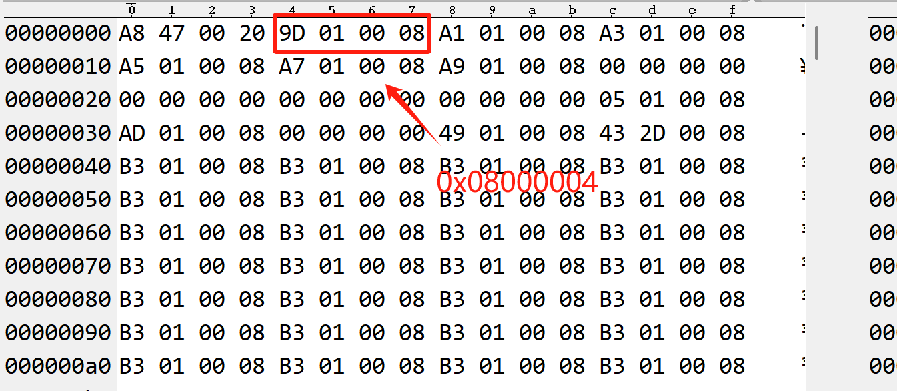

图就是一个bin文件的内容节选，在上图的bin文件中左侧的 Address 表示的是现在地址的相对位置，一般情况下我们都是将斌文件下载到地址 0x08000000 中，所以上文提及的 0x08000004 内存中存储的是上图红色框的内容 0x0800019d（这是一个小端存储的单片机）

### map件简介
  在单片机开发中，.map 文件是一种编译过程中的输出文件，通常由编译器在完成代码编译后生成。.map 文件包含了**程序中函数和变量的内存布局信息**，这些信息描述了程序在内存中的位置和大小。
  这是一个函数、变量在单片机中存储的绝对文件，可以通过该文件快速定位到单片机中某一个变量的存储地址或者某一个函数的入口地址。通过查看 .map 文件可以确定哪些变量或函数占用了大量的内存，从而进行相应的优化。在链接阶段，.map 文件用于确定程序中各个函数和变量的最终地址。链接器使用 .map 文件来确定如何将分散的代码段和数据段整合到一起，以形成一个可执行程序。**对于逆向工程和二进制分析**，.map 文件可以提供有用的信息，因为它们描述了程序如何在内存中布局，这对于理解程序的执行流程和结构非常有帮助。

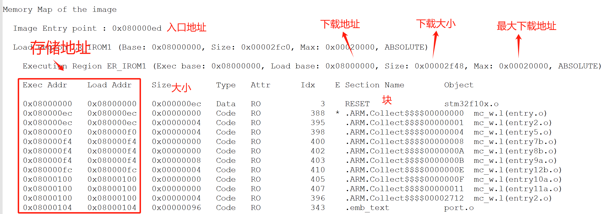

👉 **程序入口地址**（即 `Reset_Handler` 的位置）

### 反汇编文件简介
  单片机中的反汇编文件是一种将机器语言代码转换为汇编语言代码的工具。可以通过反汇编文件在调试过程中定位和解决问题。通过查看反汇编文件可以了解代码的执行过程，并确定可能出现问题的位置。可以使用反汇编文件帮助分析单片机的性能瓶颈。通过查看反汇编文件可以了解代码的执行时间和执行效率，从而确定需要优化的部分。通过查看反汇编文件，可以帮助对bin文件中的指令代码进行识别。

分析bin文件
keil生成bin、map和反汇编文件
  在keil中一般只会自动生成一个.map文件，但是这个文件内容非常多，大部分对于我们分析.bin文件没有帮助，所以需要对其生成的内容进行修改。而.bin文件和反汇编文件的生成需要使用一些命令来实现。

bin 和 反汇编文件
  在keil的 Opentions for Target ->> User ->> After Build/Rebuild 中输入如下图所示的内容即可生成 二进制 bin(.bin) 文件和 反汇编(.asm) 文件夹。
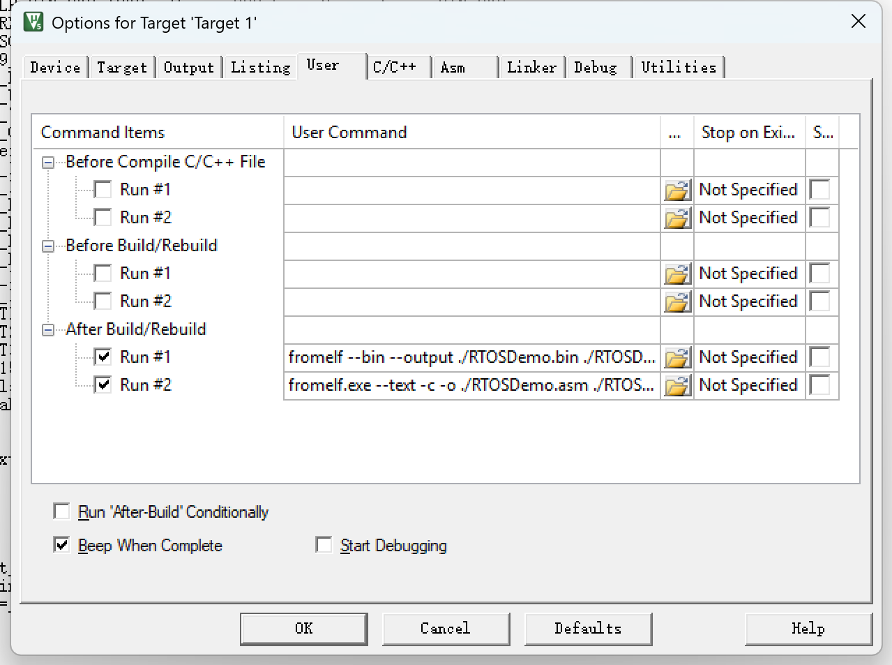

```
fromelf --bin --output ./RTOSDemo.bin ./RTOSDemo.axf
```

编写完成并且编译之后，可以在工程目录下找到对应的bin 和 asm 文件。

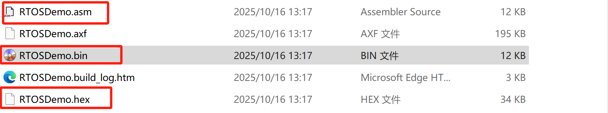

#### map文件

  在keil的 Opentions for Target ->> Listing 中选中 Linker Listing，并且按照如下图配置只选中：

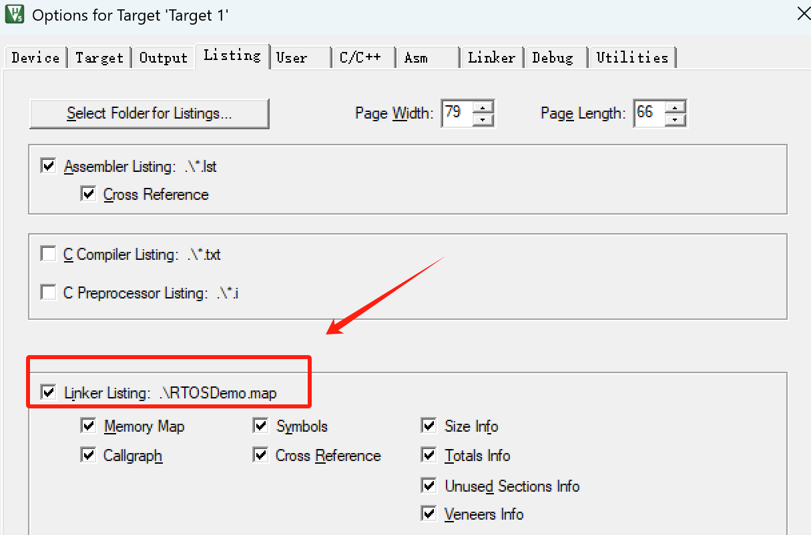

### 结合程序分析bin文件

在`.bin`文件的开头有如下内容：

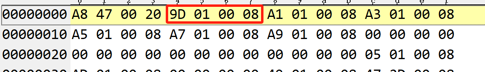

 从上面对bin文件的简介中提到单片机复位之后 PC 指针将指向 0x08000004 （这是复位中断的地址），那么前面跳过的4个字节是什么东西呢，接着我们打开单片机的汇编代码：

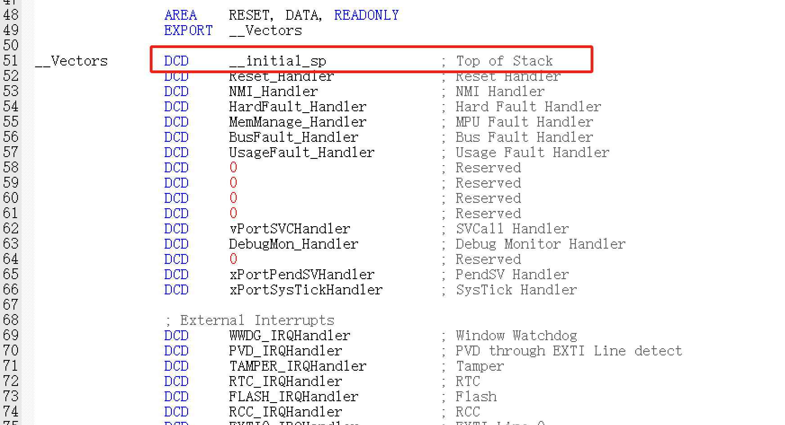

其实在单片机中已经指定了以上中断服务的入口地址，我们所编写的中断服务函数其实就是将中断服务函数的入口地址存储在这些已经确定的中断服务地址中，所以前面忽略的4个字节的内容其实就是栈（SP指针）顶地址，具体可以查看[启动过程详解](https://blog.csdn.net/qq_39400113/article/details/105056538)。

```
注意：前四个字节是栈顶地址，不是函数的入口地址（不能让PC指针指向这里），所以PC指针是在单片机复位以后自动指向 0x0800004
```

bin 文件中查看，会发现前 236 字节就是各种中断向量的地址值，0x08000000 – 0x080000EB

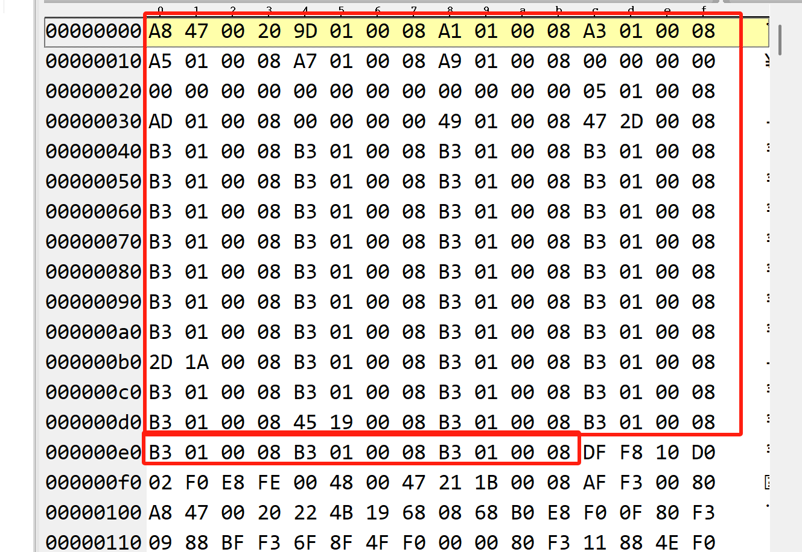

  0x08000004 地址下面存放的数据内容是上图中的 0x0800019d ，这是一个地址内容，这个是一个函数入口（PC指针指向了这里）。

### 从map和反汇编中分析bin文件

  上面是从程序中的分析，再结合`.map`文件进行分析时就会非常方便了，下图就是我们`.bin`文件中的前194字节的服务地址。

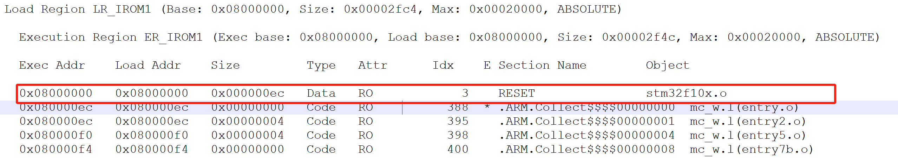

接着看 0x08000004 地址下面存放的数据内容是上图中的 0x0800019d ，在上图中我们并没有直接看到 0x0800019d 这个地址，这时我们需要对`.bin`文件和反汇编文件进行结合分析。

机器码是 `0x4805`

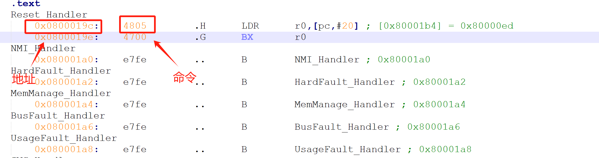

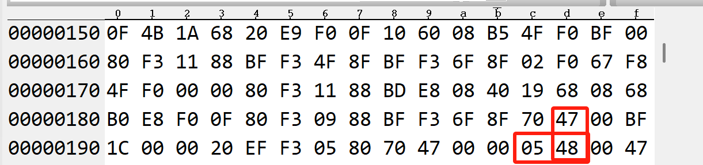

其实从上图可以看出 0x0800019d 这个地址里面的内容是一个16位的指令，所以在`.map`文件中就对应于地址 0x0800019c 。

在进入服务中断服务中，你会发现有一个在所有文档中找不到的函数 __main 。

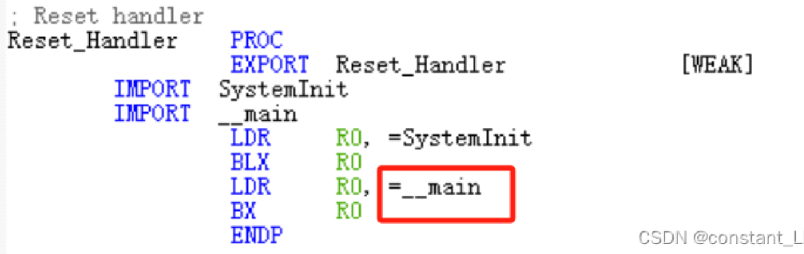

这个函数可以参考文章STM32启动详细流程之__main，结合反汇编文件进行分析可以快速理解。

  对于.bin而言最具有分析价值的地方就在于开头的地方。

总结
  对于使用IAP而言，在做程序跳转时 PC 的指针应该指向应用程序相对地址的 0x00000004 ，0x00000000存储的是栈顶指针，这一点非常重要。
Q :为什么汇编是0x0800019d，bin文件是0x0800019c？

A: **向量表中存的地址 = 代码实际地址 + 1**
 这个 +1 不是偏移量，而是 **Thumb 模式标志位**，CPU 会自动去掉后跳到偶数地址执行。

### 查找一个变量的地址

一个全局变量

```
volatile int a = 1;
```

查看map文件

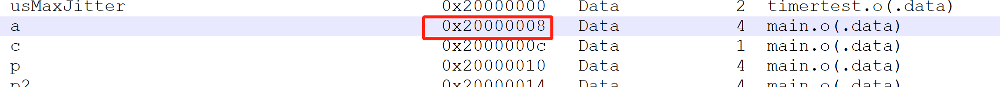

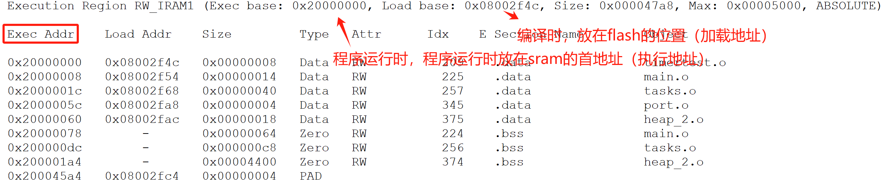

0x20000000对应0x08002f4c，0x20000008对应0x08002f54，通过查看bin文件，0x00002f54地址的值，

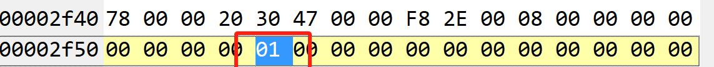

### 查找一个函数的机器码

```C
int add(int a,int b){
	return a+b;
}
```

查看map文件

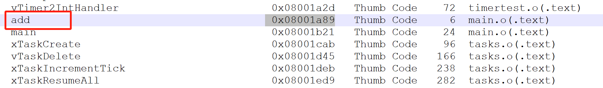

add函数对应地址0x08001a89（Thumb 指令），实际地址为0x08001a88，大小为6个字节，查看bin文件

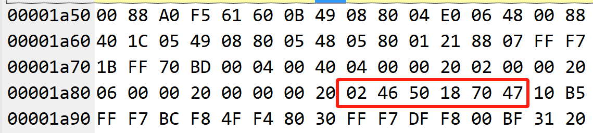

| 地址       | 机器码 | 指令              |
| ---------- | ------ | ----------------- |
| 0x08001A88 | 02 46  | `MOV r2, r0`      |
| 0x08001A8A | 50 18  | `ADDS r0, r2, r1` |
| 0x08001A8C | 70 47  | `BX lr`           |

反汇编结果

```
08001A88:  MOVS    r2, r0        ; r2 = r0
08001A8A:  ADDS    r0, r2, r1    ; r0 = r2 + r1 = r0 + r1
08001A8C:  BX      lr            ; return  从 lr 取出返回地址；跳回到调用 add 的地方；
```

## cpu&flash&ram

1.全局变量:初值来自flash

2.设置初始值，放在flash的data段


3.局部变量

未初始化的值
