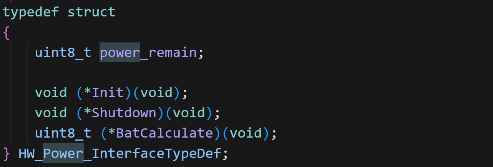
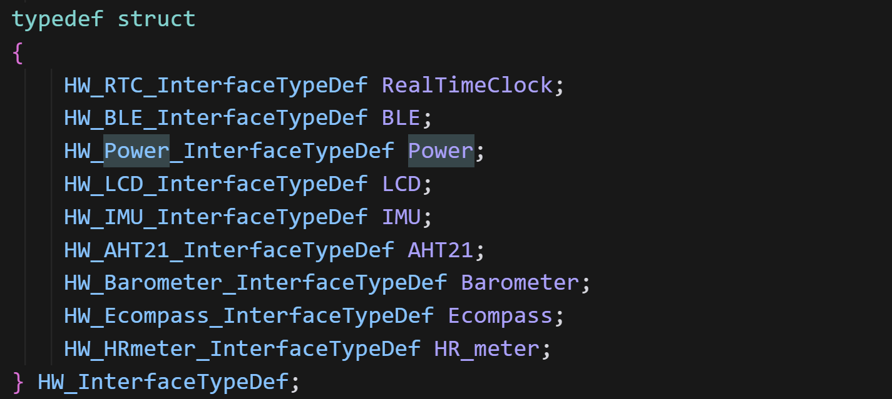
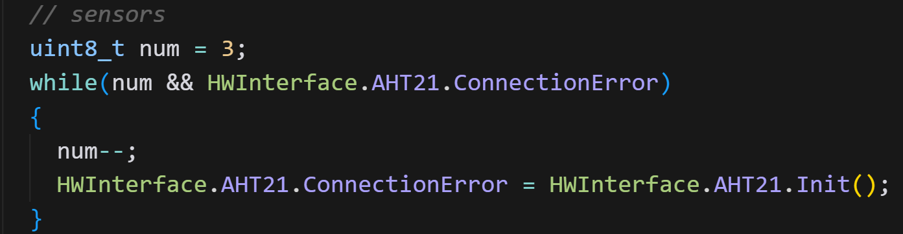

# OV-WATCH代码风格学习

## 一.工程总体框架:

- 目录结构

`Software/IAP_F411/`  IAP 升级工程

```
Software/IAP_F411/
├── README(若有)			# 工程说明
├── IAP_F411.ioc			# CubeMX 配置文件
├── BSP/				# 板级外设驱动
│   ├── KEY/			# 按键驱动
│   ├── KT6328/			# 语音/编解码芯片驱动
│   ├── LCD/			# LCD 与字体资源
│   └── POWER/			# 供电与管理
├── Core/				# 工程入口与外设初始化
│   ├── Inc/			# 头文件（gpio.h/usart.h 等）
│   └── Src/			# 源文件（main.c/中断/外设初始化）
├── Drivers/				# 芯片与 HAL 库
│   ├── CMSIS/			# ARM CMSIS 核心与设备
│   └── STM32F4xx_HAL_Driver/	# ST HAL 驱动
├── Ymodem/				# 升级协议与 Flash 接口
│   ├── ymodem.c		# YMODEM 协议
│   ├── flash_if.c		# Flash 读写适配
│   └── menu.c			# 升级菜单/命令
├── SYSTEM/				# 通用系统工具
│   └── delay.c			# 延时与系统封装
├── MDK-ARM/				# Keil 工程与启动文件
│   ├── *.uvprojx		# Keil 工程文件
│   └── startup_stm32f411xe.s	# 启动与中断向量
└── KeilClear.bat			# 构建产物清理脚本
```

`OV_Watch/`  主应用工程

```
OV_Watch/
├── OV_Watch.ioc			# CubeMX 配置文件
├── BSP/				# 板级驱动（传感器/显示/触摸/电源等）
│   ├── AHT21/  BL24C02/  EM7028/
│   ├── IIC/  KEY/  KT6328/  LCD/
│   ├── LSM303DLH/  MPU6050/  OWDG/
│   ├── POWER/  SPL06_001/  TOUCH/
│   └── ...
├── Core/				# 入口、外设初始化与中断
│   ├── Inc/			# 头文件（gpio.h/rtc.h 等）
│   └── Src/			# 源文件（main.c/freertos.c/usart.c 等）
├── Drivers/				# 芯片与 HAL 库
│   ├── CMSIS/
│   └── STM32F4xx_HAL_Driver/
├── Middlewares/			# 中间件
│   ├── LVGL/			# 图形库及端口
│   └── Third_Party/FreeRTOS/	# RTOS 内核
├── User/				# 业务与界面
│   ├── Func/			# 功能模块与数据访问
│   ├── GUI_App/			# 界面资源与屏幕实现
│   ├── Tasks/			# FreeRTOS 任务实现
│   └── version.h		# 版本号配置
├── SYSTEM/				# 系统工具（delay 等）
├── MDK-ARM/				# Keil 工程、RTE、产物与启动文件
│   └── startup_stm32f411xe.s	# 启动与中断向量
└── KeilClear.bat			# 清理脚本（若有）
```

## 二.主流程/执行流程图

 `OV_Watch` 工程：

- 执行主线（入口到调度器）
  1. `Core/Src/main.c::main()`
  2. `HAL_Init()` 初始化 HAL 与 SysTick
  3. `SystemClock_Config()` 配置系统时钟
  4. `MX_GPIO/ADC/RTC/SPI/TIM/USART*_Init()` 外设初始化
  5. `osKernelInitialize()` 初始化 CMSIS-RTOS2
  6. `MX_FREERTOS_Init()` 创建默认任务并调用 `User_Tasks_Init()` 创建业务任务
  7. `osKernelStart()` 启动调度器

- 任务清单（`User/Tasks/Src/user_TasksInit.c` 创建）
  - `HardwareInitTask`：统一初始化/唤醒硬件与传感器、启动 PWM/UART/RTC、`delay_init()`
  - `LvHandlerTask`：LVGL 循环处理与界面刷新
  - `WDOGFeedTask`：喂狗
  - `IdleEnterTask` / `StopEnterTask`：空闲/停止状态管理
  - `KeyTask`：按键扫描与事件
  - `ScrRenewTask`：页面切换与界面刷新调度
  - `SensorDataUpdateTask`：传感器数据采集更新，不同的页面对应不同的传感器
  - `HRDataUpdateTask`：心率数据算法处理
  - `ChargPageEnterTask`：充电状态检测与页面进入
  - `MessageSendTask`：串口/消息交互
  - `MPUCheckTask`：抬腕/放腕检测
  - `DataSaveTask`：数据落盘存储

- 简易执行流程图（文本版）

```
程序启动
  ↓
HAL_Init → SystemClock_Config
  ↓
外设初始化：GPIO / DMA / ADC / RTC / SPI / TIM / USART
  ↓
osKernelInitialize
  ↓
MX_FREERTOS_Init
  └─ 创建默认任务 + 调用 User_Tasks_Init 创建业务任务
       ├─ HardwareInitTask（初始化硬件与传感器）
       ├─ LvHandlerTask（LVGL）
       ├─ WDOGFeedTask / IdleEnterTask / StopEnterTask
       ├─ KeyTask / ScrRenewTask
       ├─ SensorDataUpdateTask / HRDataUpdateTask
       ├─ ChargPageEnterTask / MessageSendTask
       ├─ MPUCheckTask
       └─ DataSaveTask
  ↓
osKernelStart（进入多任务循环，GUI 与业务并行）
```

## 三.FreeRTOS的任务:

### 任务总览表

| 任务名 | 优先级 | 等待消息 | 销毁时机 | 主要职责 |
| --- | --- | --- | --- | --- |
| HardwareInitTask | High3 | 无 | 完成初始化后自删除 | 初始化RTC/USART/PWM/延时/电源/按键/传感器(含重试)/EEPROM/触摸/LCD/LVGL与UI，恢复其它任务 |
| LvHandlerTask | Low | 无；循环`osDelay(1)` | 常驻 | LVGL主循环，检测非活跃并投递`IdleBreak` |
| WDOGFeedTask | High2 | 无；周期延时 | 常驻 | 喂狗、使能看门狗(100ms) |
| IdleEnterTask | High | `Idle`、`IdleBreak` | 常驻 | 根据`Idle`降背光到5%；收到`IdleBreak`恢复亮度并清零空闲计数 |
| StopEnterTask | High1 | `Stop` | 常驻 | 收到`Stop`后关外设→进入STOP→唤醒恢复时钟/外设，并按需投递`HomeUpdata` |
| KeyTask | Normal | 无 | 常驻 | 扫描按键，向`Key`与`IdleBreak`投递；主页上的KEY2触发`Stop` |
| ScrRenewTask | Low1 | `Key` | 常驻 | 处理按键消息，页面切换与资源休眠/唤醒 |
| SensorDataTask | Low1 | `HomeUpdata` | 常驻 | 接收`HomeUpdata`后更新电量/步数/温湿度/指南针/气压等，并投递`DataSave`/`IdleBreak` |
| HRDataTask | Low1 | 无 | 常驻 | 心率采集与处理，仅在**心率页**运行，约50ms周期 |
| ChargPageEnterTask | Low1 | 无 | 常驻 | 监测充电状态变化，进入/退出充电页面，复位空闲计数 |
| MessageSendTask | Low1 | 无 | 常驻 | 串口/BLE消息处理与透传，周期检查并可能投递`IdleBreak` |
| MPUCheckTask | Low2 | 无 | 常驻 | 约300ms检查抬腕/放腕；必要时投递`Stop`/`IdleBreak` |
| DataSaveTask | Low2 | `DataSave` | 常驻 | 接收保存指令，写入EEPROM（设置与步数等） |

### 任务优先级

1. **osPriorityHigh3**: HardwareInitTask (硬件初始化)

2. **osPriorityHigh2**: WDOGFeedTask (看门狗)

3. **osPriorityHigh1**: StopEnterTask (停止模式)

4. **osPriorityHigh**: IdleEnterTask (空闲模式)

5. **osPriorityNormal**: KeyTask (按键)

6. **osPriorityLow1**: ScrRenewTask, SensorDataTask, HRDataTask, ChargPageEnterTask, MessageSendTask (按键屏幕刷新、传感器数据、心率数据、充电检查、串口消息发送)

7. **osPriorityLow2**: MPUCheckTask, DataSaveTask (MPU检查、数据保存)

8. **osPriorityLow**: LvHandlerTask (LVGL处理)

	- 总体原则：先保**系统安全与功耗，再保交互实时性，最后做后台工作**。

	- osPriorityHigh3 HardwareInitTask：尽快完成一次性硬件/外设/传感器初始化，**缩短上电到可用时间**；完成后自删，避免长期占用高优先级。

	- osPriorityHigh2 WDOGFeedTask：喂狗属于“安全底线”，优先级必须高于大  多数任务，避免因排队导致误复位。

	- osPriorityHigh1 StopEnterTask：待机/唤醒切换牵涉功耗与时钟/外设重配，要求响应迅速，优先于一般交互与后台采集。

	- osPriorityHigh IdleEnterTask：屏幕亮度/空闲管理需较快响应用户操作与定时事件，但不应压过喂狗与待机切换。

	- osPriorityNormal KeyTask：按键是人机交互入口，延迟容忍度中等（毫秒级即可），置于常规优先级即可确保流畅。

	- osPriorityLow1 ScrRenewTask/SensorDataTask/HRDataTask/ChargPageEnterTask/MessageSendTask：界面刷新与周期采集/通信属“业务层后台”，可被更高优先级打断，不影响安全与功耗控制。

	- osPriorityLow2 MPUCheckTask/DataSaveTask：抬腕判定/数据落盘更不敏感（几十到上百毫秒可接受），置更低优先级减少对前台交互与功耗控制的干扰。

	- osPriorityLow LvHandlerTask：LVGL主循环已配合 osDelay(1) 让出CPU，置最低优先级以避免抢占时序关键任务；UI帧率主要受空闲时间与定时驱动影响。

	- 额外考虑：

	- 高优先级任务须短小、少阻塞，避免饿死低优先级。

	- 涉及互斥/队列时，尽量由低优先级向高优先级发送，避免优先级反转风险。

	- 若后期发现交互卡顿或功耗切换不够迅速，可在 High/Normal/Low1 间微调对应任务。

## 四.FreeRTOS的消息队列:

| 队列名 | 创建位置 | 主要发送者 | 主要接收者 | 用途 |
| --- | --- | --- | --- | --- |
| Key_MessageQueue | `User_Tasks_Init()` | `KeyTask` | `ScrRenewTask` | 按键事件 → 页面刷新/导航 |
| Idle_MessageQueue | `User_Tasks_Init()` | `IdleTimerCallback` | `IdleEnterTask` | 达到息屏阈值时降低亮度到5% |
| Stop_MessageQueue | `User_Tasks_Init()` | `KeyTask(Home键2)`、`IdleTimerCallback`、`MPUCheckTask` | `StopEnterTask` | 进入STOP低功耗/待机 |
| IdleBreak_MessageQueue | `User_Tasks_Init()` | `TaskTickHook`、`LvHandlerTask`、`KeyTask`、`SensorDataUpdateTask`、`HRDataUpdateTask`、`MessageSendTask` | `IdleEnterTask` | 打断空闲，恢复亮度与计时 |
| HomeUpdata_MessageQueue | `User_Tasks_Init()` | `User_Tasks_Init`(开机一次) 、`StopEnterTask`(唤醒后) | `SensorDataUpdateTask` | 触发Home页面传感器数据刷新 |
| DataSave_MessageQueue | `User_Tasks_Init()` | `SensorDataUpdateTask` | `DataSaveTask` | 保存设置/步数等数据到EEPROM |

- 队列创建（`User/Tasks/Src/user_TasksInit.c::User_Tasks_Init`）
  - `Key_MessageQueue    = osMessageQueueNew(1, 1, NULL);`//队列容量1，每条消息字节数1
  - `Idle_MessageQueue   = osMessageQueueNew(1, 1, NULL);`
  - `Stop_MessageQueue   = osMessageQueueNew(1, 1, NULL);`
  - `IdleBreak_MessageQueue = osMessageQueueNew(1, 1, NULL);`
  - `HomeUpdata_MessageQueue = osMessageQueueNew(1, 1, NULL);`
  - `DataSave_MessageQueue = osMessageQueueNew(2, 1, NULL);`

  ### 1. **Key_MessageQueue** - 按键消息队列
  
  **发送者**：
  
  - `user_KeyTask.c` - `KeyTask()` 函数
  	- 第33行：KEY1按键按下时发送1
  	- 第45行：KEY2按键按下时发送2
  
  **接收者**：
  
  - `user_ScrRenewTask.c` - `ScrRenewTask()` 函数
  	- 第31行：接收按键消息进行屏幕更新
  
  **用途**：处理物理按键事件，触发屏幕刷新
  
  ---
  
  ### 2. **Idle_MessageQueue** - 空闲息屏消息队列
  
  **发送者**：
  
  - `user_RunModeTasks.c` - `IdleTimerCallback()` 函数
  	- 第176行：100ms空闲定时器达到息屏时间时发送
  
  **接收者**：
  
  - `user_RunModeTasks.c` - `IdleEnterTask()` 函数
  	- 第44行：接收息屏消息，降低屏幕亮度到5%
  
  **用途**：触发屏幕亮度降低，进入息屏状态
  
  ---
  
  ### 3. **Stop_MessageQueue** - 
  
  **发送者**：
  
  - `user_KeyTask.c` - `KeyTask()` 函数
  	- 第40行：KEY2在HomePage按下时发送
  - `user_RunModeTasks.c` - `IdleTimerCallback()` 函数
  	- 第184行：空闲定时器达到待机时间时发送
  - `user_SensUpdateTask.c` - `MPUCheckTask()` 函数
  	- 第66行：检测到手腕放下时发送
  
  **接收者**：
  
  - `user_RunModeTasks.c` - `StopEnterTask()` 函数
  	- 第70行：接收待机消息，进入STOP模式
  
  **用途**：触发系统进入深度睡眠模式
  
  ---
  
  ### 4. **IdleBreak_MessageQueue** - 空闲打断消息队列
  
  **发送者**：
  
  - `user_TasksInit.c` - `TaskTickHook()` 函数
  	- 第226行：LVGL不活跃时发送
  - `user_TasksInit.c` - `LvHandlerTask()` 函数
  	- 第255行：LVGL处理任务中发送
  - `user_KeyTask.c` - `KeyTask()` 函数
  	- 第34行：KEY1按键时发送
  	- 第46行：KEY2按键时发送
  - `user_SensUpdateTask.c` - 多个函数
  	- 第90行：`HRDataUpdateTask()` 中发送
  	- 第167行：`SensorDataUpdateTask()` 中发送
  	- 第179行：`SensorDataUpdateTask()` 中发送
  	- 第198行：`SensorDataUpdateTask()` 中发送
  - `user_MessageSendTask.c` - `MessageSendTask()` 函数
  	- 第93行：处理UART消息时发送
  
  **接收者**：
  
  - `user_RunModeTasks.c` - `IdleEnterTask()` 函数
  	- 第49行：接收打断消息，恢复屏幕亮度
  
  **用途**：打断空闲状态，恢复屏幕亮度
  
  ---
  
  ### 5. **HomeUpdata_MessageQueue** - Home页面更新消息队列
  
  **发送者**：
  
  - `user_TasksInit.c` - `User_Tasks_Init()` 函数
  	- 第198行：系统初始化时发送
  - `user_RunModeTasks.c` - `StopEnterTask()` 函数
  	- 第159行：从STOP模式唤醒后发送
  
  **接收者**：
  
  - `user_SensUpdateTask.c` - `SensorDataUpdateTask()` 函数
  	- 第124行：接收Home更新消息，更新传感器数据
  
  **用途**：触发Home页面传感器数据更新
  
  ---
  
  ### 6. **DataSave_MessageQueue** - 数据保存消息队列
  
  **发送者**：
  
  - `user_SensUpdateTask.c` - `SensorDataUpdateTask()` 函数
  	- 第159行：完成Home数据更新后发送
  
  **接收者**：
  
  - `user_DataSaveTask.c` - `DataSaveTask()` 函数
  	- 第50行：接收数据保存消息，保存到EEPROM
  
  **用途**：触发用户设置和步数数据保存到EEPROM
  
  ---
  
  ### 消息队列流程图
  
  ```
  按键事件 → Key_MessageQueue → 屏幕更新
      ↓
  空闲定时器 → Idle_MessageQueue → 屏幕变暗
      ↓
  空闲定时器 → Stop_MessageQueue → 深度睡眠
      ↓
  用户交互 → IdleBreak_MessageQueue → 屏幕恢复
      ↓
  系统唤醒 → HomeUpdata_MessageQueue → 传感器更新
      ↓
  数据更新 → DataSave_MessageQueue → EEPROM保存
  ```
  
  **总结**：这6个消息队列构成了完整的用户交互、电源管理和数据持久化系统！

## 五.可借鉴的地方

### 1.基于接口聚合的硬件中间层设计

- 思路
  - 为每类硬件定义一个“接口结构体”，包含状态变量与操作函数指针（初始化/启停/读写等）。
  
  - 用一个总结构体`HW_InterfaceTypeDef`聚合所有设备接口，形成统一访问入口`HWInterface`，便于UI/业务与BSP解耦、便于移植与单元测试。
  
  	
  
  	
  
- 代码组织
  - 接口定义：`User/Func/Inc/HWDataAccess.h`（如`HW_RTC_InterfaceTypeDef`、`HW_BLE_InterfaceTypeDef`...）。
  - 全局实例化与默认初始化：`User/Func/Src/HWDataAccess.c` 中的 `HW_InterfaceTypeDef HWInterface = { ... }`。
  - 运行时具体初始化：`HardwareInitTask` 内按设备执行 `HWInterface.*.Init()` 并设置运行参数。

- 典型初始化片段（已实现）

```C
HW_InterfaceTypeDef HWInterface = {
    .RealTimeClock = { .GetTimeDate = HW_RTC_Get_TimeDate, .SetDate = HW_RTC_Set_Date, .SetTime = HW_RTC_Set_Time, .CalculateWeekday = HW_weekday_calculate },
    .BLE = { .Init = HW_BLE_Init, .Enable = HW_BLE_Enable, .Disable = HW_BLE_Disable },
    .Power = { .power_remain = 0, .Init = HW_Power_Init, .Shutdown = HW_Power_Shutdown, .BatCalculate = HW_Power_BatCalculate },
    .LCD = { .SetLight = HW_LCD_Set_Light },
    .IMU = { .ConnectionError = 1, .Steps = 0, .wrist_is_enabled = 0, .wrist_state = WRIST_UP, .Init = HW_MPU_Init, .WristEnable = HW_MPU_Wrist_Enable, .WristDisable = HW_MPU_Wrist_Disable, .GetSteps = HW_MPU_Get_Steps, .SetSteps = HW_MPU_Set_Steps },
    .AHT21 = { .ConnectionError = 1, .humidity = 67, .temperature = 26, .Init = HW_AHT21_Init, .GetHumiTemp = HW_AHT21_Get_Humi_Temp },
    .Barometer = { .ConnectionError = 1, .altitude = 19, .Init = HW_Barometer_Init },
    .Ecompass = { .ConnectionError = 1, .direction = 45, .Init = HW_Ecompass_Init, .Sleep = HW_Ecompass_Sleep },
    .HR_meter = { .ConnectionError = 1, .HrRate = 0, .SPO2 = 99, .Init = HW_HRmeter_Init, .Sleep = HW_HRmeter_Sleep }
};
```

- 优点
  - 解耦：UI/任务层仅面对`HWInterface`，屏蔽不同BSP/平台差异。
  - 可替换：更换传感器/移植到仿真平台，只需替换函数指针实现。
  - 便测试：可注入虚拟实现以进行单测或PC仿真（将`HW_USE_HARDWARE`置0）。
  - 可维护：集中管理设备状态与操作，搜索、排障更高效。

## 2.短路问题



