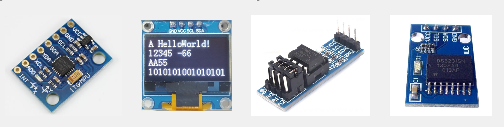
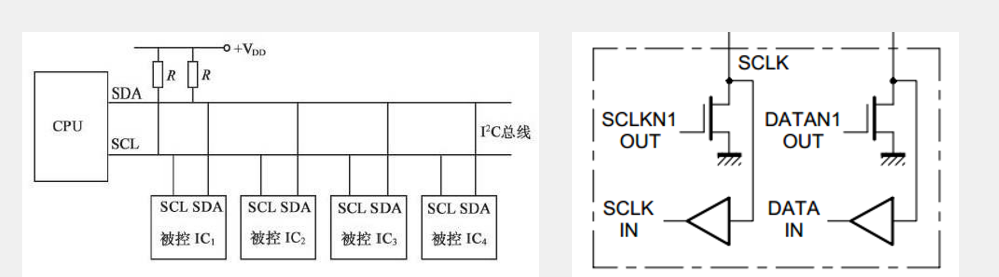
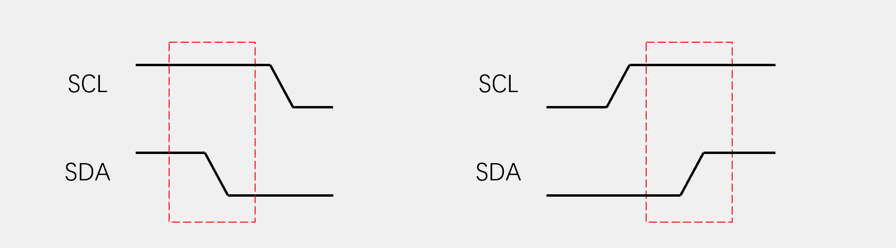
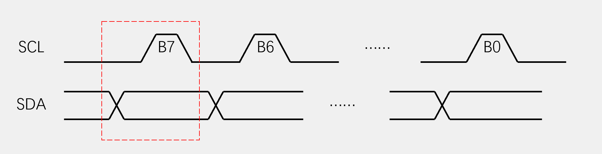
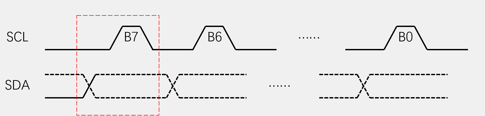
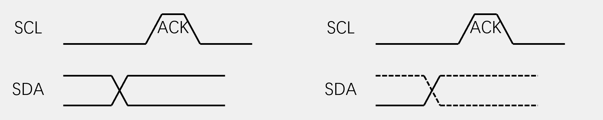
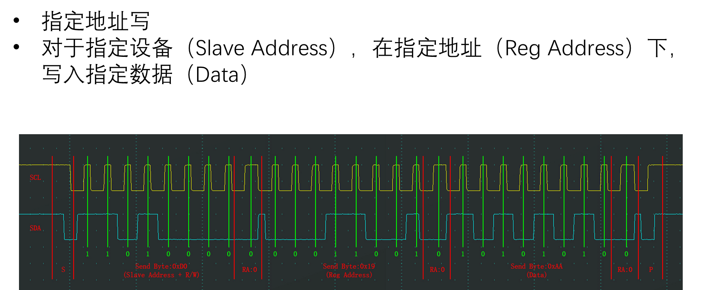
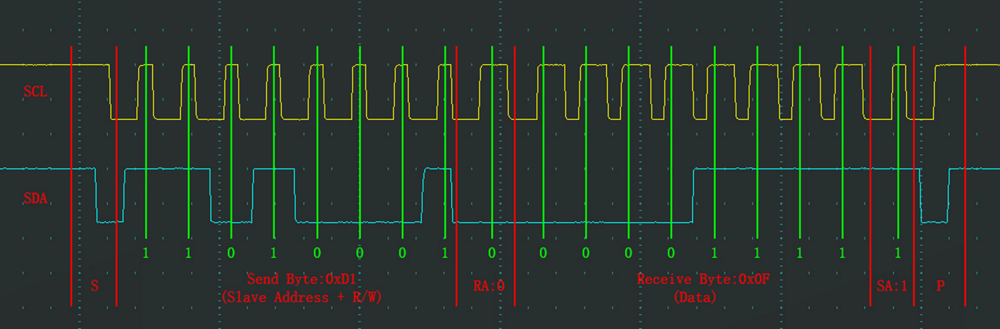
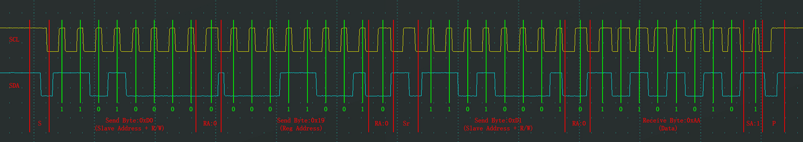

# I2C 通信

- I2C（Inter-IC Bus）是由 Philips 公司开发的一种通用数据总线。
- 两根通信线：SCL（Serial Clock）、SDA（Serial Data）。
- **同步、半双工**，**带数据应答（ACK/NACK）**。
- **支持多设备/多主**（一主多从、多主多从）。
- 典型速率：**100 kHz ~ 400 kHz**（更多档位见“特性补充”）。主设备（Master）对 SCL 具有绝对控制权（可时钟拉伸除外）。



## 硬件电路

- 所有 I2C 设备的 SCL 连在一起，SDA 连在一起。
- 设备的 SCL 和 SDA 均要配置成**开漏输出**模式。
- SCL 和 SDA 各添加一个**上拉电阻**（常见 4.7 kΩ）。
  - 为什么不用内部上拉？内部上拉过大 → 上升沿过慢 → 波形变钝 → 通信易失败（尤其高速）。



## I2C 时序基本单元

- **起始条件（START）**：SCL 高电平期间，SDA 从高电平切到低电平。
- **终止条件（STOP）**：SCL 高电平期间，SDA 从低电平切到高电平。



**发送一个字节**：
- SCL 低电平期间，主机将数据位依次放到 SDA 线上（**高位先行**）。
- 然后释放 SCL，从机在 **SCL 高电平期间采样**数据位，故 SCL 高电平期间 **SDA 不允许变化**。
- 循环 8 次完成一个字节发送。



**接收一个字节**：
- SCL 低电平期间，从机将数据位依次放到 SDA 线上（**高位先行**）。
- 然后释放 SCL，主机在 **SCL 高电平期间采样**，故 SCL 高电平期间 **SDA 不允许变化**。
- 循环 8 次完成一个字节接收（主机在接收前需释放 SDA）。



**应答位（ACK/NACK）**：
- 发送应答：主机接收完 1 字节后，下一个时钟由主机驱动 SDA 发送 1 位；**0 表示 ACK，应答；1 表示 NACK，非应答**。
- 接收应答：主机发送完 1 字节后，下一个时钟采样从机应答；**0 表示 ACK，1 表示 NACK**（采样前主机需释放 SDA）。



## I2C 时序

**指定地址写（Random Write）**
- 对于指定设备（Slave Address），在指定寄存器地址（Reg Address）下，写入指定数据（Data）。



**当前地址读（Current Address Read）**
- 对于指定设备（Slave Address），在当前地址指针指示的位置，读取从机数据（Data）。



**指定地址读（Random Read）**

- 对于指定设备（Slave Address），在指定地址（Reg Address）下，读取从机数据（Data）。




## 特性补充（建议掌握）

- **地址长度**：支持 **7 位地址**与 **10 位地址**（7 位更常见）。
- **速度档位**（依器件与线缆能力）：
  - Standard-mode：**100 kHz**
  - Fast-mode：**400 kHz**
  - Fast-mode Plus：**1 MHz**（部分 MCU/器件支持）
  - High-speed mode：**3.4 MHz**（较少见，需专用支持）
- **时钟拉伸（Clock Stretching）**：从机可在需要时 **拉低 SCL** 延长高电平，通知主机等待（部分主机/外设对时钟拉伸支持有限，需确认）。
- **仲裁与多主**：多主设备同时主导总线时，基于 **线与（wired-AND）** 的仲裁机制自动判定，未获胜的主机停止发送，**不破坏总线**。
- **上拉电阻建议**：取值与总线电容、目标速率相关；常见 2.2 kΩ ~ 10 kΩ，线长/电容大、速率高 → 倾向 **更小** 上拉以加快上升沿（但功耗增加）。
- **电气注意**：SDA/SCL 为开漏+上拉，外部短路/重负载会导致波形畸变；布局走线应尽量**短、并行少、邻近地**，必要时降低速率以增裕。

## Q&A

**Q: I2C最多支持几位地址？**

A: I2C支持两种地址长度：
- **7位地址**：最常用，支持128个设备（0x00-0x7F），实际可用112个（0x08-0x77）
- **10位地址**：扩展地址，支持1024个设备（0x000-0x3FF）

**Q: 为什么I2C需要上拉电阻？**

A: 因为I2C使用开漏输出，只能拉低不能拉高。上拉电阻提供高电平，实现线与逻辑，支持多设备仲裁。

**Q: I2C的时钟拉伸是什么？**

A: 从机在需要更多时间处理数据时，可以拉低SCL延长高电平，通知主机等待。但部分主机不支持此功能。

**Q: I2C和SPI的主要区别？**

A: 
- I2C：2线（SCL+SDA），半双工，有应答，支持多主
- SPI：4线（SCLK+MISO+MOSI+CS），全双工，无应答，单主多从

**Q: I2C的读写位（R/W位）是什么？**

A: R/W位是I2C地址字节的最后一位（第0位），用于控制数据传输方向：
- **R/W = 0**：写操作（Master向Slave写数据）
- **R/W = 1**：读操作（Master从Slave读数据）
- 地址格式：[7位地址] + [R/W位] = 8位完整字节

**Q: I2C通信失败常见原因？**

A: 
- 上拉电阻过大导致上升沿过慢
- 总线电容过大
- 地址冲突
- 时序不满足要求
- 设备未正确初始化
- R/W位设置错误
- 从设备未正确响应ACK

“I²C 总线仲裁（Arbitration）”是 I²C 协议中一个**非常核心但容易忽略**的机制。
 它保证了**多个主机同时发送时不会冲突或损坏总线数据**。
 下面我帮你从概念 → 原理 → 时序举例 → 结论，一次讲透👇

------

## 🧩 一、为什么需要仲裁？

I²C 是一种**多主多从**的总线结构：

> 多个主机（MCU、传感器等）都可以控制 SDA、SCL 线。

如果两个主机同时想发数据，比如：

- 主机A 想发地址 `0x50`
- 主机B 想发地址 `0x68`

那总线上信号会冲突：
 谁的电平才是真实的？数据会乱吗？
 👉 所以需要“**仲裁机制（Arbitration）**”来决定**谁赢、谁让**。

------

## ⚙️ 二、I²C 总线的电气特性（理解仲裁的关键）

I²C 使用**开漏（Open-Drain）**输出 + **上拉电阻**：

| 逻辑状态    | 线上的表现               | 含义     |
| ----------- | ------------------------ | -------- |
| 输出低（0） | 拉低总线                 | 强制为 0 |
| 输出高（1） | 不驱动，线被上拉为高电平 | 释放总线 |

👉 所以：

- 任意一个设备拉低 SDA，总线就为低；
- 只有当所有设备都“释放”SDA，总线才是高。

这就是仲裁的**物理基础**。

------

## 🧠 三、仲裁过程的原理

当多个主机几乎同时启动通信时，它们会这样竞争👇

1️⃣ 每个主机都从 **SDA、SCL** 线读当前电平。
 2️⃣ 当它发送一个“1”时，会先释放 SDA（希望总线变高）。
 3️⃣ 如果它检测到 SDA 实际上是低（被别人拉低了），
 👉 说明有别的主机在发送“0”，那自己就输了仲裁。
 4️⃣ 败方立即停止发送，等待总线空闲。
 5️⃣ 获胜主机继续完成传输。

------

## 📊 四、举个例子（时序说明）

假设：

- 主机A 要发地址 `0b1010000`
- 主机B 要发地址 `0b1001000`

我们比较它们每一位：

| 位序 | A 发送 | B 发送 | 总线状态   | 仲裁结果                     |
| ---- | ------ | ------ | ---------- | ---------------------------- |
| 1    | 1      | 1      | 1          | 平局                         |
| 2    | 0      | 0      | 0          | 平局                         |
| 3    | 1      | 0      | **0**      | A 想要“1”，但总线是“0”，A 输 |
| 4~7  | -      | -      | B 继续发送 | A 放弃                       |

结果：

> 主机 B 获胜，主机 A 停止传输。

------

## 🧩 五、仲裁只发生在 SDA 上

- 仲裁只在 **SDA 传输期间、SCL 为高电平** 时进行；
- SCL 由各主机都可以拉低（时钟同步），
	 所以仲裁主要靠 SDA 判断。

------

## ⚡ 六、仲裁与时钟同步关系

I²C 的多主机机制不仅有仲裁，还有 **时钟同步机制**：

- 当多个主机拉低 SCL 时，总线为低；
- 只有当所有主机释放 SCL，总线才恢复高；
- 所以多个主机可自动同步时钟。

仲裁决定谁继续通信，
 时钟同步保证多个主机时序不冲突。

------

## 🧰 七、仲裁机制的优点

| 优点               | 说明                                    |
| ------------------ | --------------------------------------- |
| ✅ 无需外部信号协调 | 不用额外仲裁线                          |
| ✅ 总线不会损坏     | 开漏输出不会电平冲突                    |
| ✅ 通信自动有序     | 自动决定优先主机                        |
| ✅ 多主安全可靠     | 适合复杂系统（如多个 MCU 控制同一总线） |

------

## ⚠️ 八、开发注意事项

- 仲裁一般只在 **多主机系统** 中出现；

- 如果系统中只有一个主机（比如 STM32 控制一堆传感器），仲裁不会发生；

- I²C 外设硬件通常 **自动检测仲裁丢失**；
	 在 STM32 中会有：

	```
	if(__HAL_I2C_GET_FLAG(&hi2c1, I2C_FLAG_ARLO)) // 仲裁丢失
	{
	    __HAL_I2C_CLEAR_FLAG(&hi2c1, I2C_FLAG_ARLO);
	    // 重新尝试发送
	}
	```

------

## ✅ 九、总结一句话

> **I²C 仲裁** 是多个主机同时操作总线时，
>  通过检测 SDA 线实际电平来决定**哪一个主机赢得控制权**的机制。

💡 它依靠“开漏输出 + 线与逻辑”，保证：

- **不会损坏总线**
- **不会传输错误数据**
- **通信自动有序**
