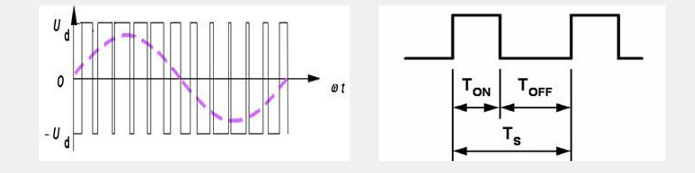
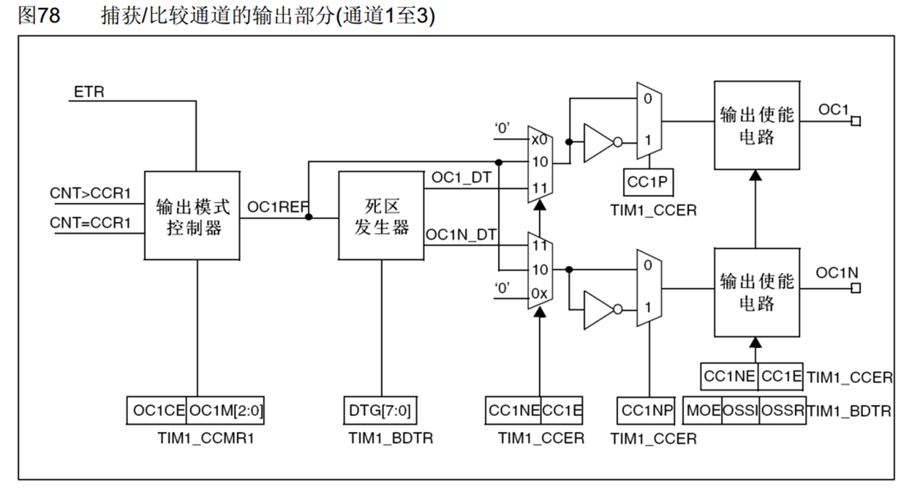
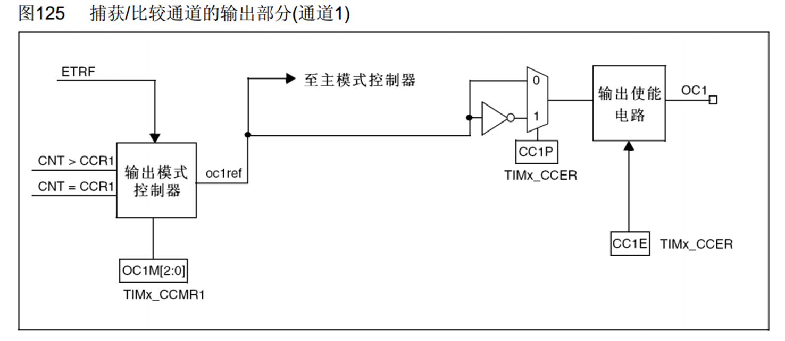
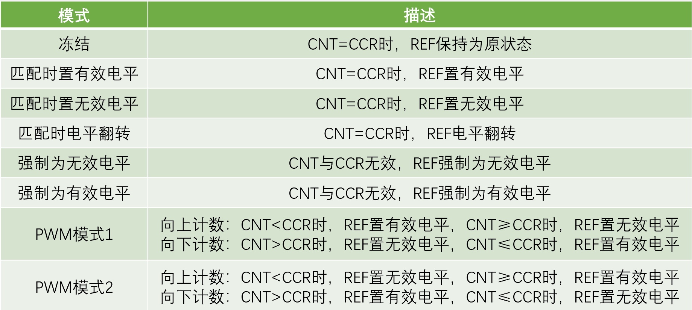
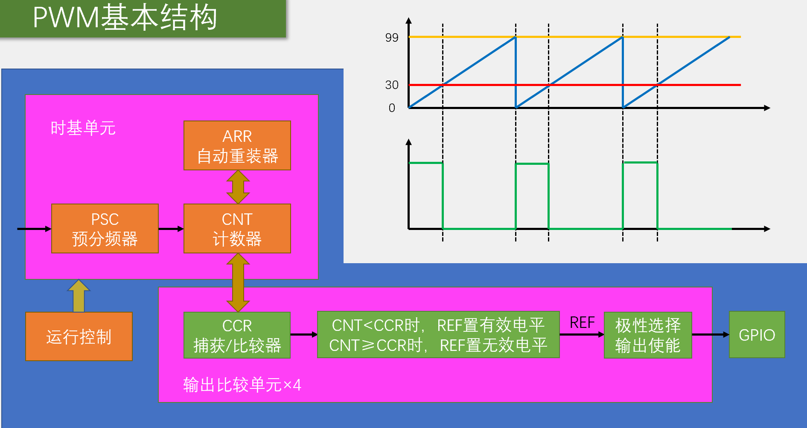
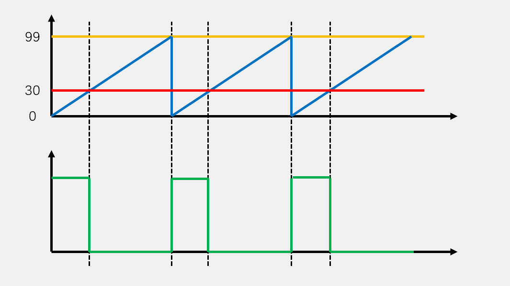
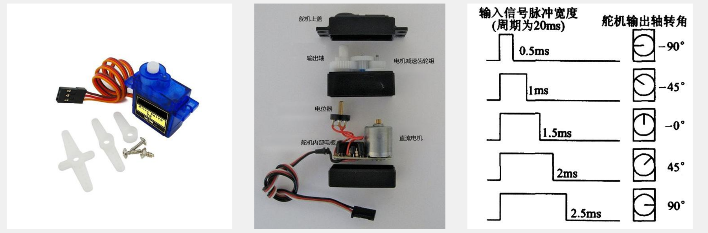

 

# PWM

## 简介

•PWM（Pulse Width Modulation）**脉冲宽度调制**

•在具有惯性的系统中，可以通过对一系列脉冲的宽度进行调制，来等效地获得所需要的模拟参量，常应用于电机控速等领域

•PWM参数：

## 输出比较通道(高级)

## 输出比较通道(通用)

## 输出比较模式

如果只用“匹配时置低电平”模式 → 在匹配点会被拉低，然后一直保持到周期结束

## PWM基本结构

## 参数计算

•PWM频率： Freq = CK_PSC / (PSC + 1) / (ARR + 1)

•PWM占空比： Duty = C CR / (ARR + 1)

•PWM分辨率： Reso = 1 / (ARR + 1)

## 舵机简介

•舵机是一种根据输入PWM信号占空比来控制输出角度的装置

•输入PWM信号要求：周期为20ms，高电平宽度为0.5ms~2.5ms

