# SPI通信

## 简介

- **SPI（Serial Peripheral Interface）**是由Motorola公司开发的一种通用数据总线
- **四根通信线**：
  - **SCK（Serial Clock）**：串行时钟信号，由主设备产生
  - **MOSI（Master Output Slave Input）**：主设备输出/从设备输入引脚
  - **MISO（Master Input Slave Output）**：主设备输入/从设备输出引脚
  - **SS（Slave Select）**：从设备片选信号，由主设备控制

### 引脚功能详解

- **MISO**：主设备输入/从设备输出引脚。该引脚在从模式下发送数据，在主模式下接收数据
- **MOSI**：主设备输出/从设备输入引脚。该引脚在主模式下发送数据，在从模式下接收数据
- **SCLK**：串行时钟信号，由主设备产生
- **CS/SS**：从设备片选信号，由主设备控制。它的功能是用来作为"片选引脚"，也就是选择指定的从设备，让主设备可以单独地与特定从设备通讯，避免数据线上的冲突

### 通信特性

- **同步，全双工**
- **支持总线挂载多设备（一主多从）**
  - 提供时钟的为主设备（Master）
  - 接收时钟的设备为从设备（Slave）
  - SPI接口的读写操作，都是由主设备发起
  - 当存在多个从设备时，通过各自的片选信号进行管理

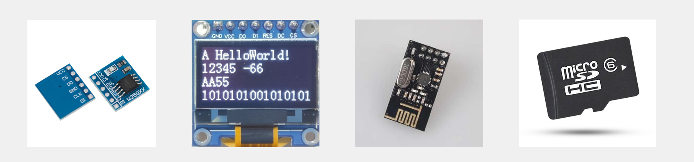

## 硬件电路

- 所有SPI设备的**SCK、MOSI、MISO分别连在一起**
- 主机另外引出多条**SS控制线**，分别接到各从机的SS引脚
- **输出引脚配置为推挽输出**，**输入引脚配置为浮空或上拉输入**
- **从机未被选中时**，即SS为高电平时，**MISO必须配置为高阻态**

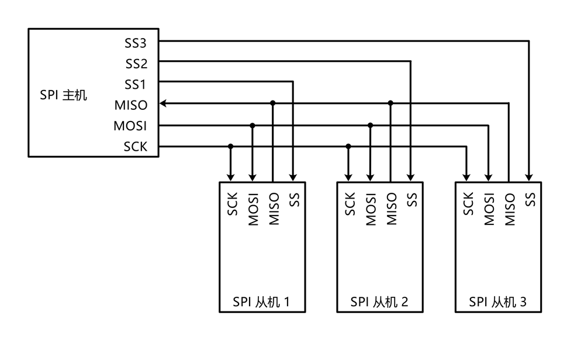

## 移位示意图

SPI主机和从机都有一个串行移位寄存器，主机通过向它的SPI串行寄存器写入一个字节来发起一次传输。

### 传输过程

1. **首先拉低对应SS信号线**，表示与该设备进行通信
2. **主机通过发送SCLK时钟信号**，来告诉从机写数据或者读数据
   - 注意：SCLK时钟信号可能是低电平有效，也可能是高电平有效，因为SPI有四种模式
3. **主机(Master)将要发送的数据写到发送数据缓存区(Memory)**，缓存区经过移位寄存器(0~7)，串行移位寄存器通过**MOSI信号线**将字节一位一位的移出去传送给从机，同时**MISO接口**接收到的数据经过移位寄存器一位一位的移到接收缓存区
4. **从机(Slave)也将自己的串行移位寄存器(0~7)中的内容通过MISO信号线返回给主机**。同时通过**MOSI信号线**接收主机发送的数据，这样，两个移位寄存器中的内容就被交换

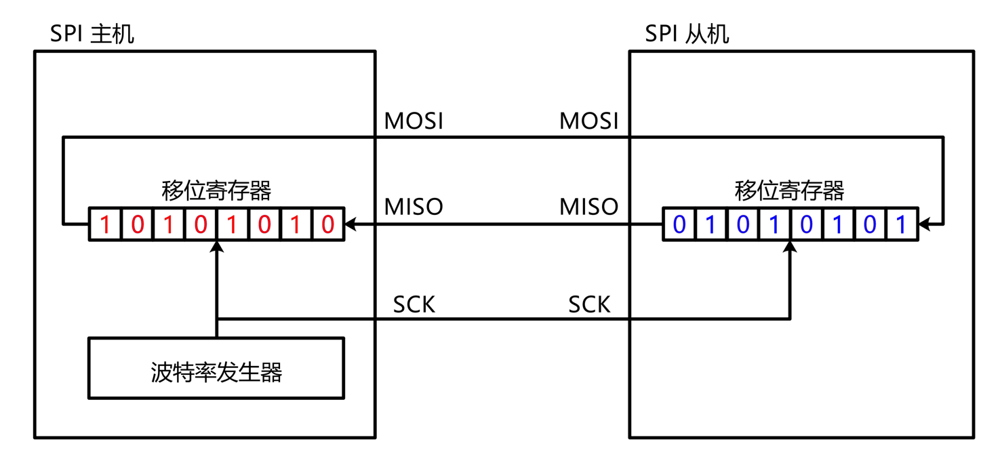

### 重要特性

SPI只有主模式和从模式之分，没有读和写的说法，外设的写操作和读操作是同步完成的。如果只进行写操作，主机只需忽略接收到的字节；反之，若主机要读取从机的一个字节，就必须发送一个空字节来引发从机的传输。也就是说，**你发一个数据必然会收到一个数据；你要收一个数据必须也要先发一个数据。**

## SPI时序基本单元

- **起始条件**：SS从高电平切换到低电平
- **终止条件**：SS从低电平切换到高电平


## SPI通信的四种模式

SPI的四种模式，简单地讲就是设置SCLK时钟信号线的那种信号为有效信号

### 模式0：CPOL=0，CPHA=0

- **CPOL（时钟极性）=0**：空闲状态时，SCK为低电平
- **CPHA（时钟相位）=0**：SCK第一个边沿移入数据，第二个边沿移出数据

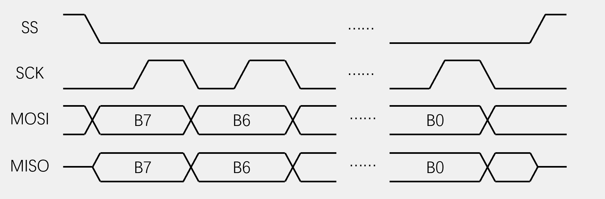

### 模式1：CPOL=0，CPHA=1

- **CPOL=0**：空闲状态时，SCK为低电平
- **CPHA=1**：SCK第一个边沿移出数据，第二个边沿移入数据

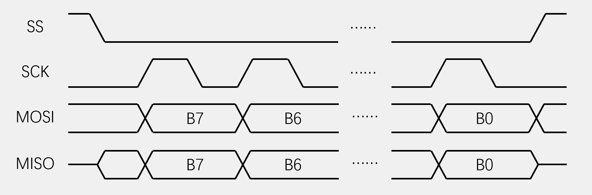

### 模式2：CPOL=1，CPHA=0

- **CPOL=1**：空闲状态时，SCK为高电平
- **CPHA=0**：SCK第一个边沿移入数据，第二个边沿移出数据

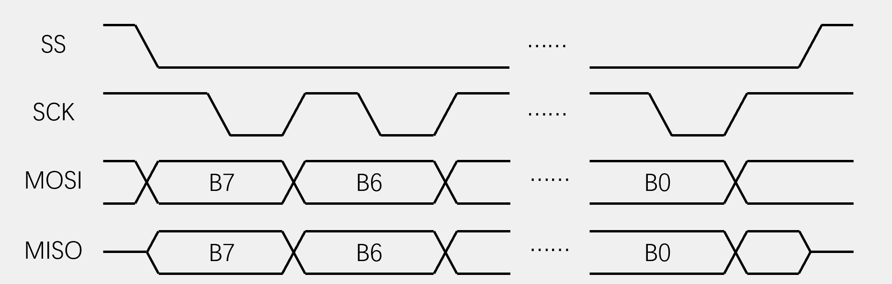

### 模式3：CPOL=1，CPHA=1

- **CPOL=1**：空闲状态时，SCK为高电平
- **CPHA=1**：SCK第一个边沿移出数据，第二个边沿移入数据

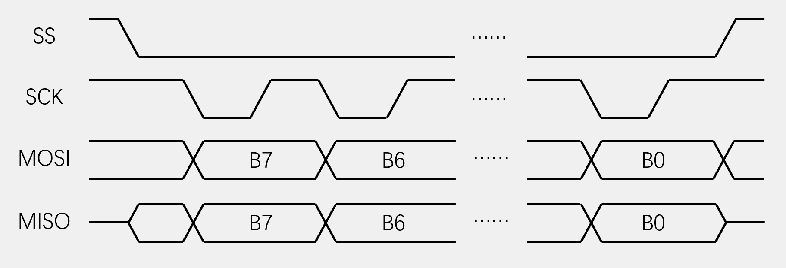

### 四种模式详细对比

| 模式 | CPOL | CPHA | 空闲状态 | 数据采样边沿 | 数据发送边沿 |
|------|------|------|----------|--------------|--------------|
| **Mode0** | 0 | 0 | SCK低电平 | 上升沿 | 下降沿 |
| **Mode1** | 0 | 1 | SCK低电平 | 下降沿 | 上升沿 |
| **Mode2** | 1 | 0 | SCK高电平 | 下降沿 | 上升沿 |
| **Mode3** | 1 | 1 | SCK高电平 | 上升沿 | 下降沿 |

### 模式选择说明

- **Mode0**：空闲态时，SCLK处于低电平，数据采样是在第1个边沿（上升沿），数据发送是在下降沿
- **Mode1**：空闲态时，SCLK处于低电平，数据发送是在第1个边沿（上升沿），数据采样是在下降沿
- **Mode2**：空闲态时，SCLK处于高电平，数据采集是在第1个边沿（下降沿），数据发送是在上升沿
- **Mode3**：空闲态时，SCLK处于高电平，数据发送是在第1个边沿（下降沿），数据采集是在上升沿

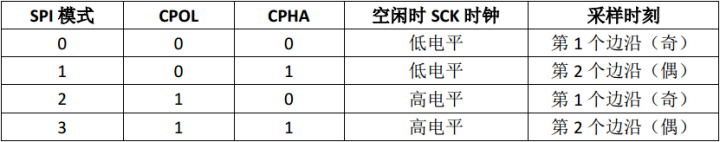

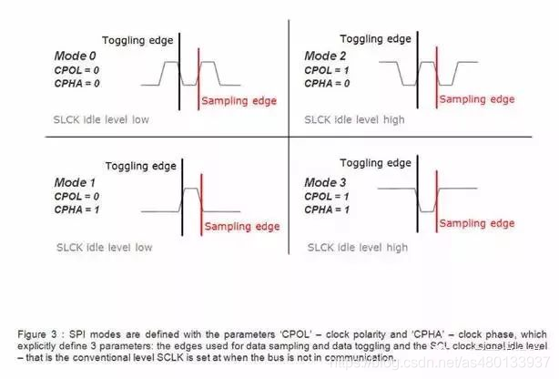

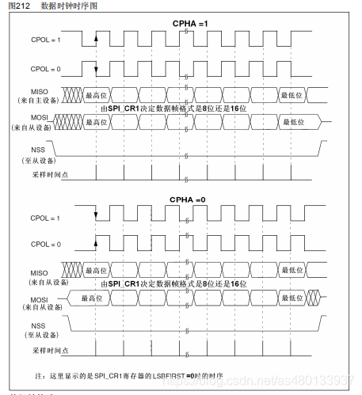

**它们的区别是定义了在时钟脉冲的哪条边沿转换（toggles）输出信号，哪条边沿采样输入信号，还有时钟脉冲的稳定电平值（就是时钟信号无效时是高还是低）。每种模式由一对参数刻画，它们称为时钟极（clock polarity）CPOL与时钟期（clock phase）CPHA。**

## SPI时序

### 发送指令

向SS指定的设备，发送指令（0x06）

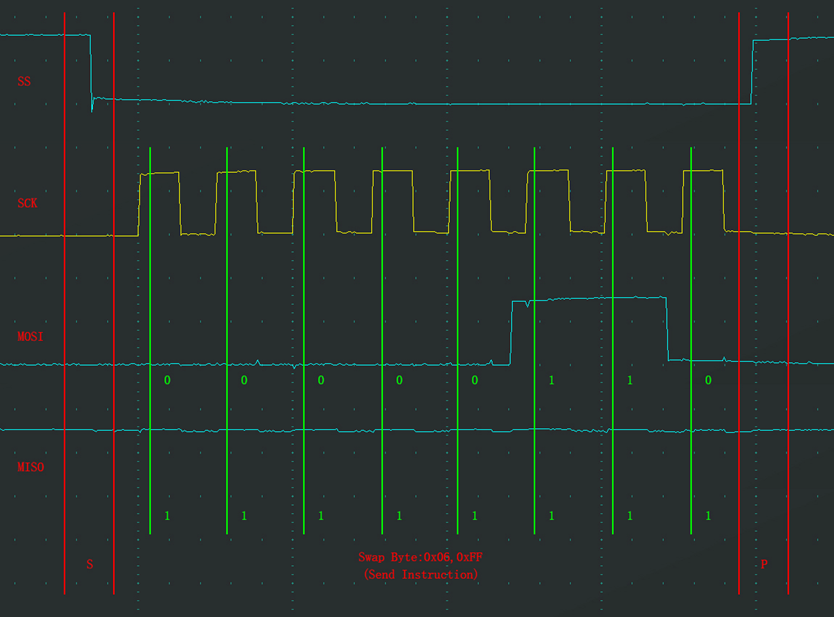

## SPI的通信协议


### 协议特点

主从设备必须使用**相同的工作模式**（SCLK、CPOL和CPHA），才能正常工作。如果有多个从设备，并且它们使用了不同的工作模式，那么主设备必须在读写不同从设备时需要重新修改对应从设备的模式。

### SPI协议局限性

SPI没有规定：
- **最大传输速率**
- **地址方案**
- **通信应答机制**
- **流控制规则**

只要四根信号线连接正确，SPI模式相同，将CS/SS信号线拉低，即可以直接通信，一次一个字节的传输，读写数据同时操作，这就是SPI。

**注意**：这些通信控制都得通过SPI设备自行实现，SPI并不关心物理接口的电气特性，例如信号的标准电压。

**PS**: 这也是SPI接口的一个缺点：**没有指定的流控制，没有应答机制确认是否接收到数据**。

## SPI的三种工作模式

SPI工作在3种模式下，分别是运行、等待和停止。

### 运行模式（Run Mode）
- 这是**基本的操作模式**

### 等待模式（Wait Mode）
- SPI工作在等待模式是一种**可配置的低功耗模式**，可以通过SPICR2寄存器的SPISWAI位进行控制
- 在等待模式下：
  - 如果SPISWAI位清0，SPI操作类似于运行模式
  - 如果SPISWAI位置1，SPI进入低功耗状态，并且SPI时钟将关闭
  - 如果SPI配置为主机，所有的传输将停止，但是会在CPU进入运行模式后重新开始
  - 如果SPI配置为从机，会继续接收和传输一个字节，这样就保证从机与主机同步

### 停止模式（Stop Mode）
- 为了降低功耗，SPI在停止模式是**不活跃的**
- 如果SPI配置为主机，正在进行的传输会停止，但是在CPU进入运行模式后会重新开始
- 如果SPI配置为从机，会继续接受和发送一个字节，这样就保证了从机与主机同步

## STM32中SPI初始化配置

### 配置步骤

1. **初始化GPIO口**，配置相关引脚的复用功能，使能SPIx时钟
   ```c
   void GPIO_Init();
   ```

2. **使能SPI时钟总线**
   ```c
   RCC_APB2PeriphClockCmd(RCC_APB2Periph_SPI1, ENABLE);
   ```

3. **配置SPI初始化的参数**，设置SPI工作模式
   ```c
   SPI_Init(SPI1, &SPI_Initstructure);
   ```

4. **使能SPI外设**
   ```c
   SPI_Cmd(SPI1, ENABLE);
   ```

## Q&A

**Q: SPI是高位先行吗？**

A: SPI的位传输顺序是可配置的：
- **MSB先行（高位先行）**：默认和最常见的方式
- **LSB先行（低位先行）**：某些设备需要
- 通过SPI控制器的LSBFE位或类似寄存器位控制

**Q: SPI支持多主机吗？**

A: **不支持**。SPI是单主机多从机协议：
- 只有一个主设备控制时钟
- 多个从设备通过片选信号选择
- 无仲裁机制，不支持多主

**Q: SPI和I2C的主要区别？**

A: 
- **SPI**：4线，全双工，无应答，单主多从，高速
- **I2C**：2线，半双工，有应答，支持多主，中速

**Q: SPI通信失败常见原因？**

A: 
- 主从设备模式不匹配（CPOL/CPHA设置错误）
- 片选信号时序错误
- 时钟频率过高
- 数据线连接错误
- 从设备未正确初始化