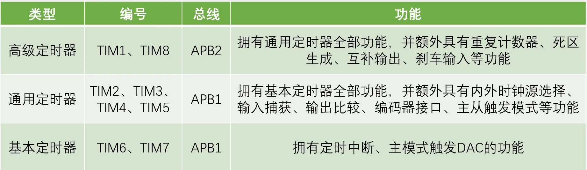
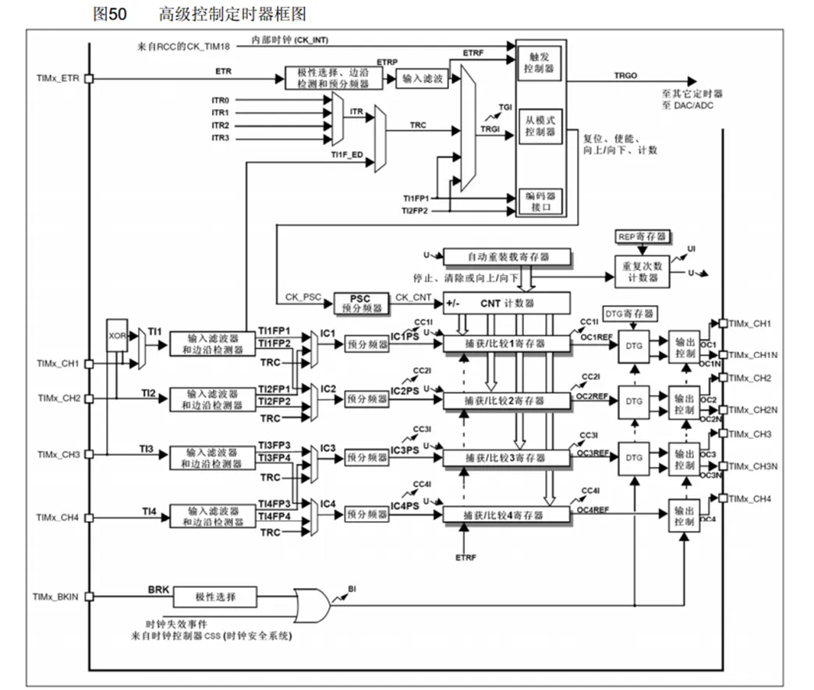
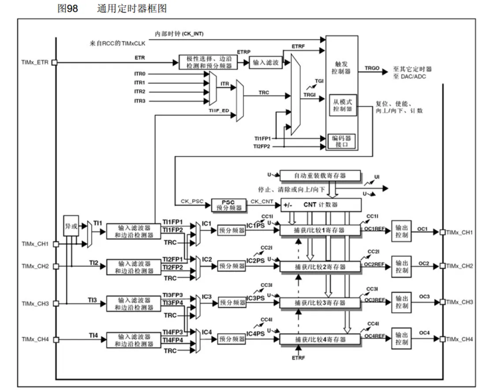
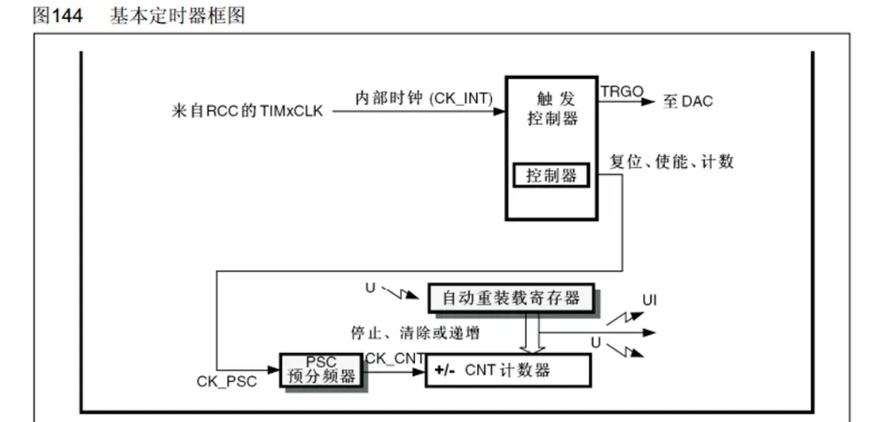
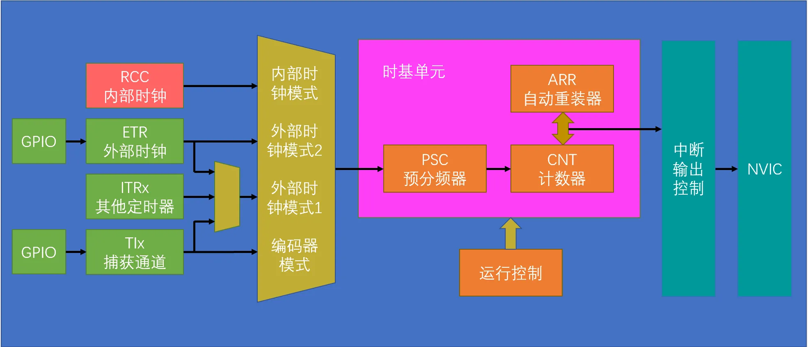
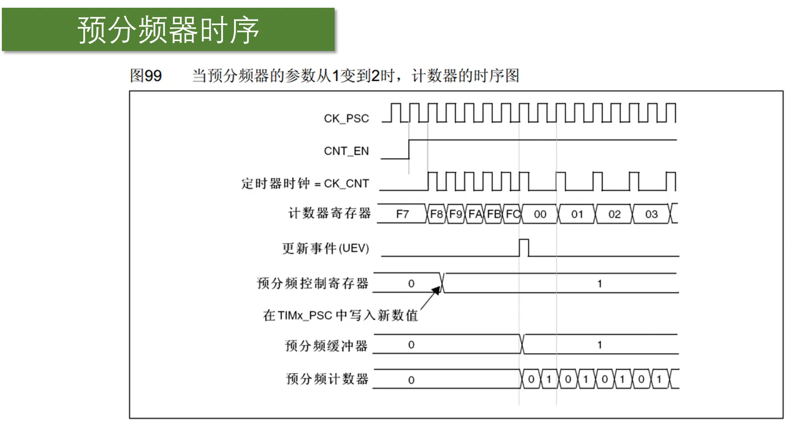
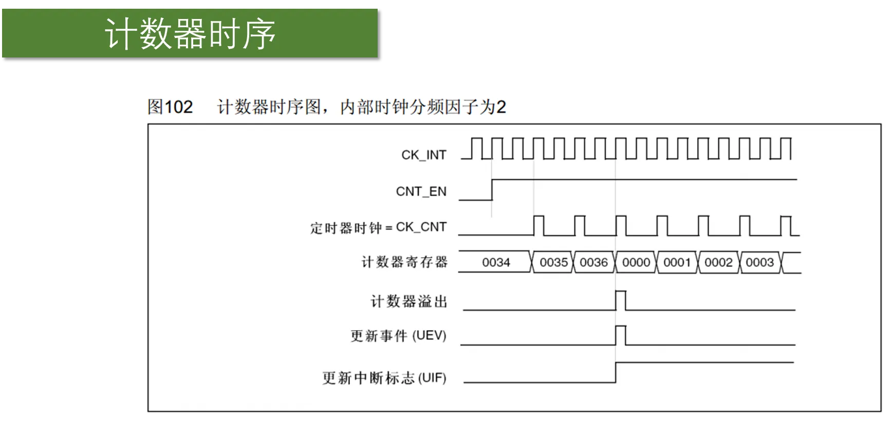
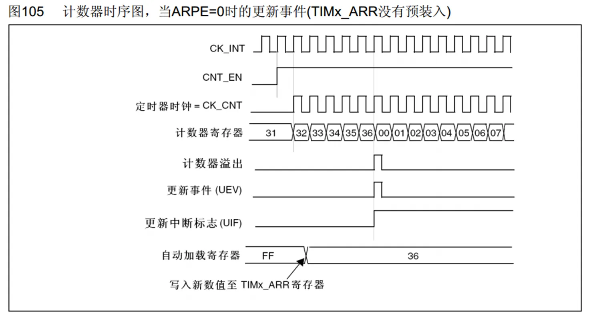
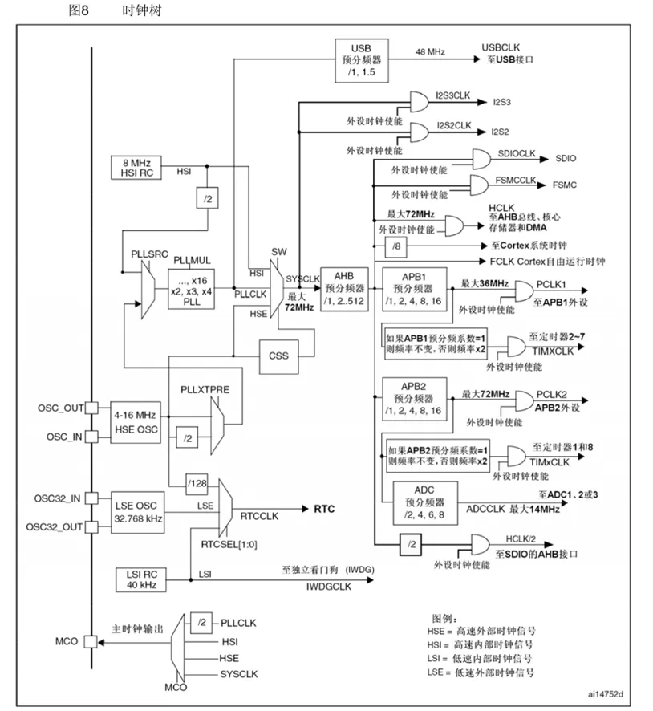

# TIM简介

•TIM（Timer）定时器

•定时器可以对输入的时钟进行计数，并在计数值达到设定值时触发中断

•**16位计数器、预分频器、自动重装寄存器**的时基单元，在72MHz计数时钟下可以实现最大59.65s的定时

•不仅具备基本的**定时中断功能**，而且还包含**内外时钟源选择、输入捕获、输出比较、编码器接口、主从触发****模式等**多种功能

•根据复杂度和应用场景分为了**高级定时器、通用定时器、基本定时器**三种类型

## 定时器类型

•STM32F103C8T6定时器资源：TIM1、TIM2、TIM3、TIM4

## 高级定时器

## 通用定时器

## 基本定时器

## 定时中断基本结构

## 预分频器时序

•计数器计数频率：CK_CNT = CK_PSC / (PSC + 1)

## 计数器时序

•计数器溢出频率：CK_CNT_OV = CK_CNT / (ARR + 1) = CK_PSC / (PSC + 1) / (ARR + 1)

## 计数器无预装时序

## 计数器有预装时序

## RCC时钟树

## 输出比较简介

•OC（Output Compare）输出比较

•输出比较可以通过比较CNT与CCR寄存器值的关系，来对输出电平进行置1、置0或翻转的操作，用于输出一定频率和占空比的PWM波形

•每个高级定时器和通用定时器都拥有4个输出比较通道

•高级定时器的前3个通道额外拥有死区生成和互补输出的功能
