# 串口通信（UART/USART）

- 串口是一种应用十分广泛的通讯接口，串口成本低、容易使用、通信线路简单，可实现两个设备的互相通信。
- 单片机的串口可以使单片机与单片机、单片机与电脑、单片机与各式各样的模块互相通信，极大地扩展了单片机的应用范围，增强了单片机系统的硬件实力。

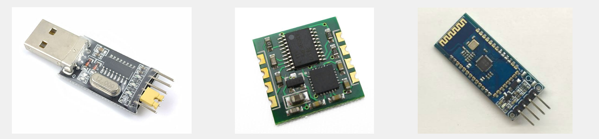

## 硬件电路

- 简单双向串口通信有两根通信线（发送端 TX 和接收端 RX）。
- TX 与 RX 要交叉连接。
- 当只需单向的数据传输时，可以只接一根通信线。
- 当电平标准不一致时，需要加电平转换芯片。

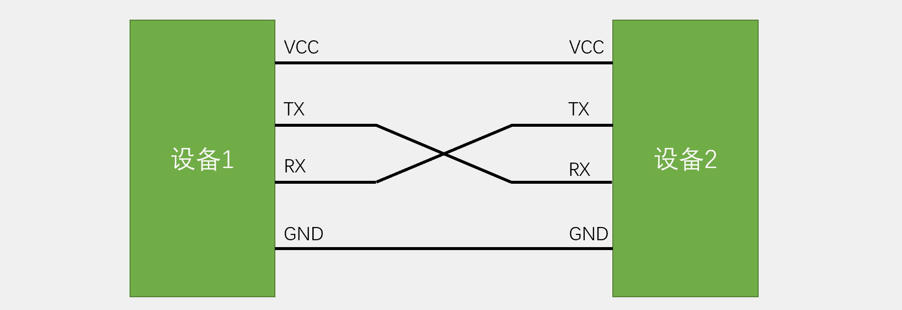

## 电平标准

电平标准是数据 1 和数据 0 的表达方式，是传输线缆中人为规定的电压与数据的对应关系。串口常用的电平标准有如下三种：

- TTL 电平：+3.3V 或 +5V 表示 1，0V 表示 0。
- RS232 电平：-3 ~ -15V 表示 1，+3 ~ +15V 表示 0。
- RS485 电平：两线压差 +2 ~ +6V 表示 1，-2 ~ -6V 表示 0（差分信号）。

## 串口参数及时序

- 波特率：串口通信的速率，每秒传输的比特位。
- 起始位：标志一个数据帧的开始，固定为低电平。
- 数据位：数据帧的有效载荷，1 为高电平，0 为低电平，低位先行。
- 校验位：用于数据验证，根据数据位计算得来，奇校验:保证发送时1的个数为奇数，偶校验:保证发送时1的个数为偶数。
- 停止位：用于规定相邻数据帧间隔几个周期，固定为高电平。

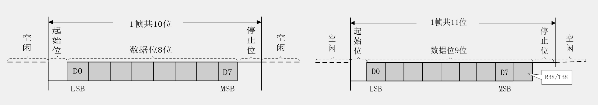

## 串口时序

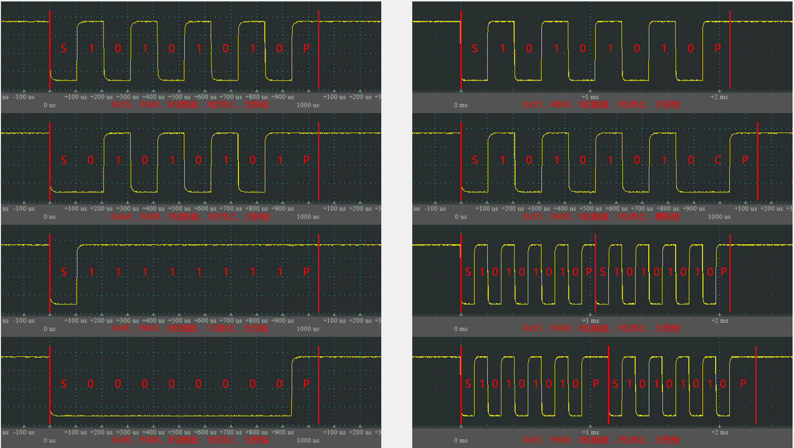

## USART 简介--低位先行

- USART（Universal Synchronous/Asynchronous Receiver/Transmitter）通用同步/异步收发器，同步和异步主要看有没有时钟线。
- USART 是 STM32 内部集成的硬件外设，可根据数据寄存器的一个字节数据自动生成数据帧时序，从 TX 引脚发送出去，也可自动接收 RX 引脚的数据帧时序，拼接为一个字节数据，存放在数据寄存器里。
- 自带波特率发生器，最高达 4.5 Mbits/s。
- 可配置数据位长度（8/9）、停止位长度（0.5/1/1.5/2）。
- 可选校验位（无校验/奇校验/偶校验）。
- 支持同步模式、硬件流控制、DMA、智能卡、IrDA、LIN。
- STM32F103C8T6 USART 资源：USART1、USART2、USART3。

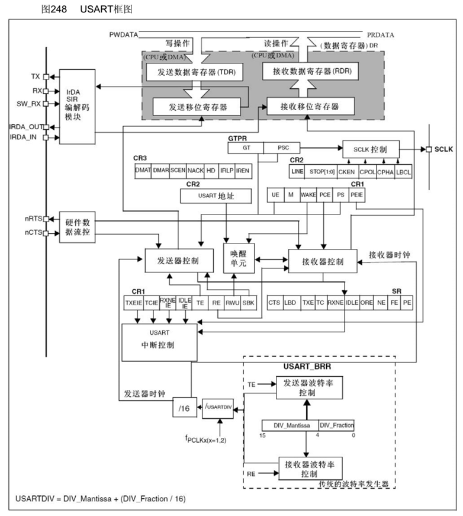

## USART 基本结构

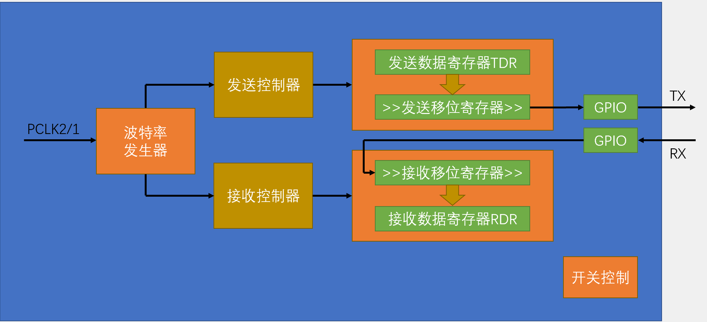

## 数据帧

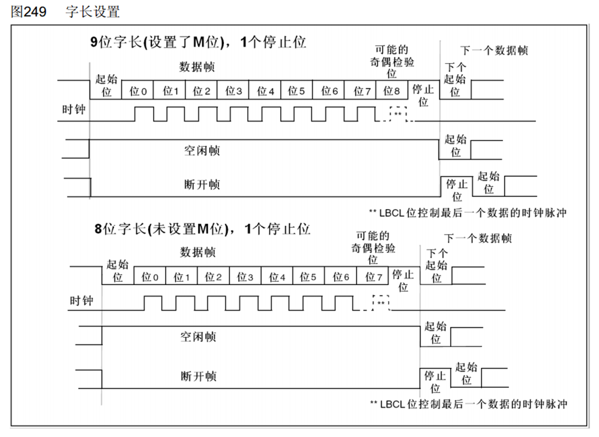

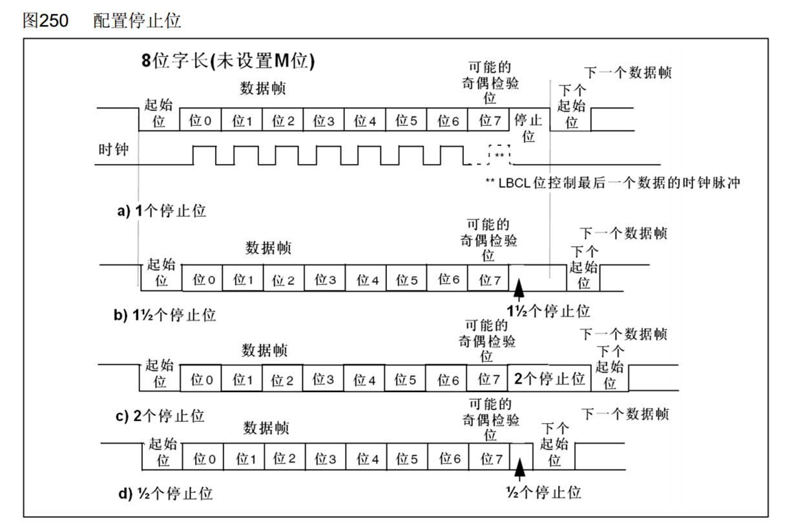

## 起始位侦测

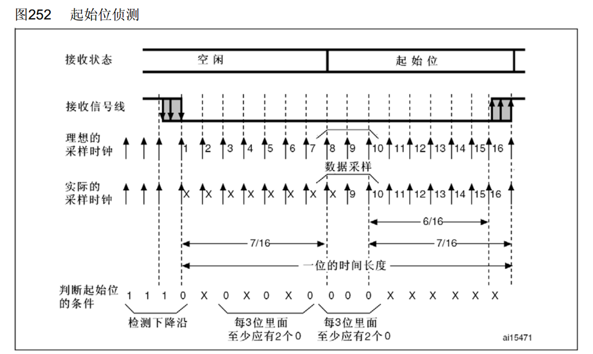

## 数据采样

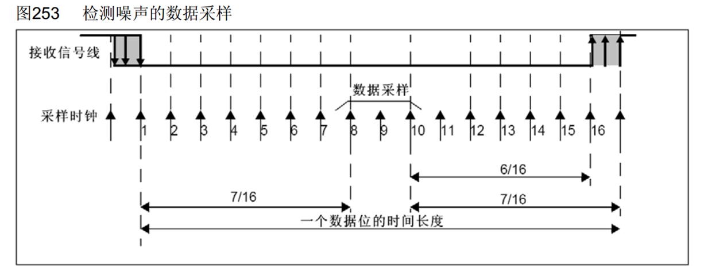

## 波特率发生器

- 发送器和接收器的波特率由波特率寄存器 BRR 里的 DIV 确定。
- 计算公式：波特率 = fPCLK2/1 / (16 × DIV)。

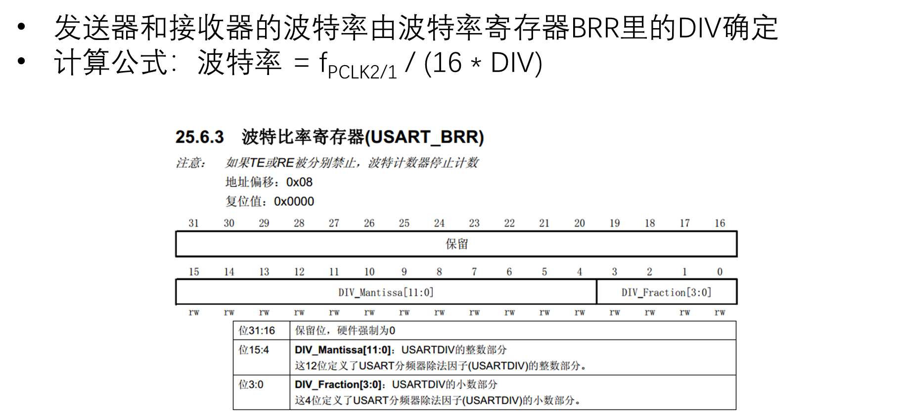

## 数据模式

- HEX 模式/十六进制模式/二进制模式：以原始数据的形式显示。
- 文本模式/字符模式：以原始数据编码后的形式显示。

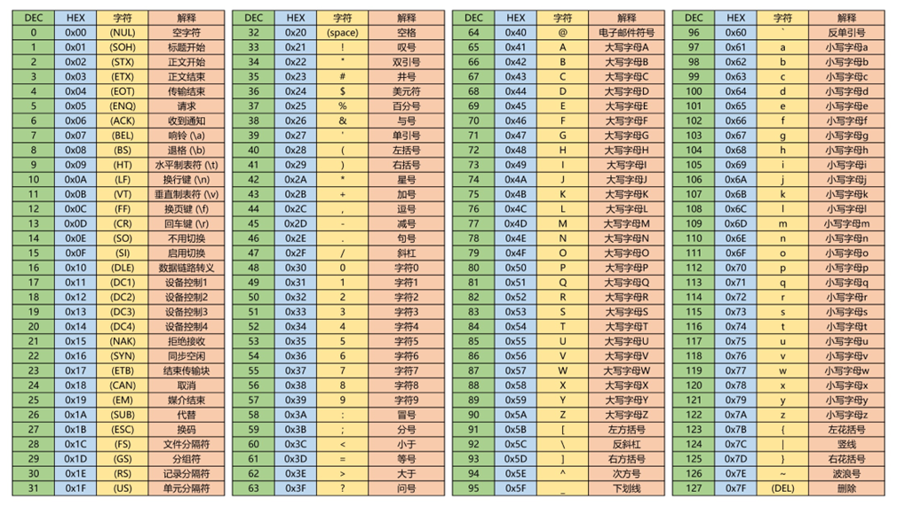

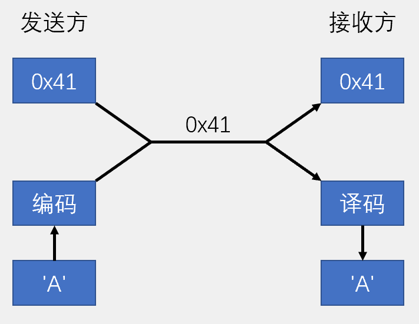

## HEX 数据包

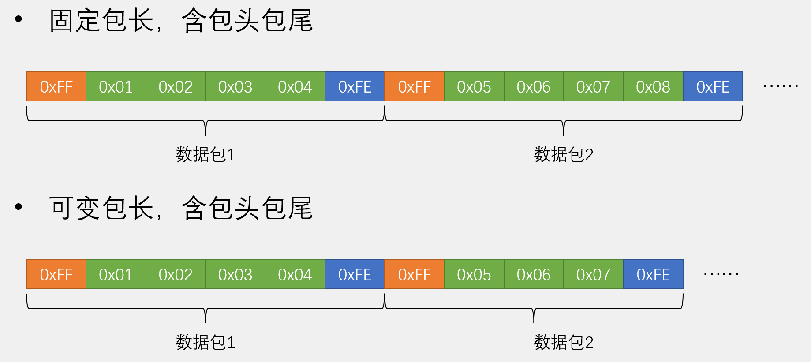

## 文本数据包

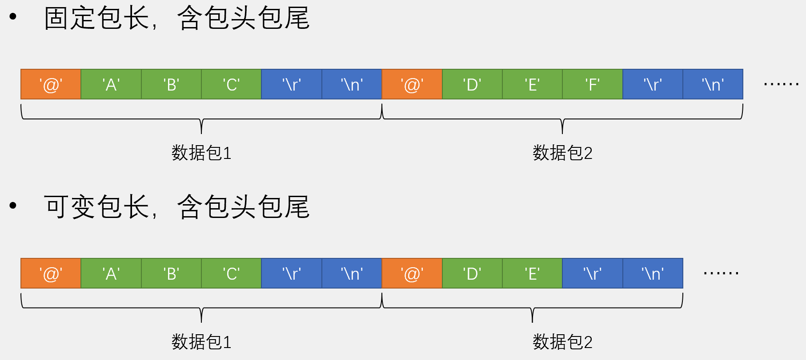

## HEX 数据包接收

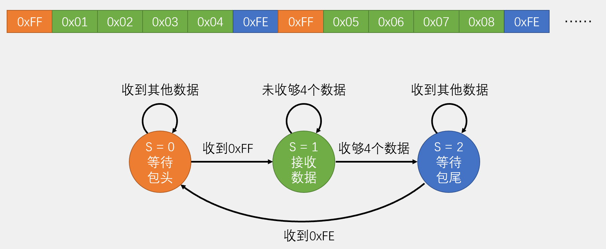

## 文本数据包接收

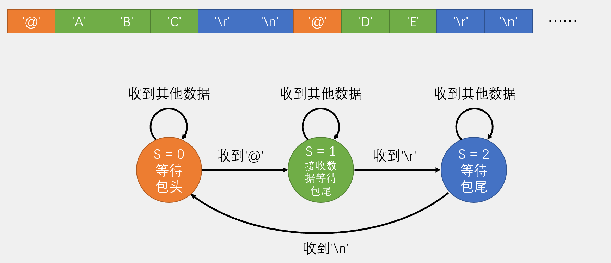