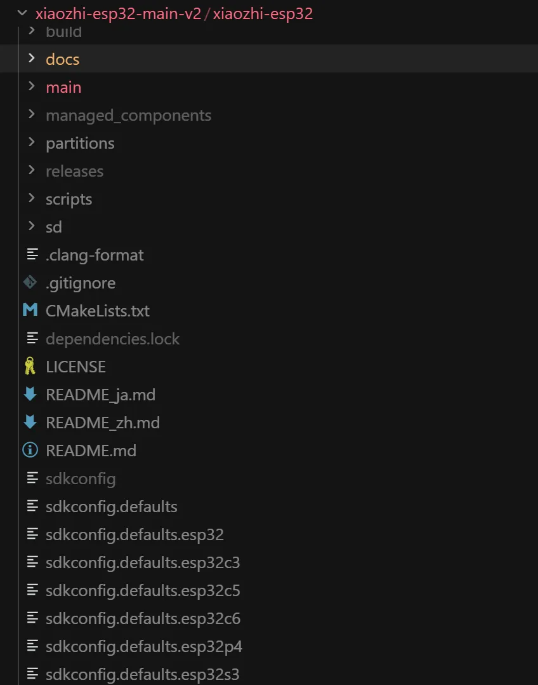
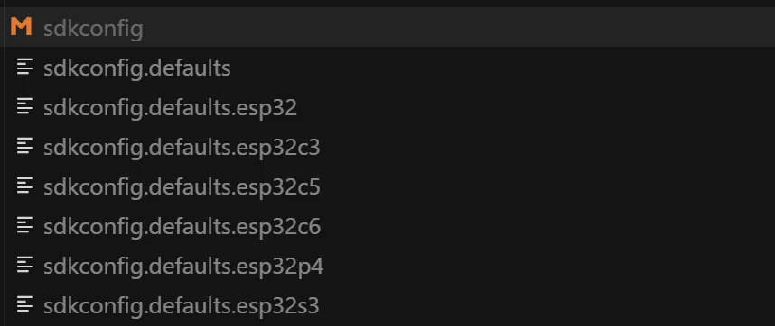
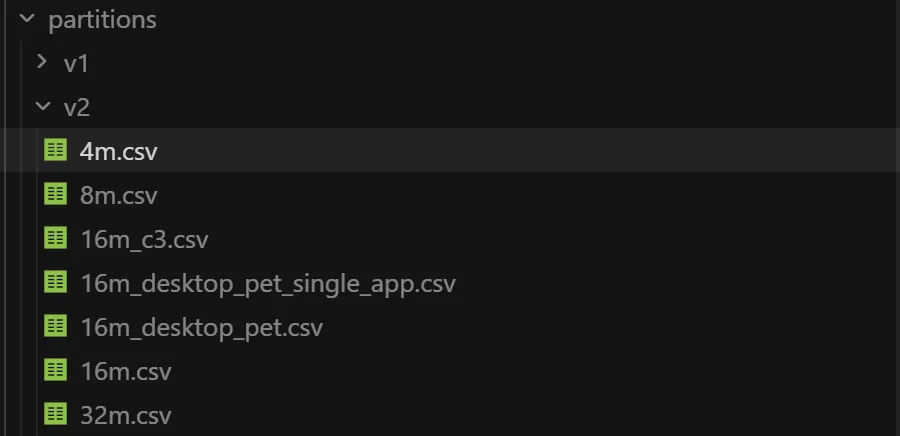

# 小智AI机器人 - 代码框架梳理

# 前言

这段时间毕业设计选了一个题目是AI桌面萌宠，目前开源硬件很多，选择了嘉立创开源的一个桌面电视项目作为开发平台，由于作者只开源了基础的外设，所以业务逻辑部分需要自己来实现，随着AI使用成本的降低，嵌入式AI会迎来有个不错的发展，后序也会有更多的产品面世。

小智AI目前是一个比较火的嵌入式开源项目，复刻成本较低而且项目全开源，适合入门嵌入式AI学习，很多开发者完成了业务端的代码之后，对小智底层源码不太了解，我想在这里和大家一起梳理下小智AI的代码框架。通过对其框架有个大致的了解，来方便我们后续的代码阅读和二次开发。

小智源码地址:https://github.com/78/xiaozhi-esp32

# 1.项目的文件结构介绍



这里主要看CMakeLists.txt，main.c，idf_components.yml，Kconfig.projbuild，分区表（partitions）几个主要文件

## 1.1 CMakeLists.txt

顶层CMakeLists.txt通常是项目的主构建文件，会包含对ESP-IDF构建系统的引用，作用是告诉 CMake 如何编译和构建你的项目，例如什么文件参与编译，指定项目等。

通过文件的内容，我们可以看到它是一个标准的ESP-IDF项目CMake配置。

包含如下关键点：

**包含ESP-IDF的project.cmake**

**设置了项目名称(xiaozhi)和版本**

**包含必要的CMake最低版本要求**

```c
cmake_minimum_required(VERSION 3.16)

# Add this line to disable the specific warning
add_compile_options(-Wno-missing-field-initializers)

include($ENV{IDF_PATH}/tools/cmake/project.cmake)
# "Trim" the build. Include the minimal set of components, main, and anything it depends on.
idf_build_set_property(MINIMAL_BUILD ON)

set(PROJECT_VER "2.2.1")
project(xiaozhi)
```

## 

## 1.2 idf_components.yml

管理 ESP-IDF 组件的依赖关系

## 1.3 sdkconfig

在第一级目录下，有多个sdkconfig配置文件（那个橙色的sdkconfig是编译后生成的）。



```c
- sdkconfig.defaults：基础通用配置

- sdkconfig.defaults.esp32c3：ESP32-C3芯片特有配置

- sdkconfig.defaults.esp32s3：ESP32-S3芯片特有配置
```

不同的sdkconfig适配不同的板子，使用时的一个加载顺序，

## 1.4 分区表（partitions）

为了更好的区分哪里保存了哪些信息，首先在设计时就要提前规划好分区，操作时也要避免操作本分区时误操作了别的分区。 那么这个划分方式最终都会体现在代码里面。 可能是个宏定义，或者是从分区的头里面读出来的信息。

**本项目的分区表**



具体使用哪一个分区表是由用户使用**menuconfig**或者**sdkconfig.defaults**决定的，然后生成sdkconfig

一般的16m的分区

```c
# ESP-IDF Partition Table
# Name,   Type, SubType, Offset,  Size, Flags
nvs,      data, nvs,     0x9000,    0x4000,
otadata,  data, ota,     0xd000,    0x2000,
phy_init, data, phy,     0xf000,    0x1000,
ota_0,    app,  ota_0,   0x20000,   0x3f0000,
ota_1,    app,  ota_1,   ,          0x3f0000,
assets,   data, spiffs,  0x800000,  8M
```

## 1.5 核心应用文件

```c
- main.cc：应用入口，包含app_main()函数

- application.h/cc：主应用逻辑实现

- background_task.h/cc：后台任务处理

- system_info.h/cc：系统信息管理

- settings.h/cc：配置参数管理
```

## 1.6 OTA相关

```c
- ota.h/cc：固件空中升级实现
- partitions_\*.csv：分区表配置(已在前面讨论
```

## 1.7 资源文件(assets)

多语言语音资源(.p3音频文件)

```
- en-US/：英语资源

- zh-CN/：简体中文资源

- zh-TW/：繁体中文资源

- ja-JP/：日语资源
```

language.json

```
多语言文本配置
```

## 1.8 硬件抽象层

boards/：各种开发板定义

```
包含50+种硬件配置
每个子目录对应特定开发板
```

display/：显示驱动

```
LCD/OLED抽象接口抽象层
```

通信协议

protocols/：网络协议实现

```
MQTT协议WebSocket协议
```


# 2.代码的逻辑介绍

代码是面向对象的。每个板子封装成了一个类。把每个类共性的东西提取成父类。每个主板就是一个类

# 3.声音数据逻辑

# 4.网络通信