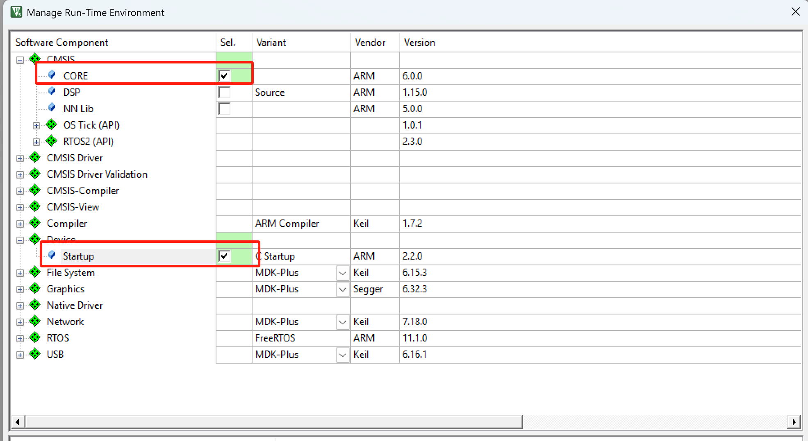
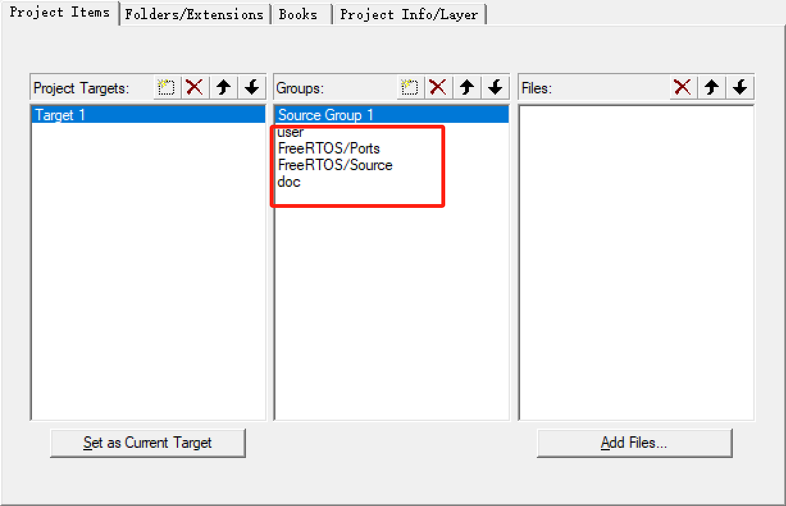
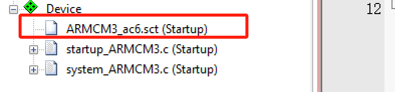
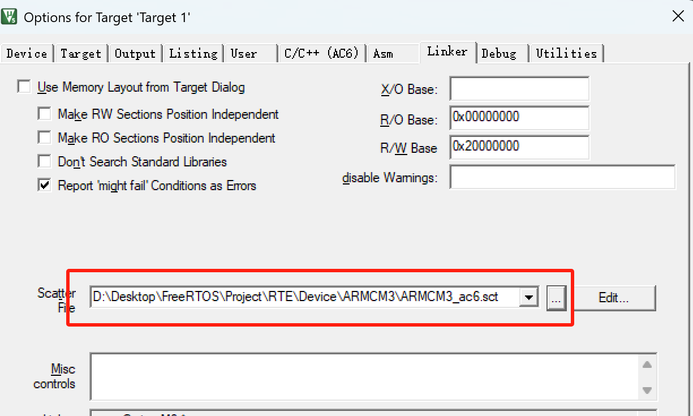
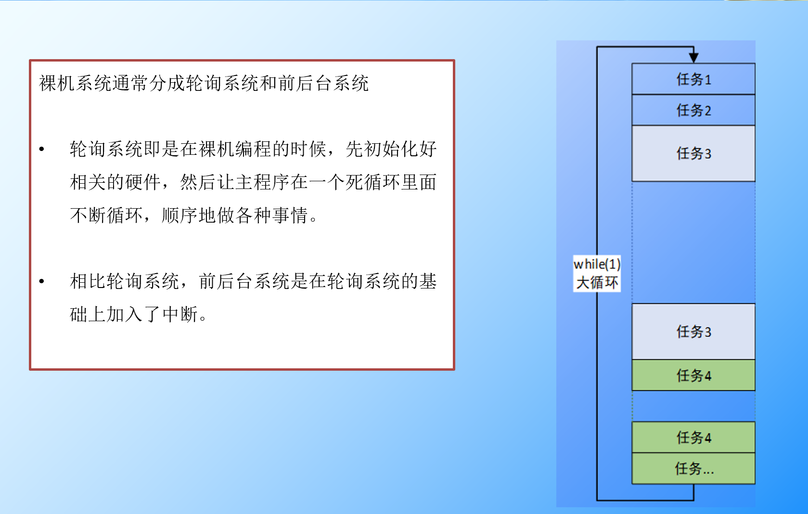
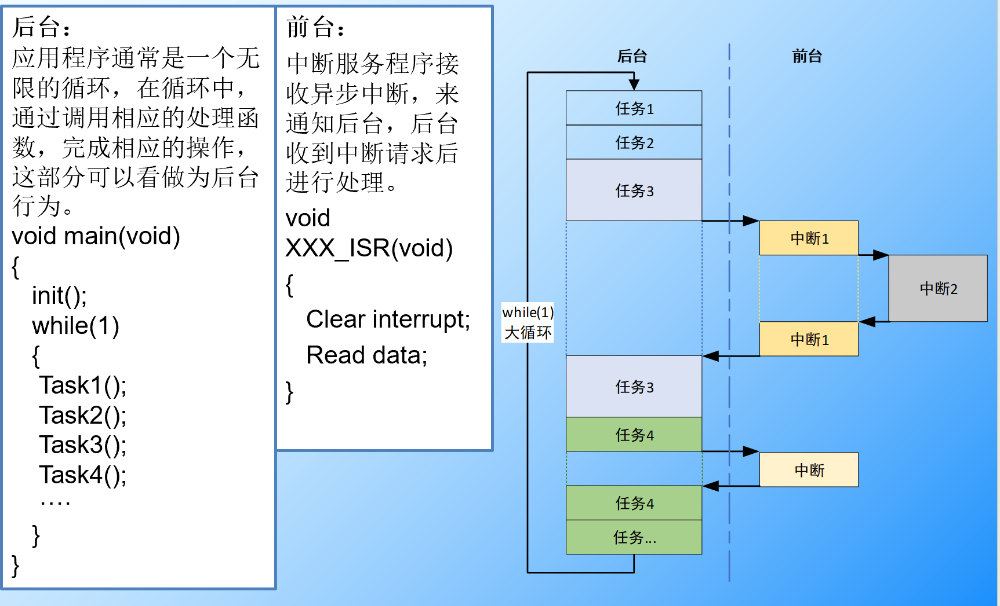
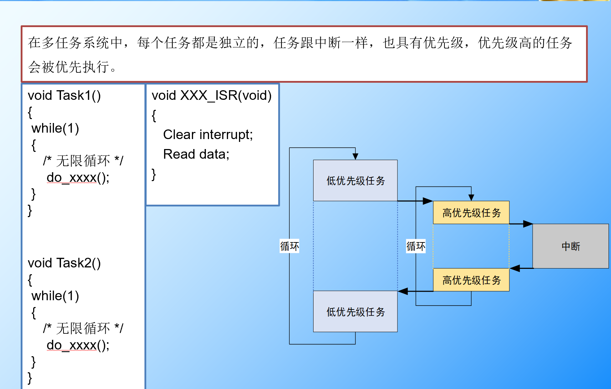

## 01-FreeRTOS工程创建





编译出现的问题：

```
Error: L6218E: Undefined symbol Image$$ARM_LIB_STACK$$ZI$$Limit (referred from startup_armcm3.o)

```

分析：

这个错误依然说明：
 链接器（ARM Linker）**没有生成堆栈边界符号**
 `Image$$ARM_LIB_STACK$$ZI$$Limit`。

> 该符号通常由链接脚本（Scatter File 或自动生成的内存布局）提供。
>  启动文件 `startup_ARMCM3.s` 里引用它来设置堆栈初始值。

解决方法:



找到该文件的磁盘位置，复制绝对路径到下方位置



## 02-裸机系统



## 03-前后台系统



## 04-多任务系统



## 05-对比

