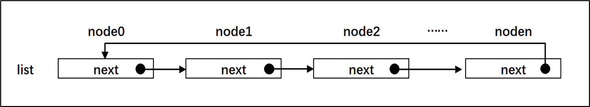
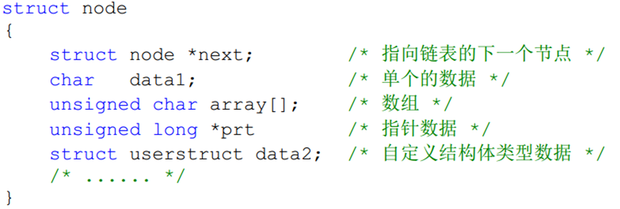
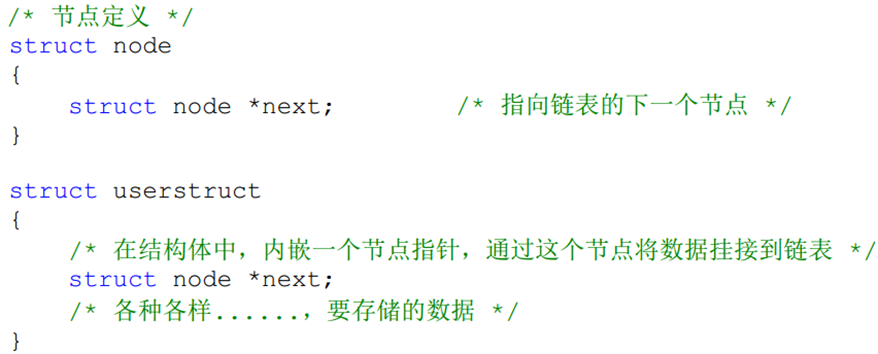
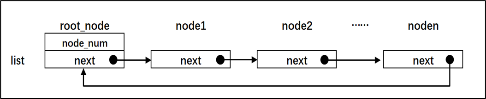
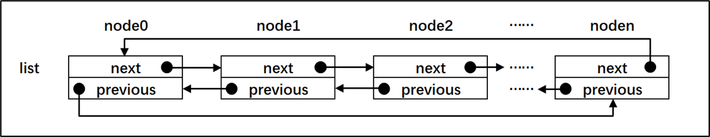
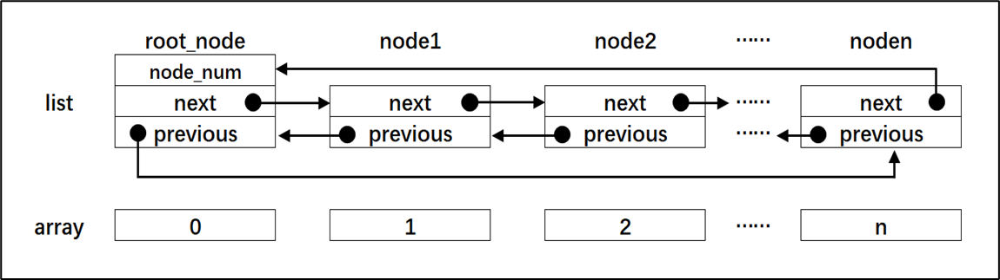
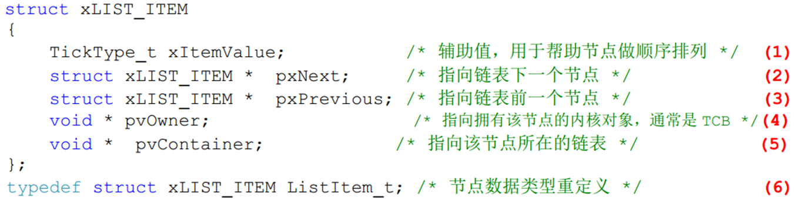

# 数据结构 -- 列表与列表项

## 01-C语言链表简介

链表作为C语言中一种基础的数据结构，在操作系统里面使用的非常多。

**单链表:** 节点本身必须包含一个**节点指针**，用于指向后一个节点，除了这个节点指针是必须有的之外，节点本身还可以携带一些私有信息

为了把离散的数据组合在一个链表更方便，通常一条链表我们会人为地规定一个根节点

双向链表;节点中有两个节点指针，分别指向前后两个节点

与数组对比

数组是连续存储的，链表的离散存储的

## 02-FreeRTOS中链表的实现

实现链表节点
FreeRTOS中与链表相关的操作均在list.h和list.c这两个文件中实现,

## 03-实验