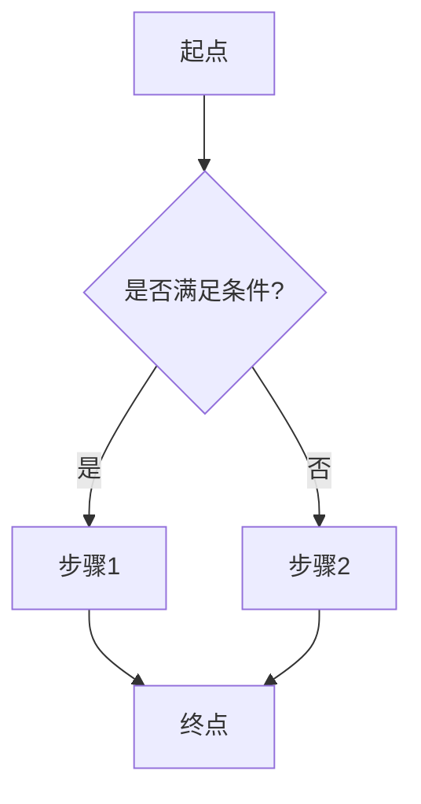
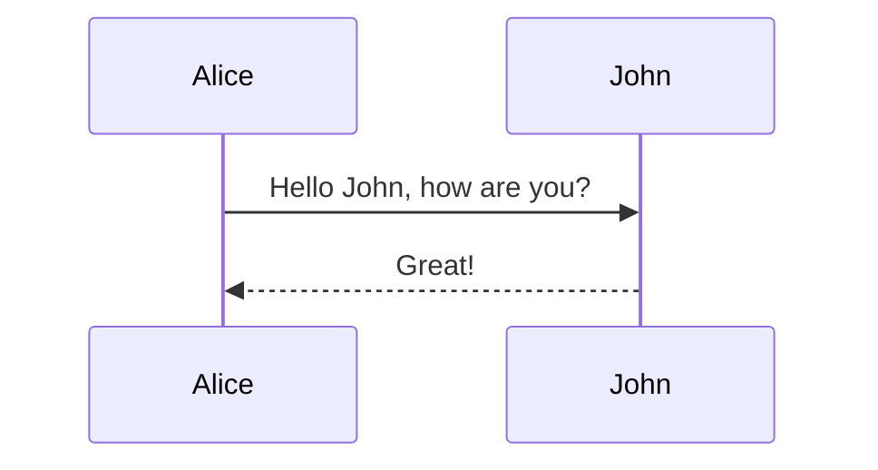
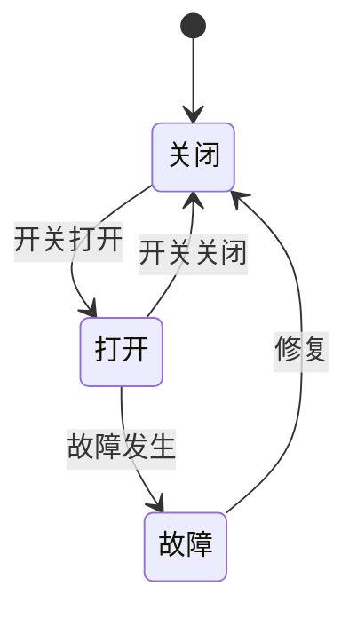
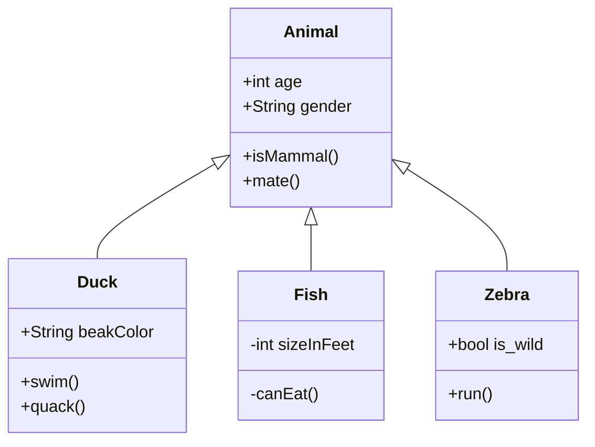
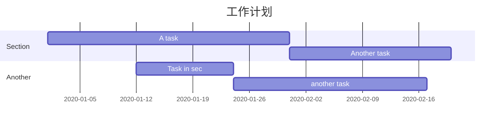
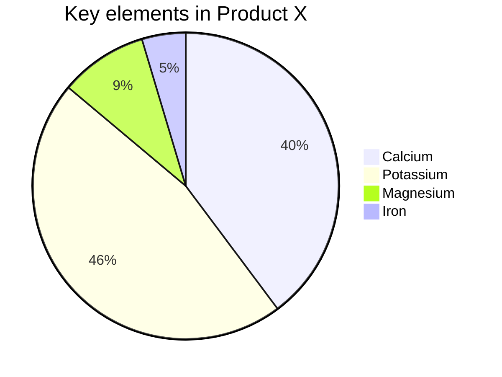

### **Mermaid**

**Mermaid[1]** 是一种简单的类似 Markdown 的脚本语言，通过 JavaScript 编程语言，将文本转换为图片。因此，真正实现画图功能的并不是 Typora 本身，它只是内置了对 Mermaid 的支持。

、甘特图等等。下面分享一下如何绘制这些图，语法非常容易掌握。

先在 Typora 中，输入 **```mermaid** 然后敲击回车，即可初始化一张空白图。

### **流程图**

**方向选项：** - `TD`：从上到下（Top to Down） - `LR`：从左到右（Left to Right） - `RL`：从右到左（Right to Left） - `BT`：从下到上（Bottom to Top）

语法解释：`graph` 关键字就是声明一张流程图，`TD` 表示的是方向，这里的含义是 Top-Down 由上至下。



### **时序图**

语法解释：`->>` 代表实线箭头，`-->>` 则代表虚线。



### 状态图

语法解释：`[*]` 表示开始或者结束，如果在箭头右边则表示结束。




### **类图**

语法解释：`<|--` 表示继承，`+` 表示 `public`，`-` 表示 `private`，学过 Java 的应该都知道。



### **甘特图**

甘特图一般用来表示项目的计划排期，目前在工作中经常会用到。

语法也非常简单，从上到下依次是图片标题、日期格式、项目、项目细分的任务。



### **饼图**

饼图使用 `pie` 表示，标题下面分别是区域名称及其百分比。



### **导出**

绘制好的图片可以选择菜单/文件/导出，导出为图片或者网页格式。在网页中图片是以 SVG 格式渲染的，你可以复制 SVG 内容，导入到 SVG 的图片编辑器中进一步操作。

**节点样式：** ```markdown graph TD    A[矩形节点]    B((圆形节点))    C{菱形节点}    D>尖头节点]    E)圆角节点(

**连接样式**: graph TD    A --> B    A -- 使用虚线 --> C    A -. 使用点线 .-> D    A == 使用双实线 ==> E    A ==> 使用箭头实线 ==> F