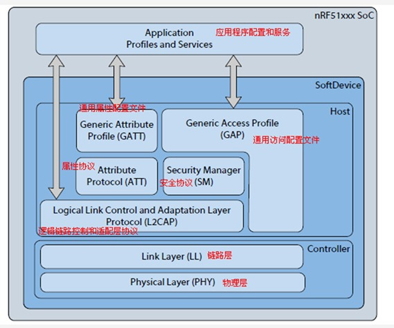
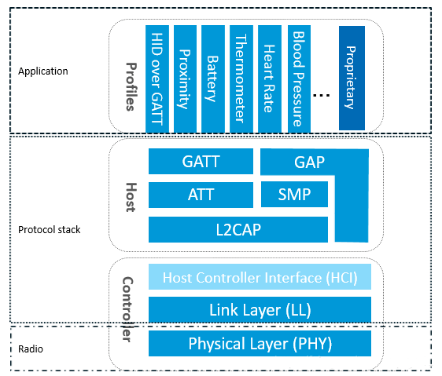

# BLE蓝牙协议学习笔记

## 一、BLE协议概述

### 1.1 什么是BLE
- **BLE**：Bluetooth Low Energy（低功耗蓝牙）
- **特点**：低功耗、短距离、低成本
- **应用**：物联网设备、可穿戴设备、智能家居等

### 1.2 BLE vs 经典蓝牙
| 特性 | BLE | 经典蓝牙 |
|------|-----|----------|
| 功耗 | 极低 | 较高 |
| 传输距离 | 10-100m | 10-100m |
| 数据传输率 | 1Mbps | 1-3Mbps |
| 连接时间 | <3ms | 100ms |
| 应用场景 | 传感器、控制 | 音频、文件传输 |

## 二、BLE协议栈结构

### 2.1 协议栈组成





如上图所述，要实现一个BLE应用，首先需要一个支持BLE射频的芯片，然后还需要提供一个与此芯片配套的BLE协议栈，最后在协议栈上开发自己的应用。可以看出BLE协议栈是连接芯片和应用的桥梁，是实现整个BLE应用的关键。那BLE协议栈具体包含哪些功能呢？简单来说，BLE协议栈主要用来对你的应用数据进行层层封包，以生成一个满足BLE协议的空中数据包，也就是说，把应用数据包裹在一系列的帧头（header）和帧尾（tail）中。具体来说，BLE协议栈主要由如下几部分组成：

PHY层（Physical layer物理层）。
PHY层用来指定BLE所用的无线频段，调制解调方式和方法等。PHY层做得好不好，直接决定整个BLE芯片的功耗，灵敏度以及selectivity等射频指标。

LL层（Link Layer链路层）。
LL层是整个BLE协议栈的核心，也是BLE协议栈的难点和重点。像Nordic的BLE协议栈能同时支持20个link（连接），就是LL层的功劳。LL层要做的事情非常多，比如具体选择哪个射频通道进行通信，怎么识别空中数据包，具体在哪个时间点把数据包发送出去，怎么保证数据的完整性，ACK如何接收，如何进行重传，以及如何对链路进行管理和控制等等。LL层只负责把数据发出去或者收回来，对数据进行怎样的解析则交给上面的GAP或者ATT。

HCI（Host controller interface）。
HCI是可选的，HCI主要用于2颗芯片实现BLE协议栈的场合，用来规范两者之间的通信协议和通信命令等。

GAP层（Generic access profile）。
GAP是对LL层payload（有效数据包）如何进行解析的两种方式中的一种，而且是最简单的那一种。GAP简单的对LL payload进行一些规范和定义，因此GAP能实现的功能极其有限。GAP目前主要用来进行广播，扫描和发起连接等。

L2CAP层（Logic link control and adaptation protocol）。
L2CAP对LL进行了一次简单封装，LL只关心传输的数据本身，L2CAP就要区分是加密通道还是普通通道，同时还要对连接间隔进行管理。

SMP（Secure manager protocol）。
SMP用来管理BLE连接的加密和安全的，如何保证连接的安全性，同时不影响用户的体验，这些都是SMP要考虑的工作。

ATT（Attribute protocol）。
简单来说，ATT层用来定义用户命令及命令操作的数据，比如读取某个数据或者写某个数据。BLE协议栈中，开发者接触最多的就是ATT。BLE引入了attribute概念，用来描述一条一条的数据。Attribute除了定义数据，同时定义该数据可以使用的ATT命令，因此这一层被称为ATT层。

GATT（Generic attribute profile ）。
GATT用来规范attribute中的数据内容，并运用group（分组）的概念对attribute进行分类管理。没有GATT，BLE协议栈也能跑，但互联互通就会出问题，也正是因为有了GATT和各种各样的应用profile，BLE摆脱了ZigBee等无线协议的兼容性困境，成了出货量最大的2.4G无线通信产品。

```
应用层 (Application)
    ↓
Profiles (配置文件)
    ↓
GATT (Generic Attribute Profile)
    ↓
ATT (Attribute Protocol)
    ↓
L2CAP (Logical Link Control and Adaptation Protocol)
    ↓
SMP (Security Manager Protocol)
    ↓
GAP (Generic Access Profile)
    ↓
Host (主机)
    ↓
Controller (控制器)
    ↓
PHY (物理层)
```

### 2.2 Controller和Host分离架构

#### **Controller（控制器）**：
- **功能**：负责底层的无线通信
- **包含**：PHY（物理层）、LL（链路层）
- **特点**：硬件相关，处理射频信号、数据包等

#### **Host（主机）**：
- **功能**：负责上层协议处理
- **包含**：L2CAP、SMP、ATT、GATT、GAP等
- **特点**：软件实现，处理应用逻辑

### 2.3 单芯片方案优势
- **集成度**：Controller和Host在同一芯片中
- **性能**：内部通信更快，减少延迟
- **成本**：降低系统复杂度和成本

## 三、核心协议层

### 3.1 GAP（Generic Access Profile）
- **作用**：设备发现、连接管理、安全控制
- **功能**：
  - 广播（Advertising）
  - 扫描（Scanning）
  - 配对（Pairing）
  - 连接建立/断开
- **应用**：所有BLE设备都必须实现GAP

### 3.2 GATT（Generic Attribute Profile）
- **作用**：数据交换的标准方式
- **功能**：
  - 服务发现
  - 特征值读写
  - 通知/指示
- **应用**：数据通信的基础协议

### 3.3 ATT（Attribute Protocol）
- **作用**：定义数据结构和传输方式
- **核心概念**：
  - Attribute（属性）
  - Handle（句柄）
  - UUID（通用唯一标识符）

## 四、BLE通信模型

### 4.1 角色定义
- **Central（中心设备）**：发起连接的设备
- **Peripheral（外围设备）**：接受连接的设备
- **Broadcaster（广播设备）**：只发送广播的设备
- **Observer（观察者）**：只接收广播的设备

### 4.2 连接过程
1. **广播阶段**：Peripheral发送广播包
2. **扫描阶段**：Central扫描并发现设备
3. **连接阶段**：Central发起连接请求
4. **数据交换**：建立GATT连接进行数据通信

### 4.3 数据包结构
```
Preamble + Access Address + PDU + CRC
  1字节      4字节       可变长度   3字节
```

## 五、服务和特征

### 5.1 服务（Service）
- **定义**：一组相关功能的集合
- **结构**：包含一个或多个特征
- **类型**：
  - 标准服务（如心率服务）
  - 自定义服务

### 5.2 特征（Characteristic）
- **定义**：服务中的具体数据点
- **属性**：
  - Read（可读）
  - Write（可写）
  - Notify（通知）
  - Indicate（指示）

### 5.3 UUID（通用唯一标识符）
- **16位**：标准服务和特征
- **128位**：自定义服务和特征
- **示例**：
  - 心率服务：0x180D
  - 心率测量特征：0x2A37

## 六、BLE配置和参数

### 6.1 连接参数
- **连接间隔**：7.5ms - 4s
- **从机延迟**：0 - 499
- **监督超时**：100ms - 32s

### 6.2 广播参数
- **广播间隔**：20ms - 10.24s
- **广播类型**：
  - Connectable Undirected
  - Connectable Directed
  - Non-connectable Undirected
  - Scan Response

### 6.3 发射功率
- **范围**：-40dBm 到 +10dBm
- **影响**：传输距离和功耗

## 七、安全机制

### 7.1 配对方式
- **Just Works**：无安全保护
- **Passkey Entry**：输入配对码
- **Out of Band**：外部方式交换密钥
- **Numeric Comparison**：数字比较

### 7.2 加密级别
- **Level 1**：无加密
- **Level 2**：未认证配对
- **Level 3**：认证配对
- **Level 4**：安全连接

## 八、应用开发

### 8.1 开发工具
- **Nordic nRF Connect**：BLE调试工具
- **BLE Scanner**：手机端扫描工具
- **Wireshark**：协议分析工具

### 8.2 开发平台
- **Nordic nRF52**：高性能BLE芯片
- **TI CC26xx**：低功耗BLE芯片
- **ESP32**：集成WiFi和BLE

### 8.3 代码示例
```c
// 广播数据设置
uint8_t adv_data[] = {
    0x02, 0x01, 0x06,  // Flags
    0x03, 0x03, 0x12, 0x18  // 16-bit Service UUID
};

// 扫描响应数据
uint8_t scan_rsp_data[] = {
    0x0B, 0x09, 'M', 'y', 'D', 'e', 'v', 'i', 'c', 'e'
};
```

## 九、常见应用场景

### 9.1 可穿戴设备
- 智能手表
- 健康监测设备
- 运动追踪器

### 9.2 智能家居
- 智能灯泡
- 门锁系统
- 温控设备

### 9.3 工业应用
- 传感器网络
- 设备监控
- 资产追踪

## 十、性能优化

### 10.1 功耗优化
- 合理设置连接参数
- 优化广播间隔
- 使用睡眠模式

### 10.2 传输优化
- 合理的数据包大小
- 批量数据传输
- 连接参数协商

### 10.3 可靠性提升
- 重传机制
- 错误检测和纠正
- 连接监控

## 十一、调试和测试

### 11.1 常见问题
- 连接不稳定
- 数据传输错误
- 功耗过高
- 兼容性问题

### 11.2 调试方法
- 使用BLE分析工具
- 检查连接参数
- 验证数据格式
- 测试不同设备

## 十二、学习资源

### 12.1 官方文档
- Bluetooth SIG官方规范
- 各芯片厂商SDK文档
- 开发板用户手册

### 12.2 在线资源
- Bluetooth开发者网站
- GitHub开源项目
- 技术博客和论坛

### 12.3 实践项目
- 简单的心率监测器
- 智能LED控制器
- 环境传感器节点

---

**学习进度记录**：
- [ ] 协议栈结构理解
- [ ] GAP和GATT协议掌握
- [ ] 服务和特征概念
- [ ] 连接过程理解
- [ ] 安全机制学习
- [ ] 实际项目开发
- [ ] 性能优化实践

**下一步学习计划**：
1. 深入理解ATT协议
2. 学习L2CAP层功能
3. 掌握SMP安全协议
4. 实践项目开发
5. 性能测试和优化
