# Wi-Fi抓包方法总结

安全等级：内部公开

开放范围：部门内部

本文主要讲解Wi-Fi抓包以及分析方法。

| 版本号 | 修改内容         | 时间      | 作者 |
| ------ | ---------------- | --------- | ---- |
| V1.0   | 初版             | 2021/6/2  | 杨辉 |
| V1.1   | 增加抓包方法说明 | 2021/6/24 | 杨辉 |

# Part1. 捕获空口包

空口包指的是空中的无线包。 抓包网卡在sniffer 模式下，可以捕获所有的空口包。

下面是讲解空口包的捕获方法。

# 1.安装Omnipeek

（1）从服务器 \\10.33.197.78\share\repo\svn\midea\版本发布\01. 工具\Omnipeek10.0  下载并安装Omnipeek.

(PS: 需要向IT5000 （也可以直接联系张志发）申请权限安装软件。如遇到双击安装包自动消失。)

（2）安装好后使用注册机破解


# 2.抓包方法

### （1）安装抓包网卡驱动。

#####     MTK网卡的驱动安装演示

​	(PS: \\10.33.197.78\share\repo\svn\midea\版本发布\01. 工具\Omnipeek10.0\Ralink_Wireless_USB_Driver_v5.1.12.48 目录下有安装包)

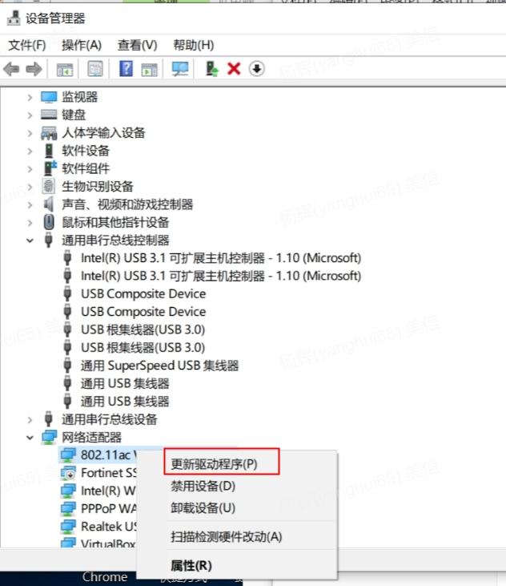

按照下图指示选择驱动程序所在目录，比如：我的电脑的驱动在D:\Omnipeek10.0\Ralink WIreless USB Driver v5.1.12.48\x64目录。

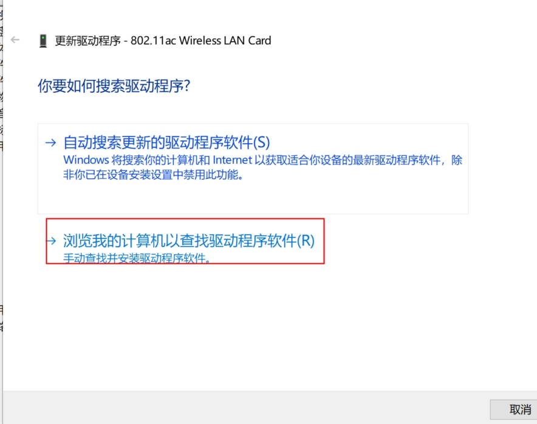


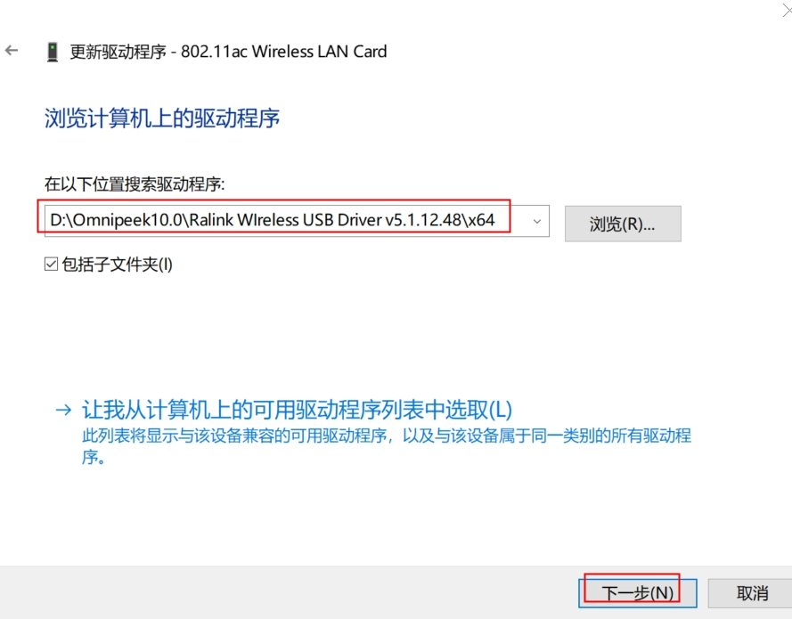

如果需要抓包效果好一点，建议使用EDIMAX EW-7822UAC抓包网卡。实验室即将采购：

##### EDIMAX EW-7822UAC网卡驱动安装演示

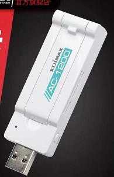

驱动安装方法，[参考](.\Wi-Fi抓包方法总结.assets\file\windows10抓包网卡驱动安装.docx)

[驱动位置](.\Wi-Fi抓包方法总结.assets\file\11AC_8812AU_Driver_白色.rar)

### （2）运行Omnipeek软件

以**管理员身份**打开Omnipeek软件，New capture. 按照下图进行配置。

<1> 设备保存路径，文件。

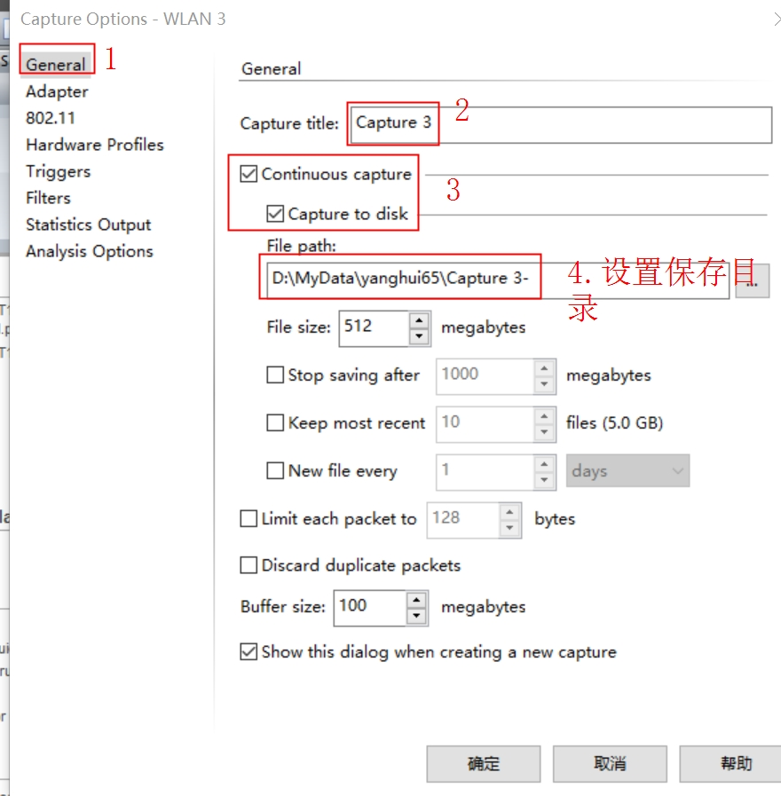

<2> 设置使用的抓包网卡。

**注意：**下图的7. 显示的Omnipeek的描述是Yes,才代表抓包网卡驱动安装成功，否则，不成功，需要重新检查驱动的安装。

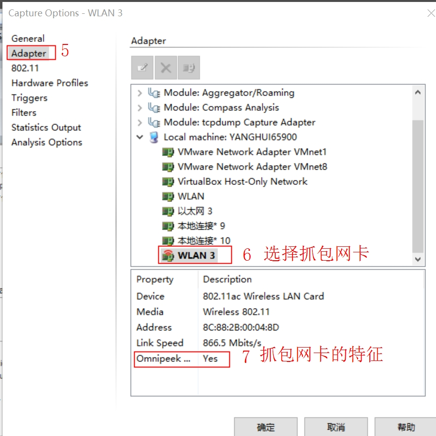


<3> 设置抓包信道以及解密无线包。 抓包信道需要与路由器信道一致，才能抓到包。（一般抓2.4G的设备使用的模式为bgn）解密秘钥正确，才能解密带密码的无线网络包。

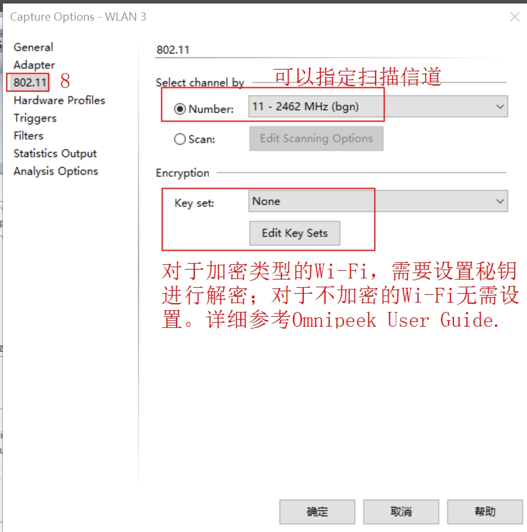

###### **信道查看**

下面指定channel是指扫描路由器某个信道（可以通过PC连接路由器后查看）;  对于android手机可以下载Cellular-Z软件查看。

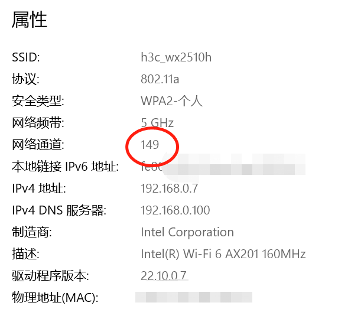


###### **解密包设置**

**特别注意**：对于Encryption选项，如果路由器设置成加密类型，则Omnipeek需要设置正确的秘钥, 才能解密包。

点击Edit Key Sets —— Insert 

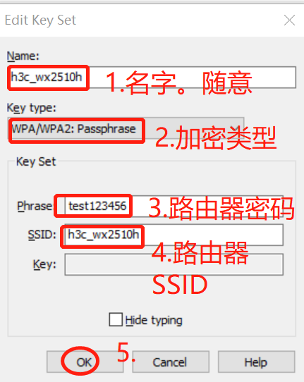


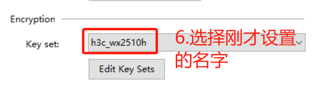

详细设置方法查看：

**查看3.2** 关于先抓包后解密

**和3.3** 关于中文SSID的解密设置。  （Omnipeek不支持中文SSID解密，故采用其他方式。）

**3.4** 如何确保解密成功 （**这个在抓包的前期需要注意**）

在配置好后，点击确定。

### （3）开始抓包

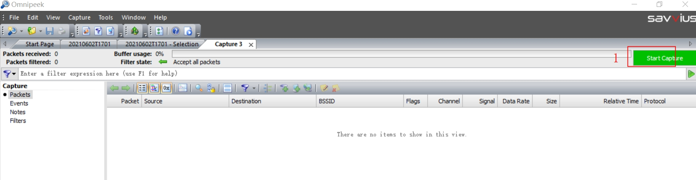


抓包中：

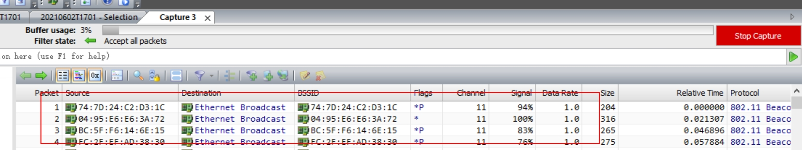


### （4）停止抓包

停止抓包的方法：按上图的Stop Capture即可完成停止抓包。

# 3.分析方法

## 3.1 使用过滤器

对于**2. 抓包方法**中讲述的是抓取所有的空中包，实际应用中常需要针对某两台设备之间的通信包进行分析。

### 3.1.1 通过创建过滤器筛选包

#### 筛选特定模组与特定路由器之间的包

下面以 **模组与路由器之间Wi-Fi连接过程**为例。介绍过滤器的使用，这样操作筛选出有用的包。

比如：我们知道模组的MAC地址是3C:20:93:22:1D:2C ，路由器的MAC地址是04:95:E6:E6:3A:72.

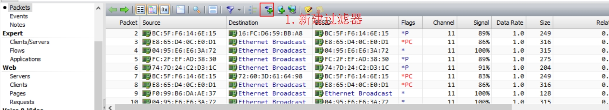

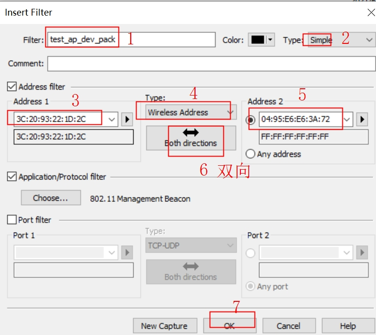


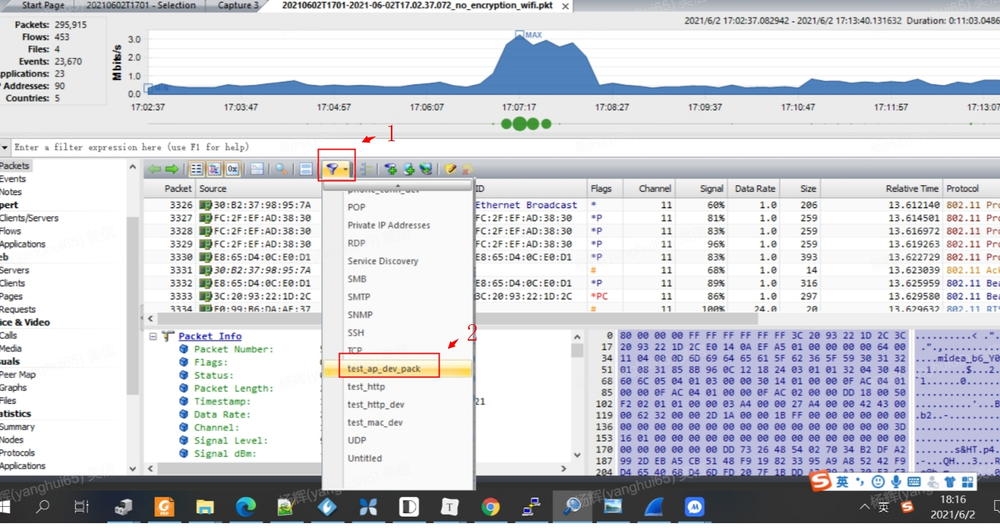

筛选出相应的包：


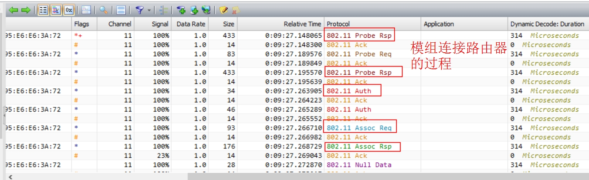

#### 筛选模组连接Wi-Fi的握手包

通过创建以下过滤器

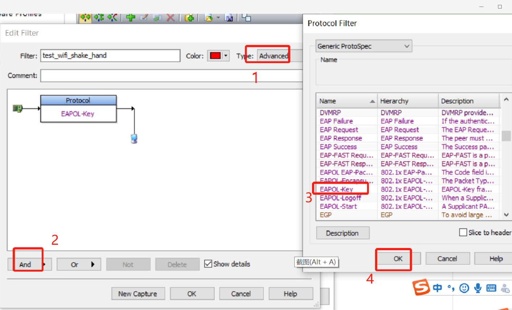

### 3.1.2 使用正则表达式筛选包

在下方填入规则，回车。

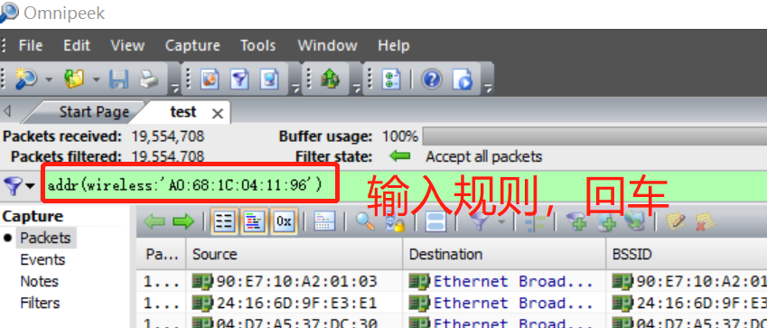

比如：筛选无线模组相关的包，无线模组的MAC地址是A0:68:1C:04:11:96。

```
addr(wireless:'A0:68:1C:04:11:96')
```


比如：使用某个过滤器进行筛选，如使用3.1.1中过滤器

```
filter('test_ap_dev_pack')
```


## 3.2 使用Wi-Fi密码解密数据包

例1：

[解密前的包](Wi-Fi抓包方法总结.assets\file\Capture 2-2021-06-02T22.04.39.731.pkt)

[解密后的包](Wi-Fi抓包方法总结.assets\file\Capture 2-2021-06-02T22.04.39.731_dec.pkt)

解密过程：

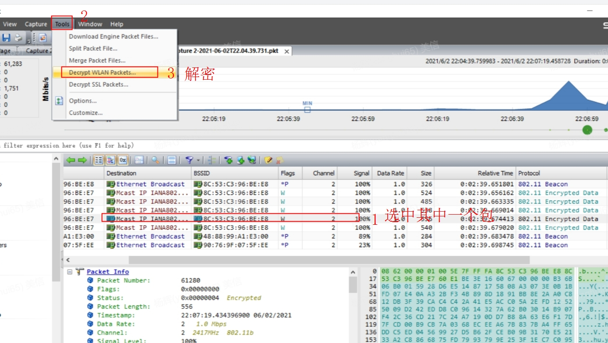

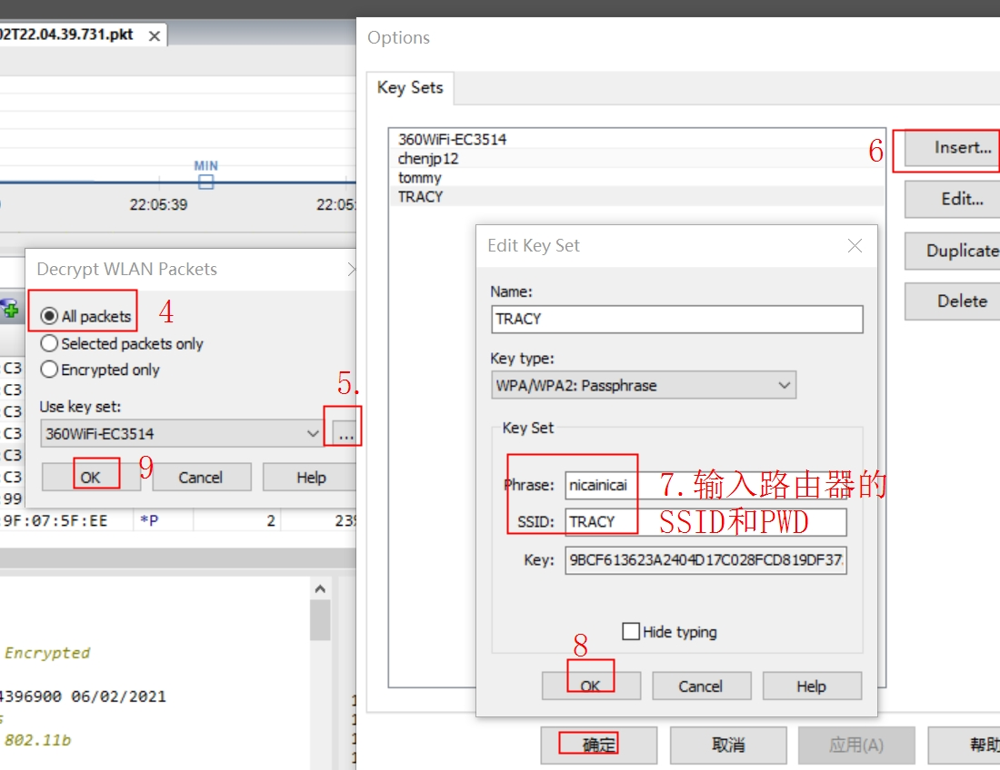


参考 P185 Omnipeek_UserGuide.pdf.


## 3.3  中文SSID的解密方法

**方法1：**建议采用这个方法

在ubuntu上执行下面的命令

```
wpa_passphrase 一楼 66668888
```

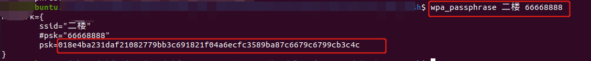

**方法2：**

中文进行uncode-8转换成16进制，代入到代码【这个代码是ASR5501闭源的代码】中算出PSK，然后打印到串口。


## 3.4 如何确保解密成功

**为了保证Omnipeek正确解密，需要做到：**

(1) Omnipeek开始抓包后，设备才开始连接路由器。

(2) 需要保证抓到路由器与STA设备之间秘钥协商的握手全过程(四次握手的eapol包不能少，这个是需要计算秘钥的)，才能完成解密。

eapol包如下图，关于如何筛选，请参考**3.1使用过滤器**

特征是：第一次由路由器发起，设备回复。经过两个来回。

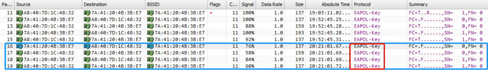

为了保险起见，可以检查是否存在模组对应MAC地址相关的TCP包，可以通过查看Protocol，如果存在TCP包，就说明解密成功了。

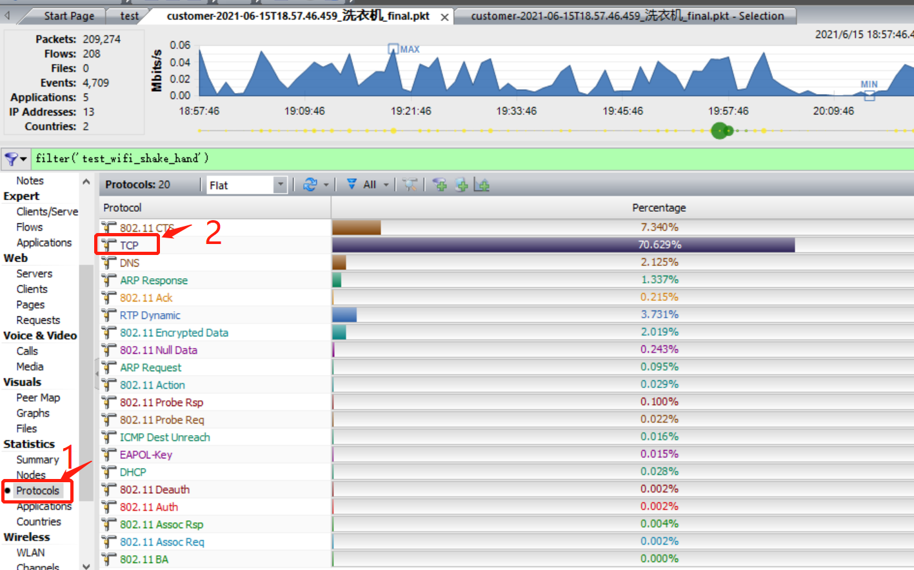

## **3.5其他过滤器使用方法**

Omnipeek:

(1) 筛选出某个mac地址 双向数据包

addr(wireless:'A0:68:1C:04:11:96')

addr(wireless:'*.*.*.19.4F:B6')

(2) 使用某条规则

filter('xxx')


WireShark:

（1）过滤网卡mac地址

eth.addr == 00:e0:4c:68:01:f0

wlan.addr==04:95:E6:E6:3A:71


(2) 通过ip地址筛选单方向包

ip.src == 192.168.3.10 && ip.dst == 101.37.194.26

(3) 通过ip地址筛选双向包

(ip.src == 192.168.3.10 && ip.dst == 101.37.194.26) || (ip.dst == 192.168.3.10 && ip.src == 101.37.194.26) 


# Part2. 捕获wlan口包

前提：安装WireShark，通过Midea软件管理中心下载

# 1.何时需要捕获wlan口包？ 

由于捕获空口包只能捕获路由器与设备之间通信包，对于路由器与WLAN口之间的数据无法捕获。 因此，需要借助额外的手段捕获wlan口包。

# 2.抓wlan口包配置方法

**方法1**：借助集线器。

在网线与wlan口之间增加集线器。示意图如下。

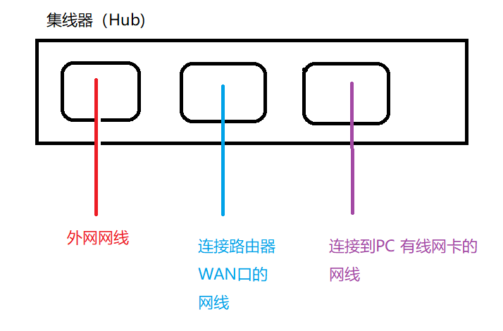

对于市面上旧款的集线器拥有端口转发的功能，推荐型号如下：

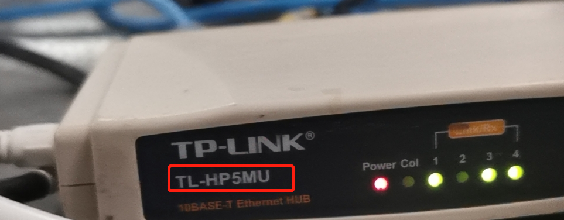

**方法2**：借助交换机。

在网线与wlan口之间增加交换机。示意图如下。

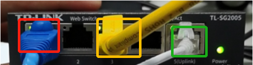

举例TL-SG2218P交换机：三根网线对应三个端口。

端口4：被镜像端口（被监控的端口），连接到路由器。

端口6：接到外网的网线。

端口8：镜像端口（监控端口），连接到PC.

在交换机后台设置：

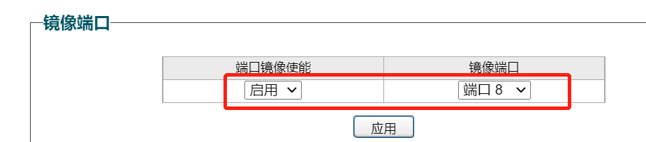


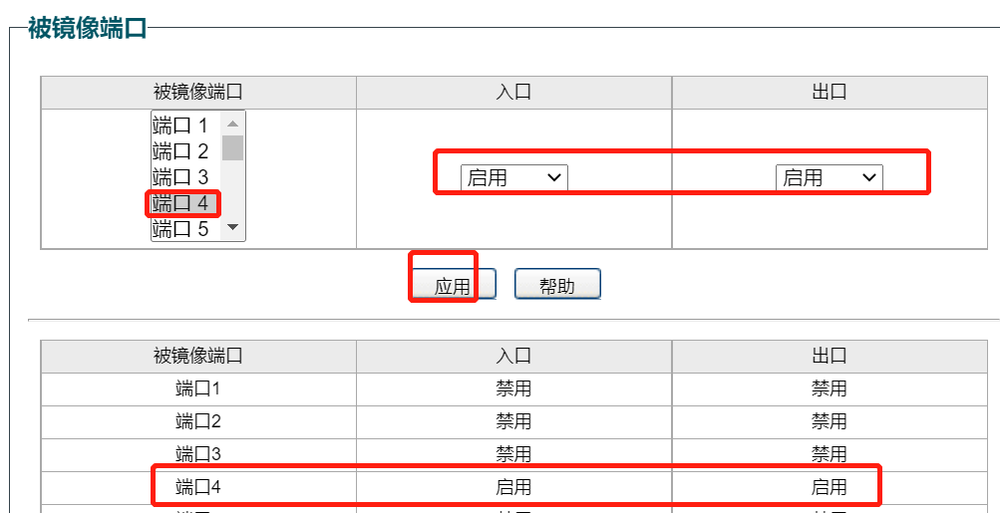

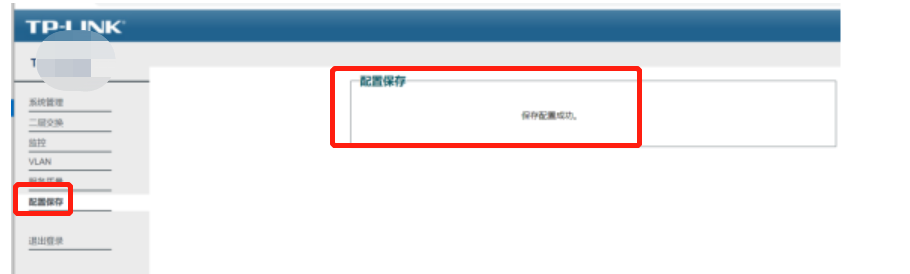

[参考](https://blog.51cto.com/jiayimeng/2543422)

# 3.抓包实例

实例说明：PC执行 ping 101.xx.xx.xx (xx是举例的意思)，查看wlan口包的数据以及空口包数据。

网络拓扑：

- PC连接到路由器A的热点，此时可以访问外网
- 路由器A的WAN口连接到交换机的被镜像端口 （被监控端口）
- PC有线网卡通过网线连接到交换机的镜像端口（监控端口），且IP地址设置为192.168.0.1 （通过有线网无法上网，只能通过路由器A的热点上网）
- 外网通过网线连接到交换机。

操作步骤：

1. 在PC执行ping操作。

   如：ping  -c 86400 -i 2  101.xx.xx.xx

2. 通过wireshark捕获到PC的有线网卡的数据包，经过筛选

   如：得知上一级网络给路由器分配的ip是192.168.3.10， 101.xx.xx.xx是指ping的服务器ip.

   ```
   (ip.src == 192.168.3.10 && ip.dst == 101.xx.xx.xx) || (ip.dst == 192.168.3.10 && ip.src == 101.xx.xx.xx) 
   ```

   捕获到wlan口关于PC 与服务器之间ping的交互数据。

   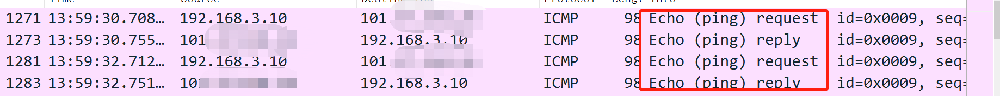


# 工具栏使用方法

**Omnipeek**:

Wireless的WLAN栏目 可以看到有哪些MAC地址


**WireShark:**

TCP包分析使用wireshark比较方便

# 参考资料

[Omnipeek User Guide](Wi-Fi抓包方法总结.assets\file\OmniPeek_UserGuide.pdf)

参考抓包分析方法，详细参考   P189 


[关于WireShark抓包 解密方法](https://wifisharks.com/2021/01/17/how-to-decrypt-the-802-11-encrypted-packets-using-wireshark/?cn-reloaded=1)，  https://wiki.wireshark.org/HowToDecrypt802.11

[WireShark WPA PSK KEY在线生成方法](https://www.wireshark.org/tools/wpa-psk.html)

[Wi-Fi四次握手过程](https://cloud.tencent.com/developer/article/1180881)


