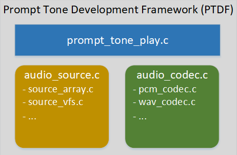

# Aud\_Intf API 使用说明

重要

AIDK使用的音频组件在功能上和其他 `bk_avdk` 分支有所不同，针对AI对话的应用场景新增了一些功能，具体如下：
\- 支持G722编解码
\- 支持提示音播放功能，支持pcm、wav、MP3格式提示音的播放，
\- 支持ASR离线语音唤醒功能
\- 支持speaker播放源切换功能

本文档主要对AIDK新增的功能进行详细说明，标准的录音、播放、语音通话功能的使用说明请参考下述链接：

[https://docs.bekencorp.com/arminodoc/bk\_avdk/bk7258/zh\_CN/v2.0.1/api-reference/multi\_media/bk\_aud\_intf.html](../../../bk_avdk/api-reference/multi_media/bk_aud_intf.md)

## 1\. G722编解码

> 在cpu1上打开 `CONFIG_AUD_INTF_SUPPORT_G722=y` 宏即可使能G722编解码功能。

## 2\. speaker播放源切换功能

> 针对AI语音对话的过程中存在插播提示音的场景，AIDK的音频组件增加了播放源切换功能，通过api可以动态切换播放源。
>
> 相关API接口如下：
>
> - bk\_err\_t aud\_tras\_drv\_voc\_set\_spk\_source\_type(spk\_source\_type\_t type) //设置播放源
> - spk\_source\_type\_t aud\_tras\_drv\_get\_spk\_source\_type(void) //获取当前播放源

重要

上述接口只支持在cpu1上调用，目前已经适配了三种播放源：
\- SPK\_SOURCE\_TYPE\_VOICE： 语音通话
\- SPK\_SOURCE\_TYPE\_PROMPT\_TONE： 提示音
\- SPK\_SOURCE\_TYPE\_A2DP： 蓝牙音乐

## 3\. 提示音播放

> 源码路径： `<source code>/bk_avdk/components/multimedia/prompt_tone_play/`
>
> 如下图所示:
> 提示音开发框架采用模块化的设计方案。主要分为三个模块，提示音播放模块（prompt\_tone\_play）、提示音读取模块(audio\_source)和提示音解码模块（audio\_codec）.
>
> 1.提示音播放模块
> :   - 提示音播放模块是提供给上层用户使用的app模块，负责集成提示音读取模块和提示音解码模块，完成整个提示音播放的配置和控制。
>
> 2.提示音读取模块
> :   - 为了可扩展性，根据功能抽象为一个类，再基于该类开发不同功能实例。
>     - 目前已经支持从数组读取提示音的实例 `audio_array.c` 和从vfs文件系统读取提示音的实例 `audio_vfs.c` ，客户有其他需求可以参考其他实例自行适配。
>     - 默认使用支持vfs文件系统的sd nand存储提示音，可使用宏选择指定的实例。
>
> 3.提示音解码模块
> :   - 为了可扩展性，根据功能抽象为一个类，再基于该类开发不同功能实例。
>     - 目前已经支持pcm格式解码的实例 `pcm_codec.c` 、wav格式解码的实例 `wav_codec.c` 和mp3格式解码实例 `mp3_codec.c` ，客户有其他需求可以参考其他实例自行适配。
>     - 默认使用wav格式的提示音，可使用宏选择指定的实例。

Figure 2\. Prompt Tone Development Framework

提示音相关宏配置:

|  |  |  |  |  |
| --- | --- | --- | --- | --- |
| 宏 | CPU | 格式 | 值 | 说明 |
| CONFIG\_AUD\_INTF\_SUPPORT\_PROMPT\_TONE | CPU1 | bool | y | 使能提示音功能 |
| CONFIG\_AUD\_PROMPT\_TONE\_SOURCE\_ARRAY | CPU1 | bool | y | 音频源为全局数组 |
| CONFIG\_AUD\_PROMPT\_TONE\_SOURCE\_VFS | CPU1 | bool | y | 音频源为SD NAND |
| CONFIG\_PROMPT\_TONE\_CODEC\_PCM | CPU1 | bool | y | 音频格式为pcm |
| CONFIG\_PROMPT\_TONE\_CODEC\_WAV | CPU1 | bool | y | 音频格式为wav |
| CONFIG\_PROMPT\_TONE\_CODEC\_MP3 | CPU1 | bool | y | 音频格式为mp3 |

重要

提示音功能依赖speaker播放源切换功能，因此使用提示音功能的话，需要打开speaker播放源切换功能。
请知悉！！！

备注

提示音文件格式必须满足下述要求：
:   - 单声道
    - 16bit位宽
    - 16K采样率

重要

- wav格式提示音文件格式必须是 `44字节的头 + 有效pcm音频数据` ，不包含作者、专辑等其他说明信息。
- mp3格式提示音文件不包含 `ID3v1` 头和作者、专辑等其他说明信息。

## 4\. ASR离线语音唤醒

> AIDK支持通过ASR离线语音唤醒来控制AI对话。ASR算法运行在cpu2上，通过宏 `CONFIG_AI_ASR_MODE_CPU2=y` 打开此功能。
>
> 使能ASR离线语音唤醒功能后，需要通过唤醒词唤醒设备后才能正常对话，否则设备不向AI Agent推送mic数据。
