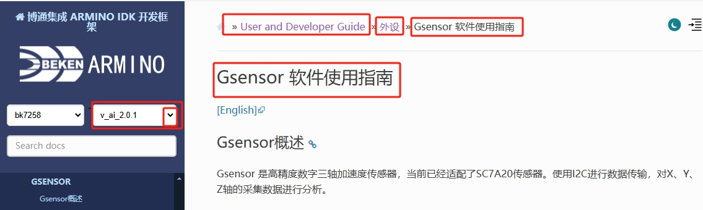

# Gsensor API使用及算法demo

## Gsensor API使用及算法demo

通过下述链接可查看 Gsensor相关的API使用。

## Gsensor API 描述的相关链接

> API描述链接如下图。

gsensor link

<https://docs.bekencorp.com/arminodoc/bk_idk/bk7258/zh_CN/v_ai_2.0.1/developer-guide/peripheral/bk_gsensor.html>

## 模块导航

- [快速入门](../get-started.md)
- [H/W 参考](../hw-reference.md)
- [API 参考](../api-reference.md)
- [api-reference](../api-reference.md)
- [Nand磁盘使用注意事项](nand_disk_note.md)
- [Nfc API介绍](nfc_link.md)
- [aud_intf API使用说明](bk_aud_intf.md)
- [TensorFlow Lite Micro开发指南](tensorflow.md)
- [参考工程](../projects.md)
- [第三方文档](../thirdparty.md)
