<a id="beken-genie-ai"></a>

# Beken Genie AI

<a id="id1"></a>

## 1\. 简介

> 本工程是基于，端对云，云对大模型的设计方案。
>
> 支持双屏显示，提供视觉加语音的陪伴体验和情绪价值。
>
> 支持端侧打通，各种通用大模型的设计方案，直接对接Open AI、豆包、DeepSeek等。
>
> 并且能够有效，利用云的分布式部署，降低网络延迟，提高交互体验。
>
> 支持端侧AEC，NS等音频处理算法，支持G711/G722编码格式，支持KWS关键字打断唤醒，支持提示音播放。
>
> 包含常用外设的参考设计以及Demo，比如，陀螺仪，NFC，按键，震动马达，Nand Flash，LED灯效，充电管理，DVP camera，双QPSI屏。

<a id="id2"></a>

### 1.1 硬件原理图

> - [AI玩具开发板 原理图](../../../_assets/679dec1192d55ced9040-AIDK_AI%E7%8E%A9%E5%85%B7%E5%BC%80%E5%8F%91%E6%9D%BF_%E5%8E%9F%E7%90%86%E5%9B%BE.pdf)
> - [AI玩具开发板\_底层位号图](../../../_assets/d5e457fd28e413bdc045-AIDK_AI%E7%8E%A9%E5%85%B7%E5%BC%80%E5%8F%91%E6%9D%BF_%E5%BA%95%E5%B1%82%E4%BD%8D%E5%8F%B7%E5%9B%BE.pdf)
> - [AI玩具开发板\_顶层位号图](../../../_assets/389af17f4f7b796c9500-AIDK_AI%E7%8E%A9%E5%85%B7%E5%BC%80%E5%8F%91%E6%9D%BF_%E9%A1%B6%E5%B1%82%E4%BD%8D%E5%8F%B7%E5%9B%BE.pdf)

<a id="id5"></a>

### 1.2 规格

> - 硬件配置：
>   :   - SPI LCD X2 (GC9D01 160x160)
>       - 麦克
>       - 喇叭
>       - SD NAND 128MB
>       - NFC (MFRC522)
>       - 陀螺仪 (SC7A20H)
>       - 充电管理芯片 (ETA3422)
>       - 锂电池
>       - DVP (gc2145)
> - 软件特性：
>   :   - AEC
>       - NS
>       - G722 / G711u
>       - 唤醒词定制
>       - WIFI Station
>       - BLE
>       - BT PAN

<a id="id33"></a>
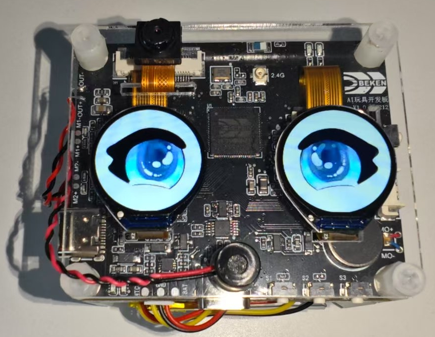


Figure 1\. Hardware Development Board

<a id="id6"></a>

### 1.3 按键

<a id="id7"></a>

#### 1.3.1 按键功能说明

开发板下边靠右三个按键，对应丝印S1,S2,S3;右边一个按键K1

> 开关机
> :   - 1.开机：长按(\>\=3秒) `S2` 开机
>     - 2.关机：当系统处于开机状态时，长按(\>\=3秒) `S2` 关机
>
> 多模态切换
> :   - 1.当系统首次上电，默认使用大语言模型
>     - 2.当系统处于唤醒状态，单击 `S2` 切换成图像识别大模型
>     - 3.当系统处于唤醒状态，再次单击 `S2` 切换成大语言模型
>     - 4.系统没有下电并处于唤醒状态，重复单击 `S2` ，重复步骤2和3
>
> 配网
> :   - 1.配网：当系统处于开机状态时，长按(\>\=3秒) `S1` 进入等待配网状态
>
> 喇叭音量控制
> :   - 1.调大音量：单击 `S1` 按钮调大音量
>     - 2.调小音量：单击 `S3` 按钮调小音量
>
> 恢复出厂设置
> :   - 1.恢复出厂设置：长按 `S3` 按钮恢复出厂设置
>
> 复位按键K1
> :   - 1.关机状态复位：单击 `K1` 按钮，系统从关机状态开机
>     - 2.开机状态复位：单击 `K1` 按钮，系统从开机状态硬重启

<a id="id8"></a>

#### 1.3.2 按键开发说明

> 1.GPIO按键
> :   - 按键功能配置，参考projects/common\_components/bk\_key\_app/key\_app\_config.h和key\_app\_service.c，开发者在该表中填写对应的IO管脚和按键对应的回调函数事件即可
>     - 长按键时长配置参考multi\_button.h中的LONG\_TICKS宏定义
>     - 当前所有的按键事件转到任务中执行，如果按键事件执行程序被阻塞或执行时间过长，会影响按键响应速度
>
> 2.GPIO按键注意事项
> :   - 请确认GPIO管脚只供按键使用，否则同一个GPIO管脚功能冲突，会引起按键无效问题
>     - 如果开发者开发板与beken\_genie开发板不同，请根据开发板硬件设计重新配置GPIO。关于GPIO使用方法，请参考bk\_avdk/bk\_idk/docs/bk7258/zh\_CN/api-reference/peripheral/bk\_gpio.rst。

<a id="id9"></a>

### 1.4 灯效

开发板上边有红绿两个状态指示灯，重要信息红灯闪烁，一般性提示绿灯闪烁，以及特殊性提醒红绿灯交替闪烁。
灯效开发参考代码led\_blink.c。

> 绿灯常亮/长灭提示信息
> :   - 1.开机时，绿灯长亮，等待用户操作或下一个事件开始
>     - 2.对话开始，绿灯灭
>
> 红绿灯交替闪烁提示信息
> :   - 1.用户配网：用户配网
>
> 绿灯闪烁提示信息
> :   - 1.上电联网中：绿灯快闪
>     - 2.大模型服务器连接成功：绿灯慢闪
>     - 3.对话停止：绿灯慢闪
>
> 红灯闪烁提示信息
> :   - 1.配网失败/网络重连失败：红灯快闪
>     - 2.WEBRTC连接断开：红灯快闪
>     - 3.大模型服务器连接断开：红灯快闪
>     - 4.电池电量低于20%：红灯慢闪30秒后自动停止闪烁；如果充电中，则红灯不闪烁
>     - 5.无重要提醒事件：当无重要提醒事件时，红灯处于关闭状态

<a id="sd-nand"></a>

### 1.5 SD-NAND存储器

> - 1.SD-NAND存放本地资源文件，比如显示屏上的图片资源文件
> - 2.SD-NAND存储器默认使用FAT32文件系统，供应用程序通过VFS接口间接调用FATFS开源程序接口访问文件
> - 3.PC端，通过USB接口，读写访问开发板SD-NAND文件(开发板左边USB接口)
> - 4.请注意PC端删除的文件，不要同时被本地应用程序使用，防止系统异常

<a id="gsensor"></a>

### 1.6 陀螺仪-Gsensor

> - 1.本地Gsensor支持唤醒系统功能，用户可以S形轨迹晃动开发板，将系统唤醒

<a id="id10"></a>

### 1.7 充电管理

> - 1.当前开发板使用充电管理芯片型号为 (ETA3422)
> - 2.充电满时，充电口边上的红灯会关闭，绿灯亮；红灯亮表示在充电
> - 3.注意：在充电过程中或者外部电源接入的情况下，系统切换至外部输入电压源进行电压检测，而非使用电池电压，此时用命令获取的电压为外部输入电压。
> - 4.充电状态监测取决于GPIO51和GPIO26。
>   :   - GPIO51负责检测是否为充电状态，GPIO51为高时，存在外部供电输入，反之，则没有。
>       - GPIO26为高时，则表示电池正在充电中。为低时，则表示电池已经充满电。
>       - 注意：该功能需要确认硬件上R14电阻是否已经焊接，如无焊接，需额外焊接。
> - 5.使能充电管理功能需配置CONFIG\_BAT\_MONITOR\=y，使能充电管理的测试用例需配置CONFIG\_BATTERY\_TEST\=y。
> - 6.配置电池测试命令使能后，可以通过battery命令对电池的信息进行获取。
>   :   - 比如“battery init”可以对电池监控任务进行初始化。
>       - “battery get\_battery\_info”可以查看电池的基本信息。
>       - “battery get\_voltage”可以查看电池当前的电压值。
>       - “battery get\_level”可以查看电池当前的电量。
>       - 如上命令使用时，需注意是否为外部电源供电情况下，否则检测电压信息为外部供电电压。
>       - 具体其他命令，可以只发送“battery”，打印相关命令支持。更进一步信息，可参考cli\_battery.c中的定义。
> - 7.当电量等于或小于20%时，会发送低电量告警事件。
>   :   - 只有不插电的时候会触发，外部供电或者充电时，不会发送低电量告警。
>       - 每次进入低电量状态时，只会发送一次。
>       - 此时，另一侧的红灯慢闪30s。
> - 8.充电管理任务在充电时，会打印“Device is charging…”信息。
> - 9.在充满电时，会打印“Battery is full.”信息。
> - 10.尽管电池存在低压保护功能，但建议用户在低电量的时候及时充电，可延长电池的寿命。
> - 11.用户如果使用其他厂家的电池，需要根据具体电池的信息修改电量插值表s\_chargeLUT以及iot\_battery\_open中电池基本信息的内容。
> - 12.在我们的SDK中，我们提供了电流、电压和电量的API函数。目前，电池仅支持电压和电量的检测功能。需要注意的是，电流检测的API接口虽然已保留，但目前尚未实现，因此如果用户的设备支持电流检测，需要自行对电流的API进行实现。
> - 13.由于目前硬件仅支持非充电状态下的电量检测，若用户需要充电期间检测电压，硬件上需要进行改造。
>   :   - 仅去除D6二极管和R21电阻即可。
> - 14 按键旁边的USB口既是充电口又是串口。
> - 15.电量采样的ADC接口为芯片内部的ADC0，外部不需要接电阻分压电路再加ADC通道采集。ADC0与VBAT监控通道直连，该接口为芯片内部专用接口，没有外部连线。
> - 16.注意：电池最高检测电压为4.35V。高于该电压存在烧坏系统的风险。

<a id="id11"></a>

### 1.8 唤醒词

> 1. `hi armino` 或 `嗨阿米诺` 用于唤醒，本地端侧和云端AI互动，同时LCD亮起，展示眼睛动画。
>
>    > 响应词为 `A Ha`
> 2. `byebye armino` 或 `拜拜阿米诺` 用于关闭，本地端侧和云端AI互动，同时关闭LCD，眼睛动画不再展示。
>
>    > 响应词为 `Byebye`

<a id="id12"></a>

### 1.9 马达

> - 1.LDO连接马达的正极，PWM连接马达的负极，通过调节PWM的占空比来控制马达的振动强度。
> - 2.通过长按按键开机时，马达会振动。
> - 3.PWM详细使用例程见cli\_pwm.c。

<a id="id13"></a>

### 1.10 提示音

<a id="id14"></a>

#### 1.10.1 提示音功能说明

开发板工作过程中会根据事件播放对应提示音，事件对应的提示音内容如下：

> 蓝牙配网：
> :   - 1.开始蓝牙配网： `请使用蓝牙配网`
>     - 2.蓝牙配网： `蓝牙配网失败，请重新配网。`
>     - 3.蓝牙配网成功： `蓝牙配网成功`
>
> 连网
> :   - 1.连网中： `网络连接中，请稍后。`
>     - 2.连网失败： `网络连接失败，请检查网络。`
>     - 3.连网成功： `网络连接成功`
>
> 唤醒和关闭
> :   - 1.唤醒： `A Ha`
>     - 2.关闭： `Byebye`
>
> AI智能体
> :   - 1.AI智能体连接成功： `AI智能体已连接`
>     - 2.AI智能体断开连接： `AI智能体已断开`
>
> 设备断连
> :   - 1.设备断开连接： `设备断开连接`
>
> 电池电量
> :   - 1.电池低电量： `电池电量低，请充电。`

<a id="id15"></a>

#### 1.10.2 提示音开发指南

> 请参考文档：[音频组件开发指南](../api-reference/bk_aud_intf.md)
>
> 默认提示音文件资源路径：`<source code>/projects/common_components/resource/`

<a id="id17"></a>

### 1.11 倒计时

> - 1.配网事件倒计时为五分钟，五分钟未配网，则芯片会进入深度睡眠(类似于关机)。
> - 2.网络错误倒计时为五分钟，若发生网络错误，五分钟内网络未恢复，则芯片会进入深度睡眠。
> - 3.待机状态倒计时为三分钟，系统上电后默认状态为待机状态，当您喊 `byebye armino` 或 `拜拜阿米诺` 之后，系统也会处于待机状态，若无其他事件发生，三分钟后芯片会进入深度睡眠。
> - 4.您可以在countdown\_app.c的s\_ticket\_durations\[COUNTDOWN\_TICKET\_MAX\]数组里修改倒计时时间。

<a id="id18"></a>

## 2\. 开发指南

<a id="id19"></a>

### 2.1 模块架构图

> 此AI demo方案和门锁方案类似，设备端和和AI大模型端双向语音通话，同时设备端向AI大模型端单向图传，门锁方案中的对端apk变为了AI Agent机器人。
> :   软件模块架构如下图所示：

<a id="id34"></a>
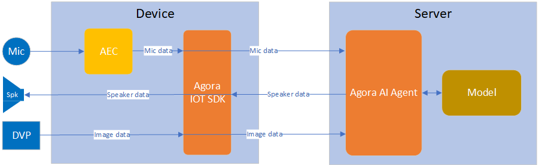


Figure 3\. software module architecture

> - 方案中，设备端采集mic语音，通过agora sdk将语音数据发送至声网服务器，声网服务器负责和AI Agent大模型的交互，将mic语音发送至AI Agent并获取回复，再将语音回复发送至设备端喇叭播放。
> - 方案中，设备端采集图像，通过agora sdk将每帧图像发送至声网服务器，声网服务器再将图像送至AI Agent大模型进行识别。

<a id="id20"></a>

### 2.2 配网及对话时序图

<a id="id35"></a>
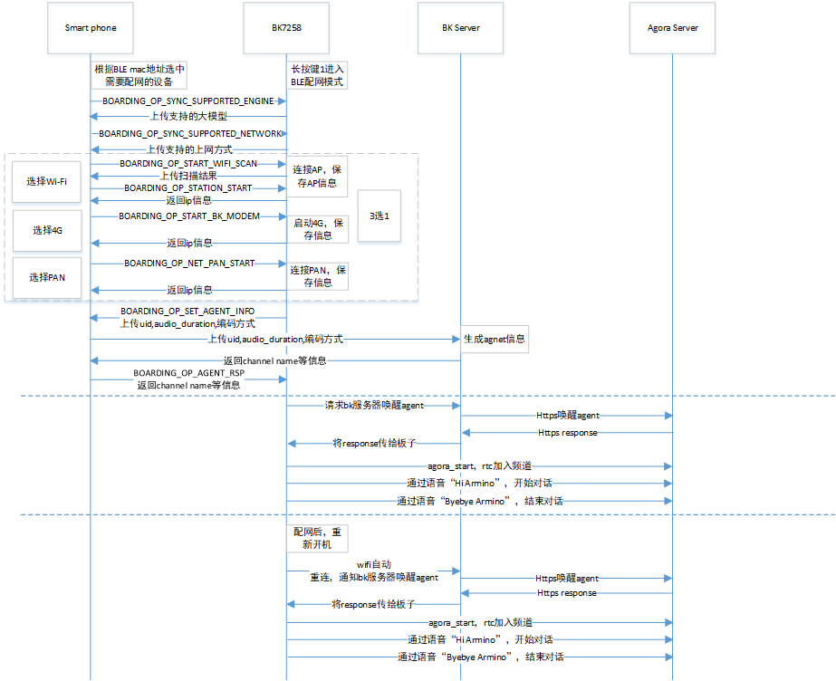


Figure 4\. Operation Flow Sequence

<a id="id21"></a>

### 2.3 工作状态机

<a id="id36"></a>
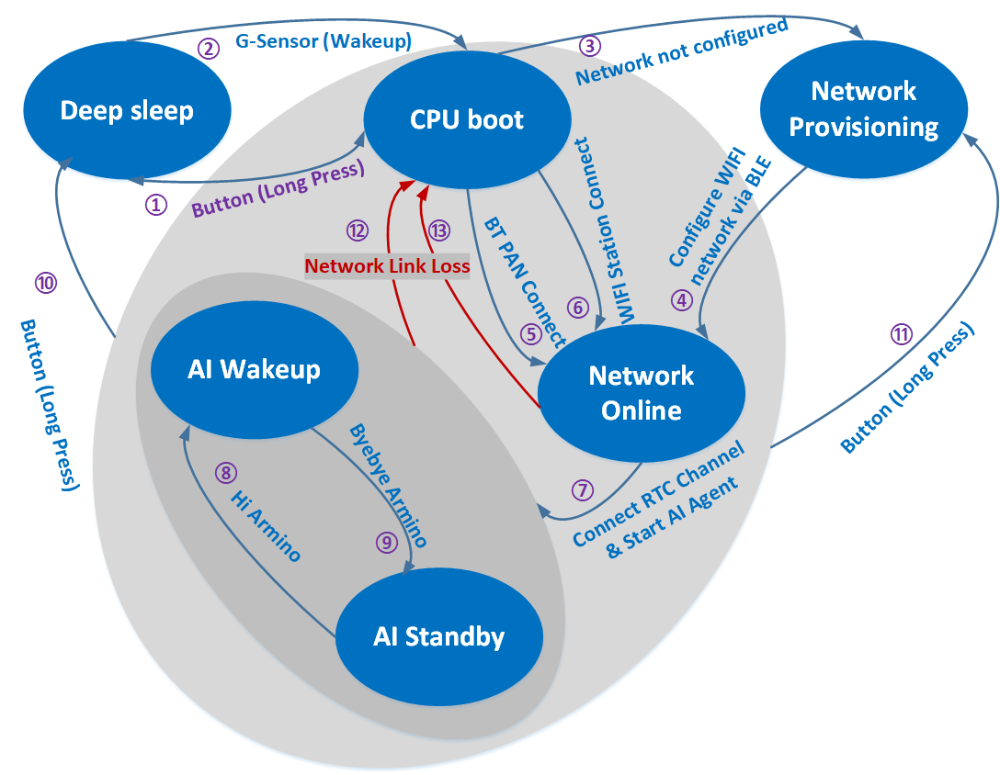


Figure 5\. module state diagram

```
1/2 Green light stays on.
3/4 Green and red lights flash alternately
5/6 Green light flashes quickly.
7 Green light flashes quickly.
8 LCD on, LED off.
9 LCD off
12/13 Red light flashes quickly
```

<a id="id22"></a>

### 2.4 主要配置

> 打开声网功能库需要在 `cpu0` 上打开以下配置:
>
> |  |  |  |  |
> | --- | --- | --- | --- |
> | Kconfig | CPU | Format | Value |
> | CONFIG\_AGORA\_IOT\_SDK | CPU0 | bool | y |
>
> 打开Beken配网及agent启动需要在 `cpu0` 上打开以下配置:
>
> |  |  |  |  |
> | --- | --- | --- | --- |
> | Kconfig | CPU | Format | Value |
> | CONFIG\_BK\_SMART\_CONFIG | CPU0 | bool | y |
>
> 打开双屏显示及AVI播放需要打开以下配置:
>
> |  |  |  |  |
> | --- | --- | --- | --- |
> | Kconfig | CPU | Format | Value |
> | CONFIG\_LCD\_SPI\_GC9D01 | CPU1 | bool | y |
> | CONFIG\_LCD\_SPI\_DEVICE\_NUM | CPU1 | int | 2 |
> | CONFIG\_AVI\_PLAY | CPU1 | bool | y |
> | CONFIG\_DUAL\_SCREEN\_AVI\_PLAY | CPU0 \& CPU1 | bool | y |
> | CONFIG\_LVGL | CPU1 | bool | y |
> | CONFIG\_LV\_IMG\_UTILITY\_CUSTOMIZE | CPU1 | bool | y |
> | CONFIG\_LV\_COLOR\_DEPTH | CPU1 | int | 16 |
> | CONFIG\_LV\_COLOR\_16\_SWAP | CPU1 | bool | y |

<a id="bleagent"></a>

### 2.5 BLE配网及agent定制指南

> BLE配网及agent相关代码主要分布在projects/common\_components/bk\_boarding\_service目录及projects/common\_components/bk\_smart\_config目录，客户可以参考如下说明定制自己的方案

1、bk\_sconf\_prepare\_for\_smart\_config 进入BLE配网模式

```
void bk_sconf_prepare_for_smart_config(void)
{
    smart_config_running = true;
    first_time_for_network_reconnect = true;
#if CONFIG_STA_AUTO_RECONNECT
    first_time_for_network_provisioning = true;
#endif
    app_event_send_msg(APP_EVT_NETWORK_PROVISIONING, 0);//进入配网模式红绿交替闪灯提示
    network_reconnect_stop_timeout_check();             //关闭重连超时检测
    bk_sconf_trans_stop();                              //关闭设备端rtc及多媒体服务
    bk_wifi_sta_stop();                                 //关闭wifi
#if CONFIG_BK_MODEM
extern bk_err_t bk_modem_deinit(void);
  bk_modem_deinit();                                    //若使能4G模块，关闭4G模块
#endif
#if !CONFIG_STA_AUTO_RECONNECT                          //CONFIG_STA_AUTO_RECONNECT默认关闭，使用beken重连策略
    demo_erase_network_auto_reconnect_info();           //默认版本进入配网模式不会擦除配网信息
    bk_sconf_erase_agent_info();                        //默认版本进入配网模式不会擦除agent信息
#endif

#if CONFIG_NET_PAN && !CONFIG_A2DP_SINK_DEMO && !CONFIG_HFP_HF_DEMO
    bk_bt_enter_pairing_mode(0);                        //BT恢复到初始状态
#else
    BK_LOGW(TAG, "%s pan disable !!!\n", __func__);
#endif
extern bool ate_is_enabled(void);

    if (!ate_is_enabled())
    {
        bk_genie_boarding_init();                       //BLE配网初始化
        wifi_boarding_adv_start();                      //BLE开启广播，进入配网模式
    }
    ......
}
```

2、bk\_genie\_message\_handle负责和手机app通过BLE交互配网信息，如下代码客户可disable，使用自己的方案

```
static void bk_genie_message_handle(void)
{
        ……
    case DBEVT_START_AGORA_AGENT_START:
    {
        LOGI("DBEVT_START_AGORA_AGENT_START\n");
        char payload[256] = {0};
        __maybe_unused uint16_t len = 0;
        //上传module uid等信息到beken服务器，若客户自行搭建服务器，可以不用这段代码，也可以参照本小节3修改bk_sconf_send_agent_info实现
        len = bk_sconf_send_agent_info(payload, 256);
        bk_genie_boarding_event_notify_with_data(BOARDING_OP_SET_AGENT_INFO, 0, payload, len);
    }
    break;
    case DBEVT_START_AGORA_AGENT_RSP:
    {
        LOGI("DBEVT_START_AGORA_AGENT_RSP\n");
        //接收beken服务器服务器分配的channel name等信息，若客户自行搭建服务器，可以不用这段代码，也可以参照本小节4修改bk_sconf_prase_agent_info实现
        bk_sconf_prase_agent_info((char *)msg.param, 1);
    }
    break;
        ……
}
```

3、bk\_sconf\_send\_agent\_info负责在配网阶段将agent配置参数发送给APK
:   代码路径：projects/common\_components/bk\_smart\_config/src/adapter/agora/bk\_smart\_config\_agora\_adapter.c

```
uint16_t bk_sconf_send_agent_info(char *payload, uint16_t max_len)
{
    unsigned char uid[32] = {0};
    char uid_str[65] = {0};
    uint16 len = 0;

    bk_uid_get_data(uid);
    for (int i = 0; i < 24; i++)
    {
        sprintf(uid_str + i * 2, "%02x", uid[i]);
    }
    //如下参数是beken服务器启动agent时，需要动态配置的，客户可以根据自己方案定制成自己的
    len = os_snprintf(payload, max_len, "{\"channel\":\"%s\",\"agent_param\": {", uid_str);
#if CONFIG_AUDIO_FRAME_DURATION_MS
    len += os_snprintf(payload+len, max_len, "\"audio_duration\": %d,", CONFIG_AUDIO_FRAME_DURATION_MS);
#endif
#if CONFIG_AUD_INTF_SUPPORT_OPUS
    len += os_snprintf(payload+len, max_len, "\"out_acodec\": \"OPUS\"");
#else
    len += os_snprintf(payload+len, max_len, "\"out_acodec\": \"G722\"");
#endif
    len += os_snprintf(payload+len, max_len, "}}");
    BK_LOGI(TAG, "ori channel name:%s, %s, %d\r\n", uid_str, payload, len);
    return len;
}
```

4、bk\_sconf\_prase\_agent\_info负责在配网阶段解析服务器启动agent后的返回参数（如app\_id, channel\_name等），用于启动设备端RTC
:   代码路径：projects/common\_components/bk\_smart\_config/src/adapter/agora/bk\_smart\_config\_agora\_adapter.c

```
void  bk_sconf_prase_agent_info(char *payload, uint8_t reset)
{
    ......
    //解析app_id及channel_name
    cJSON *app_id = cJSON_GetObjectItem(json, "app_id");
    if (app_id && ((app_id->type & 0xFF) == cJSON_String))
    {
       app_id_record = os_strdup(app_id->valuestring);
    }
    else
    {
        BK_LOGE(TAG, "[Error] not find msg\n");
    }

    cJSON *channel_name = cJSON_GetObjectItem(json, "channel_name");
    if (channel_name && ((channel_name->type & 0xFF) == cJSON_String))
    {
        channel_name_record = os_strdup(channel_name->valuestring);
        BK_LOGI(TAG, "real channel name:%s\r\n", channel_name_record);
    }
    ......
    if (app_id_record && channel_name_record)
    {
        //保存到easy flash缓存
        bk_sconf_save_agent_info(app_id_record, channel_name_record);
        BK_LOGI(TAG, "begin agora_auto_run\n");
        //强制更新到easy flash
        ret = bk_config_sync_flash_safely();
        if (ret)
            BK_LOGE(TAG, "sync flash fail!!!\r\n");
        //启动声网agent及设备端rtc等
        agora_auto_run(reset);
        ......
}
```

5、bk\_sconf\_wakeup\_agent负责Agent启动，beken支持服务器端起agent（客户定制需要自己搭建服务器）以及在开发板起agent两种方案，默认使用在服务器起

```
int bk_sconf_wakeup_agent(void)
{
#if CONFIG_BK_DEV_STARTUP_AGENT
    agora_ai_agent_start_conf_t agent_conf = BK_AGORA_AGENT_DEFAULT_CONFIG();
    __maybe_unused agent_type_t agent_type = DOUBAO_AGENT;
    unsigned char uid[32] = {0};
    char uid_str[65] = {0}, chan_name[65] = {0};
    int chan_len;

    //beken方案agent channel name是根据大模型名称及设备uid生成，客户可选择改成自己方案
    bk_uid_get_data(uid);
    for (int i = 0; i < 24; i++)
    {
        sprintf(uid_str + i * 2, "%02x", uid[i]);
    }
    if (agent_type == OPEN_AI_AGENT)
        chan_len = os_snprintf(chan_name, 65, "Openai_%s", uid_str);
    else
        chan_len = os_snprintf(chan_name, 65, "Doubao_%s", uid_str);
    agent_conf.channel = os_zalloc(chan_len+1);
    os_strcpy(agent_conf.channel, chan_name);
    //客户需要在CUSTOM_LLM_DEFAULT_OPENAI_TOKEN/CUSTOM_LLM_DEFAULT_DOUBAO_TOKEN填写自己的token
    agent_conf.custom_llm = custom_llm_default_conf(agent_type);
    //客户需要在AGORA_DEBUG_APPID填写自己的声网APPID，在AGORA_DEBUG_AUTH填写自己的声网restful key，声网token按需填写
    //在tts_str_openai/tts_str_doubao填写自己的tts key
    bk_agora_ai_agent_start(&agent_conf, agent_type);
    ......
#else
    struct webclient_session *session = NULL;
    char *buffer = NULL, *post_data = NULL;
    char generate_url[256] = {0};
    int url_len = 0, data_len = 0, bytes_read = 0, resp_status = 0, ret = 0;
    uint32_t rand_flag = 0;

    /* create webclient session and set header response size */
    session = webclient_session_create(SEND_HEADER_SIZE);
    if (session == NULL)
    {
        ret = -1;
        goto __exit;
    }
    //客户若使用自己的服务器，需要将bk_get_bk_server_url()替换成自己的服务器URL字符串
    //定义#define BK_CUSTOMER_SERVER_URL "xxx"
    //例如url_len = os_snprintf(generate_url, MAX_URL_LEN, "%s", BK_CUSTOMER_SERVER_URL);
    url_len = os_snprintf(generate_url, MAX_URL_LEN, "%s/activate_agent/", bk_get_bk_server_url());
    if ((url_len < 0) || (url_len >= MAX_URL_LEN))
    {
        BK_LOGE(TAG, "URL len overflow\r\n");
        ret = -1;
        return ret;
    }
    ......
    //生成post请求，客户可以定义自己的json消息格式
    data_len = os_snprintf(post_data, POST_DATA_MAX_SIZE, "{\"channel\":\"%s\",", channel_name_record);
    data_len += os_snprintf(post_data+data_len, POST_DATA_MAX_SIZE, "\"reset\":%u,\"agent_param\": {", reset);
#if CONFIG_AUDIO_FRAME_DURATION_MS
    data_len += os_snprintf(post_data+data_len, POST_DATA_MAX_SIZE, "\"audio_duration\": %d,", CONFIG_AUDIO_FRAME_DURATION_MS);
#endif
#if CONFIG_AUD_INTF_SUPPORT_OPUS
    data_len += os_snprintf(post_data+data_len, POST_DATA_MAX_SIZE, "\"out_acodec\": \"OPUS\"");
#else
    data_len += os_snprintf(post_data+data_len, POST_DATA_MAX_SIZE, "\"out_acodec\": \"G722\"");
#endif
    rand_flag = bk_rand();
    data_len += os_snprintf(post_data+data_len, POST_DATA_MAX_SIZE, "},\"rand_flag\":\"%u\"}", rand_flag);
    BK_LOGI(TAG, "%s, %s\r\n", __func__, post_data);
    ......
    //客户若使用自己的服务器，需要自行实现这个函数或者注释掉
    ret = bk_sconf_rsp_parse_update(buffer);
}
```

6、bk\_sconf\_netif\_event\_cb负责wifi连上后启动agent、保存wifi及agent信息及配网后，agent唤醒，客户可替换成自己方案

7、bk\_sconf\_erase\_agent\_info、bk\_sconf\_save\_agent\_info、bk\_sconf\_get\_agent\_info均是beken agent后台维护方案，客户可替换成自己方案

8、ir\_mode\_switch\_main负责切换多模态，客户定制需要自行实现bk\_sconf\_upate\_agent\_info函数，或者参考beken方案，将服务器连接bk\_get\_bk\_server\_url()替换成自己的服务器地址

```
void ir_mode_switch_main(void)
{
    if (!agora_runing) {
        BK_LOGW(TAG, "Please Run AgoraRTC First!");
        goto exit;
    }

    ir_mode_switching = 1;

    if (!video_started) {
        //切换到图像识别大模型
        bk_sconf_upate_agent_info("text_and_image");
        while (g_agent_offline)
        {
            if (!agora_runing)
            {
                goto exit;
            }
            rtos_delay_milliseconds(100);
        }
        //打开摄像头
        video_turn_on();

#if (CONFIG_DUAL_SCREEN_AVI_PLAY)
        if (lvgl_app_init_flag == 1) {
            media_app_lvgl_switch_ui(LVGL_UI_DISP_IN_TEXT_AND_IMAGE);
        }
#endif
    } else {
        //关闭摄像头
        video_turn_off();
        //切换回大语言模型
        bk_sconf_upate_agent_info("text");

#if (CONFIG_DUAL_SCREEN_AVI_PLAY)
        if (lvgl_app_init_flag == 1) {
            media_app_lvgl_switch_ui(LVGL_UI_DISP_IN_TEXT);
        }
#endif
    }

exit:
    config_ir_mode_switch_thread_handle = NULL;
    ir_mode_switching = 0;
    rtos_delete_thread(NULL);
}
```

9、bk\_sconf\_start\_agora\_rtc负责启动声网agent及设备端rtc，reset参数用来通知beken服务器是否强制切回初始agent配置

<a id="id23"></a>

## 3\. 用例演示

<a id="id24"></a>

### 3.1 代码下载及编译

> - [AIDK 代码下载](../get-started.md#armino-aidk-sdk)
> - [SDK 构建环境搭建](../../../bk_idk/BK7258/get-started.md)
> - 代码编译: `make bk7258 PROJECT=beken_genie`
>
>   > - 在源代码根目录下编译
>   > - 工程目录位于\`\`\<source code\>/project/beken\_genie\`\`
> - [代码烧录](../../../bk_idk/BK7258/get-started.md)
>
>   > - 烧录的二进制文件位于\`\`\<source code\>/build/beken\_genie/bk7258/all-app.bin\`\`

<a id="ui"></a>

### 3.2 UI资源替换

> - 1、将要使用的avi视频文件通过SDK中的 `<bk_aidk源代码路径>/bk_avdk/components/multimedia/tools/aviconvert/bk_avi.7z` 转换工具进行格式转换，具体使用方法可参考工具中的readme.txt说明
> - 2、将转换后的文件重新放进SD NAND中，并修改为只包含英文或数字的名称
> - 3、修改 `<bk_aidk源代码路径>/project/common_components/dual_screen_avi_play/lvgl_ui.c` 文件中传入函数 `bk_avi_play_open()` 的文件名。

<a id="id26"></a>

### 3.3 多个UI资源切换

> - 1、按照章节3.2中的说明，对AVI视频文件进行转换并放入到SD NAND中；
> - 2、调用函数 `bk_avi_play_stop()` 和函数 `bk_avi_play_close()` 停止播放avi文件；
> - 3、重新调用函数 `bk_avi_play_open()` 打开新的avi文件；
> - 4、调用函数 `bk_avi_play_start()` 开始播放新的avi文件；

<a id="app"></a>

### 3.4 APP注册和下载

> APP下载：[https://docs.bekencorp.com/arminodoc/bk\_app/app/zh\_CN/v2.0.1/app\_download/index.html](../../../bk_toolkit/iotapp/app_download.md)
>
> 注册登录：使用邮箱注册登录

<a id="id27"></a>

### 3.5 固件烧录和资源文件烧录

> - 1、将要播放的avi视频文件存放到SD NAND中，SD NAND具体使用方法可参考 [Nand磁盘使用注意事项](../api-reference/nand_disk_note.md)
> - 2、将SDK中的 `<bk_aidk源代码路径>/project/beken_genie/main/resource/genie_eye.avi` 文件存放到SD NAND中
> - 3、烧录编译好的all-app.bin文件并上电执行即可。

<a id="id28"></a>

### 3.6 操作步骤

<a id="beken-app"></a>

#### 3.6.1 Beken App配网方式

> a)手机进入如下界面，按照图片步骤操作
>
> [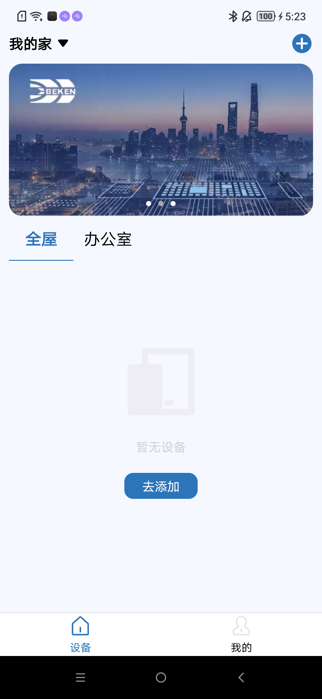](../../../_assets/3cf58ebb7a172b9c1135-add_device_zh.png)
>
> [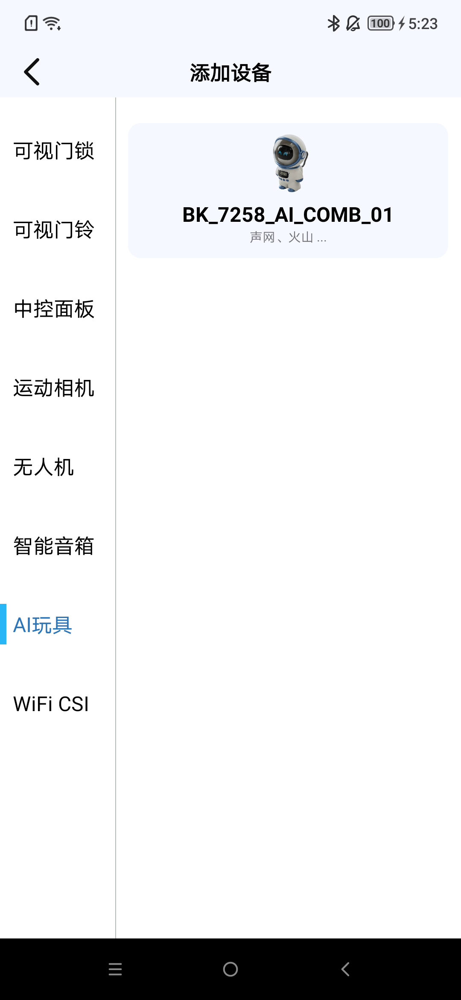](../../../_assets/fc2d47b4c643225cc21d-add_devcie_ai_toy_zh.png)
>
> [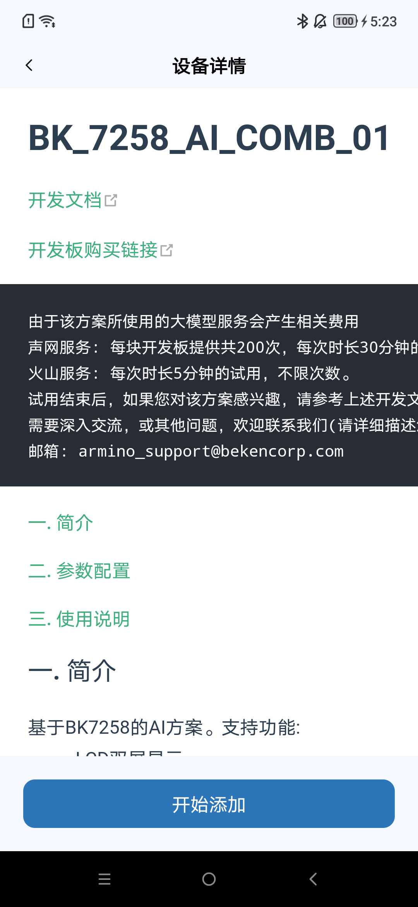](../../../_assets/efd90349ce2824238046-device_info_zh.png)
>
> b)手机开始BLE扫描后，长按下图配网键3s，板子进入配网模式
>
> [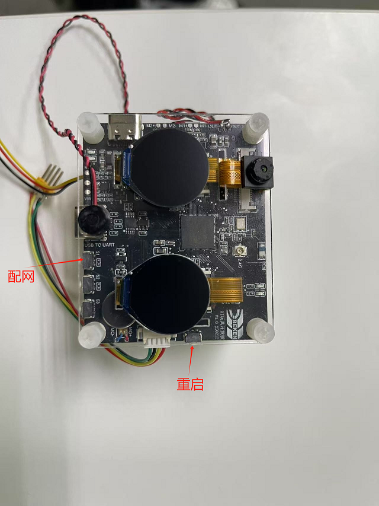](../../../_assets/1f4f598c1464bcbc213a-add_ai_device_8.png)
>
> c)手机端扫到如下设备，点击设备开始配网
>
> [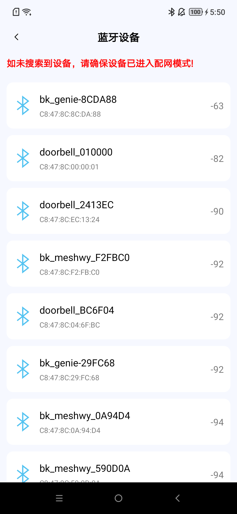](../../../_assets/0849d219b88fe3e1001e-ble_scan_zh.png)
>
> [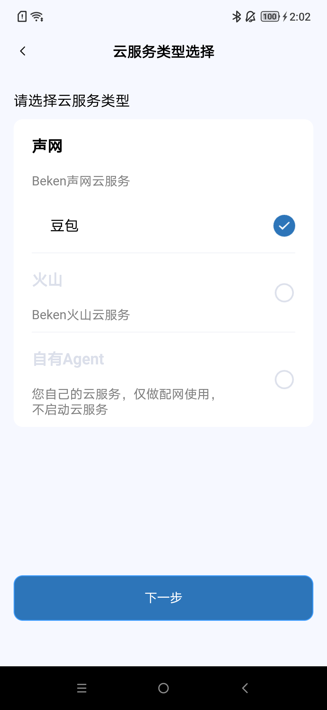](../../../_assets/e5559e20e6345788f297-select_model_zh.png)
>
> [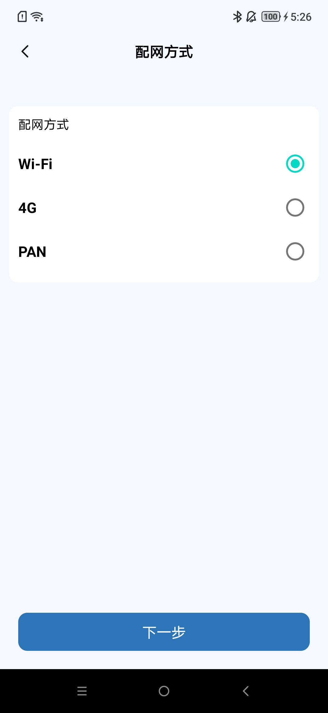](../../../_assets/ee40d7ccc372852bd07f-ai_activate_type_zh.png)
>
> [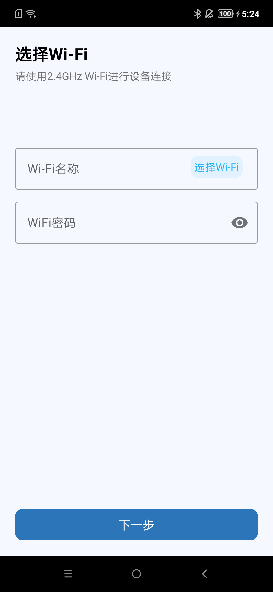](../../../_assets/69233501763476457b4a-wifi_select_zh.png)
>
> [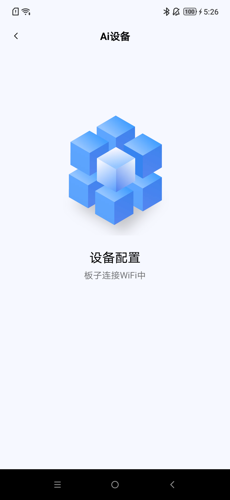](../../../_assets/764ca767c7ac44a85843-activating_zh.png)
>
> [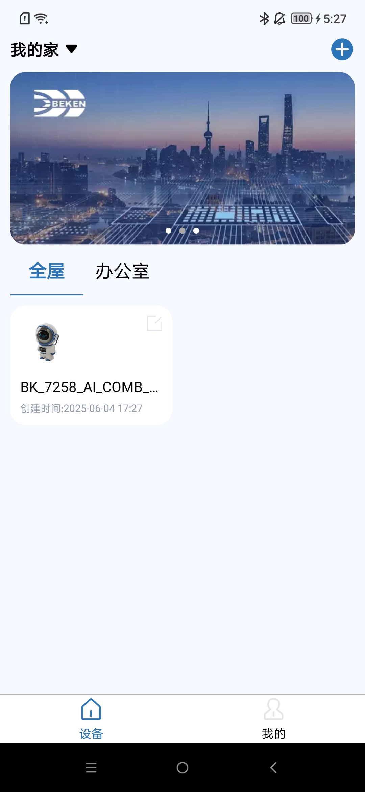](../../../_assets/67c9ffd1096d988d95e5-added_zh.png)
>
> d)对板载mic说唤醒词 `hi armino` 或 `嗨阿米诺`，设备唤醒后会播放提示音 `啊哈` ，然后可以进行AI对话
>
> > 对板载mic说关键词词 `byebye armino` 或 `拜拜阿米诺`，设备检测到后会播放提示音 `byebye` ，然后进入睡眠，停止与AI的对话

<a id="id29"></a>

#### 3.6.2 重新配网

警告

重新配网之前，需要原来的配网的手机上，把设备移除，然后再重复上述章节的操作。

移除设备方法如下：

> a)长按图示区域，会弹出提示框。
>
> [](../../../_assets/67c9ffd1096d988d95e5-added_zh.png)
>
> b)点击确认，完成操作。
>
> [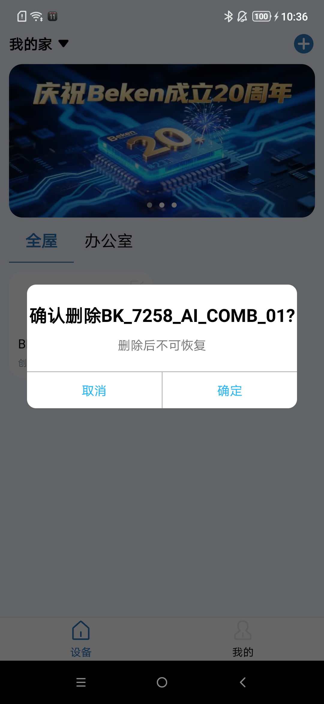](../../../_assets/17acb4c98a9f4b85bfbb-del_zh.png)

备注

更多APP操作，请参考APP文档：

[https://docs.bekencorp.com/arminodoc/bk\_app/app/zh\_CN/v2.0.1/app\_usage/app\_usage\_guide/index.html#ai](../../../bk_toolkit/iotapp/app_usage/app_usage_guide.md#ai)

<a id="id30"></a>

## 4\. 调试命令

警告

调试命令章节，阅读须知：

调试命令，仅适合对代码有一定理解的开发人员使用。

如果对代码和流程不熟悉，建议先按照以下演示步骤，熟悉和理解代码后，再酌情考虑。

<a id="id31"></a>

### 4.1 命令列表:

> |  |  |
> | --- | --- |
> | Command | Description |
> | agora\_test {start\|stop appid video\_en channel\_name} | 语音通话\+识图 |

<a id="start"></a>

### 4.2 Start命令

> |  |  |  |
> | --- | --- | --- |
> | agora\_test | 必填 | 命令 |
> | start | 必填 | 参数，使能连接RTC Channel |
> | appid | 必填 | 参数，声网的APPID |
> | video\_en | 必填 | 参数，识图功能开关:  - 1: `打开` - 0: `关闭` |
> | channel\_name | 必填 | 参数，频道名 |

备注

使用此命令前需要在PC端自行启动AI Agent

- 1、在声网官网注册，并获取以下参数 [Beken声网注册文档](../thirdparty/agora.md#id1)

  > - AGORA\_APPID
  > - AGORA\_RESTFUL\_TOKEN
- 2、根据Agora AI Agent提供的操作手册，启动服务端的AI Agent。

  > a.目前采用PC端启动Agora AI Agent的方式，POST指令请参考声网提供的使用手册 `<bk_aidk源代码路径>/docs/thirdparty/agora_ai_agent`
  >
  > b.也可以参考 [Beken AI Agent启动文档](../thirdparty/agora.md#ai-agent)

<a id="stop"></a>

### 4.2 Stop命令

> |  |  |  |
> | --- | --- | --- |
> | agora\_test | 必填 | 命令 |
> | stop | 必填 | 参数，关闭当前RTC Channel连接 |

<a id="id32"></a>

## 5\. 问题\&回答

Q：应用层没有mic数据上报？

A：目前beken\_genie默认支持基于命令词的语音唤醒功能，只有唤醒后才会上报mic采集的数据应用层，应用层再将数据发送给AI进行对话。如果客户不需要语音唤醒功能，可通过宏 `CONFIG_AUD_INTF_SUPPORT_AI_DIALOG_FREE` 将该功能关闭。

Q：UI资源播放显示异常？

A：本工程中使用的UI资源必须是AVI格式的视频，其分辨率是320x160，且必须经过AVI转换工具转换后才能使用，可先检查一下UI资源是否符合上述要求。

Q：基于USB接口已经适配的4G Cat1模组有哪些？

A：广和通LE270370、合宙Air780E、移远EC-800M、移柯I511

注意：使用移远EC-800M时，适配代码需要有一些额外修改。具体patch可从该链接中获取：<https://armino.bekencorp.com/article/34.html>

Q：使用beken genie如何通过USB接口外接4G模组？

A：请参考 <https://docs.bekencorp.com/arminodoc/bk_idk/bk7258/zh_CN/v_ai_2.0.1/developer-guide/peripheral/bk_modem.html#modem-griver-usage-guide>

Q： 如何确认4G模组已经成功连接？

A：请参考 <https://docs.bekencorp.com/arminodoc/bk_idk/bk7258/zh_CN/v_ai_2.0.1/api-reference/peripheral/bk_modem.html>。成功连接以后可通过ping包验证。
