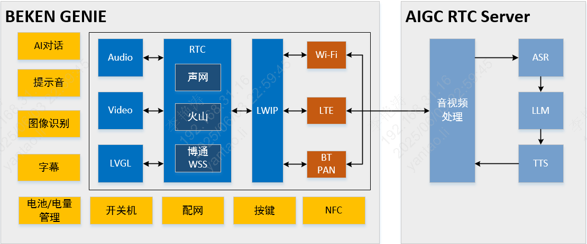
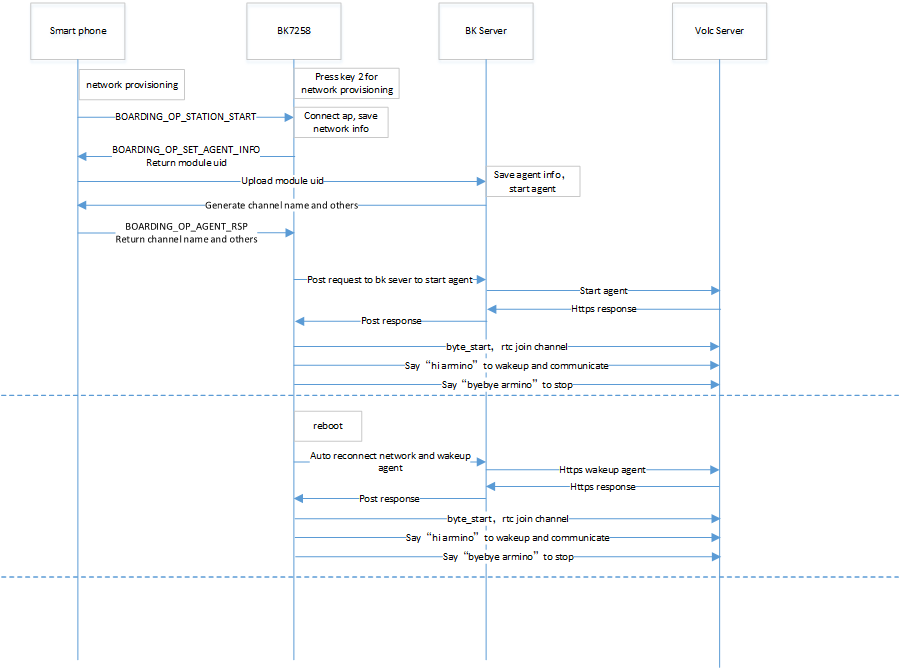

<a id="beken-geniertc"></a>

# Beken Genie火山RTC版本

<a id="id1"></a>

## **1\. 简介**

> - 本工程是基于，端对云，云对大模型的设计方案。
> - 支持双屏显示，提供视觉加语音的陪伴体验和情绪价值。
> - 支持端侧打通，各种通用大模型的设计方案，直接对接Open AI、豆包、DeepSeek等。
> - 并且能够有效，利用云的分布式部署，降低网络延迟，提高交互体验。
> - 支持端侧AEC，NS等音频处理算法，支持G711/G722编码格式，支持KWS关键字打断唤醒，支持提示音播放。
> - 包含常用外设的参考设计以及Demo，比如，陀螺仪，NFC，按键，震动马达，Nand Flash，LED灯效，充电管理，DVP camera，双QPSI屏。
> - **本工程使用火山RTC**

<a id="id2"></a>

### **1.1 硬件原理图**

> - [AI玩具开发板 原理图](../../../_assets/679dec1192d55ced9040-AIDK_AI%E7%8E%A9%E5%85%B7%E5%BC%80%E5%8F%91%E6%9D%BF_%E5%8E%9F%E7%90%86%E5%9B%BE.pdf)
> - [AI玩具开发板\_底层位号图](../../../_assets/d5e457fd28e413bdc045-AIDK_AI%E7%8E%A9%E5%85%B7%E5%BC%80%E5%8F%91%E6%9D%BF_%E5%BA%95%E5%B1%82%E4%BD%8D%E5%8F%B7%E5%9B%BE.pdf)
> - [AI玩具开发板\_顶层位号图](../../../_assets/389af17f4f7b796c9500-AIDK_AI%E7%8E%A9%E5%85%B7%E5%BC%80%E5%8F%91%E6%9D%BF_%E9%A1%B6%E5%B1%82%E4%BD%8D%E5%8F%B7%E5%9B%BE.pdf)

<a id="id5"></a>

### **1.2 规格**

> - 硬件配置：
>   :   - SPI LCD X2 (GC9D01 160x160)
>       - 麦克
>       - 喇叭
>       - SD NAND 128MB
>       - NFC (MFRC522)
>       - 陀螺仪 (SC7A20H)
>       - 充电管理芯片 (ETA3422)
>       - 锂电池
>       - DVP (gc2145)
> - 软件特性：
>   :   - AEC
>       - NS
>       - G722 / G711u
>       - 唤醒词定制
>       - WIFI Station
>       - BLE
>       - BT PAN

<a id="id33"></a>


Figure 1\. Hardware Development Board

<a id="id6"></a>

### **1.3 按键**

开发板下边靠右三个按键，对应丝印S1,S2,S3;右边一个按键K1

开关机
:   - 开机：长按(\>\=3秒) `S2` 开机
    - 关机：当系统处于开机状态时，长按(\>\=3秒) `S2` 关机

配网
:   - 配网：当系统处于开机状态时，长按(\>\=3秒) `S1` 进入等待配网状态

喇叭音量控制
:   - 调大音量：单击 `S1` 按钮调大音量
    - 调小音量：单击 `S3` 按钮调小音量

恢复出厂设置
:   - 恢复出厂设置：长按 `S3` 按钮恢复出厂设置

复位按键K1
:   - 关机状态复位：单击 `K1` 按钮，系统从关机状态开机
    - 开机状态复位：单击 `K1` 按钮，系统从开机状态硬重启

按键功能开发请参考 [火山RTC](../thirdparty/volc.md)

<a id="id7"></a>

### **1.4 灯效**

开发板上边有红绿两个状态指示灯，重要信息红灯闪烁，一般性提示绿灯闪烁，以及特殊性提醒红绿灯交替闪烁。

> 绿灯常亮/长灭提示信息
> :   - 开机时，绿灯长亮，等待用户操作或下一个事件开始
>     - 对话开始，绿灯灭
>
> 红绿灯交替闪烁提示信息
> :   - 用户配网：用户配网
>
> 绿灯闪烁提示信息
> :   - 上电联网中：绿灯快闪
>     - 大模型服务器连接成功：绿灯慢闪
>     - 对话停止：绿灯慢闪
>
> 红灯闪烁提示信息
> :   - 配网失败/网络重连失败：红灯快闪
>     - RTC连接断开：红灯快闪
>     - 大模型服务器连接断开：红灯快闪
>     - 电池电量低于20%：红灯慢闪30秒后自动停止闪烁；如果充电中，则红灯不闪烁
>     - 无重要提醒事件：当无重要提醒事件时，红灯处于关闭状态

灯效开发参考代码led\_blink.c。

<a id="sd-nand"></a>

### **1.5 SD-NAND存储器**

> - SD-NAND存放本地资源文件，比如显示屏上的图片资源文件
> - SD-NAND存储器默认使用FAT32文件系统，供应用程序通过VFS接口间接调用FATFS开源程序接口访问文件
> - PC端，通过USB接口，读写访问开发板SD-NAND文件(开发板左边USB接口)
> - 请注意PC端删除的文件，不要同时被本地应用程序使用，防止系统异常

<a id="gsensor"></a>

### **1.6 陀螺仪-Gsensor**

> - 本地Gsensor支持唤醒系统功能，用户可以S形轨迹晃动开发板，将系统唤醒

<a id="id8"></a>

### **1.7 充电管理**

> - 1.当前开发板使用充电管理芯片型号为 (ETA3422)
> - 2.充电满时，充电口边上的红灯会关闭，绿灯亮；红灯亮表示在充电
> - 3.注意：在充电过程中或者外部电源接入的情况下，系统切换至外部输入电压源进行电压检测，而非使用电池电压，此时用命令获取的电压为外部输入电压。
> - 4.充电状态监测取决于GPIO51和GPIO26。
>   :   - GPIO51负责检测是否为充电状态，GPIO51为高时，存在外部供电输入，反之，则没有。
>       - GPIO26为高时，则表示电池正在充电中。为低时，则表示电池已经充满电。
>       - 注意：该功能需要确认硬件上R14电阻是否已经焊接，如无焊接，需额外焊接。
>       - 具体硬件信息以该项目原理图为准。
> - 5.使能充电管理功能需配置CONFIG\_BAT\_MONITOR\=y，使能充电管理的测试用例需配置CONFIG\_BATTERY\_TEST\=y。
> - 6.配置电池测试命令使能后，可以通过battery命令对电池的信息进行获取。
>   :   - 比如“battery init”可以对电池监控任务进行初始化。
>       - “battery get\_battery\_info”可以查看电池的基本信息。
>       - “battery get\_voltage”可以查看电池当前的电压值。
>       - “battery get\_level”可以查看电池当前的电量。
>       - 如上命令使用时，需注意是否为外部电源供电情况下，否则检测电压信息为外部供电电压。
>       - 具体其他命令，可以只发送“battery”，打印相关命令支持。更进一步信息，可参考cli\_battery.c中的定义。
> - 7.当电量等于或小于20%时，会发送低电量告警事件。
>   :   - 只有不插电的时候会触发，外部供电或者充电时，不会发送低电量告警。
>       - 每次进入低电量状态时，只会发送一次。
>       - 此时，另一侧的红灯慢闪30s。
> - 8.充电管理任务在充电时，会打印“Device is charging…”信息。
> - 9.在充满电时，会打印“Battery is full.”信息。
> - 10.尽管电池存在低压保护功能，但建议用户在低电量的时候及时充电，可延长电池的寿命。
> - 11.用户如果使用其他厂家的电池，需要根据具体电池的信息修改电量插值表s\_chargeLUT以及iot\_battery\_open中电池基本信息的内容。
> - 12.在我们的SDK中，我们提供了电流、电压和电量的API函数。目前，电池仅支持电压和电量的检测功能。需要注意的是，电流检测的API接口虽然已保留，但目前尚未实现，因此如果用户的设备支持电流检测，需要自行对电流的API进行实现。
> - 13.由于目前硬件仅支持非充电状态下的电量检测，若用户需要充电期间检测电压，硬件上需要进行改造。去除D6二极管和R21电阻即可。
> - 14 按键旁边的USB口既是充电口又是串口。
> - 15.电量采样的ADC接口为芯片内部的ADC0，外部不需要接电阻分压电路再加ADC通道采集。ADC0与VBAT监控通道直连，该接口为芯片内部专用接口，没有外部连线。
> - 16.注意：电池最高检测电压为4.35V。高于该电压存在烧坏系统的风险。

<a id="id9"></a>

### **1.8 唤醒词**

> 1. `hi armino` 或 `嗨阿米诺` 用于唤醒，本地端侧和云端AI互动，同时LCD亮起，展示眼睛动画。
>
>    > 响应词为 `A Ha`
> 2. `byebye armino` 或 `拜拜阿米诺` 用于关闭，本地端侧和云端AI互动，同时关闭LCD，眼睛动画不再展示。
>
>    > 响应词为 `Byebye`

<a id="id10"></a>

### **1.9 马达**

> - 1.LDO连接马达的正极，PWM连接马达的负极，通过调节PWM的占空比来控制马达的振动强度。
> - 2.通过长按按键开机时，马达会振动。
> - 3.PWM详细使用例程见cli\_pwm.c。

<a id="id11"></a>

### **1.10 提示音**

开发板工作过程中会根据事件播放对应提示音，事件对应的提示音内容如下：

> 蓝牙配网：
> :   - 开始蓝牙配网： `请使用蓝牙配网`
>     - 蓝牙配网： `蓝牙配网失败，请重新配网。`
>     - 蓝牙配网成功： `蓝牙配网成功`
>
> 连网
> :   - 连网中： `网络连接中，请稍后。`
>     - 连网失败： `网络连接失败，请检查网络。`
>     - 连网成功： `网络连接成功`
>
> 唤醒和关闭
> :   - 唤醒： `A Ha`
>     - 关闭： `Byebye`
>
> AI智能体
> :   - AI智能体连接成功： `AI智能体已连接`
>     - AI智能体断开连接： `AI智能体已断开`
>
> 设备断连
> :   - 设备断开连接： `设备断开连接`
>
> 电池电量
> :   - 电池低电量： `电池电量低，请充电。`
>
> 请参考文档：[音频组件开发指南](../api-reference/bk_aud_intf.md)
> 默认提示音文件资源路径： `/projects/common_componets/resource/`

<a id="id12"></a>

### **1.11 倒计时**

> - 配网事件倒计时为五分钟，五分钟未配网，则芯片会进入深度睡眠(类似于关机)。
> - 网络错误倒计时为五分钟，若发生网络错误，五分钟内网络未恢复，则芯片会进入深度睡眠。
> - 待机状态倒计时为三分钟，系统上电后默认状态为待机状态，当您喊 `byebye armino` 或 `拜拜阿米诺` 之后，系统也会处于待机状态，若无其他事件发生，三分钟后芯片会进入深度睡眠。
> - 您可以在countdown\_app.c的s\_ticket\_durations\[COUNTDOWN\_TICKET\_MAX\]数组里修改倒计时时间。

<a id="rtc"></a>

### **1.12 火山RTC**

火山RTC，参考文档 [火山RTC](../thirdparty/volc.md)

<a id="id13"></a>

## **2\. 工程使用介绍**

<a id="id14"></a>

### **2.1 代码下载及编译**

> - [AIDK 代码下载](../get-started.md#armino-aidk-sdk)
> - [SDK 构建环境搭建](../../../bk_idk/BK7258/get-started.md)
> - 代码编译: `make bk7258 PROJECT=volc_rtc`
>
>   > - 在源代码根目录下编译
>   > - 工程目录位于 `<source code>/project/volc_rtc`

<a id="app"></a>

### **2.2 APP注册和下载**

> APP下载：[https://docs.bekencorp.com/arminodoc/bk\_app/app/zh\_CN/v2.0.1/app\_download/index.html](../../../bk_toolkit/iotapp/app_download.md)
>
> 注册登录：使用邮箱注册登录

<a id="id15"></a>

### **2.3 固件烧录和资源文件烧录**

<a id="id16"></a>

#### 2.3.1 烧录固件

烧录固件可请参考如下文档 [固件烧录](../../../bk_idk/BK7258/get-started.md)

备注

烧录的二进制文件位于 `<source code>/build/volc_rtc/bk7258/all-app.bin`

<a id="id18"></a>

#### 2.3.2 拷贝资源文件

将 `<source code>/project/common_components/resource` 目录音视频文件拷贝到AIDK开发版的SD NAND中。
SD NAND具体使用方法可参考 [Nand磁盘使用注意事项](../api-reference/nand_disk_note.md)

<a id="id19"></a>

#### 2.3.3 上电

烧录编译好的all-app.bin文件并上电执行即可。

<a id="id20"></a>

### **2.4 配网**

<a id="id21"></a>

#### 2.4.1 首次配网

> a)手机进入如下界面，按照图片步骤操作
>
> [](../../../_assets/3cf58ebb7a172b9c1135-add_device_zh.png)
>
> [](../../../_assets/fc2d47b4c643225cc21d-add_devcie_ai_toy_zh.png)
>
> [](../../../_assets/efd90349ce2824238046-device_info_zh.png)
>
> b)手机开始BLE扫描后，长按下图配网键3s，板子进入配网模式
>
> [](../../../_assets/1f4f598c1464bcbc213a-add_ai_device_8.png)
>
> c)手机端扫到如下设备，点击设备开始配网
>
> [](../../../_assets/0849d219b88fe3e1001e-ble_scan_zh.png)
>
> [](../../../_assets/e5559e20e6345788f297-select_model_zh.png)
>
> [](../../../_assets/ee40d7ccc372852bd07f-ai_activate_type_zh.png)
>
> [](../../../_assets/69233501763476457b4a-wifi_select_zh.png)
>
> [](../../../_assets/764ca767c7ac44a85843-activating_zh.png)
>
> [](../../../_assets/67c9ffd1096d988d95e5-added_zh.png)

<a id="id22"></a>

#### 2.4.1 重新配网

警告

重新配网之前，需要原来的配网的手机上，把设备移除，然后再重复上述章节的操作。

移除设备方法如下：

> a)长按图示区域，会弹出提示框。
>
> [](../../../_assets/67c9ffd1096d988d95e5-added_zh.png)
>
> b)点击确认，完成操作。
>
> [](../../../_assets/17acb4c98a9f4b85bfbb-del_zh.png)

备注

更多APP操作，请参考APP文档：

[https://docs.bekencorp.com/arminodoc/bk\_app/app/zh\_CN/v2.0.1/app\_usage/app\_usage\_guide/index.html#ai](../../../bk_toolkit/iotapp/app_usage/app_usage_guide.md#ai)

<a id="id23"></a>

### **2.5 AI对话**

对板载mic说唤醒词 `hi armino` 或 `嗨阿米诺`，设备唤醒后会播放提示音 `啊哈` ，然后可以进行AI对话

对板载mic说关键词词 `byebye armino` 或 `拜拜阿米诺`，设备检测到后会播放提示音 `byebye` ，然后进入睡眠，停止与AI的对话

<a id="id24"></a>

## **3\. 开发指南**

<a id="id25"></a>

### **3.1 模块架构图**

此AI demo方案和门锁方案类似，设备端和和AI大模型端双向语音通话，同时设备端向AI大模型端单向图传，门锁方案中的对端apk变为了AI Agent机器人。
软件模块架构如下图所示：

<a id="id34"></a>



Figure 3\. software module architecture

> - 方案中，设备端采集mic语音，通过火山RTC SDK将语音数据发送至服务器，服务器负责和AI Agent大模型的交互，将mic语音发送至AI Agent并获取回复，再将语音回复发送至设备端喇叭播放。
> - 方案中，设备端采集图像，通过火山RTC SDK将每帧图像发送至服务器，服务器再将图像送至AI Agent大模型进行识别。

<a id="id26"></a>

### **3.2 配网及对话时序图**

<a id="id35"></a>



Figure 4\. Operation Flow Sequence

<a id="id27"></a>

### **3.3 工作状态机**

<a id="id36"></a>


Figure 5\. module state diagram

```
1/2 Green light stays on.
3/4 Green and red lights flash alternately
5/6 Green light flashes quickly.
7 Green light flashes quickly.
8 LCD on, LED off.
9 LCD off
12/13 Red light flashes quickly
```

<a id="id28"></a>

### **3.4 主要配置**

> 打开火山RTC功能库需要在 `cpu0` 上打开以下配置:
>
> |  |  |  |  |
> | --- | --- | --- | --- |
> | Kconfig | CPU | Format | Value |
> | CONFIG\_VOLC\_RTC\_EN | CPU0 | bool | y |
>
> 打开Beken配网及agent启动需要在 `cpu0` 上打开以下配置:
>
> |  |  |  |  |
> | --- | --- | --- | --- |
> | Kconfig | CPU | Format | Value |
> | CONFIG\_BK\_SMART\_CONFIG | CPU0 | bool | y |
>
> 打开双屏显示及AVI播放需要打开以下配置:
>
> |  |  |  |  |
> | --- | --- | --- | --- |
> | Kconfig | CPU | Format | Value |
> | CONFIG\_LCD\_SPI\_GC9D01 | CPU1 | bool | y |
> | CONFIG\_LCD\_SPI\_DEVICE\_NUM | CPU1 | int | 2 |
> | CONFIG\_AVI\_PLAY | CPU1 | bool | y |
> | CONFIG\_DUAL\_SCREEN\_AVI\_PLAY | CPU0 \& CPU1 | bool | y |
> | CONFIG\_LVGL | CPU1 | bool | y |
> | CONFIG\_LV\_IMG\_UTILITY\_CUSTOMIZE | CPU1 | bool | y |
> | CONFIG\_LV\_COLOR\_DEPTH | CPU1 | int | 16 |
> | CONFIG\_LV\_COLOR\_16\_SWAP | CPU1 | bool | y |

<a id="id29"></a>

### **3.5 按键开发说明**

GPIO按键使用说明
:   - 按键功能配置，参考 `/projects/common_components/bk_key_app/key_app_config.h` 和 `key_app_service.c`，开发者在该表中填写对应的IO管脚和按键对应的回调函数事件即可
    - 长按键时长配置参考multi\_button.h中的LONG\_TICKS宏定义
    - 当前所有的按键事件转到任务中执行，如果按键事件执行程序被阻塞或执行时间过长，会影响按键响应速度

GPIO按键注意事项
:   - 请确认GPIO管脚只供按键使用，否则同一个GPIO管脚功能冲突，会引起按键无效问题
    - 如果开发者开发板与beken\_genie开发板不同，请根据开发板硬件设计重新配置GPIO。关于GPIO使用方法，请参考 `bk_avdk/bk_idk/docs/bk7258/zh_CN/api-reference/peripheral/bk_gpio.rst`

<a id="bleagent"></a>

### **3.6 BLE配网及agent定制指南**

BLE配网及agent相关代码主要分布在 `/projects/common_components/bk_boarding_service` 目录及 `/projects/common_components/bk_smart_config` 目录，客户可以参考如下说明定制自己的方案

核心代码如下：
:   - 进入BLE配网模式，请参考 `bk_sconf_prepare_for_smart_config(void)` 实现
    - 手机app通过BLE交互配网信息，参考代码 `bk_genie_message_handle(void)`
    - 将Agent配置参数发送给手机app，参考代码 `bk_sconf_send_agent_info(char *payload, uint16_t max_len)`
    - 解析服务器启动Agent参数，参考代码 `bk_sconf_prase_agent_info(char *payload, uint8_t reset)`
    - 启动Agent和RTC，参考代码 `bk_sconf_wakeup_agent(uint8_t reset)`
    - wifi连上后启动agent、保存wifi及agent信息及配网，参考代码 `bk_sconf_netif_event_cb`
    - 保持（存flash）/擦除/获取Agent信息相关函数接口， `bk_sconf_erase_agent_info` `bk_sconf_save_agent_info` `bk_sconf_get_agent_info`
    - 按键切换多模态，参考代码 `ir_mode_switch_main`
    - 启动火山agent及设备端rtc，参考代码 `bk_sconf_start_volc_rtc`, reset参数用来通知beken服务器是否强制切回初始agent配置

<a id="id30"></a>

### **3.7 火山相关功能开发**

火山相关功能开发请参考 [火山RTC功能](../thirdparty/volc.md#id6)

<a id="id32"></a>

## 4\. 问题\&回答

Q：应用层没有mic数据上报？
A：目前beken\_genie默认支持基于命令词的语音唤醒功能，只有唤醒后才会上报mic采集的数据应用层，应用层再将数据发送给AI进行对话。如果客户不需要语音唤醒功能，可通过宏 `CONFIG_AUD_INTF_SUPPORT_AI_DIALOG_FREE` 将该功能关闭。

Q：UI资源播放显示异常？
A：本工程中使用的UI资源必须是AVI格式的视频，其分辨率是320x160，且必须经过AVI转换工具转换后才能使用，可先检查一下UI资源是否符合上述要求。
