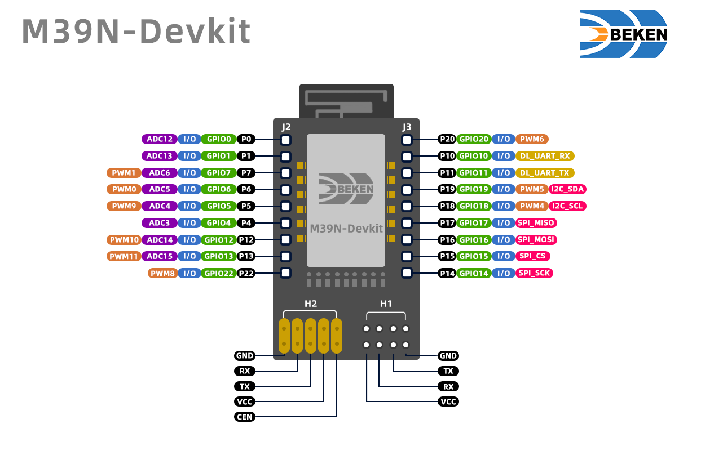

# 2\. 平台与硬件

## 芯片支持列表

| 芯片系列 | 主要特性 | 状态 |
| --- | --- | --- |
| BK7239N | Wi-Fi 6 (2.4G\+5G), BLE 6.0, IEEE 802.15.4, Arm®v8-M STAR-MC1 core at up to 240 MHz | 已支持 |

## 芯片数据手册

| 芯片 | 数据手册 |
| --- | --- |
| BK7239N | [BK7239N 数据手册](https://docs.bekencorp.com/_static/BK7239_Datasheet.pdf) |
| M39N | [M39N 数据手册](https://docs.bekencorp.com/_static/M39N_Datasheet.pdf) |

## 外设支持列表

| 外设 | BK7239N |
| --- | --- |
| GPIO | ✅ |
| ADC | ✅ |
| PWM | ✅ |
| UART | ✅ |
| I2C | ✅ |
| SPI | ✅ |
| Timer | ✅ |
| Wi-Fi | ✅ |
| BLE | ✅ |

- `✅`: 通过 Arduino Core 支持
- `❌`: 尚未通过 Arduino Core 支持
- `➖`: SoC 上不可用

## 模块/开发套件硬件介绍

### M39N

M39N 模组围绕高度集成的 BK7239N 无线 SoC 构建，专为下一代多协议 AIoT 应用而设计。

#### 模组照片

> **注意:** 由于上电毛刺的影响，以下 I/O 引脚不推荐用于对上电波动敏感的应用，例如 LED 或电机控制：GPIO0、GPIO1、GPIO10 和 GPIO11。

#### 引脚定义

**J2**

| 引脚编号 | 名称 | 输入/输出 | 类型 | 描述 |
| --- | --- | --- | --- | --- |
| 1 | P0 | I/O | 数字/模拟 | \- GPIO0: 通用输入/输出 \- ADC12: 模拟输入通道 |
| 2 | P1 | I/O | 数字/模拟 | \- GPIO1: 通用输入/输出 \- ADC13: 模拟输入通道 |
| 3 | P7 | I/O | 数字/模拟 | \- GPIO7: 通用输入/输出 \- ADC6: 模拟输入通道 \- PWM1: PWM 通道 1 |
| 4 | P6 | I/O | 数字/模拟 | \- GPIO6: 通用输入/输出 \- ADC5: 模拟输入通道 \- PWM0: PWM 通道 0 |
| 5 | P5 | I/O | 数字/模拟 | \- GPIO5: 通用输入/输出 \- ADC4: 模拟输入通道 \- PWM9: PWM 通道 9 |
| 6 | P4 | I/O | 数字/模拟 | \- GPIO4: 通用输入/输出 \- ADC3: 模拟输入通道 |
| 7 | P12 | I/O | 数字/模拟 | \- GPIO12: 通用输入/输出 \- ADC14: 模拟输入通道 \- PWM10: PWM 通道 10 |
| 8 | P13 | I/O | 数字/模拟 | \- GPIO13: 通用输入/输出 \- ADC15: 模拟输入通道 \- PWM11: PWM 通道 11 |
| 9 | P22 | I/O | 数字 | \- GPIO22: 通用输入/输出 \- PWM8: PWM 通道 8 |

**J3**

| 引脚编号 | 名称 | 输入/输出 | 类型 | 描述 |
| --- | --- | --- | --- | --- |
| 1 | P20 | I/O | 数字 | \- GPIO20: 通用输入/输出 \- PWM6: PWM 通道 6 |
| 2 | P10 | I/O | 数字 | \- GPIO10: 通用输入/输出 \- DL\_UART\_RX: UART 下载接收数据输入 |
| 3 | P11 | I/O | 数字 | \- GPIO11: 通用输入/输出 \- DL\_UART\_TX: UART 下载发送数据输出 |
| 4 | P19 | I/O | 数字 | \- GPIO19: 通用输入/输出 \- I2C\_SDA: I2C 数据线 \- PWM5: PWM 通道 5 |
| 5 | P18 | I/O | 数字 | \- GPIO18: 通用输入/输出 \- I2C\_SCL: I2C 时钟线 \- PWM4: PWM 通道 4 |
| 6 | P17 | I/O | 数字 | \- GPIO17: 通用输入/输出 \- SPI\_MISO: SPI 主入从出 |
| 7 | P16 | I/O | 数字 | \- GPIO16: 通用输入/输出 \- SPI\_MOSI: SPI 主出从入 |
| 8 | P15 | I/O | 数字 | \- GPIO15: 通用输入/输出 \- SPI\_CS: SPI 片选 |
| 9 | P14 | I/O | 数字 | \- GPIO14: 通用输入/输出 \- SPI\_SCK: SPI 串行时钟 |

**H2**

| 引脚编号 | 名称 | 输入/输出 | 类型 | 描述 |
| --- | --- | --- | --- | --- |
| 1 | GND | \- | GND | 地线 |
| 2 | RX | I/O | 数字 | DL\_UART\_RX: UART下载接收数据输入 |
| 3 | TX | I/O | 数字 | DL\_UART\_TX: UART下载发送数据输出 |
| 4 | VCC | \- | 电源 | 模块供电 |
| 5 | CEN | \- | 模拟输入 | 芯片使能，高电平有效 |

**H1**

| 引脚编号 | 名称 | 输入/输出 | 类型 | 描述 |
| --- | --- | --- | --- | --- |
| 1 | GND | \- | GND | 地线 |
| 2 | RX | I/O | 数字 | DL\_UART\_RX: UART下载接收数据输入 |
| 3 | TX | I/O | 数字 | DL\_UART\_TX: UART下载发送数据输出 |
| 4 | VCC | \- | 电源 | 模块供电 |

> **注:** H1 与 H2 是互通的，只是为了适配不同的板子而采用了不同的接口形式。
