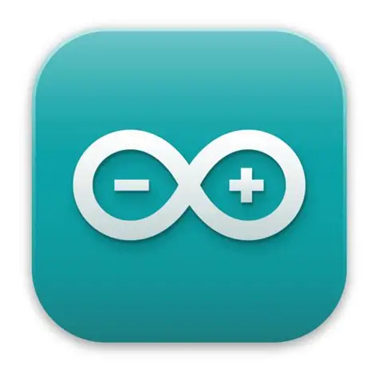
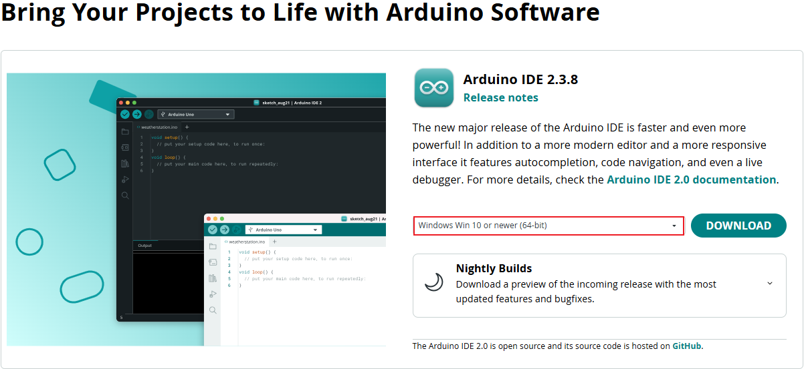
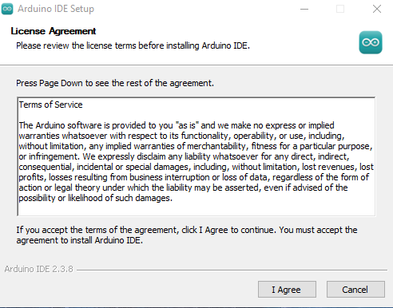
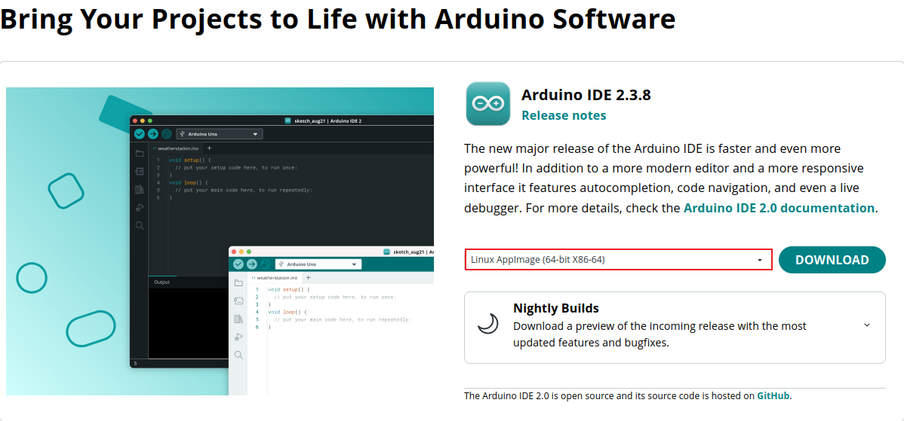
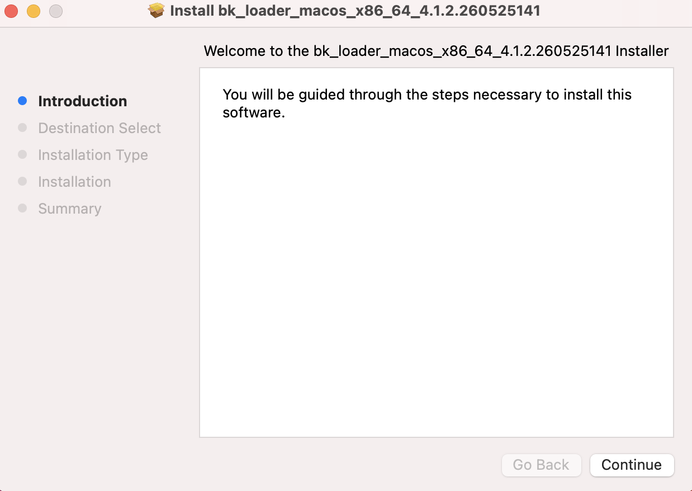
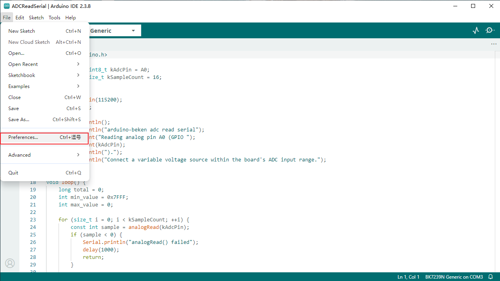
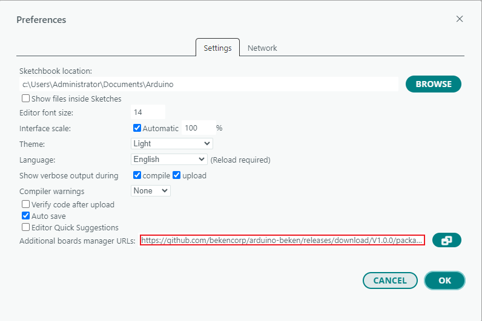
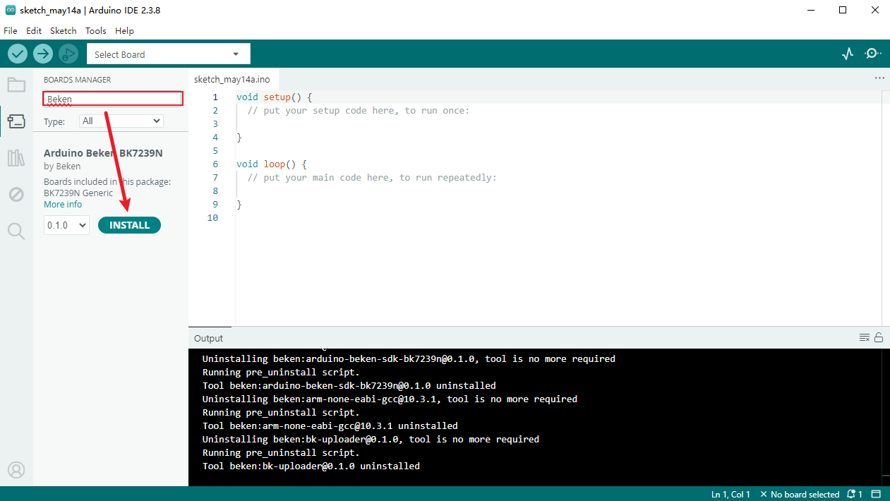

<a id="id1"></a>

# 4\. 环境搭建

本章介绍如何搭建 Beken Arduino 的开发环境，包括 Arduino IDE 安装、平台准备和验证。

<a id="id2"></a>

## 支持的操作系统

Beken Arduino 开发环境支持以下操作系统：

| 操作系统 | 版本 | 状态 |
| --- | --- | --- |
| Windows | 10/11 | ✅ 支持 |
| Linux | Ubuntu 20.04\+ LTS, Debian 11\+ | ✅ 支持 |
| macOS | 11.5\+ | ✅ 支持 |

<a id="python"></a>

## 1\. 安装 Python 环境

[](../../../_assets/76d2a2a58b6eba38f547-python_icon.png)

编译 Beken Arduino 代码需要 Python 环境。

<a id="windows"></a>

### Windows

1. 从 [官方网站](https://www.python.org/downloads/windows/) 下载 Python
2. 运行安装程序，确保勾选 **“Add Python to PATH”**
3. 打开命令提示符验证安装：

   ```
   python --version
   ```

<a id="linux"></a>

### Linux

Python 3 通常已预装。验证版本：

```
python3 --version
```

Debian/Ubuntu 系统：

```
sudo apt update
sudo apt install python3 python3-pip
```

<a id="macos"></a>

### macOS

我们建议通过 Homebrew 安装 Python，因为后续我们需要使用 Homebrew 安装 zstd：

```
/bin/bash -c "$(curl -fsSL https://raw.githubusercontent.com/Homebrew/install/HEAD/install.sh)"
brew install python3
```

验证安装：

```
python3 --version
```

<a id="arduino-ide"></a>

## 2\. 安装 Arduino IDE

[](../../../_assets/999c0139ddbf1b1bc637-arduino_icon.png)

<a id="id3"></a>

### Windows

1. 从 [官方网站](https://www.arduino.cc/en/software) 下载 Arduino IDE

[](../../../_assets/bcdb3ca22fd54893c0ad-arduino_windows.png)

2. 运行安装程序并按照向导操作
3. 安装完成后启动 Arduino IDE

[](../../../_assets/2d58404782501814bd07-en_arduino_ide_windows.png)

<a id="id4"></a>

### Linux

1. 从 [官方网站](https://www.arduino.cc/en/software) 下载 AppImage

[](../../../_assets/4b1b9603c1ffe65375ec-arduino_ide_linux.png)

2. 使 AppImage 可执行：

```
chmod +x arduino-ide_*.AppImage
```

3. 直接运行 AppImage 或集成到系统中

   - 如果 AppImage 报告缺少依赖，请按照提示安装

<a id="id5"></a>

### macOS

**重要：需要手动安装 bk\_uploader 和 zstd**

在 macOS 上使用 Arduino IDE 配合 Beken 开发板之前，您需要先手动安装 bk\_uploader：

- 适用于 Intel 芯片 Mac (x86\_64): [下载适用于 Intel Mac 的 bk\_uploader](https://dl.bekencorp.com/tools/bkfil/v4/cli/macos/bk_loader_macos_x86_64_4.1.2.260525141.pkg)
- 适用于 Apple Silicon 芯片 Mac (arm64): [下载适用于 Apple Silicon 的 bk\_uploader](https://dl.bekencorp.com/tools/bkfil/v4/cli/macos/bk_loader_macos_arm64_4.1.2.260525141.pkg)

[](../../../_assets/3a9c8ad0c47473df4ad9-install_guide.png)

在安装过程中，请选择默认配置选项。

安装完 bk\_uploader 后，工具链需要通过 Homebrew 安装 zstd：

```
brew install zstd
```

然后：

1. 从 [官方网站](https://www.arduino.cc/en/software) 下载 Arduino IDE
2. 解压下载的文件并将 Arduino IDE 移动到应用程序文件夹
3. 启动 Arduino IDE

<a id="beken-bsp"></a>

## 3\. 安装 Beken 开发板支持包 (BSP)

<a id="boards-manager"></a>

### 使用 Boards Manager（推荐）

1. **打开首选项**：

   - 点击 **File \> Preferences**

     [](../../../_assets/4e197d6ccb6252de8813-file-preference.png)
2. **添加 Beken 开发板 URL**：

   [](../../../_assets/0c824967594a33d2dcfb-url_github.png)

   - 在 **Preferences** 窗口中，找到 **Additional Boards Manager URLs** 字段
   - 点击 **\+** 按钮添加新 URL
   - 粘贴以下 URL：

     ```
     https://github.com/bekencorp/arduino-beken/releases/download/V1.0.0/package_beken_bk7239n_index.json
     ```
   - 点击 **OK** 保存
3. **安装 Beken 开发板包**：

   - 点击 **Tools \> Board \> Boards Manager**
   - 在搜索栏中搜索 “Beken”
   - 点击 **Install** 安装 “BK7239N” 包

     [](../../../_assets/3a44ff6be0b0fb74f6c0-board_import.png)
4. **选择开发板**：

   - 安装完成后，点击 **Tools \> Board \> Beken**
   - 从列表中选择 BK7239N

<a id="id6"></a>

## 4\. 验证安装

1. 通过 USB 将 Beken 开发板连接到电脑
2. 创建新的代码文件，输入以下代码：

   ```
   // setup 函数在按下复位按钮或给开发板供电时运行一次
   void setup() {
     // 将数字引脚 LED_BUILTIN 初始化为输出
     pinMode(LED_BUILTIN, OUTPUT);
   }

   // loop 函数会一遍又一遍地永远运行
   void loop() {
     digitalWrite(LED_BUILTIN, HIGH);   // 点亮 LED（HIGH 是电压级别）
     delay(1000);                       // 等待一秒
     digitalWrite(LED_BUILTIN, LOW);    // 通过将电压设为低电平关闭 LED
     delay(1000);                       // 等待一秒
   }
   ```
3. 从 **Tools \> Board \> Beken** 选择开发板
4. 从 **Tools \> Port** 选择正确的端口
5. 点击上传按钮 (▶️)
6. 您应该能看到开发板上的板载 LED 在闪烁

<a id="id7"></a>

## 示例程序

示例程序集是了解当前 Arduino 层在硬件上实际功能的最快方式。

<a id="id8"></a>

### 完整示例清单

- `ADCReadSerial`
- `BLEAdvertise`
- `BLEWriteTest`
- `Blink`
- `GPIOInterrupt`
- `HardwareTimer`
- `MultiInoBlink`
- `MultiSourceBlink`
- `PWMFade`
- `SPILoopback`
- `SerialEcho`
- `TickerBlink`
- `WiFiConnect`
- `WiFiScan`
- `WireMaster`
- `WireScanner`
- `WireSlave`

<a id="id9"></a>

### 将示例作为验证层阅读

示例不仅是演示，也是分层验证集：

- 启动示例：`Blink`, `SerialEcho`
- 连接示例：`WiFiScan`, `WiFiConnect`, `BLEAdvertise`
- 总线示例：`WireScanner`, `SPILoopback`
- 外设示例：`ADCReadSerial`, `PWMFade`, `HardwareTimer`, `DACSineWave`
- 构建形态示例：`MultiInoBlink`, `MultiSourceBlink`

<a id="id10"></a>

### 建议的验证顺序

对于新平台验证运行：

1. `Blink`
2. `SerialEcho`
3. `WiFiScan`
4. `WireScanner`

然后运行外设特定示例，如 `ADCReadSerial`、`PWMFade` 或 `HardwareTimer`。

<a id="id11"></a>

### 示例特定注意事项

- 大多数示例以 `115200` 波特率打印状态。
- `SPILoopback` 需要将 `MOSI` 连接到 `MISO`。
- `ADCReadSerial` 依赖于变体模拟引脚映射。
