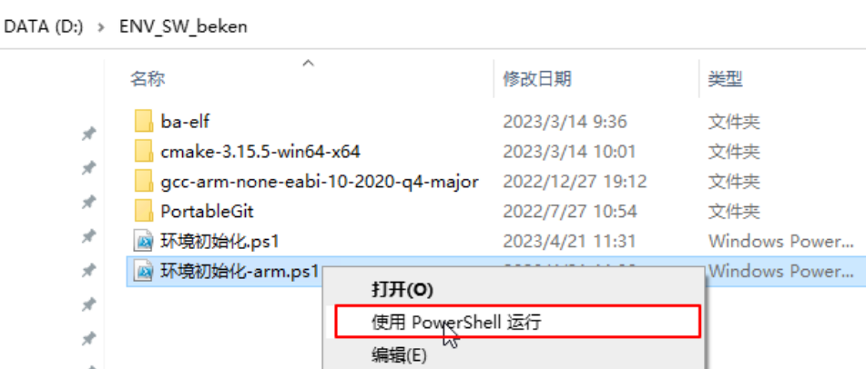
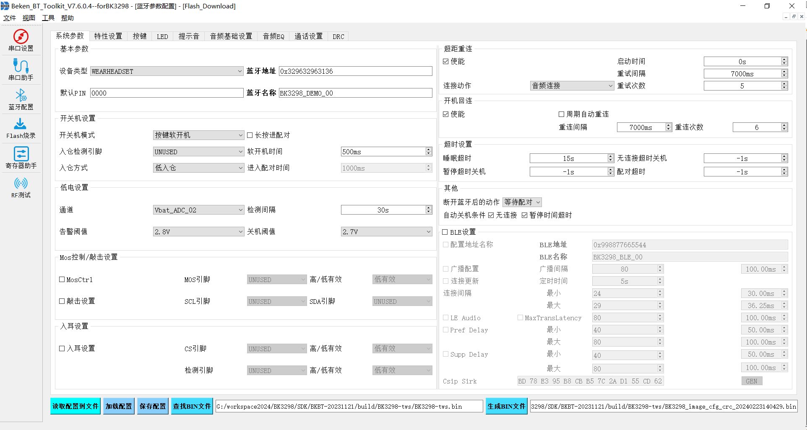
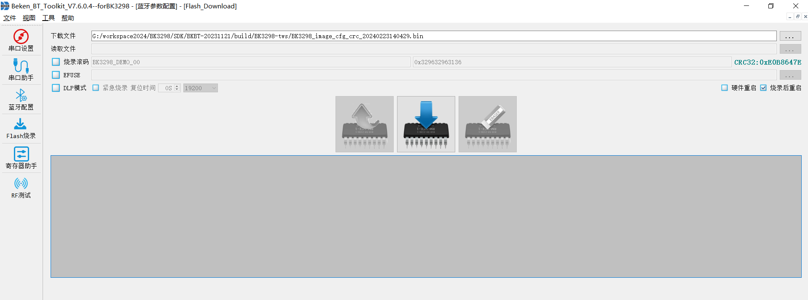
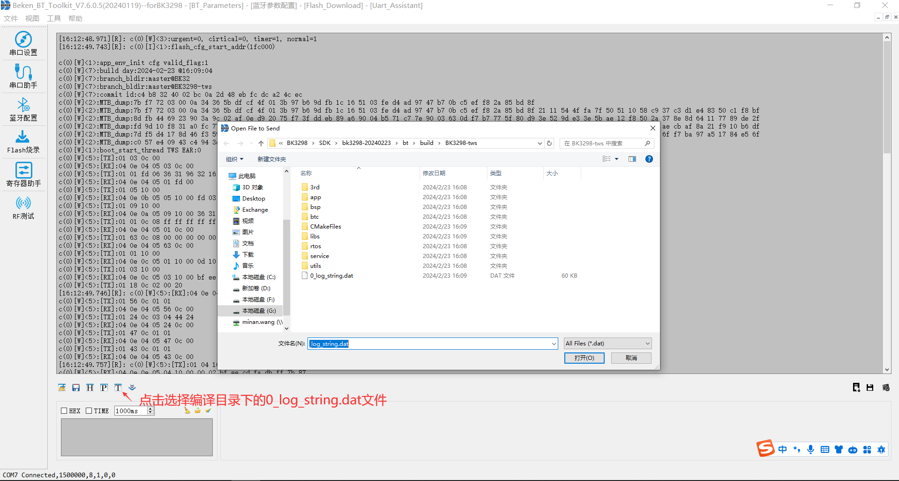

# 快速入门

本文档以 BK3298 开发板为例，通过一个简单的示例项目向您展示

> - 如何安装编译环境；
> - 如何编译、下载固件；

## 准备工作

硬件：

> - BK3298 开发板
> - 串口烧录工具
> - 电脑（Windows 或 Ubuntu）

备注

BK3298 SDK支持windows和Linux平台编译，仅支持在 Windows 平台进行固件烧录。

软件：

> - GCC ARM工具链：gcc-arm-none-eabi-10-2020-q4-major；
> - cmake-3.24.4-windows-x86\_64；
> - 安装python,推荐安装3.x的版本；
> - 安装Git；
> - BK3298源代码；
> - PC上位机串口烧录配置工具；

## BK3298代码下载

您可从 (待填写) 上下载 BK3298 SDK:

> 地址待填写

备注

从官网的（待填写）下载的为最近的SDK代码，相关账号找项目上审核申请。

## BK3298编译工具链下载

您可从 (待填写) 上下载编译工具链:

> 地址待填写

## 工具链安装

BK3298当前支持windows环境下编译，本章节将windows下编译为例，介绍整个编译环境的搭建。
将整个工具包下载到d盘的某个目录(需要该目录路径没有空格字符)，推荐放d盘根目录，然后在工具包路径下右击 环境初始化-arm.ps1 ,选使用Powershell允许即可。
以上是基于电脑已经安装了git的情况下，如果电脑没有安装git，请先安装git。

## 编译工程

在git bash中，进入SDK目录下的build目录的子目录中，命名规则是SOC-产品名字，比如以3298作为tws产品来说，目录就是BK3298-tws,
然后直接在该目录输入make即可。
编译成功在当前目录下会生成BK3298-tws.bin文件。

## 烧录代码

在 Windows 平台上， BK3298 目前支持 UART 烧录。

### 通过串口烧录

串口烧录工具如下图所示:

UART

配置烧录工具获取：

> 地址待填写
> 在此目录下获取最新版本（版本不小于7.6.0.4），如：BK\_BT\_Toolkit\_V7.6.0.4\_F.exe

BK\_BT\_Toolkit 界面及相关配置如下图所示：

配置界面

烧录界面

选择配置工具左侧的 蓝牙配置 栏目，假设您已经配置好了各个选项，如果不清楚配置选项的，请参考配置工具自带的帮助文档。
点击 查找BIN文件 ，选择上一步编译出来的BK3298-tws.bin文件，然后点击 生成BIN文件 生成带CRC的烧录文件。
切换到左侧 Flash烧录 栏目，下载文件路径自动选择的是刚刚生成的crc文件，从串口设置中选择正确的串口号，
点击烧录图标，给开发板重新上电即开始烧录。烧录过程有进度指示，烧录完成之后掉电重启设备。

## 串口Log

- 目前BK298平台，串口Log在UART0口也是下载口，默认波特率为1.5M。
- 需要使用Beken\_BT\_Toolkit配置工具自带的串口助手才能查看，同时需要先导入编译工程目录下的0\_log\_string.dat文件，
  重新上电后即可看到Log了。

Log界面
