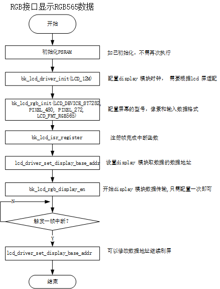
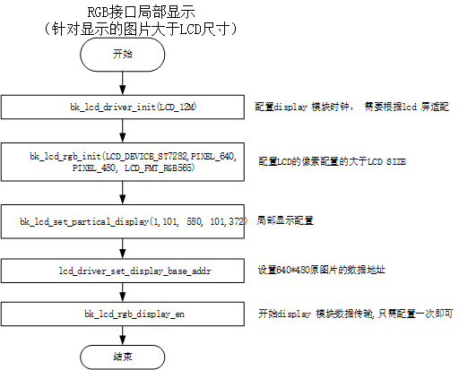

# Display APIs[](#display-apis "永久链接至标题")


## LCD Display Interface[](#lcd-display-interface "永久链接至标题")

The BK LCD Display Driver supports following interfaces:

> - i8080 LCD interface
>   :   1. 项目中使用的屏幕Driving IC 为ST7796S.
>       2. 8080 接口的数据传输为8位
>       3. 接口支持的数据为RGB565
> - RGB interface
>   :   1. 项目中支持的屏幕有Driving IC ST7282，HX8282, GC9503V.
>       2. 接口支持的数据包括RGB565,YUYV,UYVY,YYUV,UVYY,VUYY


## LCD API Categories[](#lcd-api-categories "永久链接至标题")


## LCD 8080 Config[](#lcd-8080-config "永久链接至标题")


Figure 1. 8080 lcd config flow[](#id2 "永久链接至图片")


## LCD RGB Config[](#lcd-rgb-config "永久链接至标题")



Figure 2. rgb lcd config flow[](#id3 "永久链接至图片")


## LCD parcical display[](#lcd-parcical-display "永久链接至标题")



Figure 3. rgb lcd config flow[](#id4 "永久链接至图片")

局部显示参数配置


Figure 4. rgb lcd config flow[](#id5 "永久链接至图片")


## API Reference[](#api-reference "永久链接至标题")


### Header File[](#header-file "永久链接至标题")


- [lcd.h](http://192.168.0.46/gerrit/plugins/gitiles/iot/wcn/projects/+/refs/heads/armino_main/components/lcd.h "http://192.168.0.46/gerrit/plugins/gitiles/iot/wcn/projects/+/refs/heads/armino_main/components/lcd.h")


### Functions[](#functions "永久链接至标题")

void bk_lcd_set_devices_list(const [lcd_device_t](#_CPPv412lcd_device_t "lcd_device_t") **list, uint16_t size)[](#_CPPv423bk_lcd_set_devices_listPPK12lcd_device_t8uint16_t "永久链接至目标")
:   LCD API.

    This API set LCD device list

    返回
    :   - void

bk_err_t bk_lcd_driver_init([lcd_clk_t](#_CPPv49lcd_clk_t "lcd_clk_t") clk)[](#_CPPv418bk_lcd_driver_init9lcd_clk_t "永久链接至目标")
:   This API select LCD module clk source.


    - open lcd sys interrupt/clk enable

    BK_OK: succeed


    - others: other errors.

    返回

bk_err_t bk_lcd_driver_deinit(void)[](#_CPPv420bk_lcd_driver_deinitv "永久链接至目标")
:   close lcd sys interrupt/clk enable

    返回
    :   - BK_OK: succeed

        - others: other errors.

bk_err_t bk_lcd_8080_init(const [lcd_device_t](#_CPPv412lcd_device_t "lcd_device_t") *device)[](#_CPPv416bk_lcd_8080_initPK12lcd_device_t "永久链接至目标")
:   This API init the 8080 lcd interface.


    - Set lcd display mode is 8080 interface

    - init 8080 lcd gpio

    - enable 8080 display -enable 8080 end of frame interrupt

    - if you want enable start of frame interrupt, please use API bk_lcd_8080_int_enable

    参数
    :   **-** – [lcd_device_t](#structlcd__device__t "#structlcd__device__t")

    返回
    :   - BK_OK: succeed

        - others: other errors.

bk_err_t bk_lcd_8080_deinit(void)[](#_CPPv418bk_lcd_8080_deinitv "永久链接至目标")
:   8080 lcd interface reg deinit


    - This API reset all lcd reg include power

    - close 8080 lcd enable and display

    - reset x pixel and y pixel zero

    - unregister lcd isr

    返回
    :   - BK_OK: succeed

        - others: other errors.

bk_err_t bk_lcd_8080_start_transfer(bool start)[](#_CPPv426bk_lcd_8080_start_transferb "永久链接至目标")
:   This API config 8080 lcd interrupt.

    This API start mcu 8080 lcd transfer data to display


    **Attention**
    :   8080 end of frame int is open in API bk_lcd_8080_init

    参数
    :   - **-** – is_sof_en enable start of frame interrupt

          - is_eof_en enable end of frame interrupt

        - **start_transfer** –

          - 1:data start transfer to lcd display on;

          - 0:stop transfer

    返回
    :   - BK_OK: succeed

        - others: other errors.

    返回
    :   - BK_OK: succeed

        - others: other errors.

bk_err_t bk_lcd_rgb_deinit(void)[](#_CPPv417bk_lcd_rgb_deinitv "永久链接至目标")
:   rgb lcd interface reg deinit


    - This API reset all lcd reg include power

    - close rgb lcd enable and display

    - reset x pixel and y pixel zero

    - unregister lcd isr

    返回
    :   - BK_OK: succeed

        - others: other errors.

bk_err_t bk_lcd_rgb_display_en(bool en)[](#_CPPv421bk_lcd_rgb_display_enb "永久链接至目标")
:   enable rgb lcd display

    参数
    :   **bool** – en


        - 1: enable rgb display

        - 0: disable rgb display

    返回
    :   - BK_OK: succeed

        - others: other errors.

bk_err_t bk_lcd_isr_register([lcd_isr_t](#_CPPv49lcd_isr_t "lcd_isr_t") lcd_isr)[](#_CPPv419bk_lcd_isr_register9lcd_isr_t "永久链接至目标")
:   This API config rgb lcd interrupt.

    This API register lcd isr, user should check int status in isr function, and clear status


    **Attention**
    :   rgb end of frame int is open in API bk_lcd_rgb_init

    参数
    :   - **-** – is_sof_en enable start of frame interrupt

          - is_eof_en enable end of frame interrupt

        - **-** – isr: isr function

    返回
    :   - BK_OK: succeed

        - others: other errors.

    返回
    :   - BK_OK: succeed

        - others: other errors.

uint32_t bk_lcd_int_status_get(void)[](#_CPPv421bk_lcd_int_status_getv "永久链接至目标")
:   This API used to get lcd int status.

    8080 Usage example: if (bk_lcd_int_status_get()&I8080_OUTPUT_EOF == 1), present 8080 eof int triggerd if (bk_lcd_int_status_get()&RGB_OUTPUT_EOF == 1), present rgb eof int triggerd

    返回
    :   - status value.

bk_err_t bk_lcd_int_status_clear([lcd_int_type_t](#_CPPv414lcd_int_type_t "lcd_int_type_t") int_type)[](#_CPPv423bk_lcd_int_status_clear14lcd_int_type_t "永久链接至目标")
:   This API used to clr lcd int status.

    参数
    :   **-** – int_type value.

    返回
    :   - BK_OK: succeed

        - others: other errors.

bk_err_t bk_lcd_pixel_config(uint16_t x_pixel, uint16_t y_pixel)[](#_CPPv419bk_lcd_pixel_config8uint16_t8uint16_t "永久链接至目标")
:   This API config lcd display x size and y size.

    参数
    :   **-** – x_pixel user can set by any value, can be lcd size x or picture size x


        - y_pixel user can set by any value, can be lcd size y or picture size y

    返回
    :   - BK_OK: succeed

        - others: other errors.

bk_err_t bk_lcd_rgb_init(const [lcd_device_t](#_CPPv412lcd_device_t "lcd_device_t") *device)[](#_CPPv415bk_lcd_rgb_initPK12lcd_device_t "永久链接至目标")
:   This API init the rgb lcd interface.


    - Set lcd display mode is rgb interface

    - init rgb lcd gpio

    - enable rgb display

    - enable rgb end of frame interrupt

    参数
    :   **-** – [lcd_device_t](#structlcd__device__t "#structlcd__device__t"): lcd type select from [lcd_device_t](#structlcd__device__t "#structlcd__device__t")

    返回
    :   - BK_OK: succeed

        - others: other errors.

bk_err_t bk_lcd_8080_send_cmd(uint8_t param_count, uint32_t command, uint32_t *param)[](#_CPPv420bk_lcd_8080_send_cmd7uint8_t8uint32_tP8uint32_t "永久链接至目标")
:   This API used send 8080 lcd init cmd.

    Usage example:

    #define COMMAND_1 0xf uint32_t param_command1[2] = {0xc3, 0x29}; bk_lcd_8080_send_cmd(2, COMMAND_1, param_command1);

    参数
    :   **-** – param_count: cmd parameter number


        - command: command

        - param: the cmd parameter

    返回
    :   - BK_OK: succeed

        - others: other errors.

bk_err_t bk_lcd_set_partical_display(bool en, uint16_t partial_clum_l, uint16_t partial_clum_r, uint16_t partial_line_l, uint16_t partial_line_r)[](#_CPPv427bk_lcd_set_partical_displayb8uint16_t8uint16_t8uint16_t8uint16_t "永久链接至目标")
:   This API used for display partical area.

    8080 Usage example:

    ```
    #define PARTICAL_XS   101
    #define PARTICAL_XE   220
    #define PARTICAL_YS   101
    #define PARTICAL_YE   380
    bk_lcd_set_partical_display(EDGE_PARTICAL_XS, EDGE_PARTICAL_XE, EDGE_PARTICAL_YS, EDGE_PARTICAL_YE);
    bk_lcd_8080_send_cmd(2, COMMAND_1, param_command1);
    ```

    参数
    :   **-** – partial_clum_l:


        - partial_clum_r:

        - partial_line_l:

        - partial_line_r:

    返回
    :   - BK_OK: succeed

        - others: other errors.

void lcd_driver_ppi_set(uint16_t width, uint16_t height)[](#_CPPv418lcd_driver_ppi_set8uint16_t8uint16_t "永久链接至目标")
:   This API used to clr lcd int status.

    参数
    :   **-** – int_type value.

    返回
    :   - BK_OK: succeed

        - others: other errors.

bk_err_t bk_lcd_set_yuv_mode(pixel_format_t input_data_format)[](#_CPPv419bk_lcd_set_yuv_mode14pixel_format_t "永久链接至目标")
:   This API used to set lcd display data farmat.

    参数
    :   **-** – input_data_format value.

    返回
    :   - BK_OK: succeed

        - others: other errors.

bk_err_t lcd_driver_init(const [lcd_device_t](#_CPPv412lcd_device_t "lcd_device_t") *device)[](#_CPPv415lcd_driver_initPK12lcd_device_t "永久链接至目标")
:   This API used for init lcd.

    Usage example:

    参数
    :   **lcd_config_t** –

    返回
    :   - BK_OK: succeed

        - others: other errors.

const [lcd_device_t](#_CPPv412lcd_device_t "lcd_device_t") *get_lcd_device_by_id([lcd_device_id_t](#_CPPv415lcd_device_id_t "lcd_device_id_t") id)[](#_CPPv420get_lcd_device_by_id15lcd_device_id_t "永久链接至目标")
:   this api used to get lcd device interface

    参数
    :   **select** – lcd_device_id_t member

    返回
    :   lcd device infermation, include: .id = LCD_DEVICE_HX8282, .name = “hx8282”, .type = LCD_TYPE_RGB565, .ppi = PPI_1024X600, .rgb = &lcd_rgb .init = NULL,

const [lcd_device_t](#_CPPv412lcd_device_t "lcd_device_t") **get_lcd_devices_list(void)[](#_CPPv420get_lcd_devices_listv "永久链接至目标")
:   get lcd device list

    返回
    :   - devices list

uint32_t get_lcd_devices_num(void)[](#_CPPv419get_lcd_devices_numv "永久链接至目标")
:   get lcd device number

    返回
    :   - devices number

bk_err_t lcd_driver_backlight_open(void)[](#_CPPv425lcd_driver_backlight_openv "永久链接至目标")
:   this api used to open lcd backlight

    参数
    :   **none** –

    返回
    :   - BK_OK: succeed

        - others: other errors.

bk_err_t lcd_driver_backlight_close(void)[](#_CPPv426lcd_driver_backlight_closev "永久链接至目标")
:   this api used to close lcd backlight

    返回
    :   - BK_OK: succeed

        - others: other errors.

bk_err_t lcd_driver_backlight_set(uint8_t percent)[](#_CPPv424lcd_driver_backlight_set7uint8_t "永久链接至目标")
:   this api used to set lcd backlight

    参数
    :   **percent** – rang from 0~100

    返回
    :   - BK_OK: succeed

        - others: other errors.

bk_err_t lcd_driver_display_disable(void)[](#_CPPv426lcd_driver_display_disablev "永久链接至目标")
:   this api used to disable lcd display

    返回
    :   - BK_OK: succeed

        - others: other errors.

bk_err_t lcd_driver_display_enable(void)[](#_CPPv425lcd_driver_display_enablev "永久链接至目标")
:   this api used to enable lcd display

    返回
    :   - BK_OK: succeed

        - others: other errors.

bk_err_t lcd_driver_display_continue(void)[](#_CPPv427lcd_driver_display_continuev "永久链接至目标")
:   this api used to clear eof int and diaplay continue

    返回
    :   - BK_OK: succeed

        - others: other errors.

bk_err_t lcd_driver_set_display_base_addr(uint32_t disp_base_addr)[](#_CPPv432lcd_driver_set_display_base_addr8uint32_t "永久链接至目标")
:   this api used to set lcd display addr

    参数
    :   **disp_base_addr** – sram or psram

    返回
    :   - BK_OK: succeed

        - others: other errors.

bk_err_t lcd_driver_deinit(void)[](#_CPPv417lcd_driver_deinitv "永久链接至目标")
:   this api used to close lcd

    返回
    :   - BK_OK: succeed

        - others: other errors.

const [lcd_device_t](#_CPPv412lcd_device_t "lcd_device_t") *get_lcd_device_by_ppi(media_ppi_t ppi)[](#_CPPv421get_lcd_device_by_ppi11media_ppi_t "永久链接至目标")
:   get lcd device struct by ppi

    参数
    :   **lcd** – ppi

    返回
    :   - return true is [lcd_device_t](#structlcd__device__t "#structlcd__device__t") member

        - or not find device, return NULL.

const [lcd_device_t](#_CPPv412lcd_device_t "lcd_device_t") *get_lcd_device_by_name(char *name)[](#_CPPv422get_lcd_device_by_namePc "永久链接至目标")
:   get lcd device struct by device name

    参数
    :   **lcd** – name

    返回
    :   - return true is [lcd_device_t](#structlcd__device__t "#structlcd__device__t") member

        - or not find device, return NULL.

bk_err_t bk_lcd_input_pixel_hf_reverse(bool hf_reverse)[](#_CPPv429bk_lcd_input_pixel_hf_reverseb "永久链接至目标")
:   input data halfword reverse

    参数
    :   **enable** – enable/disable hf_reverse

    返回
    :   - BK_OK: succeed

        - others: other errors.


## API Typedefs[](#api-typedefs "永久链接至标题")


### Header File[](#id1 "永久链接至标题")


- [lcd_types.h](http://192.168.0.46/gerrit/plugins/gitiles/iot/wcn/projects/+/refs/heads/armino_main/components/lcd_types.h "http://192.168.0.46/gerrit/plugins/gitiles/iot/wcn/projects/+/refs/heads/armino_main/components/lcd_types.h")


### Structures[](#structures "永久链接至标题")

struct yuv_data_t[](#_CPPv410yuv_data_t "永久链接至目标")

struct lcd_rect_t[](#_CPPv410lcd_rect_t "永久链接至目标")

struct lcd_disp_framebuf_t[](#_CPPv419lcd_disp_framebuf_t "永久链接至目标")

struct lcd_rgb_t[](#_CPPv49lcd_rgb_t "永久链接至目标")
:   rgb interface config param

    Public Members

    [lcd_clk_t](#_CPPv49lcd_clk_t "lcd_clk_t") clk[](#_CPPv4N9lcd_rgb_t3clkE "永久链接至目标")
    :   config lcd clk

    [rgb_out_clk_edge_t](#_CPPv418rgb_out_clk_edge_t "rgb_out_clk_edge_t") data_out_clk_edge[](#_CPPv4N9lcd_rgb_t17data_out_clk_edgeE "永久链接至目标")
    :   rgb data output in clk edge, should refer lcd device spec

    uint16_t hsync_back_porch[](#_CPPv4N9lcd_rgb_t16hsync_back_porchE "永久链接至目标")
    :   rang 0~0x3FF (0~1023), should refer lcd device spec

    uint16_t hsync_front_porch[](#_CPPv4N9lcd_rgb_t17hsync_front_porchE "永久链接至目标")
    :   rang 0~0x3FF (0~1023), should refer lcd device spec

    uint16_t vsync_back_porch[](#_CPPv4N9lcd_rgb_t16vsync_back_porchE "永久链接至目标")
    :   rang 0~0xFF (0~255), should refer lcd device spec

    uint16_t vsync_front_porch[](#_CPPv4N9lcd_rgb_t17vsync_front_porchE "永久链接至目标")
    :   rang 0~0xFF (0~255), should refer lcd device spec

    uint8_t hsync_pulse_width[](#_CPPv4N9lcd_rgb_t17hsync_pulse_widthE "永久链接至目标")
    :   rang 0~0x3F (0~7), should refer lcd device spec

    uint8_t vsync_pulse_width[](#_CPPv4N9lcd_rgb_t17vsync_pulse_widthE "永久链接至目标")
    :   rang 0~0x3F (0~7), should refer lcd device spec

struct lcd_mcu_t[](#_CPPv49lcd_mcu_t "永久链接至目标")
:   mcu interface config param

    Public Members

    [lcd_clk_t](#_CPPv49lcd_clk_t "lcd_clk_t") clk[](#_CPPv4N9lcd_mcu_t3clkE "永久链接至目标")
    :   config lcd clk

    void (*set_display_area)(uint16 xs, uint16 xe, uint16 ys, uint16 ye)[](#_CPPv4N9lcd_mcu_t16set_display_areaE "永久链接至目标")
    :   if lcd size is smaller then image, and set api bk_lcd_pixel_config is image x y, should set partical display

struct lcd_qspi_t[](#_CPPv410lcd_qspi_t "永久链接至目标")
:   qspi interface config param

struct lcd_spi_t[](#_CPPv49lcd_spi_t "永久链接至目标")
:   spi interface config param

struct lcd_device_t[](#_CPPv412lcd_device_t "永久链接至目标")
:   Public Members

    [lcd_device_id_t](#_CPPv415lcd_device_id_t "lcd_device_id_t") id[](#_CPPv4N12lcd_device_t2idE "永久链接至目标")
    :   lcd device type, user can add if you want to add another lcd device

    char *name[](#_CPPv4N12lcd_device_t4nameE "永久链接至目标")
    :   lcd device name

    [lcd_type_t](#_CPPv410lcd_type_t "lcd_type_t") type[](#_CPPv4N12lcd_device_t4typeE "永久链接至目标")
    :   lcd device hw interface

    media_ppi_t ppi[](#_CPPv4N12lcd_device_t3ppiE "永久链接至目标")
    :   lcd device x y size

    pixel_format_t src_fmt[](#_CPPv4N12lcd_device_t7src_fmtE "永久链接至目标")
    :   source data format: input to display module data format(rgb565/rgb888/yuv)

    pixel_format_t out_fmt[](#_CPPv4N12lcd_device_t7out_fmtE "永久链接至目标")
    :   display module output data format(rgb565/rgb666/rgb888), input to lcd device,

    const [lcd_rgb_t](#_CPPv49lcd_rgb_t "lcd_rgb_t") *rgb[](#_CPPv4N12lcd_device_t3rgbE "永久链接至目标")
    :   RGB interface lcd device config

    const [lcd_mcu_t](#_CPPv49lcd_mcu_t "lcd_mcu_t") *mcu[](#_CPPv4N12lcd_device_t3mcuE "永久链接至目标")
    :   MCU interface lcd device config

    const [lcd_qspi_t](#_CPPv410lcd_qspi_t "lcd_qspi_t") *qspi[](#_CPPv4N12lcd_device_t4qspiE "永久链接至目标")
    :   QSPI interface lcd device config

    const [lcd_spi_t](#_CPPv49lcd_spi_t "lcd_spi_t") *spi[](#_CPPv4N12lcd_device_t3spiE "永久链接至目标")
    :   SPI interface lcd device config

    void (*init)(void)[](#_CPPv4N12lcd_device_t4initE "永久链接至目标")
    :   lcd device initial function

    bk_err_t (*lcd_off)(void)[](#_CPPv4N12lcd_device_t7lcd_offE "永久链接至目标")
    :   lcd off


### Macros[](#macros "永久链接至标题")

USE_LCD_REGISTER_CALLBACKS[](#c.USE_LCD_REGISTER_CALLBACKS "永久链接至目标")


### Type Definitions[](#type-definitions "永久链接至标题")

typedef void (*lcd_isr_t)(void)[](#_CPPv49lcd_isr_t "永久链接至目标")


### Enumerations[](#enumerations "永久链接至标题")

enum lcd_device_id_t[](#_CPPv415lcd_device_id_t "永久链接至目标")
:   *Values:*

    enumerator LCD_DEVICE_UNKNOW[](#_CPPv4N15lcd_device_id_t17LCD_DEVICE_UNKNOWE "永久链接至目标")

    enumerator LCD_DEVICE_ST7282[](#_CPPv4N15lcd_device_id_t17LCD_DEVICE_ST7282E "永久链接至目标")
    :   480X270 RGB

    enumerator LCD_DEVICE_HX8282[](#_CPPv4N15lcd_device_id_t17LCD_DEVICE_HX8282E "永久链接至目标")
    :   1024X600 RGB

    enumerator LCD_DEVICE_GC9503V[](#_CPPv4N15lcd_device_id_t18LCD_DEVICE_GC9503VE "永久链接至目标")
    :   480X800 RGB

    enumerator LCD_DEVICE_NT35510[](#_CPPv4N15lcd_device_id_t18LCD_DEVICE_NT35510E "永久链接至目标")
    :   480X854 RGB

    enumerator LCD_DEVICE_H050IWV[](#_CPPv4N15lcd_device_id_t18LCD_DEVICE_H050IWVE "永久链接至目标")
    :   800X480 RGB

    enumerator LCD_DEVICE_MD0430R[](#_CPPv4N15lcd_device_id_t18LCD_DEVICE_MD0430RE "永久链接至目标")
    :   800X480 RGB

    enumerator LCD_DEVICE_MD0700R[](#_CPPv4N15lcd_device_id_t18LCD_DEVICE_MD0700RE "永久链接至目标")
    :   1024X600 RGB

    enumerator LCD_DEVICE_ST7701S_LY[](#_CPPv4N15lcd_device_id_t21LCD_DEVICE_ST7701S_LYE "永久链接至目标")
    :   480X480 RGB

    enumerator LCD_DEVICE_ST7701S[](#_CPPv4N15lcd_device_id_t18LCD_DEVICE_ST7701SE "永久链接至目标")
    :   480X480 RGB

    enumerator LCD_DEVICE_ST7701SN[](#_CPPv4N15lcd_device_id_t19LCD_DEVICE_ST7701SNE "永久链接至目标")
    :   480X480 RGB

    enumerator LCD_DEVICE_AML01[](#_CPPv4N15lcd_device_id_t16LCD_DEVICE_AML01E "永久链接至目标")
    :   720X1280 RGB

    enumerator LCD_DEVICE_ST7796S[](#_CPPv4N15lcd_device_id_t18LCD_DEVICE_ST7796SE "永久链接至目标")
    :   320X480 MCU

    enumerator LCD_DEVICE_NT35512[](#_CPPv4N15lcd_device_id_t18LCD_DEVICE_NT35512E "永久链接至目标")
    :   480X800 MCU

    enumerator LCD_DEVICE_NT35510_MCU[](#_CPPv4N15lcd_device_id_t22LCD_DEVICE_NT35510_MCUE "永久链接至目标")
    :   480X800 MCU

    enumerator LCD_DEVICE_ST7789V[](#_CPPv4N15lcd_device_id_t18LCD_DEVICE_ST7789VE "永久链接至目标")
    :   170X320 MCU

    enumerator LCD_DEVICE_SH8601A[](#_CPPv4N15lcd_device_id_t18LCD_DEVICE_SH8601AE "永久链接至目标")
    :   454X454 QSPI

    enumerator LCD_DEVICE_ST77903_WX20114[](#_CPPv4N15lcd_device_id_t26LCD_DEVICE_ST77903_WX20114E "永久链接至目标")
    :   400X400 QSPI

    enumerator LCD_DEVICE_ST77903_SAT61478M[](#_CPPv4N15lcd_device_id_t28LCD_DEVICE_ST77903_SAT61478ME "永久链接至目标")
    :   400X400 QSPI

    enumerator LCD_DEVICE_ST77903_H0165Y008T[](#_CPPv4N15lcd_device_id_t29LCD_DEVICE_ST77903_H0165Y008TE "永久链接至目标")
    :   360X480 QSPI

    enumerator LCD_DEVICE_SPD2010[](#_CPPv4N15lcd_device_id_t18LCD_DEVICE_SPD2010E "永久链接至目标")
    :   412X412 QSPI

    enumerator LCD_DEVICE_ST7796U[](#_CPPv4N15lcd_device_id_t18LCD_DEVICE_ST7796UE "永久链接至目标")
    :   320X480 SPI

    enumerator LCD_DEVICE_GC9D01[](#_CPPv4N15lcd_device_id_t17LCD_DEVICE_GC9D01E "永久链接至目标")
    :   160X160 SPI

enum lcd_type_t[](#_CPPv410lcd_type_t "永久链接至目标")
:   *Values:*

    enumerator LCD_TYPE_RGB[](#_CPPv4N10lcd_type_t12LCD_TYPE_RGBE "永久链接至目标")
    :   lcd hardware interface is parallel RGB interface

    enumerator LCD_TYPE_RGB565[](#_CPPv4N10lcd_type_t15LCD_TYPE_RGB565E "永久链接至目标")
    :   lcd device output data hardware interface is RGB565 format

    enumerator LCD_TYPE_MCU8080[](#_CPPv4N10lcd_type_t16LCD_TYPE_MCU8080E "永久链接至目标")
    :   lcd device output data hardware interface is MCU 8BIT format

    enumerator LCD_TYPE_QSPI[](#_CPPv4N10lcd_type_t13LCD_TYPE_QSPIE "永久链接至目标")
    :   lcd device hardware interface is QSPI interface

    enumerator LCD_TYPE_SPI[](#_CPPv4N10lcd_type_t12LCD_TYPE_SPIE "永久链接至目标")
    :   lcd device hardware interface is SPI interface

enum lcd_int_type_t[](#_CPPv414lcd_int_type_t "永久链接至目标")
:   *Values:*

    enumerator RGB_OUTPUT_EOF[](#_CPPv4N14lcd_int_type_t14RGB_OUTPUT_EOFE "永久链接至目标")
    :   reg end of frame int status

    enumerator RGB_OUTPUT_SOF[](#_CPPv4N14lcd_int_type_t14RGB_OUTPUT_SOFE "永久链接至目标")
    :   reg display output start of frame status

    enumerator I8080_OUTPUT_SOF[](#_CPPv4N14lcd_int_type_t16I8080_OUTPUT_SOFE "永久链接至目标")
    :   8080 display output start of frame status

    enumerator I8080_OUTPUT_EOF[](#_CPPv4N14lcd_int_type_t16I8080_OUTPUT_EOFE "永久链接至目标")
    :   8080 display output end of frame status

    enumerator DE_INT[](#_CPPv4N14lcd_int_type_t6DE_INTE "永久链接至目标")

    enumerator FRAME_INTERVAL_INT[](#_CPPv4N14lcd_int_type_t18FRAME_INTERVAL_INTE "永久链接至目标")

enum frame_delay_unit_t[](#_CPPv418frame_delay_unit_t "永久链接至目标")
:   *Values:*

    enumerator DCLK_UNIT[](#_CPPv4N18frame_delay_unit_t9DCLK_UNITE "永久链接至目标")

    enumerator HSYNC_UNIT[](#_CPPv4N18frame_delay_unit_t10HSYNC_UNITE "永久链接至目标")

    enumerator VSYNC_UNIT[](#_CPPv4N18frame_delay_unit_t10VSYNC_UNITE "永久链接至目标")

    enumerator NONE[](#_CPPv4N18frame_delay_unit_t4NONEE "永久链接至目标")

enum lcd_clk_t[](#_CPPv49lcd_clk_t "永久链接至目标")
:   rgb lcd clk select, infulence pfs, user should select according to lcd device spec


    *Values:*

    enumerator LCD_80M[](#_CPPv4N9lcd_clk_t7LCD_80ME "永久链接至目标")

    enumerator LCD_64M[](#_CPPv4N9lcd_clk_t7LCD_64ME "永久链接至目标")

    enumerator LCD_60M[](#_CPPv4N9lcd_clk_t7LCD_60ME "永久链接至目标")

    enumerator LCD_54M[](#_CPPv4N9lcd_clk_t7LCD_54ME "永久链接至目标")

    enumerator LCD_45M[](#_CPPv4N9lcd_clk_t7LCD_45ME "永久链接至目标")

    enumerator LCD_40M[](#_CPPv4N9lcd_clk_t7LCD_40ME "永久链接至目标")

    enumerator LCD_35M[](#_CPPv4N9lcd_clk_t7LCD_35ME "永久链接至目标")

    enumerator LCD_32M[](#_CPPv4N9lcd_clk_t7LCD_32ME "永久链接至目标")

    enumerator LCD_30M[](#_CPPv4N9lcd_clk_t7LCD_30ME "永久链接至目标")

    enumerator LCD_26M[](#_CPPv4N9lcd_clk_t7LCD_26ME "永久链接至目标")

    enumerator LCD_24M[](#_CPPv4N9lcd_clk_t7LCD_24ME "永久链接至目标")

    enumerator LCD_22M[](#_CPPv4N9lcd_clk_t7LCD_22ME "永久链接至目标")

    enumerator LCD_20M[](#_CPPv4N9lcd_clk_t7LCD_20ME "永久链接至目标")

    enumerator LCD_17M[](#_CPPv4N9lcd_clk_t7LCD_17ME "永久链接至目标")

    enumerator LCD_15M[](#_CPPv4N9lcd_clk_t7LCD_15ME "永久链接至目标")

    enumerator LCD_12M[](#_CPPv4N9lcd_clk_t7LCD_12ME "永久链接至目标")

    enumerator LCD_10M[](#_CPPv4N9lcd_clk_t7LCD_10ME "永久链接至目标")

    enumerator LCD_9M[](#_CPPv4N9lcd_clk_t6LCD_9ME "永久链接至目标")

    enumerator LCD_8M[](#_CPPv4N9lcd_clk_t6LCD_8ME "永久链接至目标")

    enumerator LCD_7M[](#_CPPv4N9lcd_clk_t6LCD_7ME "永久链接至目标")

enum lcd_qspi_clk_t[](#_CPPv414lcd_qspi_clk_t "永久链接至目标")
:   *Values:*

    enumerator LCD_QSPI_80M[](#_CPPv4N14lcd_qspi_clk_t12LCD_QSPI_80ME "永久链接至目标")

    enumerator LCD_QSPI_64M[](#_CPPv4N14lcd_qspi_clk_t12LCD_QSPI_64ME "永久链接至目标")

    enumerator LCD_QSPI_60M[](#_CPPv4N14lcd_qspi_clk_t12LCD_QSPI_60ME "永久链接至目标")

    enumerator LCD_QSPI_53M[](#_CPPv4N14lcd_qspi_clk_t12LCD_QSPI_53ME "永久链接至目标")

    enumerator LCD_QSPI_48M[](#_CPPv4N14lcd_qspi_clk_t12LCD_QSPI_48ME "永久链接至目标")

    enumerator LCD_QSPI_40M[](#_CPPv4N14lcd_qspi_clk_t12LCD_QSPI_40ME "永久链接至目标")

    enumerator LCD_QSPI_32M[](#_CPPv4N14lcd_qspi_clk_t12LCD_QSPI_32ME "永久链接至目标")

    enumerator LCD_QSPI_30M[](#_CPPv4N14lcd_qspi_clk_t12LCD_QSPI_30ME "永久链接至目标")

enum rgb_out_clk_edge_t[](#_CPPv418rgb_out_clk_edge_t "永久链接至目标")
:   rgb data output in clk rising or falling


    *Values:*

    enumerator POSEDGE_OUTPUT[](#_CPPv4N18rgb_out_clk_edge_t14POSEDGE_OUTPUTE "永久链接至目标")
    :   output in clk falling

    enumerator NEGEDGE_OUTPUT[](#_CPPv4N18rgb_out_clk_edge_t14NEGEDGE_OUTPUTE "永久链接至目标")
    :   output in clk rising

enum data_format_t[](#_CPPv413data_format_t "永久链接至目标")
:   *Values:*

    enumerator ARGB8888[](#_CPPv4N13data_format_t8ARGB8888E "永久链接至目标")
    :   ARGB8888 DMA2D color mode

    enumerator RGB888[](#_CPPv4N13data_format_t6RGB888E "永久链接至目标")
    :   RGB888 DMA2D color mode

    enumerator RGB565[](#_CPPv4N13data_format_t6RGB565E "永久链接至目标")
    :   RGB565 DMA2D color mode

    enumerator YUYV[](#_CPPv4N13data_format_t4YUYVE "永久链接至目标")

enum lcd_backlight_default_ctrl_t[](#_CPPv428lcd_backlight_default_ctrl_t "永久链接至目标")
:   *Values:*

    enumerator LCD_BL_DEFAULT_CLOSE[](#_CPPv4N28lcd_backlight_default_ctrl_t20LCD_BL_DEFAULT_CLOSEE "永久链接至目标")

    enumerator LCD_BL_DEFAULT_OPEN[](#_CPPv4N28lcd_backlight_default_ctrl_t19LCD_BL_DEFAULT_OPENE "永久链接至目标")
