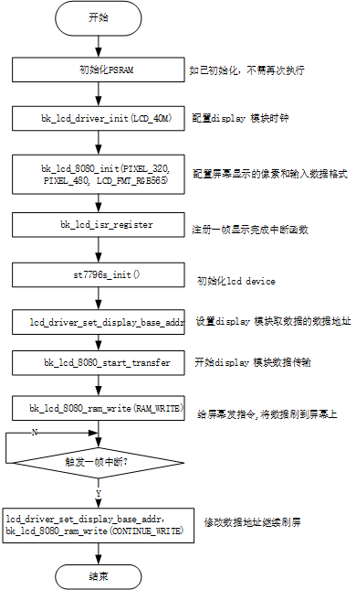

<a id="display-apis"></a>

# Display APIs

<a id="lcd-display-interface"></a>

## LCD Display Interface

The BK LCD Display Driver supports following interfaces:

> - i8080 LCD interface
>   :   1. 项目中使用的屏幕Driving IC 为ST7796S.
>       2. 8080 接口的数据传输为8位
>       3. 接口支持的数据为RGB565
> - RGB interface
>   :   1. 项目中支持的屏幕有Driving IC ST7282，HX8282, GC9503V.
>       2. 接口支持的数据包括RGB565,YUYV,UYVY,YYUV,UVYY,VUYY

<a id="lcd-api-categories"></a>

## LCD API Categories

<a id="lcd-8080-config"></a>

## LCD 8080 Config

<a id="id2"></a>



Figure 1\. 8080 lcd config flow

<a id="lcd-rgb-config"></a>

## LCD RGB Config

<a id="id3"></a>


Figure 2\. rgb lcd config flow

<a id="lcd-parcical-display"></a>

## LCD parcical display

<a id="id4"></a>


Figure 3\. rgb lcd config flow

局部显示参数配置

<a id="id5"></a>


Figure 4\. rgb lcd config flow

<a id="api-reference"></a>

## API Reference

<a id="header-file"></a>

### Header File

- [lcd.h](https://docs.bekencorp.com/arminodoc/bk_avdk/bk7258/zh_CN/v2.0.1/_header_files/bk_idk/include/driver/lcd.h)

<a id="functions"></a>

### Functions

<a id="_CPPv423bk_lcd_set_devices_listPPK12lcd_device_t8uint16_t"></a>

<a id="_CPPv323bk_lcd_set_devices_listPPK12lcd_device_t8uint16_t"></a> <a id="_CPPv223bk_lcd_set_devices_listPPK12lcd_device_t8uint16_t"></a> <a id="bk_lcd_set_devices_list__lcd_device_tCPP.uint16_t"></a> <a id="lcd_8h_1a36033e433860ef5b8bc9339f6fbc700a"></a> void bk\_lcd\_set\_devices\_list(const [lcd\_device\_t](#_CPPv412lcd_device_t "lcd_device_t") \*\*list, uint16\_t size)
:   LCD API.

    This API set LCD device list

    返回
    :   - void

<a id="_CPPv418bk_lcd_driver_init9lcd_clk_t"></a>

<a id="_CPPv318bk_lcd_driver_init9lcd_clk_t"></a> <a id="_CPPv218bk_lcd_driver_init9lcd_clk_t"></a> <a id="bk_lcd_driver_init__lcd_clk_t"></a> <a id="lcd_8h_1a2e36311f44162eb042e7349246b37ef0"></a> bk\_err\_t bk\_lcd\_driver\_init([lcd\_clk\_t](#_CPPv49lcd_clk_t "lcd_clk_t") clk)
:   This API select LCD module clk source.

    - open lcd sys interrupt/clk enable

    BK\_OK: succeed

    - others: other errors.

    返回

<a id="_CPPv420bk_lcd_driver_deinitv"></a>

<a id="_CPPv320bk_lcd_driver_deinitv"></a> <a id="_CPPv220bk_lcd_driver_deinitv"></a> <a id="bk_lcd_driver_deinit__void"></a> <a id="lcd_8h_1a9b3282ab883402807deb1f511c73c4ce"></a> bk\_err\_t bk\_lcd\_driver\_deinit(void)
:   close lcd sys interrupt/clk enable

    返回
    :   - BK\_OK: succeed
        - others: other errors.

<a id="_CPPv416bk_lcd_8080_initPK12lcd_device_t"></a>

<a id="_CPPv316bk_lcd_8080_initPK12lcd_device_t"></a> <a id="_CPPv216bk_lcd_8080_initPK12lcd_device_t"></a> <a id="bk_lcd_8080_init__lcd_device_tCP"></a> <a id="lcd_8h_1a49c92696d2c606e162df20fb1559ab21"></a> bk\_err\_t bk\_lcd\_8080\_init(const [lcd\_device\_t](#_CPPv412lcd_device_t "lcd_device_t") \*device)
:   This API init the 8080 lcd interface.

    - Set lcd display mode is 8080 interface
    - init 8080 lcd gpio
    - enable 8080 display -enable 8080 end of frame interrupt
    - if you want enable start of frame interrupt, please use API bk\_lcd\_8080\_int\_enable

    参数
    :   **\-** – [lcd\_device\_t](#structlcd__device__t)

    返回
    :   - BK\_OK: succeed
        - others: other errors.

<a id="_CPPv418bk_lcd_8080_deinitv"></a>

<a id="_CPPv318bk_lcd_8080_deinitv"></a> <a id="_CPPv218bk_lcd_8080_deinitv"></a> <a id="bk_lcd_8080_deinit__void"></a> <a id="lcd_8h_1ad5dc2b7dae2b96524819369529c2037c"></a> bk\_err\_t bk\_lcd\_8080\_deinit(void)
:   8080 lcd interface reg deinit

    - This API reset all lcd reg include power
    - close 8080 lcd enable and display
    - reset x pixel and y pixel zero
    - unregister lcd isr

    返回
    :   - BK\_OK: succeed
        - others: other errors.

<a id="_CPPv426bk_lcd_8080_start_transferb"></a>

<a id="_CPPv326bk_lcd_8080_start_transferb"></a> <a id="_CPPv226bk_lcd_8080_start_transferb"></a> <a id="bk_lcd_8080_start_transfer__b"></a> <a id="lcd_8h_1a92bfa60273a838d1db5f0f4c48f59127"></a> bk\_err\_t bk\_lcd\_8080\_start\_transfer(bool start)
:   This API config 8080 lcd interrupt.

    This API start mcu 8080 lcd transfer data to display

    **Attention**
    :   8080 end of frame int is open in API bk\_lcd\_8080\_init

    参数
    :   - **\-** – is\_sof\_en enable start of frame interrupt

          - is\_eof\_en enable end of frame interrupt
        - **start\_transfer** –

          - 1:data start transfer to lcd display on;
          - 0:stop transfer

    返回
    :   - BK\_OK: succeed
        - others: other errors.

    返回
    :   - BK\_OK: succeed
        - others: other errors.

<a id="_CPPv417bk_lcd_rgb_deinitv"></a>

<a id="_CPPv317bk_lcd_rgb_deinitv"></a> <a id="_CPPv217bk_lcd_rgb_deinitv"></a> <a id="bk_lcd_rgb_deinit__void"></a> <a id="lcd_8h_1ac42bbb0b6ddb6cebb0778f84363e123f"></a> bk\_err\_t bk\_lcd\_rgb\_deinit(void)
:   rgb lcd interface reg deinit

    - This API reset all lcd reg include power
    - close rgb lcd enable and display
    - reset x pixel and y pixel zero
    - unregister lcd isr

    返回
    :   - BK\_OK: succeed
        - others: other errors.

<a id="_CPPv421bk_lcd_rgb_display_enb"></a>

<a id="_CPPv321bk_lcd_rgb_display_enb"></a> <a id="_CPPv221bk_lcd_rgb_display_enb"></a> <a id="bk_lcd_rgb_display_en__b"></a> <a id="lcd_8h_1aecb7ee937ac1c1c5101d59390b8687c5"></a> bk\_err\_t bk\_lcd\_rgb\_display\_en(bool en)
:   enable rgb lcd display

    参数
    :   **bool** – en

        - 1: enable rgb display
        - 0: disable rgb display

    返回
    :   - BK\_OK: succeed
        - others: other errors.

<a id="_CPPv419bk_lcd_isr_register9lcd_isr_t"></a>

<a id="_CPPv319bk_lcd_isr_register9lcd_isr_t"></a> <a id="_CPPv219bk_lcd_isr_register9lcd_isr_t"></a> <a id="bk_lcd_isr_register__lcd_isr_t"></a> <a id="lcd_8h_1a1aab1d28035f4c08995d015ce75a09fd"></a> bk\_err\_t bk\_lcd\_isr\_register([lcd\_isr\_t](#_CPPv49lcd_isr_t "lcd_isr_t") lcd\_isr)
:   This API config rgb lcd interrupt.

    This API register lcd isr, user should check int status in isr function, and clear status

    **Attention**
    :   rgb end of frame int is open in API bk\_lcd\_rgb\_init

    参数
    :   - **\-** – is\_sof\_en enable start of frame interrupt

          - is\_eof\_en enable end of frame interrupt
        - **\-** – isr: isr function

    返回
    :   - BK\_OK: succeed
        - others: other errors.

    返回
    :   - BK\_OK: succeed
        - others: other errors.

<a id="_CPPv421bk_lcd_int_status_getv"></a>

<a id="_CPPv321bk_lcd_int_status_getv"></a> <a id="_CPPv221bk_lcd_int_status_getv"></a> <a id="bk_lcd_int_status_get__void"></a> <a id="lcd_8h_1a31d8d69414778dcb756ac2a438ecf7af"></a> uint32\_t bk\_lcd\_int\_status\_get(void)
:   This API used to get lcd int status.

    8080 Usage example: if (bk\_lcd\_int\_status\_get()\&I8080\_OUTPUT\_EOF \=\= 1), present 8080 eof int triggerd if (bk\_lcd\_int\_status\_get()\&RGB\_OUTPUT\_EOF \=\= 1), present rgb eof int triggerd

    返回
    :   - status value.

<a id="_CPPv423bk_lcd_int_status_clear14lcd_int_type_t"></a>

<a id="_CPPv323bk_lcd_int_status_clear14lcd_int_type_t"></a> <a id="_CPPv223bk_lcd_int_status_clear14lcd_int_type_t"></a> <a id="bk_lcd_int_status_clear__lcd_int_type_t"></a> <a id="lcd_8h_1a15a42b1eb910abcb2bbeb13796c58853"></a> bk\_err\_t bk\_lcd\_int\_status\_clear([lcd\_int\_type\_t](#_CPPv414lcd_int_type_t "lcd_int_type_t") int\_type)
:   This API used to clr lcd int status.

    参数
    :   **\-** – int\_type value.

    返回
    :   - BK\_OK: succeed
        - others: other errors.

<a id="_CPPv419bk_lcd_pixel_config8uint16_t8uint16_t"></a>

<a id="_CPPv319bk_lcd_pixel_config8uint16_t8uint16_t"></a> <a id="_CPPv219bk_lcd_pixel_config8uint16_t8uint16_t"></a> <a id="bk_lcd_pixel_config__uint16_t.uint16_t"></a> <a id="lcd_8h_1ad80b1677dba001f164e30f796bcd7119"></a> bk\_err\_t bk\_lcd\_pixel\_config(uint16\_t x\_pixel, uint16\_t y\_pixel)
:   This API config lcd display x size and y size.

    参数
    :   **\-** – x\_pixel user can set by any value, can be lcd size x or picture size x

        - y\_pixel user can set by any value, can be lcd size y or picture size y

    返回
    :   - BK\_OK: succeed
        - others: other errors.

<a id="_CPPv415bk_lcd_rgb_initPK12lcd_device_t"></a>

<a id="_CPPv315bk_lcd_rgb_initPK12lcd_device_t"></a> <a id="_CPPv215bk_lcd_rgb_initPK12lcd_device_t"></a> <a id="bk_lcd_rgb_init__lcd_device_tCP"></a> <a id="lcd_8h_1a193199e450a8d92cd6fb52547e867019"></a> bk\_err\_t bk\_lcd\_rgb\_init(const [lcd\_device\_t](#_CPPv412lcd_device_t "lcd_device_t") \*device)
:   This API init the rgb lcd interface.

    - Set lcd display mode is rgb interface
    - init rgb lcd gpio
    - enable rgb display
    - enable rgb end of frame interrupt

    参数
    :   **\-** – [lcd\_device\_t](#structlcd__device__t): lcd type select from [lcd\_device\_t](#structlcd__device__t)

    返回
    :   - BK\_OK: succeed
        - others: other errors.

<a id="_CPPv420bk_lcd_8080_send_cmd7uint8_t8uint32_tP8uint32_t"></a>

<a id="_CPPv320bk_lcd_8080_send_cmd7uint8_t8uint32_tP8uint32_t"></a> <a id="_CPPv220bk_lcd_8080_send_cmd7uint8_t8uint32_tP8uint32_t"></a> <a id="bk_lcd_8080_send_cmd__uint8_t.uint32_t.uint32_tP"></a> <a id="lcd_8h_1a939d3d14330afb4bdea703963d618e28"></a> bk\_err\_t bk\_lcd\_8080\_send\_cmd(uint8\_t param\_count, uint32\_t command, uint32\_t \*param)
:   This API used send 8080 lcd init cmd.

    Usage example:

    #define COMMAND\_1 0xf uint32\_t param\_command1\[2\] \= {0xc3, 0x29}; bk\_lcd\_8080\_send\_cmd(2, COMMAND\_1, param\_command1);

    参数
    :   **\-** – param\_count: cmd parameter number

        - command: command
        - param: the cmd parameter

    返回
    :   - BK\_OK: succeed
        - others: other errors.

<a id="_CPPv427bk_lcd_set_partical_displayb8uint16_t8uint16_t8uint16_t8uint16_t"></a>

<a id="_CPPv327bk_lcd_set_partical_displayb8uint16_t8uint16_t8uint16_t8uint16_t"></a> <a id="_CPPv227bk_lcd_set_partical_displayb8uint16_t8uint16_t8uint16_t8uint16_t"></a> <a id="bk_lcd_set_partical_display__b.uint16_t.uint16_t.uint16_t.uint16_t"></a> <a id="lcd_8h_1aa65989b93a68fcf705a4a7cc67599f4b"></a> bk\_err\_t bk\_lcd\_set\_partical\_display(bool en, uint16\_t partial\_clum\_l, uint16\_t partial\_clum\_r, uint16\_t partial\_line\_l, uint16\_t partial\_line\_r)
:   This API used for display partical area.

    8080 Usage example:

    ```
    #define PARTICAL_XS   101
    #define PARTICAL_XE   220
    #define PARTICAL_YS   101
    #define PARTICAL_YE   380
    bk_lcd_set_partical_display(EDGE_PARTICAL_XS, EDGE_PARTICAL_XE, EDGE_PARTICAL_YS, EDGE_PARTICAL_YE);
    bk_lcd_8080_send_cmd(2, COMMAND_1, param_command1);
    ```

    参数
    :   **\-** – partial\_clum\_l:

        - partial\_clum\_r:
        - partial\_line\_l:
        - partial\_line\_r:

    返回
    :   - BK\_OK: succeed
        - others: other errors.

<a id="_CPPv418lcd_driver_ppi_set8uint16_t8uint16_t"></a>

<a id="_CPPv318lcd_driver_ppi_set8uint16_t8uint16_t"></a> <a id="_CPPv218lcd_driver_ppi_set8uint16_t8uint16_t"></a> <a id="lcd_driver_ppi_set__uint16_t.uint16_t"></a> <a id="lcd_8h_1a839675d107f1352f7b8d2cbda703eae2"></a> void lcd\_driver\_ppi\_set(uint16\_t width, uint16\_t height)
:   This API used to clr lcd int status.

    参数
    :   **\-** – int\_type value.

    返回
    :   - BK\_OK: succeed
        - others: other errors.

<a id="_CPPv419bk_lcd_set_yuv_mode14pixel_format_t"></a>

<a id="_CPPv319bk_lcd_set_yuv_mode14pixel_format_t"></a> <a id="_CPPv219bk_lcd_set_yuv_mode14pixel_format_t"></a> <a id="bk_lcd_set_yuv_mode__pixel_format_t"></a> <a id="lcd_8h_1aa597394fab323a696d0da3f45ae9cfcd"></a> bk\_err\_t bk\_lcd\_set\_yuv\_mode(pixel\_format\_t input\_data\_format)
:   This API used to set lcd display data farmat.

    参数
    :   **\-** – input\_data\_format value.

    返回
    :   - BK\_OK: succeed
        - others: other errors.

<a id="_CPPv415lcd_driver_initPK12lcd_device_t"></a>

<a id="_CPPv315lcd_driver_initPK12lcd_device_t"></a> <a id="_CPPv215lcd_driver_initPK12lcd_device_t"></a> <a id="lcd_driver_init__lcd_device_tCP"></a> <a id="lcd_8h_1a2ac89ffc993395acb5662c61ac274581"></a> bk\_err\_t lcd\_driver\_init(const [lcd\_device\_t](#_CPPv412lcd_device_t "lcd_device_t") \*device)
:   This API used for init lcd.

    Usage example:

    参数
    :   **lcd\_config\_t** –

    返回
    :   - BK\_OK: succeed
        - others: other errors.

<a id="_CPPv420get_lcd_device_by_id15lcd_device_id_t"></a>

<a id="_CPPv320get_lcd_device_by_id15lcd_device_id_t"></a> <a id="_CPPv220get_lcd_device_by_id15lcd_device_id_t"></a> <a id="get_lcd_device_by_id__lcd_device_id_t"></a> <a id="lcd_8h_1adbc92366182f9fa5fd32316b11f26b97"></a> const [lcd\_device\_t](#_CPPv412lcd_device_t "lcd_device_t") \*get\_lcd\_device\_by\_id([lcd\_device\_id\_t](#_CPPv415lcd_device_id_t "lcd_device_id_t") id)
:   this api used to get lcd device interface

    参数
    :   **select** – lcd\_device\_id\_t member

    返回
    :   lcd device infermation, include: .id \= LCD\_DEVICE\_HX8282, .name \= “hx8282”, .type \= LCD\_TYPE\_RGB565, .ppi \= PPI\_1024X600, .rgb \= \&lcd\_rgb .init \= NULL,

<a id="_CPPv420get_lcd_devices_listv"></a>

<a id="_CPPv320get_lcd_devices_listv"></a> <a id="_CPPv220get_lcd_devices_listv"></a> <a id="get_lcd_devices_list__void"></a> <a id="lcd_8h_1a456f0e62446a514d290c638c9c2fc1ca"></a> const [lcd\_device\_t](#_CPPv412lcd_device_t "lcd_device_t") \*\*get\_lcd\_devices\_list(void)
:   get lcd device list

    返回
    :   - devices list

<a id="_CPPv419get_lcd_devices_numv"></a>

<a id="_CPPv319get_lcd_devices_numv"></a> <a id="_CPPv219get_lcd_devices_numv"></a> <a id="get_lcd_devices_num__void"></a> <a id="lcd_8h_1a4b898acd227b35f89f9e5040ea0dee29"></a> uint32\_t get\_lcd\_devices\_num(void)
:   get lcd device number

    返回
    :   - devices number

<a id="_CPPv425lcd_driver_backlight_openv"></a>

<a id="_CPPv325lcd_driver_backlight_openv"></a> <a id="_CPPv225lcd_driver_backlight_openv"></a> <a id="lcd_driver_backlight_open__void"></a> <a id="lcd_8h_1ae796740ee67261e51bcab6edfd6d2864"></a> bk\_err\_t lcd\_driver\_backlight\_open(void)
:   this api used to open lcd backlight

    参数
    :   **none** –

    返回
    :   - BK\_OK: succeed
        - others: other errors.

<a id="_CPPv426lcd_driver_backlight_closev"></a>

<a id="_CPPv326lcd_driver_backlight_closev"></a> <a id="_CPPv226lcd_driver_backlight_closev"></a> <a id="lcd_driver_backlight_close__void"></a> <a id="lcd_8h_1a229e9674fbc0ccb0f4a6efe67f65b8e7"></a> bk\_err\_t lcd\_driver\_backlight\_close(void)
:   this api used to close lcd backlight

    返回
    :   - BK\_OK: succeed
        - others: other errors.

<a id="_CPPv424lcd_driver_backlight_set7uint8_t"></a>

<a id="_CPPv324lcd_driver_backlight_set7uint8_t"></a> <a id="_CPPv224lcd_driver_backlight_set7uint8_t"></a> <a id="lcd_driver_backlight_set__uint8_t"></a> <a id="lcd_8h_1a836423ed91eaa361057fe14556aac8a4"></a> bk\_err\_t lcd\_driver\_backlight\_set(uint8\_t percent)
:   this api used to set lcd backlight

    参数
    :   **percent** – rang from 0\~100

    返回
    :   - BK\_OK: succeed
        - others: other errors.

<a id="_CPPv426lcd_driver_display_disablev"></a>

<a id="_CPPv326lcd_driver_display_disablev"></a> <a id="_CPPv226lcd_driver_display_disablev"></a> <a id="lcd_driver_display_disable__void"></a> <a id="lcd_8h_1ac593fc18b86b77b3845b411de1e8043c"></a> bk\_err\_t lcd\_driver\_display\_disable(void)
:   this api used to disable lcd display

    返回
    :   - BK\_OK: succeed
        - others: other errors.

<a id="_CPPv425lcd_driver_display_enablev"></a>

<a id="_CPPv325lcd_driver_display_enablev"></a> <a id="_CPPv225lcd_driver_display_enablev"></a> <a id="lcd_driver_display_enable__void"></a> <a id="lcd_8h_1adc140f7491898b349b51f0e83fe44712"></a> bk\_err\_t lcd\_driver\_display\_enable(void)
:   this api used to enable lcd display

    返回
    :   - BK\_OK: succeed
        - others: other errors.

<a id="_CPPv427lcd_driver_display_continuev"></a>

<a id="_CPPv327lcd_driver_display_continuev"></a> <a id="_CPPv227lcd_driver_display_continuev"></a> <a id="lcd_driver_display_continue__void"></a> <a id="lcd_8h_1a40a23ea4f2c0ce58940bee9a1b0227a1"></a> bk\_err\_t lcd\_driver\_display\_continue(void)
:   this api used to clear eof int and diaplay continue

    返回
    :   - BK\_OK: succeed
        - others: other errors.

<a id="_CPPv432lcd_driver_set_display_base_addr8uint32_t"></a>

<a id="_CPPv332lcd_driver_set_display_base_addr8uint32_t"></a> <a id="_CPPv232lcd_driver_set_display_base_addr8uint32_t"></a> <a id="lcd_driver_set_display_base_addr__uint32_t"></a> <a id="lcd_8h_1afc3cea1743ab798086b8ea697049aedc"></a> bk\_err\_t lcd\_driver\_set\_display\_base\_addr(uint32\_t disp\_base\_addr)
:   this api used to set lcd display addr

    参数
    :   **disp\_base\_addr** – sram or psram

    返回
    :   - BK\_OK: succeed
        - others: other errors.

<a id="_CPPv417lcd_driver_deinitv"></a>

<a id="_CPPv317lcd_driver_deinitv"></a> <a id="_CPPv217lcd_driver_deinitv"></a> <a id="lcd_driver_deinit__void"></a> <a id="lcd_8h_1a59f098a1a4c22020cd124ecbb716fafa"></a> bk\_err\_t lcd\_driver\_deinit(void)
:   this api used to close lcd

    返回
    :   - BK\_OK: succeed
        - others: other errors.

<a id="_CPPv421get_lcd_device_by_ppi11media_ppi_t"></a>

<a id="_CPPv321get_lcd_device_by_ppi11media_ppi_t"></a> <a id="_CPPv221get_lcd_device_by_ppi11media_ppi_t"></a> <a id="get_lcd_device_by_ppi__media_ppi_t"></a> <a id="lcd_8h_1aff92a31ec482588831c5e44367d1c8f5"></a> const [lcd\_device\_t](#_CPPv412lcd_device_t "lcd_device_t") \*get\_lcd\_device\_by\_ppi(media\_ppi\_t ppi)
:   get lcd device struct by ppi

    参数
    :   **lcd** – ppi

    返回
    :   - return true is [lcd\_device\_t](#structlcd__device__t) member
        - or not find device, return NULL.

<a id="_CPPv422get_lcd_device_by_namePc"></a>

<a id="_CPPv322get_lcd_device_by_namePc"></a> <a id="_CPPv222get_lcd_device_by_namePc"></a> <a id="get_lcd_device_by_name__cP"></a> <a id="lcd_8h_1a42b4344eacd049b097e7c12e2f124470"></a> const [lcd\_device\_t](#_CPPv412lcd_device_t "lcd_device_t") \*get\_lcd\_device\_by\_name(char \*name)
:   get lcd device struct by device name

    参数
    :   **lcd** – name

    返回
    :   - return true is [lcd\_device\_t](#structlcd__device__t) member
        - or not find device, return NULL.

<a id="_CPPv429bk_lcd_input_pixel_hf_reverseb"></a>

<a id="_CPPv329bk_lcd_input_pixel_hf_reverseb"></a> <a id="_CPPv229bk_lcd_input_pixel_hf_reverseb"></a> <a id="bk_lcd_input_pixel_hf_reverse__b"></a> <a id="lcd_8h_1a5c97f3a5ace7412fc5a344bc5491c7cd"></a> bk\_err\_t bk\_lcd\_input\_pixel\_hf\_reverse(bool hf\_reverse)
:   input data halfword reverse

    参数
    :   **enable** – enable/disable hf\_reverse

    返回
    :   - BK\_OK: succeed
        - others: other errors.

<a id="api-typedefs"></a>

## API Typedefs

<a id="id1"></a>

### Header File

- [lcd\_types.h](https://docs.bekencorp.com/arminodoc/bk_avdk/bk7258/zh_CN/v2.0.1/_header_files/bk_idk/include/driver/lcd_types.h)

<a id="structures"></a>

### Structures

<a id="_CPPv410yuv_data_t"></a>

<a id="_CPPv310yuv_data_t"></a> <a id="_CPPv210yuv_data_t"></a> <a id="yuv_data_t"></a> <a id="structyuv__data__t"></a> struct yuv\_data\_t

<a id="_CPPv410lcd_rect_t"></a>

<a id="_CPPv310lcd_rect_t"></a> <a id="_CPPv210lcd_rect_t"></a> <a id="lcd_rect_t"></a> <a id="structlcd__rect__t"></a> struct lcd\_rect\_t

<a id="_CPPv419lcd_disp_framebuf_t"></a>

<a id="_CPPv319lcd_disp_framebuf_t"></a> <a id="_CPPv219lcd_disp_framebuf_t"></a> <a id="lcd_disp_framebuf_t"></a> <a id="structlcd__disp__framebuf__t"></a> struct lcd\_disp\_framebuf\_t

<a id="_CPPv49lcd_rgb_t"></a>

<a id="_CPPv39lcd_rgb_t"></a> <a id="_CPPv29lcd_rgb_t"></a> <a id="lcd_rgb_t"></a> <a id="structlcd__rgb__t"></a> struct lcd\_rgb\_t
:   rgb interface config param

    <a id="breathe-section-title-public-members"></a>

    Public Members

    <a id="_CPPv4N9lcd_rgb_t3clkE"></a>

    <a id="_CPPv3N9lcd_rgb_t3clkE"></a> <a id="_CPPv2N9lcd_rgb_t3clkE"></a> <a id="lcd_rgb_t::clk__lcd_clk_t"></a> <a id="structlcd__rgb__t_1af836dffc8079a7f484f9bbb9e72379e7"></a> [lcd\_clk\_t](#_CPPv49lcd_clk_t "lcd_clk_t") clk
    :   config lcd clk

    <a id="_CPPv4N9lcd_rgb_t17data_out_clk_edgeE"></a>

    <a id="_CPPv3N9lcd_rgb_t17data_out_clk_edgeE"></a> <a id="_CPPv2N9lcd_rgb_t17data_out_clk_edgeE"></a> <a id="lcd_rgb_t::data_out_clk_edge__rgb_out_clk_edge_t"></a> <a id="structlcd__rgb__t_1a6376610d3bf354f4e9e7dd5e886cda4a"></a> [rgb\_out\_clk\_edge\_t](#_CPPv418rgb_out_clk_edge_t "rgb_out_clk_edge_t") data\_out\_clk\_edge
    :   rgb data output in clk edge, should refer lcd device spec

    <a id="_CPPv4N9lcd_rgb_t16hsync_back_porchE"></a>

    <a id="_CPPv3N9lcd_rgb_t16hsync_back_porchE"></a> <a id="_CPPv2N9lcd_rgb_t16hsync_back_porchE"></a> <a id="lcd_rgb_t::hsync_back_porch__uint16_t"></a> <a id="structlcd__rgb__t_1ac9d4a37676b80c717efcf95769f73202"></a> uint16\_t hsync\_back\_porch
    :   rang 0\~0x3FF (0\~1023), should refer lcd device spec

    <a id="_CPPv4N9lcd_rgb_t17hsync_front_porchE"></a>

    <a id="_CPPv3N9lcd_rgb_t17hsync_front_porchE"></a> <a id="_CPPv2N9lcd_rgb_t17hsync_front_porchE"></a> <a id="lcd_rgb_t::hsync_front_porch__uint16_t"></a> <a id="structlcd__rgb__t_1a4f124c59d970ca95b1c200188b95c57d"></a> uint16\_t hsync\_front\_porch
    :   rang 0\~0x3FF (0\~1023), should refer lcd device spec

    <a id="_CPPv4N9lcd_rgb_t16vsync_back_porchE"></a>

    <a id="_CPPv3N9lcd_rgb_t16vsync_back_porchE"></a> <a id="_CPPv2N9lcd_rgb_t16vsync_back_porchE"></a> <a id="lcd_rgb_t::vsync_back_porch__uint16_t"></a> <a id="structlcd__rgb__t_1a9c54c00c91d44285c214ed62918bc6fe"></a> uint16\_t vsync\_back\_porch
    :   rang 0\~0xFF (0\~255), should refer lcd device spec

    <a id="_CPPv4N9lcd_rgb_t17vsync_front_porchE"></a>

    <a id="_CPPv3N9lcd_rgb_t17vsync_front_porchE"></a> <a id="_CPPv2N9lcd_rgb_t17vsync_front_porchE"></a> <a id="lcd_rgb_t::vsync_front_porch__uint16_t"></a> <a id="structlcd__rgb__t_1abaded1c38f9c42ba6d9f337f20b84164"></a> uint16\_t vsync\_front\_porch
    :   rang 0\~0xFF (0\~255), should refer lcd device spec

    <a id="_CPPv4N9lcd_rgb_t17hsync_pulse_widthE"></a>

    <a id="_CPPv3N9lcd_rgb_t17hsync_pulse_widthE"></a> <a id="_CPPv2N9lcd_rgb_t17hsync_pulse_widthE"></a> <a id="lcd_rgb_t::hsync_pulse_width__uint8_t"></a> <a id="structlcd__rgb__t_1a6daa82777c10336129700f5b1f5571bd"></a> uint8\_t hsync\_pulse\_width
    :   rang 0\~0x3F (0\~7), should refer lcd device spec

    <a id="_CPPv4N9lcd_rgb_t17vsync_pulse_widthE"></a>

    <a id="_CPPv3N9lcd_rgb_t17vsync_pulse_widthE"></a> <a id="_CPPv2N9lcd_rgb_t17vsync_pulse_widthE"></a> <a id="lcd_rgb_t::vsync_pulse_width__uint8_t"></a> <a id="structlcd__rgb__t_1ab6b4ac49b710ca21d139760dcfd02b10"></a> uint8\_t vsync\_pulse\_width
    :   rang 0\~0x3F (0\~7), should refer lcd device spec

<a id="_CPPv49lcd_mcu_t"></a>

<a id="_CPPv39lcd_mcu_t"></a> <a id="_CPPv29lcd_mcu_t"></a> <a id="lcd_mcu_t"></a> <a id="structlcd__mcu__t"></a> struct lcd\_mcu\_t
:   mcu interface config param

    <a id="breathe-section-title-public-members"></a>

    Public Members

    <a id="_CPPv4N9lcd_mcu_t3clkE"></a>

    <a id="_CPPv3N9lcd_mcu_t3clkE"></a> <a id="_CPPv2N9lcd_mcu_t3clkE"></a> <a id="lcd_mcu_t::clk__lcd_clk_t"></a> <a id="structlcd__mcu__t_1a160d778e6342e8fad3f54ef82ef7b68e"></a> [lcd\_clk\_t](#_CPPv49lcd_clk_t "lcd_clk_t") clk
    :   config lcd clk

    <a id="_CPPv4N9lcd_mcu_t16set_display_areaE"></a>

    <a id="_CPPv3N9lcd_mcu_t16set_display_areaE"></a> <a id="_CPPv2N9lcd_mcu_t16set_display_areaE"></a> <a id="structlcd__mcu__t_1a098f7eec6bfdbb9a50776a8a7baa90cb"></a> void (\*set\_display\_area)(uint16 xs, uint16 xe, uint16 ys, uint16 ye)
    :   if lcd size is smaller then image, and set api bk\_lcd\_pixel\_config is image x y, should set partical display

<a id="_CPPv410lcd_qspi_t"></a>

<a id="_CPPv310lcd_qspi_t"></a> <a id="_CPPv210lcd_qspi_t"></a> <a id="lcd_qspi_t"></a> <a id="structlcd__qspi__t"></a> struct lcd\_qspi\_t
:   qspi interface config param

<a id="_CPPv49lcd_spi_t"></a>

<a id="_CPPv39lcd_spi_t"></a> <a id="_CPPv29lcd_spi_t"></a> <a id="lcd_spi_t"></a> <a id="structlcd__spi__t"></a> struct lcd\_spi\_t
:   spi interface config param

<a id="_CPPv412lcd_device_t"></a>

<a id="_CPPv312lcd_device_t"></a> <a id="_CPPv212lcd_device_t"></a> <a id="lcd_device_t"></a> <a id="structlcd__device__t"></a> struct lcd\_device\_t
:   <a id="breathe-section-title-public-members"></a>

    Public Members

    <a id="_CPPv4N12lcd_device_t2idE"></a>

    <a id="_CPPv3N12lcd_device_t2idE"></a> <a id="_CPPv2N12lcd_device_t2idE"></a> <a id="lcd_device_t::id__lcd_device_id_t"></a> <a id="structlcd__device__t_1abee04f3f3491d5a22ecd90dff900801b"></a> [lcd\_device\_id\_t](#_CPPv415lcd_device_id_t "lcd_device_id_t") id
    :   lcd device type, user can add if you want to add another lcd device

    <a id="_CPPv4N12lcd_device_t4nameE"></a>

    <a id="_CPPv3N12lcd_device_t4nameE"></a> <a id="_CPPv2N12lcd_device_t4nameE"></a> <a id="lcd_device_t::name__cP"></a> <a id="structlcd__device__t_1a0716f79f1dd6160e43b60071c2fb0fed"></a> char \*name
    :   lcd device name

    <a id="_CPPv4N12lcd_device_t4typeE"></a>

    <a id="_CPPv3N12lcd_device_t4typeE"></a> <a id="_CPPv2N12lcd_device_t4typeE"></a> <a id="lcd_device_t::type__lcd_type_t"></a> <a id="structlcd__device__t_1ab8e8b834216105f6b698413cb68ebe87"></a> [lcd\_type\_t](#_CPPv410lcd_type_t "lcd_type_t") type
    :   lcd device hw interface

    <a id="_CPPv4N12lcd_device_t3ppiE"></a>

    <a id="_CPPv3N12lcd_device_t3ppiE"></a> <a id="_CPPv2N12lcd_device_t3ppiE"></a> <a id="lcd_device_t::ppi__media_ppi_t"></a> <a id="structlcd__device__t_1a596b6053b342ae89bf9dc3946a2543a2"></a> media\_ppi\_t ppi
    :   lcd device x y size

    <a id="_CPPv4N12lcd_device_t7src_fmtE"></a>

    <a id="_CPPv3N12lcd_device_t7src_fmtE"></a> <a id="_CPPv2N12lcd_device_t7src_fmtE"></a> <a id="lcd_device_t::src_fmt__pixel_format_t"></a> <a id="structlcd__device__t_1a68f2167f19d06d2b4eeb0f9efa1772b5"></a> pixel\_format\_t src\_fmt
    :   source data format: input to display module data format(rgb565/rgb888/yuv)

    <a id="_CPPv4N12lcd_device_t7out_fmtE"></a>

    <a id="_CPPv3N12lcd_device_t7out_fmtE"></a> <a id="_CPPv2N12lcd_device_t7out_fmtE"></a> <a id="lcd_device_t::out_fmt__pixel_format_t"></a> <a id="structlcd__device__t_1a36ff3d7d3aef7e76e77a8e22d6e62d03"></a> pixel\_format\_t out\_fmt
    :   display module output data format(rgb565/rgb666/rgb888), input to lcd device,

    <a id="_CPPv4N12lcd_device_t3rgbE"></a>

    <a id="_CPPv3N12lcd_device_t3rgbE"></a> <a id="_CPPv2N12lcd_device_t3rgbE"></a> <a id="lcd_device_t::rgb__lcd_rgb_tCP"></a> <a id="structlcd__device__t_1a54bf0e055bf00eb1e66436d4bd09a6a1"></a> const [lcd\_rgb\_t](#_CPPv49lcd_rgb_t "lcd_rgb_t") \*rgb
    :   RGB interface lcd device config

    <a id="_CPPv4N12lcd_device_t3mcuE"></a>

    <a id="_CPPv3N12lcd_device_t3mcuE"></a> <a id="_CPPv2N12lcd_device_t3mcuE"></a> <a id="lcd_device_t::mcu__lcd_mcu_tCP"></a> <a id="structlcd__device__t_1abad62e6438452bdf022ae391a7a8ec22"></a> const [lcd\_mcu\_t](#_CPPv49lcd_mcu_t "lcd_mcu_t") \*mcu
    :   MCU interface lcd device config

    <a id="_CPPv4N12lcd_device_t4qspiE"></a>

    <a id="_CPPv3N12lcd_device_t4qspiE"></a> <a id="_CPPv2N12lcd_device_t4qspiE"></a> <a id="lcd_device_t::qspi__lcd_qspi_tCP"></a> <a id="structlcd__device__t_1a61ca212f4bbe75f92b7483fd682b06e7"></a> const [lcd\_qspi\_t](#_CPPv410lcd_qspi_t "lcd_qspi_t") \*qspi
    :   QSPI interface lcd device config

    <a id="_CPPv4N12lcd_device_t3spiE"></a>

    <a id="_CPPv3N12lcd_device_t3spiE"></a> <a id="_CPPv2N12lcd_device_t3spiE"></a> <a id="lcd_device_t::spi__lcd_spi_tCP"></a> <a id="structlcd__device__t_1ae9980b548cd1be02299aba94e57f9dc4"></a> const [lcd\_spi\_t](#_CPPv49lcd_spi_t "lcd_spi_t") \*spi
    :   SPI interface lcd device config

    <a id="_CPPv4N12lcd_device_t4initE"></a>

    <a id="_CPPv3N12lcd_device_t4initE"></a> <a id="_CPPv2N12lcd_device_t4initE"></a> <a id="structlcd__device__t_1a9d6c38af48c0850e77ecd50658e1666b"></a> void (\*init)(void)
    :   lcd device initial function

    <a id="_CPPv4N12lcd_device_t7lcd_offE"></a>

    <a id="_CPPv3N12lcd_device_t7lcd_offE"></a> <a id="_CPPv2N12lcd_device_t7lcd_offE"></a> <a id="structlcd__device__t_1ad8cddf3354e9a925e2a0d75a53860b33"></a> bk\_err\_t (\*lcd\_off)(void)
    :   lcd off

<a id="macros"></a>

### Macros

<a id="c.USE_LCD_REGISTER_CALLBACKS"></a>

<a id="lcd__types_8h_1a17da68dea3768aa8086fafa2133695cc"></a> USE\_LCD\_REGISTER\_CALLBACKS

<a id="type-definitions"></a>

### Type Definitions

<a id="_CPPv49lcd_isr_t"></a>

<a id="_CPPv39lcd_isr_t"></a> <a id="_CPPv29lcd_isr_t"></a> <a id="lcd_isr_t"></a> <a id="lcd__types_8h_1aa6ce59cb8ab121d91a7aea669231f0c1"></a> typedef void (\*lcd\_isr\_t)(void)

<a id="enumerations"></a>

### Enumerations

<a id="_CPPv415lcd_device_id_t"></a>

<a id="_CPPv315lcd_device_id_t"></a> <a id="_CPPv215lcd_device_id_t"></a> <a id="lcd__types_8h_1a37e8eb517a35d12737857d17c5c3f3ce"></a> enum lcd\_device\_id\_t
:   *Values:*

    <a id="_CPPv4N15lcd_device_id_t17LCD_DEVICE_UNKNOWE"></a>

    <a id="_CPPv3N15lcd_device_id_t17LCD_DEVICE_UNKNOWE"></a> <a id="_CPPv2N15lcd_device_id_t17LCD_DEVICE_UNKNOWE"></a> <a id="lcd__types_8h_1a37e8eb517a35d12737857d17c5c3f3ceac8710938e1091c0a603fac3ce915356e"></a> enumerator LCD\_DEVICE\_UNKNOW

    <a id="_CPPv4N15lcd_device_id_t17LCD_DEVICE_ST7282E"></a>

    <a id="_CPPv3N15lcd_device_id_t17LCD_DEVICE_ST7282E"></a> <a id="_CPPv2N15lcd_device_id_t17LCD_DEVICE_ST7282E"></a> <a id="lcd__types_8h_1a37e8eb517a35d12737857d17c5c3f3cea7574ff30a446118a9f0456850b05abc6"></a> enumerator LCD\_DEVICE\_ST7282
    :   480X270 RGB

    <a id="_CPPv4N15lcd_device_id_t17LCD_DEVICE_HX8282E"></a>

    <a id="_CPPv3N15lcd_device_id_t17LCD_DEVICE_HX8282E"></a> <a id="_CPPv2N15lcd_device_id_t17LCD_DEVICE_HX8282E"></a> <a id="lcd__types_8h_1a37e8eb517a35d12737857d17c5c3f3ceaf3a82abe4fe462cb469e330e45f05f7c"></a> enumerator LCD\_DEVICE\_HX8282
    :   1024X600 RGB

    <a id="_CPPv4N15lcd_device_id_t18LCD_DEVICE_GC9503VE"></a>

    <a id="_CPPv3N15lcd_device_id_t18LCD_DEVICE_GC9503VE"></a> <a id="_CPPv2N15lcd_device_id_t18LCD_DEVICE_GC9503VE"></a> <a id="lcd__types_8h_1a37e8eb517a35d12737857d17c5c3f3cea553dfd0dd3d872a813e791b92027a384"></a> enumerator LCD\_DEVICE\_GC9503V
    :   480X800 RGB

    <a id="_CPPv4N15lcd_device_id_t18LCD_DEVICE_NT35510E"></a>

    <a id="_CPPv3N15lcd_device_id_t18LCD_DEVICE_NT35510E"></a> <a id="_CPPv2N15lcd_device_id_t18LCD_DEVICE_NT35510E"></a> <a id="lcd__types_8h_1a37e8eb517a35d12737857d17c5c3f3cea2c361b1aecc3b18d32c64f068009e76d"></a> enumerator LCD\_DEVICE\_NT35510
    :   480X854 RGB

    <a id="_CPPv4N15lcd_device_id_t18LCD_DEVICE_H050IWVE"></a>

    <a id="_CPPv3N15lcd_device_id_t18LCD_DEVICE_H050IWVE"></a> <a id="_CPPv2N15lcd_device_id_t18LCD_DEVICE_H050IWVE"></a> <a id="lcd__types_8h_1a37e8eb517a35d12737857d17c5c3f3ceaeac8b66a1b1a716cfc7f0e43fa8d20e0"></a> enumerator LCD\_DEVICE\_H050IWV
    :   800X480 RGB

    <a id="_CPPv4N15lcd_device_id_t18LCD_DEVICE_MD0430RE"></a>

    <a id="_CPPv3N15lcd_device_id_t18LCD_DEVICE_MD0430RE"></a> <a id="_CPPv2N15lcd_device_id_t18LCD_DEVICE_MD0430RE"></a> <a id="lcd__types_8h_1a37e8eb517a35d12737857d17c5c3f3cea21467a5195bfa0ce300d5688e7f6b63c"></a> enumerator LCD\_DEVICE\_MD0430R
    :   800X480 RGB

    <a id="_CPPv4N15lcd_device_id_t18LCD_DEVICE_MD0700RE"></a>

    <a id="_CPPv3N15lcd_device_id_t18LCD_DEVICE_MD0700RE"></a> <a id="_CPPv2N15lcd_device_id_t18LCD_DEVICE_MD0700RE"></a> <a id="lcd__types_8h_1a37e8eb517a35d12737857d17c5c3f3cead8bcbfdc1a08f0805a9b8b3728fe5b0b"></a> enumerator LCD\_DEVICE\_MD0700R
    :   1024X600 RGB

    <a id="_CPPv4N15lcd_device_id_t21LCD_DEVICE_ST7701S_LYE"></a>

    <a id="_CPPv3N15lcd_device_id_t21LCD_DEVICE_ST7701S_LYE"></a> <a id="_CPPv2N15lcd_device_id_t21LCD_DEVICE_ST7701S_LYE"></a> <a id="lcd__types_8h_1a37e8eb517a35d12737857d17c5c3f3cea34780a69556d7ef3ae9267f77d250519"></a> enumerator LCD\_DEVICE\_ST7701S\_LY
    :   480X480 RGB

    <a id="_CPPv4N15lcd_device_id_t18LCD_DEVICE_ST7701SE"></a>

    <a id="_CPPv3N15lcd_device_id_t18LCD_DEVICE_ST7701SE"></a> <a id="_CPPv2N15lcd_device_id_t18LCD_DEVICE_ST7701SE"></a> <a id="lcd__types_8h_1a37e8eb517a35d12737857d17c5c3f3ceaa67ac66b9b32fcea2e6c4fa6f8c62a16"></a> enumerator LCD\_DEVICE\_ST7701S
    :   480X480 RGB

    <a id="_CPPv4N15lcd_device_id_t19LCD_DEVICE_ST7701SNE"></a>

    <a id="_CPPv3N15lcd_device_id_t19LCD_DEVICE_ST7701SNE"></a> <a id="_CPPv2N15lcd_device_id_t19LCD_DEVICE_ST7701SNE"></a> <a id="lcd__types_8h_1a37e8eb517a35d12737857d17c5c3f3cea771ffd47c9f261bc8a03b4d2abb0dd13"></a> enumerator LCD\_DEVICE\_ST7701SN
    :   480X480 RGB

    <a id="_CPPv4N15lcd_device_id_t16LCD_DEVICE_AML01E"></a>

    <a id="_CPPv3N15lcd_device_id_t16LCD_DEVICE_AML01E"></a> <a id="_CPPv2N15lcd_device_id_t16LCD_DEVICE_AML01E"></a> <a id="lcd__types_8h_1a37e8eb517a35d12737857d17c5c3f3ceae92d9e37f83a4aa9c3130bf7c9141321"></a> enumerator LCD\_DEVICE\_AML01
    :   720X1280 RGB

    <a id="_CPPv4N15lcd_device_id_t18LCD_DEVICE_ST7796SE"></a>

    <a id="_CPPv3N15lcd_device_id_t18LCD_DEVICE_ST7796SE"></a> <a id="_CPPv2N15lcd_device_id_t18LCD_DEVICE_ST7796SE"></a> <a id="lcd__types_8h_1a37e8eb517a35d12737857d17c5c3f3cea598c1bb50724f94841de83d16266b01b"></a> enumerator LCD\_DEVICE\_ST7796S
    :   320X480 MCU

    <a id="_CPPv4N15lcd_device_id_t18LCD_DEVICE_NT35512E"></a>

    <a id="_CPPv3N15lcd_device_id_t18LCD_DEVICE_NT35512E"></a> <a id="_CPPv2N15lcd_device_id_t18LCD_DEVICE_NT35512E"></a> <a id="lcd__types_8h_1a37e8eb517a35d12737857d17c5c3f3cea0865e8af0f57b7bcac7f4df3d6162d5f"></a> enumerator LCD\_DEVICE\_NT35512
    :   480X800 MCU

    <a id="_CPPv4N15lcd_device_id_t22LCD_DEVICE_NT35510_MCUE"></a>

    <a id="_CPPv3N15lcd_device_id_t22LCD_DEVICE_NT35510_MCUE"></a> <a id="_CPPv2N15lcd_device_id_t22LCD_DEVICE_NT35510_MCUE"></a> <a id="lcd__types_8h_1a37e8eb517a35d12737857d17c5c3f3cea197885af012f5ab8e811428af702d908"></a> enumerator LCD\_DEVICE\_NT35510\_MCU
    :   480X800 MCU

    <a id="_CPPv4N15lcd_device_id_t18LCD_DEVICE_ST7789VE"></a>

    <a id="_CPPv3N15lcd_device_id_t18LCD_DEVICE_ST7789VE"></a> <a id="_CPPv2N15lcd_device_id_t18LCD_DEVICE_ST7789VE"></a> <a id="lcd__types_8h_1a37e8eb517a35d12737857d17c5c3f3cead7f77e867120d3888b0530b2c0899d0d"></a> enumerator LCD\_DEVICE\_ST7789V
    :   170X320 MCU

    <a id="_CPPv4N15lcd_device_id_t18LCD_DEVICE_SH8601AE"></a>

    <a id="_CPPv3N15lcd_device_id_t18LCD_DEVICE_SH8601AE"></a> <a id="_CPPv2N15lcd_device_id_t18LCD_DEVICE_SH8601AE"></a> <a id="lcd__types_8h_1a37e8eb517a35d12737857d17c5c3f3ceafa5ce1e69e16a9912941b462adfd5644"></a> enumerator LCD\_DEVICE\_SH8601A
    :   454X454 QSPI

    <a id="_CPPv4N15lcd_device_id_t26LCD_DEVICE_ST77903_WX20114E"></a>

    <a id="_CPPv3N15lcd_device_id_t26LCD_DEVICE_ST77903_WX20114E"></a> <a id="_CPPv2N15lcd_device_id_t26LCD_DEVICE_ST77903_WX20114E"></a> <a id="lcd__types_8h_1a37e8eb517a35d12737857d17c5c3f3cea0bfe7b9a9e92bb3763b616975883ca1e"></a> enumerator LCD\_DEVICE\_ST77903\_WX20114
    :   400X400 QSPI

    <a id="_CPPv4N15lcd_device_id_t28LCD_DEVICE_ST77903_SAT61478ME"></a>

    <a id="_CPPv3N15lcd_device_id_t28LCD_DEVICE_ST77903_SAT61478ME"></a> <a id="_CPPv2N15lcd_device_id_t28LCD_DEVICE_ST77903_SAT61478ME"></a> <a id="lcd__types_8h_1a37e8eb517a35d12737857d17c5c3f3cea526d4f70fb8ba8f35684558aa6289e88"></a> enumerator LCD\_DEVICE\_ST77903\_SAT61478M
    :   400X400 QSPI

    <a id="_CPPv4N15lcd_device_id_t29LCD_DEVICE_ST77903_H0165Y008TE"></a>

    <a id="_CPPv3N15lcd_device_id_t29LCD_DEVICE_ST77903_H0165Y008TE"></a> <a id="_CPPv2N15lcd_device_id_t29LCD_DEVICE_ST77903_H0165Y008TE"></a> <a id="lcd__types_8h_1a37e8eb517a35d12737857d17c5c3f3ceac3314ab051c3b9da7f8e9a0e258b8ed0"></a> enumerator LCD\_DEVICE\_ST77903\_H0165Y008T
    :   360X480 QSPI

    <a id="_CPPv4N15lcd_device_id_t18LCD_DEVICE_SPD2010E"></a>

    <a id="_CPPv3N15lcd_device_id_t18LCD_DEVICE_SPD2010E"></a> <a id="_CPPv2N15lcd_device_id_t18LCD_DEVICE_SPD2010E"></a> <a id="lcd__types_8h_1a37e8eb517a35d12737857d17c5c3f3cea04ef1efb95afbb38b5e3a9c4f4f825ec"></a> enumerator LCD\_DEVICE\_SPD2010
    :   412X412 QSPI

    <a id="_CPPv4N15lcd_device_id_t18LCD_DEVICE_ST7796UE"></a>

    <a id="_CPPv3N15lcd_device_id_t18LCD_DEVICE_ST7796UE"></a> <a id="_CPPv2N15lcd_device_id_t18LCD_DEVICE_ST7796UE"></a> <a id="lcd__types_8h_1a37e8eb517a35d12737857d17c5c3f3ceaac7c5c4aad7d61f023cd6c3fb2a490e4"></a> enumerator LCD\_DEVICE\_ST7796U
    :   320X480 SPI

    <a id="_CPPv4N15lcd_device_id_t17LCD_DEVICE_GC9D01E"></a>

    <a id="_CPPv3N15lcd_device_id_t17LCD_DEVICE_GC9D01E"></a> <a id="_CPPv2N15lcd_device_id_t17LCD_DEVICE_GC9D01E"></a> <a id="lcd__types_8h_1a37e8eb517a35d12737857d17c5c3f3ceafdc4e632d121ef77d158e1627853c737"></a> enumerator LCD\_DEVICE\_GC9D01
    :   160X160 SPI

<a id="_CPPv410lcd_type_t"></a>

<a id="_CPPv310lcd_type_t"></a> <a id="_CPPv210lcd_type_t"></a> <a id="lcd__types_8h_1af4b71961185e1fa00ee5962123a349ae"></a> enum lcd\_type\_t
:   *Values:*

    <a id="_CPPv4N10lcd_type_t12LCD_TYPE_RGBE"></a>

    <a id="_CPPv3N10lcd_type_t12LCD_TYPE_RGBE"></a> <a id="_CPPv2N10lcd_type_t12LCD_TYPE_RGBE"></a> <a id="lcd__types_8h_1af4b71961185e1fa00ee5962123a349aea659c7a589916a748ffcf4ed245476425"></a> enumerator LCD\_TYPE\_RGB
    :   lcd hardware interface is parallel RGB interface

    <a id="_CPPv4N10lcd_type_t15LCD_TYPE_RGB565E"></a>

    <a id="_CPPv3N10lcd_type_t15LCD_TYPE_RGB565E"></a> <a id="_CPPv2N10lcd_type_t15LCD_TYPE_RGB565E"></a> <a id="lcd__types_8h_1af4b71961185e1fa00ee5962123a349aea58f49d69ae81d4124f7ce76cae70557f"></a> enumerator LCD\_TYPE\_RGB565
    :   lcd device output data hardware interface is RGB565 format

    <a id="_CPPv4N10lcd_type_t16LCD_TYPE_MCU8080E"></a>

    <a id="_CPPv3N10lcd_type_t16LCD_TYPE_MCU8080E"></a> <a id="_CPPv2N10lcd_type_t16LCD_TYPE_MCU8080E"></a> <a id="lcd__types_8h_1af4b71961185e1fa00ee5962123a349aea402c4ac8e222467f5e1b0fd05231d165"></a> enumerator LCD\_TYPE\_MCU8080
    :   lcd device output data hardware interface is MCU 8BIT format

    <a id="_CPPv4N10lcd_type_t13LCD_TYPE_QSPIE"></a>

    <a id="_CPPv3N10lcd_type_t13LCD_TYPE_QSPIE"></a> <a id="_CPPv2N10lcd_type_t13LCD_TYPE_QSPIE"></a> <a id="lcd__types_8h_1af4b71961185e1fa00ee5962123a349aeaf618168b284c75855cc6cf7e8a631247"></a> enumerator LCD\_TYPE\_QSPI
    :   lcd device hardware interface is QSPI interface

    <a id="_CPPv4N10lcd_type_t12LCD_TYPE_SPIE"></a>

    <a id="_CPPv3N10lcd_type_t12LCD_TYPE_SPIE"></a> <a id="_CPPv2N10lcd_type_t12LCD_TYPE_SPIE"></a> <a id="lcd__types_8h_1af4b71961185e1fa00ee5962123a349aea127ede10049ef527c1429050eba13f09"></a> enumerator LCD\_TYPE\_SPI
    :   lcd device hardware interface is SPI interface

<a id="_CPPv414lcd_int_type_t"></a>

<a id="_CPPv314lcd_int_type_t"></a> <a id="_CPPv214lcd_int_type_t"></a> <a id="lcd__types_8h_1a28f44ddb3274b941067b3e958614328b"></a> enum lcd\_int\_type\_t
:   *Values:*

    <a id="_CPPv4N14lcd_int_type_t14RGB_OUTPUT_EOFE"></a>

    <a id="_CPPv3N14lcd_int_type_t14RGB_OUTPUT_EOFE"></a> <a id="_CPPv2N14lcd_int_type_t14RGB_OUTPUT_EOFE"></a> <a id="lcd__types_8h_1a28f44ddb3274b941067b3e958614328ba115f811dd33a03546139c3f478f79fe9"></a> enumerator RGB\_OUTPUT\_EOF
    :   reg end of frame int status

    <a id="_CPPv4N14lcd_int_type_t14RGB_OUTPUT_SOFE"></a>

    <a id="_CPPv3N14lcd_int_type_t14RGB_OUTPUT_SOFE"></a> <a id="_CPPv2N14lcd_int_type_t14RGB_OUTPUT_SOFE"></a> <a id="lcd__types_8h_1a28f44ddb3274b941067b3e958614328bac24da633a70504b462ee0137cc60b3c7"></a> enumerator RGB\_OUTPUT\_SOF
    :   reg display output start of frame status

    <a id="_CPPv4N14lcd_int_type_t16I8080_OUTPUT_SOFE"></a>

    <a id="_CPPv3N14lcd_int_type_t16I8080_OUTPUT_SOFE"></a> <a id="_CPPv2N14lcd_int_type_t16I8080_OUTPUT_SOFE"></a> <a id="lcd__types_8h_1a28f44ddb3274b941067b3e958614328bafa88660b5cef16a11250153649d7b927"></a> enumerator I8080\_OUTPUT\_SOF
    :   8080 display output start of frame status

    <a id="_CPPv4N14lcd_int_type_t16I8080_OUTPUT_EOFE"></a>

    <a id="_CPPv3N14lcd_int_type_t16I8080_OUTPUT_EOFE"></a> <a id="_CPPv2N14lcd_int_type_t16I8080_OUTPUT_EOFE"></a> <a id="lcd__types_8h_1a28f44ddb3274b941067b3e958614328ba5a580bf2cfac1f0ca1f7aaa844f651c8"></a> enumerator I8080\_OUTPUT\_EOF
    :   8080 display output end of frame status

    <a id="_CPPv4N14lcd_int_type_t6DE_INTE"></a>

    <a id="_CPPv3N14lcd_int_type_t6DE_INTE"></a> <a id="_CPPv2N14lcd_int_type_t6DE_INTE"></a> <a id="lcd__types_8h_1a28f44ddb3274b941067b3e958614328ba924fe07dd502fe3cedbc05a08d9e3b96"></a> enumerator DE\_INT

    <a id="_CPPv4N14lcd_int_type_t18FRAME_INTERVAL_INTE"></a>

    <a id="_CPPv3N14lcd_int_type_t18FRAME_INTERVAL_INTE"></a> <a id="_CPPv2N14lcd_int_type_t18FRAME_INTERVAL_INTE"></a> <a id="lcd__types_8h_1a28f44ddb3274b941067b3e958614328ba42df9fd700394cd75f0793c144082af1"></a> enumerator FRAME\_INTERVAL\_INT

<a id="_CPPv418frame_delay_unit_t"></a>

<a id="_CPPv318frame_delay_unit_t"></a> <a id="_CPPv218frame_delay_unit_t"></a> <a id="lcd__types_8h_1aa171577dddd7f62b713731c6c9e29541"></a> enum frame\_delay\_unit\_t
:   *Values:*

    <a id="_CPPv4N18frame_delay_unit_t9DCLK_UNITE"></a>

    <a id="_CPPv3N18frame_delay_unit_t9DCLK_UNITE"></a> <a id="_CPPv2N18frame_delay_unit_t9DCLK_UNITE"></a> <a id="lcd__types_8h_1aa171577dddd7f62b713731c6c9e29541ac228e2b3cbcf9f9b887c5f1c03fe491a"></a> enumerator DCLK\_UNIT

    <a id="_CPPv4N18frame_delay_unit_t10HSYNC_UNITE"></a>

    <a id="_CPPv3N18frame_delay_unit_t10HSYNC_UNITE"></a> <a id="_CPPv2N18frame_delay_unit_t10HSYNC_UNITE"></a> <a id="lcd__types_8h_1aa171577dddd7f62b713731c6c9e29541a54273794e21b28566b85066353ad94c8"></a> enumerator HSYNC\_UNIT

    <a id="_CPPv4N18frame_delay_unit_t10VSYNC_UNITE"></a>

    <a id="_CPPv3N18frame_delay_unit_t10VSYNC_UNITE"></a> <a id="_CPPv2N18frame_delay_unit_t10VSYNC_UNITE"></a> <a id="lcd__types_8h_1aa171577dddd7f62b713731c6c9e29541a9a4fbc4f833fc81c6b3dda8fbd3845e6"></a> enumerator VSYNC\_UNIT

    <a id="_CPPv4N18frame_delay_unit_t4NONEE"></a>

    <a id="_CPPv3N18frame_delay_unit_t4NONEE"></a> <a id="_CPPv2N18frame_delay_unit_t4NONEE"></a> <a id="lcd__types_8h_1aa171577dddd7f62b713731c6c9e29541ac157bdf0b85a40d2619cbc8bc1ae5fe2"></a> enumerator NONE

<a id="_CPPv49lcd_clk_t"></a>

<a id="_CPPv39lcd_clk_t"></a> <a id="_CPPv29lcd_clk_t"></a> <a id="lcd__types_8h_1a2a759d8f610763ee03ee3bee67b3e94c"></a> enum lcd\_clk\_t
:   rgb lcd clk select, infulence pfs, user should select according to lcd device spec

    *Values:*

    <a id="_CPPv4N9lcd_clk_t7LCD_80ME"></a>

    <a id="_CPPv3N9lcd_clk_t7LCD_80ME"></a> <a id="_CPPv2N9lcd_clk_t7LCD_80ME"></a> <a id="lcd__types_8h_1a2a759d8f610763ee03ee3bee67b3e94cab97fb30150141ea72edb5f9215cc7861"></a> enumerator LCD\_80M

    <a id="_CPPv4N9lcd_clk_t7LCD_64ME"></a>

    <a id="_CPPv3N9lcd_clk_t7LCD_64ME"></a> <a id="_CPPv2N9lcd_clk_t7LCD_64ME"></a> <a id="lcd__types_8h_1a2a759d8f610763ee03ee3bee67b3e94ca4c7d0f5741cdfd4e9732ddfb348c661b"></a> enumerator LCD\_64M

    <a id="_CPPv4N9lcd_clk_t7LCD_60ME"></a>

    <a id="_CPPv3N9lcd_clk_t7LCD_60ME"></a> <a id="_CPPv2N9lcd_clk_t7LCD_60ME"></a> <a id="lcd__types_8h_1a2a759d8f610763ee03ee3bee67b3e94cab1aee5d1dbb15720fc5ccf14120b87ff"></a> enumerator LCD\_60M

    <a id="_CPPv4N9lcd_clk_t7LCD_54ME"></a>

    <a id="_CPPv3N9lcd_clk_t7LCD_54ME"></a> <a id="_CPPv2N9lcd_clk_t7LCD_54ME"></a> <a id="lcd__types_8h_1a2a759d8f610763ee03ee3bee67b3e94cae3d96ee8a2728755ccf7f16ff78aa863"></a> enumerator LCD\_54M

    <a id="_CPPv4N9lcd_clk_t7LCD_45ME"></a>

    <a id="_CPPv3N9lcd_clk_t7LCD_45ME"></a> <a id="_CPPv2N9lcd_clk_t7LCD_45ME"></a> <a id="lcd__types_8h_1a2a759d8f610763ee03ee3bee67b3e94ca56932c863afe1afe2590b2ae54ec5950"></a> enumerator LCD\_45M

    <a id="_CPPv4N9lcd_clk_t7LCD_40ME"></a>

    <a id="_CPPv3N9lcd_clk_t7LCD_40ME"></a> <a id="_CPPv2N9lcd_clk_t7LCD_40ME"></a> <a id="lcd__types_8h_1a2a759d8f610763ee03ee3bee67b3e94cafa7a466e8f78d5a69fa3e1a601387b03"></a> enumerator LCD\_40M

    <a id="_CPPv4N9lcd_clk_t7LCD_35ME"></a>

    <a id="_CPPv3N9lcd_clk_t7LCD_35ME"></a> <a id="_CPPv2N9lcd_clk_t7LCD_35ME"></a> <a id="lcd__types_8h_1a2a759d8f610763ee03ee3bee67b3e94ca4a0e0c0aeb2406559cf9359f1c61141e"></a> enumerator LCD\_35M

    <a id="_CPPv4N9lcd_clk_t7LCD_32ME"></a>

    <a id="_CPPv3N9lcd_clk_t7LCD_32ME"></a> <a id="_CPPv2N9lcd_clk_t7LCD_32ME"></a> <a id="lcd__types_8h_1a2a759d8f610763ee03ee3bee67b3e94ca7eb44b642493f447e151e6626e862b1e"></a> enumerator LCD\_32M

    <a id="_CPPv4N9lcd_clk_t7LCD_30ME"></a>

    <a id="_CPPv3N9lcd_clk_t7LCD_30ME"></a> <a id="_CPPv2N9lcd_clk_t7LCD_30ME"></a> <a id="lcd__types_8h_1a2a759d8f610763ee03ee3bee67b3e94ca63321aa0b04d8e106b6410008283138c"></a> enumerator LCD\_30M

    <a id="_CPPv4N9lcd_clk_t7LCD_26ME"></a>

    <a id="_CPPv3N9lcd_clk_t7LCD_26ME"></a> <a id="_CPPv2N9lcd_clk_t7LCD_26ME"></a> <a id="lcd__types_8h_1a2a759d8f610763ee03ee3bee67b3e94cabe590184b02fe4e435e26d15fb1d513e"></a> enumerator LCD\_26M

    <a id="_CPPv4N9lcd_clk_t7LCD_24ME"></a>

    <a id="_CPPv3N9lcd_clk_t7LCD_24ME"></a> <a id="_CPPv2N9lcd_clk_t7LCD_24ME"></a> <a id="lcd__types_8h_1a2a759d8f610763ee03ee3bee67b3e94cafca4f58723792abba180cb1727f43a4e"></a> enumerator LCD\_24M

    <a id="_CPPv4N9lcd_clk_t7LCD_22ME"></a>

    <a id="_CPPv3N9lcd_clk_t7LCD_22ME"></a> <a id="_CPPv2N9lcd_clk_t7LCD_22ME"></a> <a id="lcd__types_8h_1a2a759d8f610763ee03ee3bee67b3e94cac802d0da88ee4907021eae9f40da9938"></a> enumerator LCD\_22M

    <a id="_CPPv4N9lcd_clk_t7LCD_20ME"></a>

    <a id="_CPPv3N9lcd_clk_t7LCD_20ME"></a> <a id="_CPPv2N9lcd_clk_t7LCD_20ME"></a> <a id="lcd__types_8h_1a2a759d8f610763ee03ee3bee67b3e94ca1d773daa19c63d9fab3cdf9a51592ac4"></a> enumerator LCD\_20M

    <a id="_CPPv4N9lcd_clk_t7LCD_17ME"></a>

    <a id="_CPPv3N9lcd_clk_t7LCD_17ME"></a> <a id="_CPPv2N9lcd_clk_t7LCD_17ME"></a> <a id="lcd__types_8h_1a2a759d8f610763ee03ee3bee67b3e94caa52dbce4cfd12b9d6add5311ad38058b"></a> enumerator LCD\_17M

    <a id="_CPPv4N9lcd_clk_t7LCD_15ME"></a>

    <a id="_CPPv3N9lcd_clk_t7LCD_15ME"></a> <a id="_CPPv2N9lcd_clk_t7LCD_15ME"></a> <a id="lcd__types_8h_1a2a759d8f610763ee03ee3bee67b3e94ca68679ed24b5eaf49401f2ee5ae6c9148"></a> enumerator LCD\_15M

    <a id="_CPPv4N9lcd_clk_t7LCD_12ME"></a>

    <a id="_CPPv3N9lcd_clk_t7LCD_12ME"></a> <a id="_CPPv2N9lcd_clk_t7LCD_12ME"></a> <a id="lcd__types_8h_1a2a759d8f610763ee03ee3bee67b3e94ca0e52477003dc52e87641450bfe80c4ab"></a> enumerator LCD\_12M

    <a id="_CPPv4N9lcd_clk_t7LCD_10ME"></a>

    <a id="_CPPv3N9lcd_clk_t7LCD_10ME"></a> <a id="_CPPv2N9lcd_clk_t7LCD_10ME"></a> <a id="lcd__types_8h_1a2a759d8f610763ee03ee3bee67b3e94cafb13e6644df84ded5e6a84a52261a8a6"></a> enumerator LCD\_10M

    <a id="_CPPv4N9lcd_clk_t6LCD_9ME"></a>

    <a id="_CPPv3N9lcd_clk_t6LCD_9ME"></a> <a id="_CPPv2N9lcd_clk_t6LCD_9ME"></a> <a id="lcd__types_8h_1a2a759d8f610763ee03ee3bee67b3e94cac1ecfba5a09b23cec472172abafc41b1"></a> enumerator LCD\_9M

    <a id="_CPPv4N9lcd_clk_t6LCD_8ME"></a>

    <a id="_CPPv3N9lcd_clk_t6LCD_8ME"></a> <a id="_CPPv2N9lcd_clk_t6LCD_8ME"></a> <a id="lcd__types_8h_1a2a759d8f610763ee03ee3bee67b3e94ca2165418b3d183b1e333224e72599f321"></a> enumerator LCD\_8M

    <a id="_CPPv4N9lcd_clk_t6LCD_7ME"></a>

    <a id="_CPPv3N9lcd_clk_t6LCD_7ME"></a> <a id="_CPPv2N9lcd_clk_t6LCD_7ME"></a> <a id="lcd__types_8h_1a2a759d8f610763ee03ee3bee67b3e94ca1d06e576e4378c4ec5377e9d43345820"></a> enumerator LCD\_7M

<a id="_CPPv414lcd_qspi_clk_t"></a>

<a id="_CPPv314lcd_qspi_clk_t"></a> <a id="_CPPv214lcd_qspi_clk_t"></a> <a id="lcd__types_8h_1a771a804dae215a78f525dedc780e5ba9"></a> enum lcd\_qspi\_clk\_t
:   *Values:*

    <a id="_CPPv4N14lcd_qspi_clk_t12LCD_QSPI_80ME"></a>

    <a id="_CPPv3N14lcd_qspi_clk_t12LCD_QSPI_80ME"></a> <a id="_CPPv2N14lcd_qspi_clk_t12LCD_QSPI_80ME"></a> <a id="lcd__types_8h_1a771a804dae215a78f525dedc780e5ba9a7171fe84c1d1ba3b17d168601b102e17"></a> enumerator LCD\_QSPI\_80M

    <a id="_CPPv4N14lcd_qspi_clk_t12LCD_QSPI_64ME"></a>

    <a id="_CPPv3N14lcd_qspi_clk_t12LCD_QSPI_64ME"></a> <a id="_CPPv2N14lcd_qspi_clk_t12LCD_QSPI_64ME"></a> <a id="lcd__types_8h_1a771a804dae215a78f525dedc780e5ba9a6fc5b285649ce48d3d7670b813e7bbbf"></a> enumerator LCD\_QSPI\_64M

    <a id="_CPPv4N14lcd_qspi_clk_t12LCD_QSPI_60ME"></a>

    <a id="_CPPv3N14lcd_qspi_clk_t12LCD_QSPI_60ME"></a> <a id="_CPPv2N14lcd_qspi_clk_t12LCD_QSPI_60ME"></a> <a id="lcd__types_8h_1a771a804dae215a78f525dedc780e5ba9a223c0ade308316e45e99bc673a72ef77"></a> enumerator LCD\_QSPI\_60M

    <a id="_CPPv4N14lcd_qspi_clk_t12LCD_QSPI_53ME"></a>

    <a id="_CPPv3N14lcd_qspi_clk_t12LCD_QSPI_53ME"></a> <a id="_CPPv2N14lcd_qspi_clk_t12LCD_QSPI_53ME"></a> <a id="lcd__types_8h_1a771a804dae215a78f525dedc780e5ba9af7eac094cd3b2854f60c1fbe3fd55c78"></a> enumerator LCD\_QSPI\_53M

    <a id="_CPPv4N14lcd_qspi_clk_t12LCD_QSPI_48ME"></a>

    <a id="_CPPv3N14lcd_qspi_clk_t12LCD_QSPI_48ME"></a> <a id="_CPPv2N14lcd_qspi_clk_t12LCD_QSPI_48ME"></a> <a id="lcd__types_8h_1a771a804dae215a78f525dedc780e5ba9aa83051548449c3a875a315595086364f"></a> enumerator LCD\_QSPI\_48M

    <a id="_CPPv4N14lcd_qspi_clk_t12LCD_QSPI_40ME"></a>

    <a id="_CPPv3N14lcd_qspi_clk_t12LCD_QSPI_40ME"></a> <a id="_CPPv2N14lcd_qspi_clk_t12LCD_QSPI_40ME"></a> <a id="lcd__types_8h_1a771a804dae215a78f525dedc780e5ba9a751e939647a9e0f6115f0e99811387e1"></a> enumerator LCD\_QSPI\_40M

    <a id="_CPPv4N14lcd_qspi_clk_t12LCD_QSPI_32ME"></a>

    <a id="_CPPv3N14lcd_qspi_clk_t12LCD_QSPI_32ME"></a> <a id="_CPPv2N14lcd_qspi_clk_t12LCD_QSPI_32ME"></a> <a id="lcd__types_8h_1a771a804dae215a78f525dedc780e5ba9a1e746f2f289e20af77f0036fbea50a39"></a> enumerator LCD\_QSPI\_32M

    <a id="_CPPv4N14lcd_qspi_clk_t12LCD_QSPI_30ME"></a>

    <a id="_CPPv3N14lcd_qspi_clk_t12LCD_QSPI_30ME"></a> <a id="_CPPv2N14lcd_qspi_clk_t12LCD_QSPI_30ME"></a> <a id="lcd__types_8h_1a771a804dae215a78f525dedc780e5ba9a2259644616f95000b38737fcb31c6b76"></a> enumerator LCD\_QSPI\_30M

<a id="_CPPv418rgb_out_clk_edge_t"></a>

<a id="_CPPv318rgb_out_clk_edge_t"></a> <a id="_CPPv218rgb_out_clk_edge_t"></a> <a id="lcd__types_8h_1aa5f0b3766c01d0133b2cb106c31f5177"></a> enum rgb\_out\_clk\_edge\_t
:   rgb data output in clk rising or falling

    *Values:*

    <a id="_CPPv4N18rgb_out_clk_edge_t14POSEDGE_OUTPUTE"></a>

    <a id="_CPPv3N18rgb_out_clk_edge_t14POSEDGE_OUTPUTE"></a> <a id="_CPPv2N18rgb_out_clk_edge_t14POSEDGE_OUTPUTE"></a> <a id="lcd__types_8h_1aa5f0b3766c01d0133b2cb106c31f5177a005de0101234af3f0d8c3dafb47e773a"></a> enumerator POSEDGE\_OUTPUT
    :   output in clk falling

    <a id="_CPPv4N18rgb_out_clk_edge_t14NEGEDGE_OUTPUTE"></a>

    <a id="_CPPv3N18rgb_out_clk_edge_t14NEGEDGE_OUTPUTE"></a> <a id="_CPPv2N18rgb_out_clk_edge_t14NEGEDGE_OUTPUTE"></a> <a id="lcd__types_8h_1aa5f0b3766c01d0133b2cb106c31f5177ac1a22fd926be61d730c8d8531a32a328"></a> enumerator NEGEDGE\_OUTPUT
    :   output in clk rising

<a id="_CPPv413data_format_t"></a>

<a id="_CPPv313data_format_t"></a> <a id="_CPPv213data_format_t"></a> <a id="lcd__types_8h_1a5bf8652e0ba6d33572895efc752f5b8c"></a> enum data\_format\_t
:   *Values:*

    <a id="_CPPv4N13data_format_t8ARGB8888E"></a>

    <a id="_CPPv3N13data_format_t8ARGB8888E"></a> <a id="_CPPv2N13data_format_t8ARGB8888E"></a> <a id="lcd__types_8h_1a5bf8652e0ba6d33572895efc752f5b8caf540c373a71dee269827b0d12026de80"></a> enumerator ARGB8888
    :   ARGB8888 DMA2D color mode

    <a id="_CPPv4N13data_format_t6RGB888E"></a>

    <a id="_CPPv3N13data_format_t6RGB888E"></a> <a id="_CPPv2N13data_format_t6RGB888E"></a> <a id="lcd__types_8h_1a5bf8652e0ba6d33572895efc752f5b8cacbcf87c79628b8c7fed02f39f7cbd15f"></a> enumerator RGB888
    :   RGB888 DMA2D color mode

    <a id="_CPPv4N13data_format_t6RGB565E"></a>

    <a id="_CPPv3N13data_format_t6RGB565E"></a> <a id="_CPPv2N13data_format_t6RGB565E"></a> <a id="lcd__types_8h_1a5bf8652e0ba6d33572895efc752f5b8ca183737a1f19f772782bc5e24cfd662e7"></a> enumerator RGB565
    :   RGB565 DMA2D color mode

    <a id="_CPPv4N13data_format_t4YUYVE"></a>

    <a id="_CPPv3N13data_format_t4YUYVE"></a> <a id="_CPPv2N13data_format_t4YUYVE"></a> <a id="lcd__types_8h_1a5bf8652e0ba6d33572895efc752f5b8ca0105757557d0eed9bac6f9f1c0185a0b"></a> enumerator YUYV

<a id="_CPPv428lcd_backlight_default_ctrl_t"></a>

<a id="_CPPv328lcd_backlight_default_ctrl_t"></a> <a id="_CPPv228lcd_backlight_default_ctrl_t"></a> <a id="lcd__types_8h_1a819d4bf58c6af6da7b6cafbb27fcce99"></a> enum lcd\_backlight\_default\_ctrl\_t
:   *Values:*

    <a id="_CPPv4N28lcd_backlight_default_ctrl_t20LCD_BL_DEFAULT_CLOSEE"></a>

    <a id="_CPPv3N28lcd_backlight_default_ctrl_t20LCD_BL_DEFAULT_CLOSEE"></a> <a id="_CPPv2N28lcd_backlight_default_ctrl_t20LCD_BL_DEFAULT_CLOSEE"></a> <a id="lcd__types_8h_1a819d4bf58c6af6da7b6cafbb27fcce99af67b00652219d0c6dee529ca8d7d7fb7"></a> enumerator LCD\_BL\_DEFAULT\_CLOSE

    <a id="_CPPv4N28lcd_backlight_default_ctrl_t19LCD_BL_DEFAULT_OPENE"></a>

    <a id="_CPPv3N28lcd_backlight_default_ctrl_t19LCD_BL_DEFAULT_OPENE"></a> <a id="_CPPv2N28lcd_backlight_default_ctrl_t19LCD_BL_DEFAULT_OPENE"></a> <a id="lcd__types_8h_1a819d4bf58c6af6da7b6cafbb27fcce99ab542fe5dad321524cd11100a61a84b6b"></a> enumerator LCD\_BL\_DEFAULT\_OPEN
