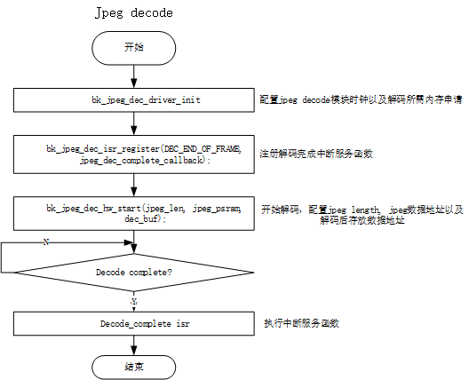

<a id="hardware-jpegdec-apis"></a>

# Hardware JPEGDEC APIs

<a id="jpegdec-api-categories"></a>

## JPEGDEC API Categories

JPEGDEC APIs:
:   - [`bk_jpeg_dec_driver_init()`](#_CPPv423bk_jpeg_dec_driver_initv "bk_jpeg_dec_driver_init") \- init jpeg decode hardware module
    - [`bk_jpeg_dec_driver_deinit()`](#_CPPv425bk_jpeg_dec_driver_deinitv "bk_jpeg_dec_driver_deinit") \- deinit jpeg decode hardware module
    - [`bk_jpeg_dec_hw_start()`](#_CPPv420bk_jpeg_dec_hw_start8uint32_tPhPh "bk_jpeg_dec_hw_start") \- start jpeg decode
    - [`bk_jpeg_dec_stop()`](#_CPPv416bk_jpeg_dec_stopv "bk_jpeg_dec_stop") \- stop jpeg decode
    - [`bk_jpeg_dec_isr_register()`](#_CPPv424bk_jpeg_dec_isr_register14jpeg_dec_isr_t "bk_jpeg_dec_isr_register") \- register jpeg dec complete callback

<a id="hw-jpeg-decode-config"></a>

## HW JPEG DECODE Config

<a id="id2"></a>



Figure 1\. jpeg decode config flow

<a id="api-reference"></a>

## API Reference

<a id="header-file"></a>

### Header File

- [jpeg\_dec.h](https://docs.bekencorp.com/arminodoc/bk_avdk/bk7258/zh_CN/v2.0.1/_header_files/bk_idk/include/driver/jpeg_dec.h)

<a id="functions"></a>

### Functions

<a id="_CPPv423bk_jpeg_dec_driver_initv"></a>

<a id="_CPPv323bk_jpeg_dec_driver_initv"></a> <a id="_CPPv223bk_jpeg_dec_driver_initv"></a> <a id="bk_jpeg_dec_driver_init__void"></a> <a id="jpeg__dec_8h_1a552f51ade0e024fad2c5ee5915d16ad2"></a> bk\_err\_t bk\_jpeg\_dec\_driver\_init(void)
:   HW JPEG DEC API.

    this api open the jpeg decode clk

<a id="_CPPv425bk_jpeg_dec_driver_deinitv"></a>

<a id="_CPPv325bk_jpeg_dec_driver_deinitv"></a> <a id="_CPPv225bk_jpeg_dec_driver_deinitv"></a> <a id="bk_jpeg_dec_driver_deinit__void"></a> <a id="jpeg__dec_8h_1af8646c6e4195a498f12bdf1d833e3217"></a> bk\_err\_t bk\_jpeg\_dec\_driver\_deinit(void)
:   this api close the jpeg decode clk

    - disable jpeg decode

<a id="_CPPv424bk_jpeg_dec_line_int_disv"></a>

<a id="_CPPv324bk_jpeg_dec_line_int_disv"></a> <a id="_CPPv224bk_jpeg_dec_line_int_disv"></a> <a id="bk_jpeg_dec_line_int_dis__void"></a> <a id="jpeg__dec_8h_1a0cec9f70d58a676de0e6ce732a6e629c"></a> bk\_err\_t bk\_jpeg\_dec\_line\_int\_dis(void)
:   this api used for jpeg decode config

    this api used for jpeg decode line interrupt config decode can select a frame complete done isr(defult) , or this decode lin\_num enter int isr

    Usage example:

    ```
     if x pixel 320, you set bk_jpeg_dec_line_int_en(32), every 32 line will enter isr, in all ten times
     if x pixel 240, you set bk_jpeg_dec_line_int_en(24), every 24 line will enter isr, in all ten times
    ```

    this api used for disable jpeg decode line num int

    参数
    :   - **xpixel** – jpeg decode picture x pixel

          - input\_buf decode input data addr

            - output\_buf decode output data addr
        - **lin\_num** – decode line num ,should multiple of 8,

    返回
    :   - BK\_OK: succeed
        - others: other errors.

    返回


    返回
    :   - BK\_OK: succeed
        - others: other errors.

    返回


    返回
    :   - BK\_OK: succeed
        - others: other errors.

<a id="_CPPv420bk_jpeg_dec_hw_start8uint32_tPhPh"></a>

<a id="_CPPv320bk_jpeg_dec_hw_start8uint32_tPhPh"></a> <a id="_CPPv220bk_jpeg_dec_hw_start8uint32_tPhPh"></a> <a id="bk_jpeg_dec_hw_start__uint32_t.unsigned-cP.unsigned-cP"></a> <a id="jpeg__dec_8h_1a0fc1a529ca48d60ef88a72b6fb8e4d8f"></a> bk\_err\_t bk\_jpeg\_dec\_hw\_start(uint32\_t length, unsigned char \*input\_buf, unsigned char \*output\_buf)
:   this api start jpeg decode

    参数
    :   **length** – jpeg length

        - input\_buf jpeg data src addr
        - output\_buf jpeg decode output addr

    返回
    :   0: jpeg decode ok; others: error

<a id="_CPPv421bk_jpeg_dec_dma_start8uint32_tPhPh"></a>

<a id="_CPPv321bk_jpeg_dec_dma_start8uint32_tPhPh"></a> <a id="_CPPv221bk_jpeg_dec_dma_start8uint32_tPhPh"></a> <a id="bk_jpeg_dec_dma_start__uint32_t.unsigned-cP.unsigned-cP"></a> <a id="jpeg__dec_8h_1aa3b2bce4f370b8745c8f466eacd6ced4"></a> bk\_err\_t bk\_jpeg\_dec\_dma\_start(uint32\_t length, unsigned char \*input\_buf, unsigned char \*output\_buf)
:   this api start jpeg decode

    参数
    :   **length** – jpeg length

        - input\_buf jpeg data src addr
        - output\_buf jpeg decode output addr

    返回
    :   0: jpeg decode ok; others: error

<a id="_CPPv416bk_jpeg_dec_stopv"></a>

<a id="_CPPv316bk_jpeg_dec_stopv"></a> <a id="_CPPv216bk_jpeg_dec_stopv"></a> <a id="bk_jpeg_dec_stop__void"></a> <a id="jpeg__dec_8h_1afcfee99c48a3ba77697f1f9210766115"></a> bk\_err\_t bk\_jpeg\_dec\_stop(void)
:   stop jpeg decode

    返回
    :   0: jpeg decode stop ok; others: error

<a id="_CPPv422bk_jpeg_dec_out_format14pixel_format_t"></a>

<a id="_CPPv322bk_jpeg_dec_out_format14pixel_format_t"></a> <a id="_CPPv222bk_jpeg_dec_out_format14pixel_format_t"></a> <a id="bk_jpeg_dec_out_format__pixel_format_t"></a> <a id="jpeg__dec_8h_1a5fe45f3b27fbd017ab547012c69d8acf"></a> bk\_err\_t bk\_jpeg\_dec\_out\_format(pixel\_format\_t pixel\_fmt)
:   set jpeg decode out format, useful in bk7258

    参数
    :   **pixel\_fmt** – select, PIXEL\_FMT\_YUYV(default), PIXEL\_FMT\_VUYY, PIXEL\_FMT\_VYUY (not commonly used),PIXEL\_FMT\_YYUV(not commonly used)

    返回
    :   BK\_OK

<a id="_CPPv424bk_jpeg_dec_line_num_set10line_num_t"></a>

<a id="_CPPv324bk_jpeg_dec_line_num_set10line_num_t"></a> <a id="_CPPv224bk_jpeg_dec_line_num_set10line_num_t"></a> <a id="bk_jpeg_dec_line_num_set__line_num_t"></a> <a id="jpeg__dec_8h_1a6d5efe3365ce52c31436a982a682852f"></a> void bk\_jpeg\_dec\_line\_num\_set([line\_num\_t](#_CPPv410line_num_t "line_num_t") line\_num)
:   when set decode by line, use this api config decode by how many lines

    参数
    :   **select** – according to line\_num\_t enum,like 8/16/24/32….etc. multiple of 8 line

<a id="_CPPv425bk_jpeg_dec_by_line_startv"></a>

<a id="_CPPv325bk_jpeg_dec_by_line_startv"></a> <a id="_CPPv225bk_jpeg_dec_by_line_startv"></a> <a id="bk_jpeg_dec_by_line_start__void"></a> <a id="jpeg__dec_8h_1a389a409848d9b469f65a67660e990684"></a> void bk\_jpeg\_dec\_by\_line\_start(void)
:   start decode in every line decode isr

<a id="_CPPv421jpeg_dec_set_dst_addrPh"></a>

<a id="_CPPv321jpeg_dec_set_dst_addrPh"></a> <a id="_CPPv221jpeg_dec_set_dst_addrPh"></a> <a id="jpeg_dec_set_dst_addr__unsigned-cP"></a> <a id="jpeg__dec_8h_1a3e78323a75b489a15eddcb60968c448f"></a> bk\_err\_t jpeg\_dec\_set\_dst\_addr(unsigned char \*output\_buf)
:   set decode output addr,this api is changed by line decode mode isr

<a id="_CPPv441bk_jpeg_dec_by_line_is_last_line_completev"></a>

<a id="_CPPv341bk_jpeg_dec_by_line_is_last_line_completev"></a> <a id="_CPPv241bk_jpeg_dec_by_line_is_last_line_completev"></a> <a id="bk_jpeg_dec_by_line_is_last_line_complete__void"></a> <a id="jpeg__dec_8h_1ac8eace78902810c095e25b3b34fbbb3f"></a> bool bk\_jpeg\_dec\_by\_line\_is\_last\_line\_complete(void)
:   check decode by line is decode last line complete

    返回
    :   return true: last line complete

<a id="_CPPv424bk_jpeg_dec_isr_register14jpeg_dec_isr_t"></a>

<a id="_CPPv324bk_jpeg_dec_isr_register14jpeg_dec_isr_t"></a> <a id="_CPPv224bk_jpeg_dec_isr_register14jpeg_dec_isr_t"></a> <a id="bk_jpeg_dec_isr_register__jpeg_dec_isr_t"></a> <a id="jpeg__dec_8h_1af137e01a2a21f57ffd2e616364074e26"></a> bk\_err\_t bk\_jpeg\_dec\_isr\_register(jpeg\_dec\_isr\_t jpeg\_dec\_isr)
:   This API is direct registerjpeg dec cpu isr.

    参数
    :   **isr** – isr function

    返回
    :   - BK\_OK: succeed
        - others: other errors.

<a id="api-typedefs"></a>

## API Typedefs

<a id="id1"></a>

### Header File

- [jpeg\_dec\_types.h](https://docs.bekencorp.com/arminodoc/bk_avdk/bk7258/zh_CN/v2.0.1/_header_files/bk_idk/include/driver/jpeg_dec_types.h)

<a id="structures"></a>

### Structures

<a id="_CPPv414jpeg_dec_res_t"></a>

<a id="_CPPv314jpeg_dec_res_t"></a> <a id="_CPPv214jpeg_dec_res_t"></a> <a id="jpeg_dec_res_t"></a> <a id="structjpeg__dec__res__t"></a> struct jpeg\_dec\_res\_t
:   jpeg dec isr return value

    <a id="breathe-section-title-public-members"></a>

    Public Members

    <a id="_CPPv4N14jpeg_dec_res_t2okE"></a>

    <a id="_CPPv3N14jpeg_dec_res_t2okE"></a> <a id="_CPPv2N14jpeg_dec_res_t2okE"></a> <a id="jpeg_dec_res_t::ok__uint8_t"></a> <a id="structjpeg__dec__res__t_1af6396e1a2875995947d73c9ad29ef117"></a> uint8\_t ok
    :   jpeg decoder success

    <a id="_CPPv4N14jpeg_dec_res_t7pixel_xE"></a>

    <a id="_CPPv3N14jpeg_dec_res_t7pixel_xE"></a> <a id="_CPPv2N14jpeg_dec_res_t7pixel_xE"></a> <a id="jpeg_dec_res_t::pixel_x__uint16_t"></a> <a id="structjpeg__dec__res__t_1ae6d8f949366ecb9b066193f25d8e1f90"></a> uint16\_t pixel\_x
    :   jpeg x pixel

    <a id="_CPPv4N14jpeg_dec_res_t7pixel_yE"></a>

    <a id="_CPPv3N14jpeg_dec_res_t7pixel_yE"></a> <a id="_CPPv2N14jpeg_dec_res_t7pixel_yE"></a> <a id="jpeg_dec_res_t::pixel_y__uint16_t"></a> <a id="structjpeg__dec__res__t_1ac793397e9b6dd6f4f29455f9d5130134"></a> uint16\_t pixel\_y
    :   jpeg y pixel

    <a id="_CPPv4N14jpeg_dec_res_t4sizeE"></a>

    <a id="_CPPv3N14jpeg_dec_res_t4sizeE"></a> <a id="_CPPv2N14jpeg_dec_res_t4sizeE"></a> <a id="jpeg_dec_res_t::size__uint32_t"></a> <a id="structjpeg__dec__res__t_1aeb5b34ca5bb957da48356493929ed84a"></a> uint32\_t size
    :   jpeg size

    <a id="_CPPv4N14jpeg_dec_res_t13jpeg_enc_modeE"></a>

    <a id="_CPPv3N14jpeg_dec_res_t13jpeg_enc_modeE"></a> <a id="_CPPv2N14jpeg_dec_res_t13jpeg_enc_modeE"></a> <a id="jpeg_dec_res_t::jpeg_enc_mode__jpeg_encode_mode_t"></a> <a id="structjpeg__dec__res__t_1a76e38f3db640e3690e4eaf62b6bc2f17"></a> [jpeg\_encode\_mode\_t](#_CPPv418jpeg_encode_mode_t "jpeg_encode_mode_t") jpeg\_enc\_mode
    :   jpeg encode mode

<a id="macros"></a>

### Macros

<a id="c.USE_JPEG_DEC_COMPLETE_CALLBACKS"></a>

<a id="jpeg__dec__types_8h_1a66088280275a86c35d56d6063a4e1093"></a> USE\_JPEG\_DEC\_COMPLETE\_CALLBACKS
:   set 1, register jpeg decode complete callback, set 0, register jpeg dec cpu isr

<a id="type-definitions"></a>

### Type Definitions

<a id="_CPPv410line_num_t"></a>

<a id="_CPPv310line_num_t"></a> <a id="_CPPv210line_num_t"></a> <a id="line_num_t"></a> <a id="jpeg__dec__types_8h_1a8a8ddcd5a2c2e982a1d6ebd848a210e1"></a> typedef enum [\_line\_num](#_CPPv49_line_num "_line_num") line\_num\_t

<a id="_CPPv417jpeg_dec_isr_cb_t"></a>

<a id="_CPPv317jpeg_dec_isr_cb_t"></a> <a id="_CPPv217jpeg_dec_isr_cb_t"></a> <a id="jpeg_dec_isr_cb_t"></a> <a id="jpeg__dec__types_8h_1a39dfc07581e88fe81cdee98045629833"></a> typedef void (\*jpeg\_dec\_isr\_cb\_t)([jpeg\_dec\_res\_t](#_CPPv414jpeg_dec_res_t "jpeg_dec_res_t") \*result)
:   refistrer type jpeg decode complete isr function

    param return jpeg x pixel , y pixel , and jpeg size

    Return
    :   - BK\_OK: succeed
        - others: other errors. jpegdec int isr register func type

<a id="enumerations"></a>

### Enumerations

<a id="_CPPv418jpeg_encode_mode_t"></a>

<a id="_CPPv318jpeg_encode_mode_t"></a> <a id="_CPPv218jpeg_encode_mode_t"></a> <a id="jpeg__dec__types_8h_1a8ddabc3f1f53adec2ac477b182c2e326"></a> enum jpeg\_encode\_mode\_t
:   *Values:*

    <a id="_CPPv4N18jpeg_encode_mode_t17JPEG_ENCODE_UNSTDE"></a>

    <a id="_CPPv3N18jpeg_encode_mode_t17JPEG_ENCODE_UNSTDE"></a> <a id="_CPPv2N18jpeg_encode_mode_t17JPEG_ENCODE_UNSTDE"></a> <a id="jpeg__dec__types_8h_1a8ddabc3f1f53adec2ac477b182c2e326a71e66061fb052c9899f9f7507515e869"></a> enumerator JPEG\_ENCODE\_UNSTD

    <a id="_CPPv4N18jpeg_encode_mode_t18JPEG_ENCODE_YUV420E"></a>

    <a id="_CPPv3N18jpeg_encode_mode_t18JPEG_ENCODE_YUV420E"></a> <a id="_CPPv2N18jpeg_encode_mode_t18JPEG_ENCODE_YUV420E"></a> <a id="jpeg__dec__types_8h_1a8ddabc3f1f53adec2ac477b182c2e326a5caddca91d5a3afbc3c988ee5c4aae78"></a> enumerator JPEG\_ENCODE\_YUV420

    <a id="_CPPv4N18jpeg_encode_mode_t18JPEG_ENCODE_YUV422E"></a>

    <a id="_CPPv3N18jpeg_encode_mode_t18JPEG_ENCODE_YUV422E"></a> <a id="_CPPv2N18jpeg_encode_mode_t18JPEG_ENCODE_YUV422E"></a> <a id="jpeg__dec__types_8h_1a8ddabc3f1f53adec2ac477b182c2e326a9c8b1ba23dc39a9cfe4634b8db5f7b4f"></a> enumerator JPEG\_ENCODE\_YUV422

    <a id="_CPPv4N18jpeg_encode_mode_t18JPEG_ENCODE_YUV444E"></a>

    <a id="_CPPv3N18jpeg_encode_mode_t18JPEG_ENCODE_YUV444E"></a> <a id="_CPPv2N18jpeg_encode_mode_t18JPEG_ENCODE_YUV444E"></a> <a id="jpeg__dec__types_8h_1a8ddabc3f1f53adec2ac477b182c2e326a8f0573ec41a22730f8798520f82066cb"></a> enumerator JPEG\_ENCODE\_YUV444

<a id="_CPPv47JRESULT"></a>

<a id="_CPPv37JRESULT"></a> <a id="_CPPv27JRESULT"></a> <a id="jpeg__dec__types_8h_1afad169fe8afac8df0e63c84451334aa7"></a> enum JRESULT
:   Error code

    *Values:*

    <a id="_CPPv4N7JRESULT6JDR_OKE"></a>

    <a id="_CPPv3N7JRESULT6JDR_OKE"></a> <a id="_CPPv2N7JRESULT6JDR_OKE"></a> <a id="jpeg__dec__types_8h_1afad169fe8afac8df0e63c84451334aa7a385067f3b2ef0bc7a8ef7d608dec9d7a"></a> enumerator JDR\_OK
    :   0: Succeeded

    <a id="_CPPv4N7JRESULT8JDR_INTRE"></a>

    <a id="_CPPv3N7JRESULT8JDR_INTRE"></a> <a id="_CPPv2N7JRESULT8JDR_INTRE"></a> <a id="jpeg__dec__types_8h_1afad169fe8afac8df0e63c84451334aa7a0c681360e9e61fa13a20ea17930efcdc"></a> enumerator JDR\_INTR
    :   1: Interrupted by output function

    <a id="_CPPv4N7JRESULT7JDR_INPE"></a>

    <a id="_CPPv3N7JRESULT7JDR_INPE"></a> <a id="_CPPv2N7JRESULT7JDR_INPE"></a> <a id="jpeg__dec__types_8h_1afad169fe8afac8df0e63c84451334aa7a32738f8cc7dfc473bd08e7304864a383"></a> enumerator JDR\_INP
    :   2: Device error or wrong termination of input stream

    <a id="_CPPv4N7JRESULT8JDR_MEM1E"></a>

    <a id="_CPPv3N7JRESULT8JDR_MEM1E"></a> <a id="_CPPv2N7JRESULT8JDR_MEM1E"></a> <a id="jpeg__dec__types_8h_1afad169fe8afac8df0e63c84451334aa7a3bf881c1dda2585790262b8bf90a58bc"></a> enumerator JDR\_MEM1
    :   3: Insufficient memory pool for the image

    <a id="_CPPv4N7JRESULT8JDR_MEM2E"></a>

    <a id="_CPPv3N7JRESULT8JDR_MEM2E"></a> <a id="_CPPv2N7JRESULT8JDR_MEM2E"></a> <a id="jpeg__dec__types_8h_1afad169fe8afac8df0e63c84451334aa7a1bad2c149d075898d5a2057c36944498"></a> enumerator JDR\_MEM2
    :   4: Insufficient stream input buffer

    <a id="_CPPv4N7JRESULT7JDR_PARE"></a>

    <a id="_CPPv3N7JRESULT7JDR_PARE"></a> <a id="_CPPv2N7JRESULT7JDR_PARE"></a> <a id="jpeg__dec__types_8h_1afad169fe8afac8df0e63c84451334aa7a6ba2d79df76ec386fa8bb676b4fba24f"></a> enumerator JDR\_PAR
    :   5: Parameter error

    <a id="_CPPv4N7JRESULT8JDR_FMT1E"></a>

    <a id="_CPPv3N7JRESULT8JDR_FMT1E"></a> <a id="_CPPv2N7JRESULT8JDR_FMT1E"></a> <a id="jpeg__dec__types_8h_1afad169fe8afac8df0e63c84451334aa7abf28072708ad79d0a1f6c2e5c8272eb7"></a> enumerator JDR\_FMT1
    :   6: Data format error (may be damaged data)

    <a id="_CPPv4N7JRESULT8JDR_FMT2E"></a>

    <a id="_CPPv3N7JRESULT8JDR_FMT2E"></a> <a id="_CPPv2N7JRESULT8JDR_FMT2E"></a> <a id="jpeg__dec__types_8h_1afad169fe8afac8df0e63c84451334aa7aad33a77dec9e843adca3611d8abc3628"></a> enumerator JDR\_FMT2
    :   7: Right format but not supported

    <a id="_CPPv4N7JRESULT8JDR_FMT3E"></a>

    <a id="_CPPv3N7JRESULT8JDR_FMT3E"></a> <a id="_CPPv2N7JRESULT8JDR_FMT3E"></a> <a id="jpeg__dec__types_8h_1afad169fe8afac8df0e63c84451334aa7a1635eda9fa9febb37f8dcefebe7c690e"></a> enumerator JDR\_FMT3
    :   8: Not supported JPEG standard

<a id="_CPPv49_line_num"></a>

<a id="_CPPv39_line_num"></a> <a id="_CPPv29_line_num"></a> <a id="jpeg__dec__types_8h_1a08b6cdc268707689b7263aad713e7118"></a> enum \_line\_num
:   *Values:*

    <a id="_CPPv4N9_line_num6LINE_8E"></a>

    <a id="_CPPv3N9_line_num6LINE_8E"></a> <a id="_CPPv2N9_line_num6LINE_8E"></a> <a id="jpeg__dec__types_8h_1a08b6cdc268707689b7263aad713e7118a91f99357ccb245440517fdbf8c0af446"></a> enumerator LINE\_8

    <a id="_CPPv4N9_line_num7LINE_16E"></a>

    <a id="_CPPv3N9_line_num7LINE_16E"></a> <a id="_CPPv2N9_line_num7LINE_16E"></a> <a id="jpeg__dec__types_8h_1a08b6cdc268707689b7263aad713e7118aaa7254a951ab4719f5c7996ef647ddcf"></a> enumerator LINE\_16

    <a id="_CPPv4N9_line_num7LINE_24E"></a>

    <a id="_CPPv3N9_line_num7LINE_24E"></a> <a id="_CPPv2N9_line_num7LINE_24E"></a> <a id="jpeg__dec__types_8h_1a08b6cdc268707689b7263aad713e7118a46a1e4f8266d5636aa282a99f7189fab"></a> enumerator LINE\_24

    <a id="_CPPv4N9_line_num7LINE_32E"></a>

    <a id="_CPPv3N9_line_num7LINE_32E"></a> <a id="_CPPv2N9_line_num7LINE_32E"></a> <a id="jpeg__dec__types_8h_1a08b6cdc268707689b7263aad713e7118aae4d4b114ea2040e564dd4abfbab0401"></a> enumerator LINE\_32

    <a id="_CPPv4N9_line_num7LINE_40E"></a>

    <a id="_CPPv3N9_line_num7LINE_40E"></a> <a id="_CPPv2N9_line_num7LINE_40E"></a> <a id="jpeg__dec__types_8h_1a08b6cdc268707689b7263aad713e7118a4723d0debb769d097fdfda56e018ad89"></a> enumerator LINE\_40

    <a id="_CPPv4N9_line_num7LINE_48E"></a>

    <a id="_CPPv3N9_line_num7LINE_48E"></a> <a id="_CPPv2N9_line_num7LINE_48E"></a> <a id="jpeg__dec__types_8h_1a08b6cdc268707689b7263aad713e7118a7dd19a6e3d356eacc8a887fe69a6c74e"></a> enumerator LINE\_48

<a id="_CPPv419jpeg_dec_isr_type_t"></a>

<a id="_CPPv319jpeg_dec_isr_type_t"></a> <a id="_CPPv219jpeg_dec_isr_type_t"></a> <a id="jpeg__dec__types_8h_1a1a1354fb4e996706ddb611a3d075c160"></a> enum jpeg\_dec\_isr\_type\_t
:   *Values:*

    <a id="_CPPv4N19jpeg_dec_isr_type_t16DEC_END_OF_FRAMEE"></a>

    <a id="_CPPv3N19jpeg_dec_isr_type_t16DEC_END_OF_FRAMEE"></a> <a id="_CPPv2N19jpeg_dec_isr_type_t16DEC_END_OF_FRAMEE"></a> <a id="jpeg__dec__types_8h_1a1a1354fb4e996706ddb611a3d075c160a2a86ddc1a50843dcfcd91710e772ba9f"></a> enumerator DEC\_END\_OF\_FRAME
    :   select jpeg decode a complete frame enter isr callback

    <a id="_CPPv4N19jpeg_dec_isr_type_t18DEC_EVERY_LINE_INTE"></a>

    <a id="_CPPv3N19jpeg_dec_isr_type_t18DEC_EVERY_LINE_INTE"></a> <a id="_CPPv2N19jpeg_dec_isr_type_t18DEC_EVERY_LINE_INTE"></a> <a id="jpeg__dec__types_8h_1a1a1354fb4e996706ddb611a3d075c160a82407abfb4b82bb1aa56f01d811a0059"></a> enumerator DEC\_EVERY\_LINE\_INT
    :   select jpeg decode by line num enter isr callback

    <a id="_CPPv4N19jpeg_dec_isr_type_t7DEC_ERRE"></a>

    <a id="_CPPv3N19jpeg_dec_isr_type_t7DEC_ERRE"></a> <a id="_CPPv2N19jpeg_dec_isr_type_t7DEC_ERRE"></a> <a id="jpeg__dec__types_8h_1a1a1354fb4e996706ddb611a3d075c160ae7ac53933648f6d9915960c3906f1a37"></a> enumerator DEC\_ERR

    <a id="_CPPv4N19jpeg_dec_isr_type_t11DEC_ISR_MAXE"></a>

    <a id="_CPPv3N19jpeg_dec_isr_type_t11DEC_ISR_MAXE"></a> <a id="_CPPv2N19jpeg_dec_isr_type_t11DEC_ISR_MAXE"></a> <a id="jpeg__dec__types_8h_1a1a1354fb4e996706ddb611a3d075c160aeedf1b35b37bb22dbe07c948c7973ebd"></a> enumerator DEC\_ISR\_MAX
