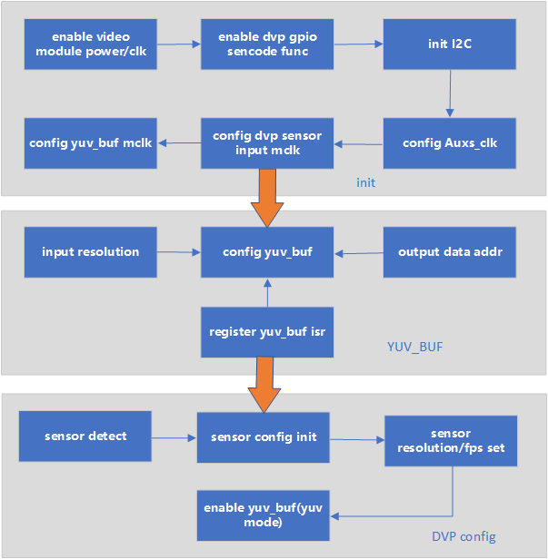
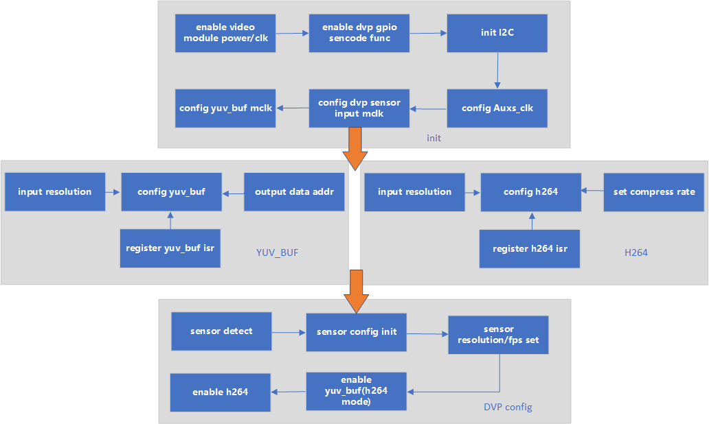

# DVP Camera 详解

## 1 DVP简介

> 当前DVP摄像头是基于CIS接口，仅支持20/24Pin的8bit数据输出。是通过I2C协议对sensor内部寄存器机型配置，以达到需要输出的分辨率、帧率以及曝光等性能调节。
> 另外针对sensor输出的数据，需要使用硬件模块做进一步的编辑，比如使用YUV\_BUF模块对sensor输出的YUV422数据做裁剪，做转换，比如转换成YUV420，然后使用H264模块进行编码，
> 减小内存空间的使用，以做更多的功能；或者直接针对YUV422数据使用JPEG模块进行编码，输出更加稳定且内存空间使用较小的图像。

## 2 DVP目前支持的类型与规格

> 已支持的外设，请参考 [支持外设](../support_peripherals.md)

## 3 DVP的使用流程

- 1、给各个多媒体硬件模块进行上电和时钟配置，包括YUV\_BUF/JPEG/H264模块，并且给sensor供电；
- 2、初始化I2C，因为需要利用I2C配置DVP寄存器，明确DVP的write/read地址
- 3、配置DVP的GPIO第二功能，使输出能实时被检测
- 4、配置sensor的输入时钟，时钟的来源有两种：对YUV\_BUF的时钟分频和对AUXS时钟分频
- 5、根据具体应用配置YUV\_BUF/JPEG/H264的寄存器的值，同时配置DMA对数据进行处理，最后使能相关模块；
- 6、通过I2C配置sensor的寄存器值，达到理想的输出数据；

## 4 DVP工作模式的主要应用

> DVP摄像头可以依赖不同的硬件模块，以达到不同的需求，下面列举了几种主要的应用。

1、DVP工作在YUV（或GRAY）模式下

Figure 1.DVP工作在YUV（或GRAY）模式下

2、DVP工作在JPEG(或JPEG\&YUV)模式下

Figure 2.DVP工作在JPEG模式下

3、DVP工作在H264(或H264\&YUV)模式下

Figure 3.DVP工作在H264模式下
