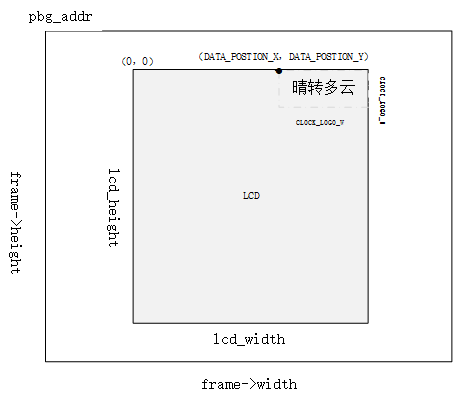
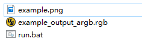
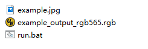

<a id="osd"></a>

# OSD视频叠加

<a id="id1"></a>

## 1、功能概述

> OSD(on screen display)，视频叠加显示, 在视频或图片上叠加字符和图标显示。
> 其中，字符叠加使用的是CPU运算实现，图标叠加可以使用CPU，也可以使用DMA2D的方式实现。

<a id="id2"></a>

## 2、参考代码

> OSD参考工程在 [doorbell](https://docs.bekencorp.com/arminodoc/bk_avdk/bk7258/zh_CN/v2.0.1/projects_work/media/doorbell/index.html)
>
> 用户使用参考 [DMA2D用户手册参考](../../display/dma2d_user_guide/dma2d_user_guide.md)
>
> OSD参考代码在 `components/bk_draw_blend` 和 `components/display_service/src/lcd_draw_blend.c`

<a id="id3"></a>

## 3、字库融合

字库融合需要先生成字库，然后融合到图片上，关于字库生成的文档请参考 [字库生成](font_generate.md)

字库融合的示意图如下：

<a id="id8"></a>



Figure. font\_osd

下面对图进行说明：
:   - 外面的大图表示摄像头实际出图，可能比屏幕大，也可能与屏幕大小相同。
    - 融合的位置是以LCD为参考的坐标点。

调用字库融合的 app 层接口在 lcd\_draw\_blend.c 中，API 具体的使用如下：

> - start\_x，start\_y 刷屏的起始位置，是在图片比LCD屏幕尺寸大时，display取居中数据刷屏，即图中的坐标点（0，0）。
> - pixel\_bytes是根据背景像素是RGB888还是YUV或RGB565定义
> - frame\_addr\_offset：即图标显示基于基地址的偏移量，比如时钟clock显示在屏幕坐标的（0，0）位置，那么frame\_addr\_offset \= (start\_y \* frame-\>width \+ start\_x) \* pixel\_bytes

比如天气显示在屏幕坐标的 (DATA\_POSTION\_X, DATA\_POSTION\_Y) 那么 frame\_addr\_offset \= ((start\_y \+ DATA\_POSTION\_Y) \* frame-\>width \+ start\_x \+ DATA\_POSTION\_X) \* pixel\_bytes;

用户需要考虑当屏幕宽度不足够显示字符时，可能需要更改坐标计算偏移地址。

用户主要调用下面的接口配置的参数有：

> - 计算融合图标的偏移位置 frame\_addr\_offset
> - 融合图标的xsize ysize

```
bk_err_t lcd_font_handle(frame_buffer_t *frame, uint16_t lcd_width, uint16_t lcd_height)
{
        #if (CONFIG_LCD_FONT_BLEND)
        lcd_font_config_t lcd_font_config = {0};

        uint16_t start_x = 0;
        uint16_t start_y = 0;
        uint32_t frame_addr_offset = 0;
        uint8_t pixel_bytes;
        if(g_blend_data.lcd_blend_type == 0)
        {
                return BK_OK;
        }
                if ((lcd_width < frame->width) || (lcd_height < frame->height)) //for lcd size is small then frame image size
                {
                        if (lcd_width < frame->width)
                                start_x = (frame->width - lcd_width) / 2;
                        if (lcd_height < frame->height)
                                start_y = (frame->height - lcd_height) / 2;
                }
                if (frame->fmt == PIXEL_FMT_RGB888)
                        pixel_bytes = 3;
                else
                        pixel_bytes = 2;
        ///示例一：时间融合到（0，0）位置
        if ((g_blend_data.lcd_blend_type & LCD_BLEND_TIME) != 0)         /// start display lcd (0,0)
        {
                frame_addr_offset = (start_y * frame->width + start_x) * pixel_bytes;

                lcd_font_config.pbg_addr = (uint8_t *)(frame->frame + frame_addr_offset);
                lcd_font_config.bg_offline = frame->width - CLOCK_LOGO_W;  //不需要，在DMA2D中使用
                lcd_font_config.xsize = CLOCK_LOGO_W;                      // 显示汉字的宽度
                lcd_font_config.ysize = CLOCK_LOGO_H;                      //显示汉字的高度
                lcd_font_config.str_num = 1;
                if (frame->fmt == PIXEL_FMT_VUYY)
                        lcd_font_config.font_format = FONT_VUYY;               //字库融合的输出像素
                else if (frame->fmt == PIXEL_FMT_YUYV)
                        lcd_font_config.font_format = FONT_YUYV;
                else
                        lcd_font_config.font_format = FONT_RGB565;

                lcd_font_config.str[0] = (font_str_t){(const char *)g_blend_data.time_data, FONT_WHITE, font_digit_Roboto53, 0,0};
                lcd_font_config.bg_data_format = frame->fmt;             //背景的像素格式
                lcd_font_config.bg_width = frame->width;                 //背景的图片宽度
                lcd_font_config.bg_height = frame->height;               //背景的图片高度
                lcd_driver_font_blend(&lcd_font_config);
         }

        ///示例二：日期融合到（DATA_POSTION_X，DATA_POSTION_Y）位置
        if ((g_blend_data.lcd_blend_type & LCD_BLEND_DATA) != 0)   /// tart display lcd (DATA_POSTION_X,DATA_POSTION_Y)
        {
                if ((DATA_POSTION_X + DATA_LOGO_W) > lcd_width)
                        frame_addr_offset = ((start_y + DATA_POSTION_Y + lcd_height - DATA_LOGO_H) * frame->width + start_x) * pixel_bytes;
                else
                        frame_addr_offset = ((start_y + DATA_POSTION_Y) * frame->width + start_x + DATA_POSTION_X) * pixel_bytes;
                lcd_font_config.pbg_addr = (uint8_t *)(frame->frame + frame_addr_offset);
                lcd_font_config.bg_offline = frame->width - DATA_LOGO_W;
                lcd_font_config.xsize = DATA_LOGO_W;
                lcd_font_config.ysize = DVP_LOGO_H;
                lcd_font_config.str_num = 1;
                if (frame->fmt == PIXEL_FMT_VUYY)
                        lcd_font_config.font_format = FONT_VUYY;
                else if (frame->fmt == PIXEL_FMT_YUYV)
                        lcd_font_config.font_format = FONT_YUYV;
                else
                        lcd_font_config.font_format = FONT_RGB565;

                lcd_font_config.str[0] = (font_str_t){(const char *)("晴转多云, 27℃"), FONT_WHITE, font_digit_black24, 0, 2};
                lcd_font_config.bg_data_format = frame->fmt;
                lcd_font_config.bg_width = frame->width;
                lcd_font_config.bg_height = frame->height;
                lcd_driver_font_blend(&lcd_font_config);

                lcd_font_config.pbg_addr += DVP_LOGO_H * frame->width * 2;
                lcd_font_config.str[0] = (font_str_t){(const char *)("2022-12-12 星期三"), FONT_WHITE, font_digit_black24, 0, 0};
                lcd_driver_font_blend(&lcd_font_config);
        }
                ......

#endif
        return BK_OK;
}
```

备注

需要注意的是，融合需要先将背景图片拷贝到sram中，融合后再拷贝回去，拷贝的大小是根据 lcd\_font\_config.xsize和lcd\_font\_config.ysize
决定，所以用户需要注意的是图标的尺寸不能超过定义的尺寸,即lcd\_font\_config.xsize和lcd\_font\_config.ysize，
图标的尺寸如何确定请参考字库生成文档 [font generate](font_generate.md)

<a id="id5"></a>

## 4、图标融合

图标融合需要准备如下：

> - 准备需要融合的小图标的png图片或者jpg图片（又称前景图片）
> - 将png转换为rgba8888的数据，该转换可以实现保持png的透明度，适合融合背景是透明的图标。判断图片背景是否透明，可以用photoshop查看背景是否是镂空。
> - png转换工具路径： `components/multimedia/tools/ffmpeg_bat/png2argb` 将所有的png图片访在该路径下，双击run.bat.
>
> <a id="id9"></a>
> 
>
>
> Figure. png to rgba8888.rgb
>
> - 或将jpg转换为rgb565(大端)的数据，该转换过程中将所有不透明的jpg像素默认转换为不透明，适合对背景框没有要求的融合。
> - 工具路径： `components/multimedia/tools/ffmpeg_bat/jpeg2rgb565` 将所有的jpg图片访在该路径下，双击run.bat.
>
> <a id="id10"></a>
> 
>
>
> Figure. png to rgb565le.rgb
>
> - 使用 “HxD”或其他工具将rgb数据转成const数组并保存到flash中。
> - 在 “components/media/include/blend\_logo.h” 中定义前景图片，以及前景图片的长和宽:

```
#define WIFI_LOGO_W 32
#define WIFI_LOGO_H 36

const unsigned char wifi_full_rgb565[2304] = {
        0xFF, 0xFF, 0xFF, 0xFF, 0xFF, 0xFF, 0xFF, 0xFF, 0xFF, 0xFF, 0xFF, 0xFF,
        0xFF, 0xFF, 0xFF, 0xFF, 0xFF, 0xFF, 0xFF, 0xFF, 0xFF, 0xFF, 0xFF, 0xFF,
        ....
};
```

如果想要将前景图标融合在LCD屏幕的固定位置，还需要设置前景融合的坐标
比如：想要将版本号的前景图标(16x36)从屏幕(480x800)的第500行，居中的位置开始融合，可以这样设置：

```
#define VERSION_POSTION_Y   500   //HIGH 800
#define VERSION_POSTION_X   144   //WIDTH 480 "BK7 V1.23.45"  (480-(12*16))/2    12个字节, 图标宽16
```

<a id="id6"></a>

### 4.1 DMA2D融合

> DMA2D融合需要用到硬件DMA2D模块，该硬件模块只有一个，应该尽量避免DMA2D在别处使用。
> DMA2D融合的参考代码如下，用户需要传入logo图片的地址，图标的长宽，图标在LCD上显示的坐标等。
> 比如要融合的 Wi-Fi 图标在屏幕的右上角，即屏幕坐标 lcd\_blend.xpos \= lcd\_width \- WIFI\_LOGO\_W 处开始融合，代码如下：

```
bk_err_t lcd_dma2d_handle(frame_buffer_t *frame,  uint16_t lcd_width, uint16_t lcd_height)
{
#if (CONFIG_LCD_DMA2D_BLEND)
        lcd_blend_t lcd_blend = {0};

        if(g_blend_data.lcd_blend_type == 0)
        {
                return BK_OK;
        }
        if ((g_blend_data.lcd_blend_type & LCD_BLEND_WIFI) != 0)      /// start display lcd (xpos,ypos)
        {
                if(g_blend_data.wifi_data > WIFI_LEVEL_MAX - 1)
                        return BK_FAIL;
                lcd_blend.pfg_addr = (uint8_t *)wifi_logo[g_blend_data.wifi_data];
                lcd_blend.pbg_addr = (uint8_t *)(frame->frame);
                lcd_blend.xsize = WIFI_LOGO_W;               //logo width
                lcd_blend.ysize = WIFI_LOGO_H;               //logo height
                lcd_blend.xpos = lcd_width - WIFI_LOGO_W;
                lcd_blend.ypos = WIFI_LOGO_YPOS;
                lcd_blend.fg_alpha_value = FG_ALPHA;
                lcd_blend.fg_data_format = ARGB8888;
                lcd_blend.bg_data_format = frame->fmt;
                lcd_blend.bg_width = frame->width;
                lcd_blend.bg_height = frame->height;
                lcd_blend.lcd_width = lcd_width;
                lcd_blend.lcd_height = lcd_height;
                lcd_dma2d_driver_blend(&lcd_blend);
        }
#endif
return BK_OK;
}
```

<a id="cpu"></a>

### 4.2 CPU融合

CPU融合主要是将ARGB8888和yuv数据通过CPU计算叠加到背景图片中
CPU融合的代码如下：

```
bk_err_t lcd_font_handle(frame_buffer_t *frame, uint16_t lcd_width, uint16_t lcd_height)
{
         ...........

        if ((g_blend_data.lcd_blend_type & LCD_BLEND_WIFI) != 0)      /// start display lcd (lcd_width,0)
        {
                lcd_blend_t lcd_blend = {0};
                LOGD("lcd wifi blend level =%d \n", g_blend_data.wifi_data);
                frame_addr_offset = (start_y * frame->width + start_x + (lcd_width - WIFI_LOGO_W)) * pixel_bytes;

                lcd_blend.pfg_addr = (uint8_t *)wifi_logo[g_blend_data.wifi_data];
                lcd_blend.pbg_addr = (uint8_t *)(frame->frame + frame_addr_offset);
                lcd_blend.fg_offline = 0;
                lcd_blend.bg_offline = frame->width - WIFI_LOGO_W;
                lcd_blend.xsize = WIFI_LOGO_W;
                lcd_blend.ysize = WIFI_LOGO_H;
                lcd_blend.fg_alpha_value = FG_ALPHA;
                lcd_blend.fg_data_format = ARGB8888;
                lcd_blend.bg_data_format = frame->fmt;
                lcd_blend.bg_width = frame->width;
                lcd_blend.bg_height = frame->height;
                lcd_driver_blend(&lcd_blend);
        }

        .........

        return BK_OK;
}
```

<a id="id7"></a>

## 5\. 注意事项

注意

对于CPU进行图片小图标融合，背景数据为YUV数据（一般为解码后的YUV数据），软件实现是将融合坐标点处的背景拷贝出来，拷贝的大小和小图标size一样,将拷贝的数据暂存在blend\_addr1内存中，
然后直接将ARGB8888的小图标数据和背景融合到该地址blend\_addr1中，如果小图标还需要额外的旋转，则需要增加一块相同内存大小的内存blend\_addr2。
如果不需要小图标的旋转，则只需要一块内存即可，该内存的大小应大于小图标的大小。

blend\_addr1 和 blend\_addr2 内存的申请在 “components/bk\_draw\_blend/draw\_blend.c” 的API: bk\_err\_t lcd\_blend\_malloc\_buffer(void)中，
用户可以根据需要修改该内存的大小，如果不需要blend\_addr2 可以不申请。

即:

```
lcd_blend.xsize = WIFI_LOGO_W;
lcd_blend.ysize = WIFI_LOGO_H;

需要保证 WIFI_LOGO_W * WIFI_LOGO_H * 2 < blend_addr1
```

其中 lcd\_blend\_malloc\_buffer中的实现如下：

```
blend_addr1 = (uint8_t *)os_malloc(LCD_BLEND_MALLOC_SIZE);
blend_addr2 = (uint8_t *)os_malloc(LCD_BLEND_MALLOC_RG4B_SIZE);
```

注意

对于CPU进行字库小图标融合，背景数据为YUV（一般为解码后的YUV数据）或RGB565数据，软件实现是直接将汉字画到背景YUV/RGB565数据中，所以需要将背景中的YUV数据拷贝到blend\_addr1中，
如果不需要小图标的旋转，即不需要申请blend\_addr2,只需要保证：

```
lcd_font_config.xsize = CLOCK_LOGO_W;
lcd_font_config.ysize = CLOCK_LOGO_H;

CLOCK_LOGO_W * CLOCK_LOGO_H * 2 < blend_addr1
```

注意

对于DMA2D硬件融合，是硬件直接将前景图片融合到背景的指定坐标点，不需要申请额外的内存，背景数据格式可以为YUV/RGB565/RGB888，前景为ARGB8888，还可以设置前景的透明度。所以，
对于图标的融合使用优先选择硬件DMA2D，但是由于DMA2D在doorbell工程中（按行解码旋转模式）作为拷贝数据已经使用，所以工程中默认使用CPU融合。
