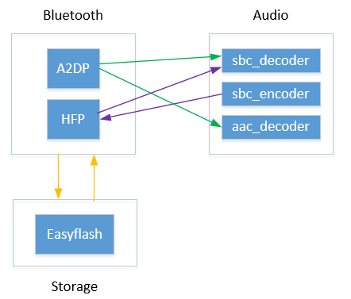
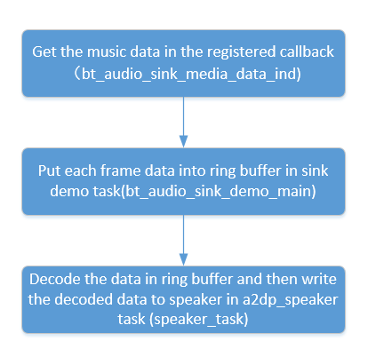
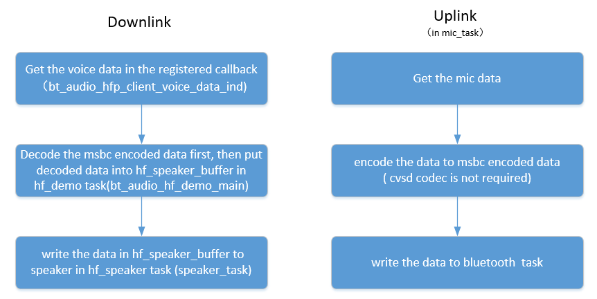

<a id="headset"></a>

# 耳机(Headset)

<a id="id1"></a>

## 1\. 功能概述

> 本工程用于耳机等设备场景，主要功能有
>
> 1.作为a2dp sink接收对端传输的音乐数据
>
> 2.作为avrcp ct/tg对端进行控制（播放暂停等）
>
> 3.作为hfp hf接收对端传输的语音数据
>
> 4.ble gatt server/gatt client（可以详见Central工程相关介绍）

<a id="id2"></a>

### 1.1 软件规格

> - a2dp:
>   :   - avdtp sink
> - avrcp:
>   :   - tg
>       - ct
> - hfp:
>   :   - hf
> - ble:
>   :   - gap
>       - gatt server
>       - gatt client
>       - smp legacy pair/secure connection pair

<a id="id3"></a>

### 1.2 代码路径及编译命令

> Demo路径：[./projects/bluetooth/headset](https://gitlab.bekencorp.com/wifi/armino/-/tree/main/projects/bluetooth/headset)
>
> > 编译命令：`make bk7258 PROJECT=bluetooth/headset`

<a id="cmd"></a>

## 2\. cmd命令简介

<a id="a2dp-avrcp"></a>

### 2.1 a2dp/avrcp

> |  |  |
> | --- | --- |
> | headset connect \<xx:xx:xx:xx:xx:xx\> | 主动连接对端设备 |
> | headset disconnect \<xx:xx:xx:xx:xx:xx\> | 断开连接 |
> | headset play | 播放 |
> | headset pause | 暂停 |
> | headset next | 下一曲 |
> | headset prev | 上一曲 |
> | headset rewind \[msec\] | 快退，可指定时间 |
> | headset fast\_forward \[msec\] | 快进，可指定时间 |
> | headset vol\_up | 音量增加 |
> | headset vol\_down | 音量减少 |
> | headset pair\_mode | 进入配对模式 |

<a id="id4"></a>

## 3\. 框架图

<a id="id5"></a>

### 3.1 软件模块架构图

> 如下图所示，bluetooth负责音乐数据接收以及语音数据接收和发送；audio负责对音乐和语音数据解码播放以及采集MIC数据并编码；storage负责蓝牙关键信息存储，比如加密key

<a id="id14"></a>



Figure 1\. software module architecture

<a id="id6"></a>

### 3.2 流程图

> A2DP工作流程和HFP工作流程见下图

<a id="id15"></a>



Figure 2\. a2dp flow chart

<a id="id16"></a>



Figure 3\. hfp flow chart

<a id="id7"></a>

## 4\. 配置

<a id="demo"></a>

### 4.1 demo开启配置

> 在工程路径下config/bk7258/config，修改宏来配置是否开启A2DP和HFP demo，当前默认开启A2DP demo；
>
> //开启A2DP demo
>
> CONFIG\_A2DP\_SINK\_DEMO\=y
>
> //开启HFP demo
>
> CONFIG\_HFP\_HF\_DEMO\=y

<a id="codec"></a>

### 4.2 codec方式配置

<a id="a2dp"></a>

#### 4.2.1 A2DP

> |  |  |  |  |
> | --- | --- | --- | --- |
> |  | CONFIG\_SBC | CONFIG\_AAC\_DECODER | a2dp\_sink\_demo\_init的参数 |
> | 支持SBC | Y | N | 0 |
> | 支持AAC | Y | Y | 1 |

<a id="hfp"></a>

#### 4.2.1 HFP

> |  |  |  |
> | --- | --- | --- |
> |  | CONFIG\_SBC | hfp\_hf\_demo\_init的参数 |
> | 支持CVSD | N | 0 |
> | 支持mSBC | Y | 1 |

<a id="id8"></a>

## 5\. 代码讲解

<a id="a2dp-demo"></a>

### 5.1 A2DP demo

<a id="id9"></a>

#### 5.1.1 获得蓝牙上报的音乐数据

```
void bt_audio_sink_media_data_ind(const uint8_t *data, uint16_t data_len)
{
        bt_audio_sink_demo_msg_t demo_msg;
        int rc = -1;

        os_memset(&demo_msg, 0x0, sizeof(bt_audio_sink_demo_msg_t));

        if (bt_audio_sink_demo_msg_que == NULL)
        {
                return;
        }

        demo_msg.data = (char *) os_malloc(data_len);

        if (demo_msg.data == NULL)
        {
                LOGE("%s, malloc failed\r\n", __func__);
                return;
        }

        os_memcpy(demo_msg.data, data, data_len);
        demo_msg.type = BT_AUDIO_D2DP_DATA_IND_MSG;
        demo_msg.len = data_len;

        //发送给audio_sink_demo task
        rc = rtos_push_to_queue(&bt_audio_sink_demo_msg_que, &demo_msg, BEKEN_NO_WAIT);

        ...
}
```

<a id="ring-buffer"></a>

#### 5.1.2 把音乐数据按帧暂存ring buffer

```
void bt_audio_sink_demo_main(void *arg)
{
        ...

        case BT_AUDIO_D2DP_DATA_IND_MSG:
        {
                ...

                uint8 *fb = (uint8_t *)msg.data;
                if(s_spk_is_started)
                {
                        //对sbc格式数据按帧存入ring buffer
                        if (CODEC_AUDIO_SBC == bt_audio_a2dp_sink_codec.type)
                        {
                                uint8_t payload_header = *fb++;
                                uint8_t frame_num = payload_header&0xF;
                                if(msg.len - 1 != frame_length*frame_num)
                                {
                                        LOGI("recv undef sbc, payload_header %d, payload_len: %d, frame_num:%d \r\n", payload_header, msg.len - 1, frame_num);
                                }
                                for(uint8_t i=0;i<frame_num;i++)
                                {
                                        if (ring_buffer_node_get_free_nodes(&s_a2dp_frame_nodes))
                                        {
                                                uint8_t *node = ring_buffer_node_get_write_node(&s_a2dp_frame_nodes);
                                                os_memcpy(node, fb, frame_length);
                                                fb += frame_length;
                                        }
                                        else
                                        {
                                                LOGI("A2DP frame nodes buffer(sbc) is full\n");
                                                //os_free(msg.data);
                                                break;
                                        }
                                }
                        }
#if CONFIG_AAC_DECODER
                        //先解析出AAC格式数据的帧长度，再按帧长度存入ring buffer
                        else if(CODEC_AUDIO_AAC == bt_audio_a2dp_sink_codec.type)
                        {
                                // LOGI("-> %d \n", msg.len);
                                uint8_t *inbuf = &fb[9];
                                uint32_t inlen = 0;
                                uint8_t  len   = 255;
                                do
                                {
                                        inlen += len = *inbuf++;
                                }
                                while (len == 255);
                                {
                                        if (ring_buffer_node_get_free_nodes(&s_a2dp_frame_nodes))
                                        {
                                                uint8_t *node = ring_buffer_node_get_write_node(&s_a2dp_frame_nodes);
                                                *((uint32_t *)node) = inlen;
                                                os_memcpy(node + 4, inbuf, inlen);
                                        }
                                        else
                                        {
                                                LOGI("A2DP frame nodes buffer(aac) is full\n");
                                                os_free(msg.data);
                                                break;
                                        }
                                }
                        }
#endif
                        else
                        {
                                LOGE("%s, Unsupported a2dp codec %d \r\n", __func__, bt_audio_a2dp_sink_codec.type);
                        }
                        if(a2dp_speaker_sema)
                        {
                                rtos_set_semaphore(&a2dp_speaker_sema);
                        }
                }

                ...

        }
        break;

        ...

}
```

<a id="id10"></a>

#### 5.1.3 解码音乐数据

```
static void speaker_task(void *arg)
{
        ...

        for (; i < s_frame; i++)
        {
                //从ring buffer读取
                uint8_t *inbuf = ring_buffer_node_get_read_node(&s_a2dp_frame_nodes);
                bk_err_t ret;

                if (CODEC_AUDIO_SBC == bt_audio_a2dp_sink_codec.type)
                {
                        //进行sbc解码
                        ret = bk_sbc_decoder_frame_decode(&bt_audio_sink_sbc_decoder, inbuf, frame_length);
                        if (ret < 0)
                        {
                                LOGE("sbc_decoder_decode error <%d>\n", ret);
                                continue;
                        }
                        int16_t *dst = (int16_t*)bt_audio_sink_sbc_decoder.pcm_sample;
                        int16_t w_len = bt_audio_sink_sbc_decoder.pcm_length * 4;
                        if(CONFIG_BOARD_AUDIO_CHANNLE_NUM == 1)
                        {
                                for(int i=0; i<bt_audio_sink_sbc_decoder.pcm_length * 2; i++)
                                {
                                        dst[i] = dst[i*2];
                                }
                                w_len = bt_audio_sink_sbc_decoder.pcm_length * 2;
                        }
                        //发送解码数据给speaker
                        int size = raw_stream_write(raw_write, (char *)dst, w_len);
                        if (size <= 0)
                        {
                                LOGE("raw_stream_write size fail: %d \n", size);
                                break;
                        }
                        else
                        {
                                //LOGI("raw_stream_write size: %d \n", size);
                        }
                }
#if (CONFIG_AAC_DECODER)
                else if(CODEC_AUDIO_AAC == bt_audio_a2dp_sink_codec.type)
                {
                        uint32_t len = *(uint32_t *)inbuf;
                        // LOGI("<- %d \n", len);
                        uint8_t *out_buf = 0;
                        uint32_t out_len = 0;

                        //进行aac解码
                        ret = bk_aac_decoder_decode(&bt_audio_sink_aac_decoder, (inbuf+4), len, &out_buf, &out_len);
                        if(ret == 0)
                        {
                                int16_t *dst = (int16_t*)out_buf;
                                int16_t w_len = out_len;
                                if(CONFIG_BOARD_AUDIO_CHANNLE_NUM == 1)
                                {
                                        for(uint16_t i=0;i<out_len/2;i++)
                                        {
                                                dst[i] = dst[i*2];
                                        }
                                        w_len = out_len/2;
                                }
                                //发送解码数据给speaker
                                int size = raw_stream_write(raw_write, (char *)dst, w_len);
                                if (size <= 0)
                                {
                                        LOGE("raw_stream_write size fail: %d \n", size);
                                        break;
                                }
                                else
                                {
                                        // LOGI("raw_stream_write size: %d \n", size);
                                }
                        }else
                        {
                                LOGE("sbc_decoder_decode error <%d>\n", ret);
                        }
                }
#endif
                else
                {
                        LOGE("unsupported codec!! /n");
                }
        }

        ...
}
```

<a id="hfp-demo"></a>

### 5.2 HFP demo

<a id="id11"></a>

#### 5.2.1 获得蓝牙上报的语音数据

```
void bt_audio_hfp_client_voice_data_ind(const uint8_t *data, uint16_t data_len)
{
        bt_audio_hf_demo_msg_t demo_msg;
        int rc = -1;

        os_memset(&demo_msg, 0x0, sizeof(bt_audio_hf_demo_msg_t));
        if (bt_audio_hf_demo_msg_que == NULL)
                return;

        demo_msg.data = (char *) os_malloc(data_len);
        if (demo_msg.data == NULL)
        {
                LOGI("%s, malloc failed\r\n", __func__);
                return;
        }

        os_memcpy(demo_msg.data, data, data_len);
        demo_msg.type = BT_AUDIO_VOICE_IND_MSG;
        demo_msg.len = data_len;

        //发送给audio_hf_demo task
        rc = rtos_push_to_queue(&bt_audio_hf_demo_msg_que, &demo_msg, BEKEN_NO_WAIT);
        ...
}
```

<a id="id12"></a>

#### 5.2.2 解码语音数据

```
void bt_audio_hf_demo_main(void *arg)
{
        ...

        case BT_AUDIO_VOICE_IND_MSG:
        {
                ...
                //对msbc格式语音数据进行解码
                if (CODEC_VOICE_MSBC == bt_audio_hfp_hf_codec)
                {
                        fb += 2; //Skip Synchronization Header
                        ret = bk_sbc_decoder_frame_decode(&bt_audio_hf_sbc_decoder, fb, msg.len - 2);
//                        LOGI("sbc decod %d \n", ret);
                        if (ret < 0)
                        {
                                LOGE("msbc decode fail, ret:%d\n", ret);
                        }
                        else
                        {
                                ret = BK_OK;
                                fb = (uint8_t*)bt_audio_hf_sbc_decoder.pcm_sample;
                                packet_len = r_len = SCO_MSBC_SAMPLES_PER_FRAME*2;
                                packet_num = 4;
                        }
                }
                else
                {
                        packet_len = r_len = SCO_CVSD_SAMPLES_PER_FRAME * 2;
                        packet_num = 8;
                }

                if(ret == BK_OK)
                {
                        ...
                        //把原生语音数据存入hf_speaker_buffer
                        os_memcpy(hf_speaker_buffer + hf_speaker_data_count, fb, r_len);
                        hf_speaker_data_count += r_len;
                        if (hf_speaker_data_count >= packet_len * packet_num)
                        {
                                if (hf_speaker_sema)
                                {
                                        rtos_set_semaphore(&hf_speaker_sema);
                                }
                                hf_speaker_data_count -= packet_len * packet_num;
                        }
                }else
                {
                        //LOGE("write spk data fail \r\n");
                }

                os_free(msg.data);
        }
        break;

        ...
}
```

<a id="id13"></a>

#### 5.2.3 播放语音数据

```
static void speaker_task(void *arg)
{
        ...

        while (hf_auido_start)
        {
                rtos_get_semaphore(&hf_speaker_sema, BEKEN_WAIT_FOREVER);

                //把hf_speaker_buffer中的语音数据发给SPEAKER
                int size = raw_stream_write(raw_write, (char *)hf_speaker_buffer, packet_len);

                if (size <= 0)
                {
                        LOGE("raw_stream_write size: %d \n", size);
                        break;
                }
                else
                {
                        //LOGI("raw_stream_write size: %d \n", size);
                }
        }

   ...
}
```

<a id="mic"></a>

#### 5.2.4 获取上行MIC数据

```
static void mic_task(void *arg)
{
        ...

        while (hf_auido_start)
        {
                if (hf_mic_data_count+read_size < sizeof(hf_mic_sco_data))
                {
                        //获取MIC数据
                        int size = raw_stream_read(raw_read, (char *)(hf_mic_sco_data + hf_mic_data_count), read_size);
                        if (size > 0)
                        {
                                ...

                                while (hf_mic_data_count >= send_len)
                                {
                                        //根据选用的编码格式决定是否进行msbc编码
                                        if (CODEC_VOICE_MSBC == bt_audio_hfp_hf_codec)
                                        {
                                                int32_t produced = sbc_encoder_encode(&bt_audio_hf_sbc_encoder, (int16_t *)(hf_mic_sco_data + send_len * i));
//                        LOGI("[send_mic_data_to_air_msbc]  %d \r\n",produced);
                                                //发送编码后的语音数据给蓝牙
                                                bk_bt_hf_client_voice_out_write(hfp_peer_addr, (uint8_t *)&bt_audio_hf_sbc_encoder.stream [ -2 ], produced + 2);
                                        }else
                                        {
                                                //发送未编码的语音数据给蓝牙
                                                bk_bt_hf_client_voice_out_write(hfp_peer_addr, hf_mic_sco_data + send_len * i, send_len);
                                        }
                                        i++;
                                        hf_mic_data_count -= send_len;
                                }
                                if (hf_mic_data_count)
                                {
                                        os_memmove(hf_mic_sco_data, hf_mic_sco_data + send_len * i, hf_mic_data_count);
                                }
                        }
                }
                else
                {
                        LOGE("MIC BUFFER FULL \r\n");
                        hf_mic_data_count = 0;
                }
        }

        ...
}
```
