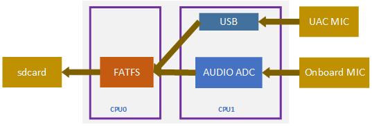
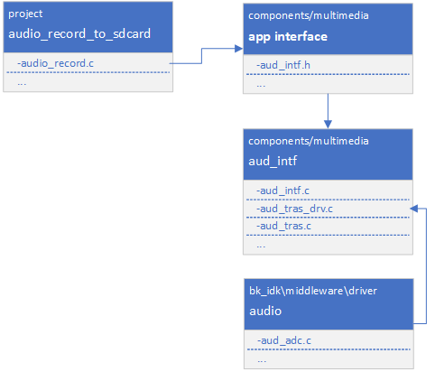

<a id="sdcard"></a>

# sdcard录音工程

<a id="id1"></a>

## 1\. 简介

本工程是录音到sdcard的一个demo，支持录音并存储到sdcard功能。

<a id="id2"></a>

### 1.1 规格

> - 硬件配置：
>   :   - 核心板，**BK7258\_QFN88\_9X9\_V3.2**
>       - 麦克小板，**BK\_Module\_Microphone\_V1.1**
>       - PSRAM 8M/16M
>       - tfcard
> - 支持，UAC

<a id="id3"></a>

### 1.2 路径

> 工程路径: `<bk_avdk源代码路径>/media/audio_record_to_sdcard`

<a id="id4"></a>

## 2\. 框架图

<a id="id5"></a>

### 2.1 软件模块架构图

> 如下图所示，mic数据采集运行在 `cpu1` 上，存储sdcard运行在cpu0上。

<a id="id11"></a>



Figure 1\. software module architecture
audio\_record\_to\_sdcard software module architecture

> - 方案中，我们采用在aud\_intf方式来采集获取mic数据，然后存储到tfcard。

<a id="id6"></a>

### 2.2 代码模块关系图

> 如下图所示，音频的接口，都定义在 **aud\_intf.h** 中。

<a id="id12"></a>



Figure 1\. module relationship diagram

audio\_record\_to\_sdcard relationship diagram

<a id="id7"></a>

## 3\. 演示说明

> 通过发送uart命令来控制录音，命令说明如下：
>
> `audio_record_to_sdcard start xxx.pcm sample_rate`
>
> - 启动录音指令，其中 `xxx.pcm` 是存储录音的文件名， `sample_rate` 是采样率
>
> `audio_record_to_sdcard stop`
>
> - 停止录音指令

备注

录制的音频文件存储在tfcard的根目录。

<a id="id8"></a>

## 4\. 代码讲解

<a id="id9"></a>

### 4.1 启动录音

```
//Path      ： projects/media/audio_record_to_sdcard/main/audio_record.c
//Location  :  CPU0

    //获取mic数据的回调函数
static int send_mic_data_to_sd(uint8_t *data, unsigned int len)
{

    ...

    //写mic数据到tfcard
    fr = f_write(&mic_file, (void *)data, len, &uiTemp);

        ...

}

//启动录音
bk_err_t audio_record_to_sdcard_start(char *file_name, uint32_t samp_rate)
{
    ...

        //挂载tfcard
    ret = tf_mount();

    //打开存储录音的文件
    fr = f_open(&mic_file, mic_file_name, FA_CREATE_ALWAYS | FA_WRITE);

    //初始化aud_intf组件
    aud_intf_drv_setup.aud_intf_tx_mic_data = send_mic_data_to_sd;
    ret = bk_aud_intf_drv_init(&aud_intf_drv_setup);

    //设置aud_intf组件工作在普通模式
    ret = bk_aud_intf_set_mode(AUD_INTF_WORK_MODE_GENERAL);

    //初始化mic
    //aud_intf_mic_setup.mic_type = AUD_INTF_MIC_TYPE_UAC;  //设置mic的类型为uac mic，默认为板载mic
    ret = bk_aud_intf_mic_init(&aud_intf_mic_setup);

    //开启mic采样和存储
    ret = bk_aud_intf_mic_start();

    ...
}
```

<a id="id10"></a>

### 4.2 停止录音

```
//Path      ： projects/media/audio_record_to_sdcard/main/audio_record.c
//Location  :  CPU0

bk_err_t audio_record_to_sdcard_stop(void)
{

    ...

    //停止mic采样
    ret = bk_aud_intf_mic_stop();

    //释放mic采样的配置
    ret = bk_aud_intf_mic_deinit();

    //重置aud_intf组件的工作模式
    ret = bk_aud_intf_set_mode(AUD_INTF_WORK_MODE_NULL);

    //注销aud_intf组件
    ret = bk_aud_intf_drv_deinit();

    //关闭录音文件
    f_close(&mic_file);

    //卸载tfcard
    tf_unmount();

    ...

}
```
