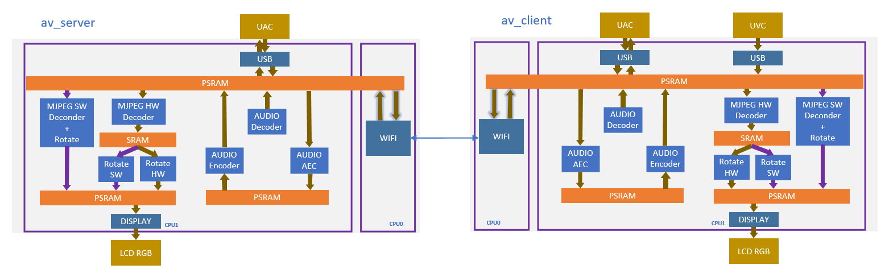
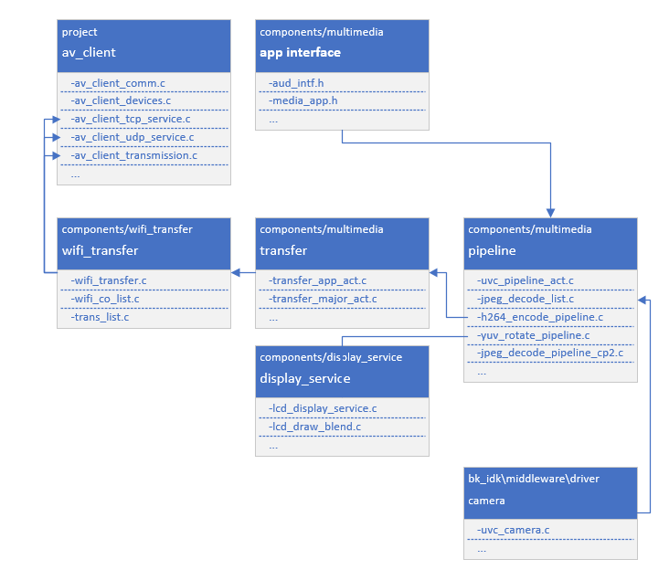

<a id="double-board-intertransfer-mission-client"></a>

# Double-Board Intertransfer Mission (Client)

<a id="id1"></a>

## 1 功能概述

> 本工程展示两块BK7258板子之间视频单向传输，音频双向传输的功能;
> client端接入实体摄像头dvp/uvc，且支持当前板子接入LCD屏实时显示摄像头拍摄的画面

<a id="id2"></a>

### 1.1 规格

> - 硬件配置：
>   :   - 核心板，**BK7258\_QFN88\_9X9\_V3.2**
>       - 显示转接板，**BK7258\_LCD\_Interface\_V3.0**
>       - 麦克小板，**BK\_Module\_Microphone\_V1.1**
>       - 喇叭小板，**BK\_Module\_Speaker\_V1.1**
>       - PSRAM 8M/16M
> - 支持，UVC
>   :   - 参考外设，**864 \* 480** 分辨率的UVC
> - 支持，UAC
> - 支持，TCP局域网图传
> - 支持，UDP局域网图传
> - 支持，LCD RGB/MCU I8080显示
>   :   - 参考外设，**ST7701SN**，480 \* 854 RGB LCD
>       - RGB565/RGB888
> - 支持，硬件旋转
>   :   - 0°，90°，180°，270°
> - 支持，板载喇叭
> - 支持，麦克
> - 支持，MJPEG硬件解码
>   :   - YUV422
> - 支持，MJPEG软件解码
>   :   - YUV420

<a id="id3"></a>

### 1.2 路径

> \<bk\_avdk源代码路径\>/projects/media/av\_client

<a id="id4"></a>

## 2\. 框架图

<a id="id5"></a>

### 2.1 软件模块架构图

> 如下图所示，av\_client负责采集USB摄像头图像，通过wifi传输给av\_server，
> 同时av\_client本地lcd会显示采集的图像，av\_server显示av\_client传输的图像
>
> - CPU0，运行WIFI/BLE，作为低功耗CPU。
> - CPU1，运行多媒体，作为多媒体高性能CPU。

<a id="id19"></a>



Figure 1\. software module architecture

<a id="id6"></a>

### 2.2 代码模块关系图

> 如下图所示，多媒体的接口，都定义在 **media\_app.h** 和 **aud\_intf.h** 中。

<a id="id20"></a>



Figure 2\. module relationship diagram

<a id="id7"></a>

## 3\. 配置

<a id="id8"></a>

### 3.1 图像传输方式配置

> 在工程路径下config/bk7258/config，修改宏来配置图像传输方式，当前默认传输方式为UDP；
>
> //使用UDP连接进行传输
> CONFIG\_AV\_DEMO\_MODE\_UDP\=y
> CONFIG\_AV\_DEMO\_MODE\_TCP\=n
>
> //使用TCP连接进行传输
> CONFIG\_AV\_DEMO\_MODE\_UDP\=n
> CONFIG\_AV\_DEMO\_MODE\_TCP\=y

<a id="id9"></a>

## 4\. 演示说明

> 双板对传需要两个开发板，A开发板上下载av\_client, B开发板上下载av\_server；
>
> B板为AP，固定SSID为”av\_demo”，无密码，需要在A板前上电；需要连接LCD
>
> A板为STA，固定连接SSID “av\_demo”；需要连接USB摄像头和LCD
>
> A板上电后默认连接B板的wifi，连接成功后打开摄像头和LCD,
> 在A板连接成功后，B板上LCD显示A板上USB输出的图像

<a id="id10"></a>

## 5\. 代码讲解

<a id="uvc"></a>

### 5.1 UVC摄像头

> 已支持的外设，请参考 [支持外设](../../support_peripherals.md)

<a id="id12"></a>

#### 5.1.1 打开UVC

<a id="id13"></a>

##### 5.1.1.1 应用代码

```
//Path      ： projects/media/av_client/main/src/av_client_devices.c
//Location  :  CPU0

int av_client_camera_turn_on(camera_parameters_t *parameters)
{
    ...

    //打开UVC摄像头
    ret = media_app_camera_open(&device);

    //设置本地显示旋转。
    media_app_pipline_set_rotate(rot_angle);

    ...
}
```

<a id="id14"></a>

##### 5.1.1.2 接口代码

```
//Path      ： components/multimedia/app/media_app.c
//Location  :  CPU0

bk_err_t media_app_camera_open(media_camera_device_t *device)
{
    ...

    //卸载蓝牙
    #ifdef CONFIG_BT_REUSE_MEDIA_MEMORY
    #if CONFIG_BLUETOOTH
            bk_bluetooth_deinit();
    #endif
    #endif

    //投票启动CPU1。投票的目的是，确保CPU1不用的时候能够被自动关闭，以达到低功耗的目的。
    bk_pm_module_vote_boot_cp1_ctrl(PM_BOOT_CP1_MODULE_NAME_VIDP_JPEG_EN, PM_POWER_MODULE_STATE_ON);

    //通知CPU1，去打开UVC摄像头
    ret = media_send_msg_sync(EVENT_CAM_UVC_OPEN_IND, (uint32_t)device);

    ...
}
```

<a id="lcd"></a>

### 5.2 LCD显示

> 已支持的外设，请参考 [支持外设](../../support_peripherals.md)

<a id="id16"></a>

#### 5.2.1 打开LCD

<a id="id17"></a>

##### 5.2.1.1 应用代码

```
//Path      ： projects/media/av_client/main/src/av_client_devices.c
//Location  :  CPU0

int av_client_display_turn_on(uint16_t id, uint16_t rotate, uint16_t fmt)
{
    ...

    //设置显示的像素格式
    if (fmt == 0)
    {
        media_app_lcd_fmt(PIXEL_FMT_RGB565_LE);
    }
    else if (fmt == 1)
    {
        media_app_lcd_fmt(PIXEL_FMT_RGB888);
    }

    //设置旋转的角度。
    switch (rotate)
    {
        case 90:
            rot_angle = ROTATE_90;
            break;
        case 180:
            rot_angle = ROTATE_180;
            break;
        case 270:
            rot_angle = ROTATE_270;
            break;
        case 0:
        default:
            rot_angle = ROTATE_NONE;
            break;
    }

    media_app_pipline_set_rotate(rot_angle);

    //打开本地LCD显示
            media_app_lcd_pipeline_open(&lcd_open);

    ...
}
```

<a id="id18"></a>

##### 5.2.1.2 接口代码

```
//Path      ： components/multimedia/app/media_app.c
//Location  :  CPU0

bk_err_t media_app_lcd_pipeline_open(void *lcd_open)
{
    ...

    //
    ret = media_app_lcd_pipeline_disp_open(config);

    //
    ret = media_app_lcd_pipeline_jdec_open();

    ...
}

bk_err_t media_app_lcd_pipeline_disp_open(void *config)
{
    ...

    //投票启动CPU1。投票的目的是，确保CPU1不用的时候能够被自动关闭，以达到低功耗的目的。
    bk_pm_module_vote_boot_cp1_ctrl(PM_BOOT_CP1_MODULE_NAME_VIDP_LCD, PM_POWER_MODULE_STATE_ON);

    //通知CPU1打开LCD
    ret = media_send_msg_sync(EVENT_PIPELINE_LCD_DISP_OPEN_IND, (uint32_t)ptr);

    ...
}

bk_err_t media_app_lcd_pipeline_jdec_open(void)
{
    int ret = BK_OK;

    //投票启动CPU1。投票的目的是，确保CPU1不用的时候能够被自动关闭，以达到低功耗的目的。
    bk_pm_module_vote_boot_cp1_ctrl(PM_BOOT_CP1_MODULE_NAME_VIDP_JPEG_DE, PM_POWER_MODULE_STATE_ON);

    //设置旋转角度
    ret = media_send_msg_sync(EVENT_PIPELINE_SET_ROTATE_IND, jpeg_decode_pipeline_param.rotate);

    //打开显示依赖的旋转，缩放，解码模块
    ret = media_send_msg_sync(EVENT_PIPELINE_LCD_JDEC_OPEN_IND, 0);

    return ret;
}
```

<a id="audio"></a>

### 5.3 Audio

<a id="uac-mic-speaker"></a>

#### 5.3.1 打开UAC，板载MIC/SPEAKER

```
//Path      ： projects/media/av_client/main/src/av_client_devices.c
//Location  :  CPU0

int av_client_audio_turn_on(audio_parameters_t *parameters)
{
    ...

    //启用AEC
    if (parameters->aec == 1)
    {
        aud_voc_setup.aec_enable = true;
    }
    else
    {
        aud_voc_setup.aec_enable = false;
    }


    //设置SPEAKER单端模式
    ud_voc_setup.spk_mode = AUD_DAC_WORK_MODE_SIGNAL_END;

    //启用UAC
    if (parameters->uac == 1)
    {
        aud_voc_setup.mic_type = AUD_INTF_MIC_TYPE_UAC;
        aud_voc_setup.spk_type = AUD_INTF_SPK_TYPE_UAC;
    }
    else //启动板载MIC和SPEAKER
    {
        aud_voc_setup.mic_type = AUD_INTF_MIC_TYPE_BOARD;
        aud_voc_setup.spk_type = AUD_INTF_SPK_TYPE_BOARD;
    }

    if (aud_voc_setup.mic_type == AUD_INTF_MIC_TYPE_BOARD && aud_voc_setup.spk_type == AUD_INTF_SPK_TYPE_BOARD) {
        aud_voc_setup.data_type = parameters->rmt_recoder_fmt - 1;
    }

    //设置采样率
    switch (parameters->rmt_recorder_sample_rate)
    {
        case DB_SAMPLE_RARE_8K:
            aud_voc_setup.samp_rate = 8000;
        break;

        case DB_SAMPLE_RARE_16K:
            aud_voc_setup.samp_rate = 16000;
        break;

        default:
            aud_voc_setup.samp_rate = 8000;
        break;
    }

    //注册MIC数据回调
    aud_intf_drv_setup.aud_intf_tx_mic_data = av_client_udp_voice_send_callback;

    ...
}
```

<a id="mic"></a>

#### 5.3.2 获取上行MIC数据

```
//Path      ： projects/media/av_client/main/src/av_client_devices.c
//Location  :  CPU0

//注册MIC回调
    aud_intf_drv_setup.aud_intf_tx_mic_data = av_client_udp_voice_send_callback;
    ret = bk_aud_intf_drv_init(&aud_intf_drv_setup);

int av_client_udp_voice_send_callback(unsigned char *data, unsigned int len)
{
    ...

    //通常实现的回调是往WIFI方向传输。
    return db_device_info->audio_transfer_cb->send(buffer, len, &retry_cnt);
}
```

<a id="speaker"></a>

#### 5.3.3 播放下行SPEAKER数据

```
//Path      ： projects/media/av_client/main/src/av_client_devices.c
//Location  :  CPU0

void av_client_audio_data_callback(uint8_t *data, uint32_t length)
{
    ...

    //往SPEAKER送数据
    ret = bk_aud_intf_write_spk_data(data, length);

    ...
}
```
