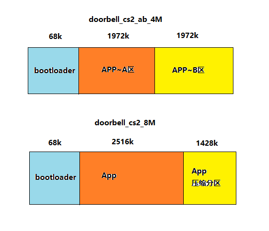
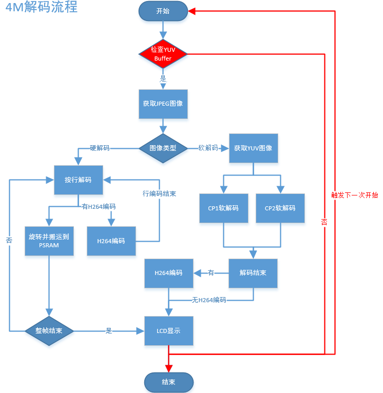

# Doorbell_cs2_ab_4M[](#doorbell-cs2-ab-4m "永久链接至标题")

## 1. 简介[](#id1 "永久链接至标题")

本工程是USB摄像头门锁的一个demo，支持端（BK7258设备）到端（手机APP端）的演示。默认支持尚云进行网络传输。

### 1.1 规格[](#id2 "永久链接至标题")

> - 硬件配置：
>   :   - 核心板，**BK7258_QFN68_8X8_V1**
>       - 显示转接板，**BK7258_LCD_Interface_V3.0**
>       - 喇叭小板，**BK_Module_Speaker_V1.1**
>       - PSRAM 4M
> - 支持，UVC
>   :   - 参考外设，最大支持**864 * 480** 分辨率的UVC
> - 支持，UAC
> - 支持，TCP局域网图传
> - 支持，UDP局域网图传
> - 支持，尚云，P2P图传
> - 支持，LCD RGB/MCU I8080显示
>   :   - 参考外设，**ST7701SN**，480 * 854 RGB LCD
>       - RGB565/RGB888
> - 支持，硬件/软件旋转
>   :   - 0°，90°，180°，270°
> - 支持，板载喇叭
> - 支持，MJPEG硬件解码
>   :   - YUV422
> - 支持，MJPEG软件解码
>   :   - YUV420
> - 支持，H264硬件解码
> - 支持，OSD显示
>   :   - ARGB888[PNG]
>       - 自定义字体

### 1.2 路径[](#id3 "永久链接至标题")

> <bk_avdk源代码路径>/projects/thirdparty/doorbell_cs2_ab_4M

## 2. 框架图[](#id4 "永久链接至标题")

> 请参考 [框架图](../../media/doorbell/index.md#id4 "../../media/doorbell/index.md#id4")

## 3. 配置[](#id6 "永久链接至标题")

> 请参考 [配置](../../media/doorbell/index.md#id7 "../../media/doorbell/index.md#id7")

### 3.1 区别[](#id8 "永久链接至标题")

> doorbell_cs2_ab_4M与doorbell_cs2_8M的区别在于，前一个不支持DVP摄像头，还不支持板载mic。
> 此外，doorbell_cs2_ab_4M 相比 doorbell_cs2_8M ，除了psram大小的区别外，前者支持ab分区，且分区表与不带ab分区的分区表信息不同：

Figure 1. ab_4M & cs2_8M的主要分区差异图[](#id15 "永久链接至图片")

从8M的PSRAM大小修改为4M_ab的PSRAM大小，需要针对config文件进行修改，文件路径为：

thirdparty/doorbell_cs2_ab_4M/config/bk7258/config

thirdparty/doorbell_cs2_ab_4M/config/bk7258_cp1/config

thirdparty/doorbell_cs2_ab_4M/config/bk7258_cp2/config

以下是 doorbell_cs2_8M 与doorbell_cs2_ab_4M 主要的 config 参数区别（关键config但没有差异的，也会列出）：

> |  |  |  |
> | --- | --- | --- |
> | project | doorbell_cs2_8M | doorbell_cs2_ab_4M |
> | CONFIG_PSRAM_MEM_SLAB_USER_SIZE | 102400 | 0 |
> | CONFIG_PSRAM_MEM_SLAB_AUDIO_SIZE | 102400 | 51200 |
> | CONFIG_PSRAM_MEM_SLAB_ENCODE_SIZE | 1433600 | 946176 |
> | CONFIG_PSRAM_MEM_SLAB_DISPLAY_SIZE | 5701632 | 2490368 |
> | CONFIG_MEDIA_PSRAM_SIZE_4M | N | Y |
> | CONFIG_BUCK_ANALOG_DISABLE | N | Y |
> | CONFIG_PSRAM_W955D8MKY_5J | N | Y |
> | CONFIG_PSRAM_APS6408L_O | N | N |
> | CONFIG_CPU0_SPE_RAM_SIZE | 0X56000 | 0X5E000 |
> | CONFIG_CPU1_APP_RAM_SIZE | 0X3F000 | 0X38000 |
> | CONFIG_CPU2_APP_RAM_SIZE | 0XB000 | 0XA000 |
> | CONFIG_PSRAM_HEAP_BASE | 0x60700000 | 0x60354000 |
> | CONFIG_PSRAM_HEAP_SIZE | 0x80000 | 0x7D000 |
> | CONFIG_PSRAM_HEAP_CPU0_BASE_ADDER | 0x60700000 | 0x60354000 |
> | CONFIG_H264_P_FRAME_CNT | 5 | 3 |
> | CONFIG_ALI_MQTT | N | N |

流程如下图所示：

Figure 2. doorbell_cs2_ab_4M解码流程[](#id16 "永久链接至图片")

Figure 3. doorbell_cs2_8M解码流程[](#id17 "永久链接至图片")

流程上主要区别如下表：

|  |  |
| --- | --- |
| project | 解码流程 |
| doorbell_cs2_4M | 先尝试获取YUV图像，申请成功后才继续进行解码， lcd显示完直接触发下一次获取图像流程 |
| doorbell_cs2_ab_4M | 同doorbell_cs2_4M |
| doorbell_cs2_8M | 直接解码，获取YUV图像失败后直接将JPEG释放，等待下一帧JPEG |

## 4. 演示说明[](#id9 "永久链接至标题")

> 请访问
> [APP使用文档](https://docs.bekencorp.com/arminodoc/bk_app/app/zh_CN/v2.0.1/app_usage/app_usage_guide/index.html#debug "https://docs.bekencorp.com/arminodoc/bk_app/app/zh_CN/v2.0.1/app_usage/app_usage_guide/index.html#debug")
> 查看。
>
> 演示结果：运行时会启动UVC，LCD和AUDIO，LCD显示UVC输出JPEG（864X480）图像经过解码和旋转90°后显示到LCD(480X854)上，
> 解码后的YUV经过H264编码后，经CS2云到手机上显示(864X480)。

提示

如果您没有云账号权限，可以使用debug模式，设置局域网TCP图传方式。

## 5. 代码讲解[](#id10 "永久链接至标题")

> 请参考 [代码讲解](../../media/doorbell/index.md#id13 "../../media/doorbell/index.md#id13")

## 6. 移植说明[](#id12 "永久链接至标题")

> 对于media模块而言，4M（不论是否包括ab分区）和8M最大的区别在于PSRAM大小配置缩小，因此内部缓冲图像数量减少，如下表所示；
>
> |  |  |  |  |
> | --- | --- | --- | --- |
> | project | YUV图像（张） | JPEG图像（张） | H264图像（张） |
> | doorbell_cs2_4M | 3 | 4 | 4 |
> | doorbell_cs2_ab_4M | 3 | 4 | 4 |
> | doorbell_cs2_8M | 5 | 4 | 8 |
>
> 将8M FLASH + 8M PSRAM 修改为4M FLASH + 4M PSRAM ab 工程按照以下步骤进行：

### 步骤1：[](#id13 "永久链接至标题")

> 将平台代码合入；
>
> 根据patch将修改同步，patch的提交标题为”adapter for new 4+4 psram of W955D8MKY”,
>
> 共四笔提交，包括doorbell_cs2_ab_4M的工程代码，代码目录核涉及文件如下表所示：
>
> |  |  |
> | --- | --- |
> | 代码目录 | 涉及文件 |
> | middleware | driver/pwr_clk/Kconfig  soc/bk7258/hal/sys_pm_hal.c  soc/common/hal/include/psram_hal.h  soc/common/hal/psram_hal.c |
> | tools/build_tools | part_table_tools/otherScript/special_project_deal.py |
> | bk_idk/components/part_table | CMakeLists.txt  part_table.mk |
> | projects | thirdparty/doorbell_cs2_ab_4M/CMakeLists.txt  thirdparty/doorbell_cs2_ab_4M/config/bk7258_cp1/config  thirdparty/doorbell_cs2_ab_4M/config/bk7258_cp2/config  thirdparty/doorbell_cs2_ab_4M/config/bk7258/ab_position_independent.csv  thirdparty/doorbell_cs2_ab_4M/config/bk7258/bk7258_partitions.csv  thirdparty/doorbell_cs2_ab_4M/config/bk7258/config  thirdparty/doorbell_cs2_ab_4M/config/bk7258/configuration.json  thirdparty/doorbell_cs2_ab_4M/config/bk7258/configurationab.json  thirdparty/doorbell_cs2_ab_4M/config/bk7258/partitions.csv  thirdparty/doorbell_cs2_ab_4M/config/ota_rbl.config  thirdparty/doorbell_cs2_ab_4M/main/app_main.c  thirdparty/doorbell_cs2_ab_4M/main/CMakeLists.txt  thirdparty/doorbell_cs2_ab_4M/main/Kconfig.projbuild  thirdparty/doorbell_cs2_ab_4M/main/vendor_flash.c  thirdparty/doorbell_cs2_ab_4M/main/vendor_flash_partition.h  thirdparty/doorbell_cs2_ab_4M/pj_config.mk  thirdparty/doorbell_cs2_ab_4M/README.md |
>
> 主要修改点如下表所示：
>
> |  |  |
> | --- | --- |
> | 涉及文件 | 主要修改点 |
> | driver/pwr_clk/Kconfig | 增加BUCK_ANALOG_DISABLE 关闭模拟域BUCK的宏控 |
> | soc/bk7258/hal/sys_pm_hal.c | 配置关闭模拟域BUCK的实际代码 |
> | soc/common/hal/include/psram_hal.h | 增加4M PSRAM的新配置MODE以及ID信息 |
> | soc/common/hal/psram_hal.c | 增加4M PSRAM的初始化流程 |
> | part_table_tools/otherScript/special_project_deal.py | 增加针对doorbell_cs2_ab_4M分区工程的编译处理 |
> | CMakeLists.txt  part_table.mk | 增加doorbell_cs2_ab_4M工程  增加doorbell_cs2_ab_4M编译信息 |
> | thirdparty/doorbell_cs2_ab_4M/config/bk7258_cp1/config  thirdparty/doorbell_cs2_ab_4M/config/bk7258_cp2/config  thirdparty/doorbell_cs2_ab_4M/config/bk7258/config | 增加doorbell_cs2_ab_4M工程CPU1使用的宏控  增加doorbell_cs2_ab_4M工程CPU2使用的宏控  增加doorbell_cs2_ab_4M工程CPU0使用的宏控 |
> | thirdparty/doorbell_cs2_4M/config/bk7258/bk7258_partitions.csv | 修改FLASH空间分配为4M |

### 步骤2：[](#id14 "永久链接至标题")

> 根据patch将修改同步,patch的提交标题为”PSRAM configuration for image transmission-related buffers when the size is 4M”,
>
> 共两笔提交,不包括doorbell_cs2_4M的工程代码,代码目录核涉及文件如下表所示：
>
> |  |  |
> | --- | --- |
> | 代码目录 | 涉及文件 |
> | components | display_service/src/lcd_display_service.c  media_utils/src/psram_mem_slab.c  multimedia/comm/frame_buffer.c  multimedia/Kconfig  multimedia/pipeline/h264_encode_pipeline.c  multimedia/pipeline/jpeg_decode_pipeline.c  multimedia/pipeline/jpeg_get_pipeline.c |
> | bk_idk/components/part_table | CMakeLists.txt  part_table.mk |
>
> 主要修改点如下表所示：
>
> |  |  |
> | --- | --- |
> | 涉及文件 | 主要修改点 |
> | display_service/src/lcd_display_service.c | 显示完成后立马获取JPEG图像 |
> | media_utils/src/psram_mem_slab.c | 避免buffer循环查找 |
> | multimedia/comm/frame_buffer.c | 减少内部图像缓冲数量 |
> | multimedia/Kconfig | 增加CONFIG_MEDIA_PSRAM_SIZE_4M的宏控 |
> | multimedia/pipeline/h264_encode_pipeline.c  multimedia/pipeline/jpeg_decode_pipeline.c  multimedia/pipeline/jpeg_get_pipeline.c | 修改pipeline流程  降低YUV图像缩减对软解码帧率的影响 |
> | CMakeLists.txt  part_table.mk | 增加doorbell_cs2_ab_4M工程 |
