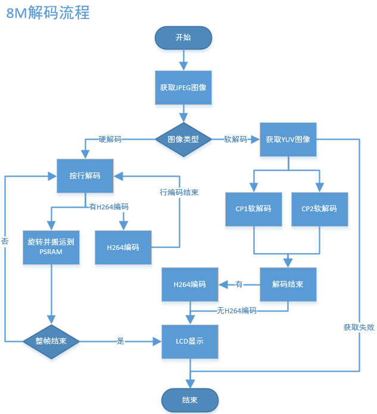

# Doorbell\_cs2\_ab\_4M

## 1\. 简介

本工程是USB摄像头门锁的一个demo，支持端（BK7258设备）到端（手机APP端）的演示。默认支持尚云进行网络传输。

### 1.1 规格

> - 硬件配置：
>   :   - 核心板，**BK7258\_QFN68\_8X8\_V1**
>       - 显示转接板，**BK7258\_LCD\_Interface\_V3.0**
>       - 喇叭小板，**BK\_Module\_Speaker\_V1.1**
>       - PSRAM 4M
> - 支持，UVC
>   :   - 参考外设，最大支持\*\*864 \* 480\*\* 分辨率的UVC
> - 支持，UAC
> - 支持，TCP局域网图传
> - 支持，UDP局域网图传
> - 支持，尚云，P2P图传
> - 支持，LCD RGB/MCU I8080显示
>   :   - 参考外设，**ST7701SN**，480 \* 854 RGB LCD
>       - RGB565/RGB888
> - 支持，硬件/软件旋转
>   :   - 0°，90°，180°，270°
> - 支持，板载喇叭
> - 支持，MJPEG硬件解码
>   :   - YUV422
> - 支持，MJPEG软件解码
>   :   - YUV420
> - 支持，H264硬件解码
> - 支持，OSD显示
>   :   - ARGB888\[PNG\]
>       - 自定义字体

### 1.2 路径

> \<bk\_avdk源代码路径\>/projects/thirdparty/doorbell\_cs2\_ab\_4M

## 2\. 框架图

> 请参考 [框架图](../media/doorbell.md#id4)

## 3\. 配置

> 请参考 [配置](../media/doorbell.md#id7)

### 3.1 区别

> doorbell\_cs2\_ab\_4M与doorbell\_cs2\_8M的区别在于，前一个不支持DVP摄像头，还不支持板载mic。
> 此外，doorbell\_cs2\_ab\_4M 相比 doorbell\_cs2\_8M ，除了psram大小的区别外，前者支持ab分区，且分区表与不带ab分区的分区表信息不同：

Figure 1\. ab\_4M \& cs2\_8M的主要分区差异图

从8M的PSRAM大小修改为4M\_ab的PSRAM大小，需要针对config文件进行修改，文件路径为：

thirdparty/doorbell\_cs2\_ab\_4M/config/bk7258/config

thirdparty/doorbell\_cs2\_ab\_4M/config/bk7258\_cp1/config

thirdparty/doorbell\_cs2\_ab\_4M/config/bk7258\_cp2/config

以下是 doorbell\_cs2\_8M 与doorbell\_cs2\_ab\_4M 主要的 config 参数区别（关键config但没有差异的，也会列出）：

> |  |  |  |
> | --- | --- | --- |
> | project | doorbell\_cs2\_8M | doorbell\_cs2\_ab\_4M |
> | CONFIG\_PSRAM\_MEM\_SLAB\_USER\_SIZE | 102400 | 0 |
> | CONFIG\_PSRAM\_MEM\_SLAB\_AUDIO\_SIZE | 102400 | 51200 |
> | CONFIG\_PSRAM\_MEM\_SLAB\_ENCODE\_SIZE | 1433600 | 946176 |
> | CONFIG\_PSRAM\_MEM\_SLAB\_DISPLAY\_SIZE | 5701632 | 2490368 |
> | CONFIG\_MEDIA\_PSRAM\_SIZE\_4M | N | Y |
> | CONFIG\_BUCK\_ANALOG\_DISABLE | N | Y |
> | CONFIG\_PSRAM\_W955D8MKY\_5J | N | Y |
> | CONFIG\_PSRAM\_APS6408L\_O | N | N |
> | CONFIG\_CPU0\_SPE\_RAM\_SIZE | 0X56000 | 0X5E000 |
> | CONFIG\_CPU1\_APP\_RAM\_SIZE | 0X3F000 | 0X38000 |
> | CONFIG\_CPU2\_APP\_RAM\_SIZE | 0XB000 | 0XA000 |
> | CONFIG\_PSRAM\_HEAP\_BASE | 0x60700000 | 0x60354000 |
> | CONFIG\_PSRAM\_HEAP\_SIZE | 0x80000 | 0x7D000 |
> | CONFIG\_PSRAM\_HEAP\_CPU0\_BASE\_ADDER | 0x60700000 | 0x60354000 |
> | CONFIG\_H264\_P\_FRAME\_CNT | 5 | 3 |
> | CONFIG\_ALI\_MQTT | N | N |

流程如下图所示：

Figure 2\. doorbell\_cs2\_ab\_4M解码流程

Figure 3\. doorbell\_cs2\_8M解码流程

流程上主要区别如下表：

|  |  |
| --- | --- |
| project | 解码流程 |
| doorbell\_cs2\_4M | 先尝试获取YUV图像，申请成功后才继续进行解码， lcd显示完直接触发下一次获取图像流程 |
| doorbell\_cs2\_ab\_4M | 同doorbell\_cs2\_4M |
| doorbell\_cs2\_8M | 直接解码，获取YUV图像失败后直接将JPEG释放，等待下一帧JPEG |

## 4\. 演示说明

> 请访问
> [APP使用文档](../../../bk_toolkit/iotapp/app_usage/app_usage_guide.md#debug)
> 查看。
>
> 演示结果：运行时会启动UVC，LCD和AUDIO，LCD显示UVC输出JPEG（864X480）图像经过解码和旋转90°后显示到LCD(480X854)上，
> 解码后的YUV经过H264编码后，经CS2云到手机上显示(864X480)。

提示

如果您没有云账号权限，可以使用debug模式，设置局域网TCP图传方式。

## 5\. 代码讲解

> 请参考 [代码讲解](../media/doorbell.md#id13)

## 6\. 移植说明

> 对于media模块而言，4M（不论是否包括ab分区）和8M最大的区别在于PSRAM大小配置缩小，因此内部缓冲图像数量减少，如下表所示；
>
> |  |  |  |  |
> | --- | --- | --- | --- |
> | project | YUV图像（张） | JPEG图像（张） | H264图像（张） |
> | doorbell\_cs2\_4M | 3 | 4 | 4 |
> | doorbell\_cs2\_ab\_4M | 3 | 4 | 4 |
> | doorbell\_cs2\_8M | 5 | 4 | 8 |
>
> 将8M FLASH \+ 8M PSRAM 修改为4M FLASH \+ 4M PSRAM ab 工程按照以下步骤进行：

### 步骤1：

> 将平台代码合入；
>
> 根据patch将修改同步，patch的提交标题为”adapter for new 4\+4 psram of W955D8MKY”,
>
> 共四笔提交，包括doorbell\_cs2\_ab\_4M的工程代码，代码目录核涉及文件如下表所示：
>
> |  |  |
> | --- | --- |
> | 代码目录 | 涉及文件 |
> | middleware | driver/pwr\_clk/Kconfig  soc/bk7258/hal/sys\_pm\_hal.c  soc/common/hal/include/psram\_hal.h  soc/common/hal/psram\_hal.c |
> | tools/build\_tools | part\_table\_tools/otherScript/special\_project\_deal.py |
> | bk\_idk/components/part\_table | CMakeLists.txt  part\_table.mk |
> | projects | thirdparty/doorbell\_cs2\_ab\_4M/CMakeLists.txt  thirdparty/doorbell\_cs2\_ab\_4M/config/bk7258\_cp1/config  thirdparty/doorbell\_cs2\_ab\_4M/config/bk7258\_cp2/config  thirdparty/doorbell\_cs2\_ab\_4M/config/bk7258/ab\_position\_independent.csv  thirdparty/doorbell\_cs2\_ab\_4M/config/bk7258/bk7258\_partitions.csv  thirdparty/doorbell\_cs2\_ab\_4M/config/bk7258/config  thirdparty/doorbell\_cs2\_ab\_4M/config/bk7258/configuration.json  thirdparty/doorbell\_cs2\_ab\_4M/config/bk7258/configurationab.json  thirdparty/doorbell\_cs2\_ab\_4M/config/bk7258/partitions.csv  thirdparty/doorbell\_cs2\_ab\_4M/config/ota\_rbl.config  thirdparty/doorbell\_cs2\_ab\_4M/main/app\_main.c  thirdparty/doorbell\_cs2\_ab\_4M/main/CMakeLists.txt  thirdparty/doorbell\_cs2\_ab\_4M/main/Kconfig.projbuild  thirdparty/doorbell\_cs2\_ab\_4M/main/vendor\_flash.c  thirdparty/doorbell\_cs2\_ab\_4M/main/vendor\_flash\_partition.h  thirdparty/doorbell\_cs2\_ab\_4M/pj\_config.mk  thirdparty/doorbell\_cs2\_ab\_4M/README.md |
>
> 主要修改点如下表所示：
>
> |  |  |
> | --- | --- |
> | 涉及文件 | 主要修改点 |
> | driver/pwr\_clk/Kconfig | 增加BUCK\_ANALOG\_DISABLE 关闭模拟域BUCK的宏控 |
> | soc/bk7258/hal/sys\_pm\_hal.c | 配置关闭模拟域BUCK的实际代码 |
> | soc/common/hal/include/psram\_hal.h | 增加4M PSRAM的新配置MODE以及ID信息 |
> | soc/common/hal/psram\_hal.c | 增加4M PSRAM的初始化流程 |
> | part\_table\_tools/otherScript/special\_project\_deal.py | 增加针对doorbell\_cs2\_ab\_4M分区工程的编译处理 |
> | CMakeLists.txt  part\_table.mk | 增加doorbell\_cs2\_ab\_4M工程  增加doorbell\_cs2\_ab\_4M编译信息 |
> | thirdparty/doorbell\_cs2\_ab\_4M/config/bk7258\_cp1/config  thirdparty/doorbell\_cs2\_ab\_4M/config/bk7258\_cp2/config  thirdparty/doorbell\_cs2\_ab\_4M/config/bk7258/config | 增加doorbell\_cs2\_ab\_4M工程CPU1使用的宏控  增加doorbell\_cs2\_ab\_4M工程CPU2使用的宏控  增加doorbell\_cs2\_ab\_4M工程CPU0使用的宏控 |
> | thirdparty/doorbell\_cs2\_4M/config/bk7258/bk7258\_partitions.csv | 修改FLASH空间分配为4M |

### 步骤2：

> 根据patch将修改同步,patch的提交标题为”PSRAM configuration for image transmission-related buffers when the size is 4M”,
>
> 共两笔提交,不包括doorbell\_cs2\_4M的工程代码,代码目录核涉及文件如下表所示：
>
> |  |  |
> | --- | --- |
> | 代码目录 | 涉及文件 |
> | components | display\_service/src/lcd\_display\_service.c  media\_utils/src/psram\_mem\_slab.c  multimedia/comm/frame\_buffer.c  multimedia/Kconfig  multimedia/pipeline/h264\_encode\_pipeline.c  multimedia/pipeline/jpeg\_decode\_pipeline.c  multimedia/pipeline/jpeg\_get\_pipeline.c |
> | bk\_idk/components/part\_table | CMakeLists.txt  part\_table.mk |
>
> 主要修改点如下表所示：
>
> |  |  |
> | --- | --- |
> | 涉及文件 | 主要修改点 |
> | display\_service/src/lcd\_display\_service.c | 显示完成后立马获取JPEG图像 |
> | media\_utils/src/psram\_mem\_slab.c | 避免buffer循环查找 |
> | multimedia/comm/frame\_buffer.c | 减少内部图像缓冲数量 |
> | multimedia/Kconfig | 增加CONFIG\_MEDIA\_PSRAM\_SIZE\_4M的宏控 |
> | multimedia/pipeline/h264\_encode\_pipeline.c  multimedia/pipeline/jpeg\_decode\_pipeline.c  multimedia/pipeline/jpeg\_get\_pipeline.c | 修改pipeline流程  降低YUV图像缩减对软解码帧率的影响 |
> | CMakeLists.txt  part\_table.mk | 增加doorbell\_cs2\_ab\_4M工程 |
