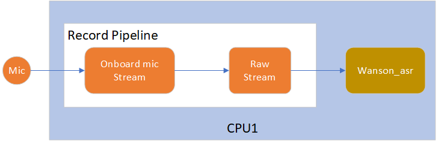
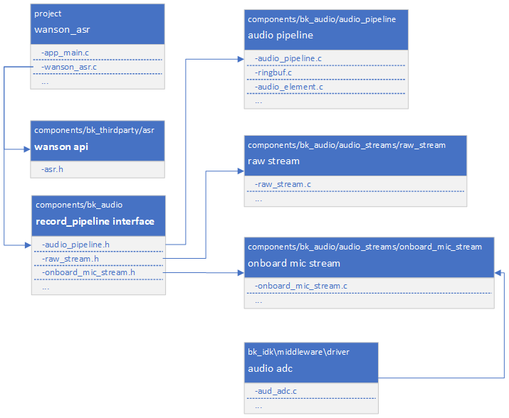

<a id="id1"></a>

# 华镇语音识别工程

<a id="id2"></a>

## 1\. 简介

本工程是本地语音识别的一个demo，基于第三方公司 `华镇` 提供的本地语音识别库，实现本地离线语音唤醒词和命令词识别功能。

<a id="id3"></a>

### 1.1 规格

> - 硬件配置：
>   :   - 核心板，**BK7258\_QFN88\_9X9\_V3.2**
>       - 麦克小板，**BK\_Module\_Microphone\_V1.1**
>       - PSRAM 8M/16M
> - 支持的唤醒词
>   :   - `小蜂管家`
>       - `阿尔米诺`
> - 支持的命令词
>   :   - `会客模式`
>       - `用餐模式`
>       - `离开模式`
>       - `回家模式`

警告

- 1、华镇语音识别库要求音频流格式为：单声道、16K采样率、16bit位宽。
- 2、华镇语音识别库基于浮点运算。
- 3、当修改唤醒词或命令词后，需要替换 `libasr.a` 库。

<a id="id4"></a>

### 1.2 路径

> 工程路径: `<bk_avdk源代码路径>/thirdparty/wanson_asr`
>
> 语音识别算法demo路径: `<bk_avdk源代码路径>/components/audio_algorithm/wanson_asr`
>
> 华镇的本地语音识别库（浮点库）路径: `<bk_avdk源代码路径>/components/bk_thirdparty/asr/wanson/bk7258`
>
> 华镇的本地语音识别库API接口的详细说明请参考源文件: `<bk_avdk源代码路径>/components/bk_thirdparty/asr/wanson/include/asr.h`
>
> project编译指令: `make bk7258 PROJECT=thirdparty/wanson_asr`

<a id="id5"></a>

## 2\. 框架图

<a id="id6"></a>

### 2.1 软件模块架构图

> bk7258的CPU1拥有更高的主频和性能，可以确保运行语音识别算法的效率更高。
> :   所以如下图所示，整个语音识别应用都运行在 `cpu1` 上。

<a id="id18"></a>



Figure 1\. software module architecture
wanson\_asr software module architecture

> - 方案中，我们采用pipeline方式来采集获取mic数据，然后送给wanson\_asr算法进行实时语音识别。

<a id="id7"></a>

### 2.2 代码模块关系图

> 如下图所示，方案使用的onboard\_mic\_stream、raw\_stream和audio\_pipeline模块接口分别定义在 `onboard_mic_stream.h` ，`raw_stream.h` 和 `audio_pipeline.h` 中。

<a id="id19"></a>



Figure 1\. module relationship diagram

wanson\_asr module relationship diagram

<a id="id8"></a>

## 3\. 配置

> > 板载mic采样基于audio pipeline实现，因此需要在 `cpu1` 上打开以下配置:
>
> | Kconfig | CPU | Format | Value |
> | --- | --- | --- | --- |
> | CONFIG\_FREERTOS\_USE\_QUEUE\_SETS | CPU0 \&\& CPU1 | bool | y |
> | CONFIG\_ASDF | CPU0 \&\& CPU1 | bool | y |
> | CONFIG\_ASDF\_WORK\_CPU1 | CPU0 \&\& CPU1 | bool | y |
> | CONFIG\_ASDF\_ONBOARD\_MIC\_STREAM | CPU1 | bool | y |
> | CONFIG\_ASDF\_RAW\_STREAM | CPU1 | bool | y |
> | CONFIG\_WANSON\_ASR | CPU1 | bool | y |

<a id="id9"></a>

## 4\. 演示说明

> > 烧录固件后，设备上电就会运行实时语音识别功能，对着mic说唤醒词和命令词，识别成功会在uart中打印相应的log。
> > 唤醒词和命令词对应的log打印如下：
>
> | 唤醒词或命令词 | log |
> | --- | --- |
> | `小蜂管家` | `xiao feng guan jia` |
> | `阿尔米诺` | `a er mi nuo` |
> | `会客模式` | `hui ke mo shi` |
> | `用餐模式` | `yong can mo shi` |
> | `离开模式` | `li kai mo shi` |
> | `回家模式` | `hui jia mo shi` |

<a id="id10"></a>

## 5\. 代码讲解

<a id="mic"></a>

### 5.1 mic采样

<a id="id11"></a>

#### 5.1.1 打开mic采样

```
//Path      ： projects/thirdparty/wanson_asr/main/wanson_asr.c
//Location  :  CPU1

static bk_err_t record_pipeline_open(void)
{
    ...

        //初始化录音的pipeline
    record_pipeline = audio_pipeline_init(&record_pipeline_cfg);

    //初始化板载mic组件
    onboard_mic = onboard_mic_stream_init(&onboard_mic_cfg);

    //初始化mic数据获取组件
    raw_read = raw_stream_init(&raw_read_cfg);

    //注册板载mic组件到录音pipeline
    if (BK_OK != audio_pipeline_register(record_pipeline, onboard_mic, "onboard_mic"))

    //注册mic数据获取组件到录音pipeline
    if (BK_OK != audio_pipeline_register(record_pipeline, raw_read, "raw_read"))

    //组合录音pipeline
    if (BK_OK != audio_pipeline_link(record_pipeline, (const char *[]) {"onboard_mic", "raw_read"}, 2))

    ...
}
```

<a id="id12"></a>

#### 5.1.2 关闭mic采样

```
//Path      ： projects/thirdparty/wanson_asr/main/wanson_asr.c
//Location  :  CPU1

static bk_err_t record_pipeline_close(void)
{
    ...

        //结束录音pipeline
    if (BK_OK != audio_pipeline_terminate(record_pipeline))

    //注销板载mic组件
    if (BK_OK != audio_pipeline_unregister(record_pipeline, onboard_mic))

    //注销mic数据获取组件
    if (BK_OK != audio_pipeline_unregister(record_pipeline, raw_read))

    //释放录音pipeline
    if (BK_OK != audio_pipeline_deinit(record_pipeline))

    //释放板载mic组件
    if (BK_OK != audio_element_deinit(onboard_mic))

    //释放mic数据获取组件
    if (BK_OK != audio_element_deinit(raw_read))

    ...
}
```

<a id="wanson"></a>

### 5.2 wanson语音识别

<a id="id13"></a>

#### 5.2.1 初始化语音识别

```
//Path      ： projects/thirdparty/wanson_asr/main/wanson_asr.c
//Location  :  CPU1

bk_err_t wanson_asr_init(void)
{
    //投票提高cpu1的主频到480MHz
    bk_pm_module_vote_cpu_freq(PM_DEV_ID_AUDIO, PM_CPU_FRQ_480M);

    //初始化语音识别的task
    send_mic_data_init();

    //打开mic采样pipeline
    record_pipeline_open();

    ...

}
```

<a id="id14"></a>

#### 5.2.2 退出语音识别

```
//Path      ： projects/thirdparty/wanson_asr/main/wanson_asr.c
//Location  :  CPU1

bk_err_t wanson_asr_deinit(void)
{
    //退出语音识别的task
    send_mic_data_send_msg(WANSON_ASR_EXIT, NULL);

    //关闭mic采样pipeline
    record_pipeline_close();

    //投票恢复cpu1的主频到默认值
    bk_pm_module_vote_cpu_freq(PM_DEV_ID_AUDIO, PM_CPU_FRQ_DEFAULT);

    ...

}
```

<a id="id15"></a>

#### 5.2.3 启动语音识别

```
//Path      ： projects/thirdparty/wanson_asr/main/wanson_asr.c
//Location  :  CPU1

bk_err_t wanson_asr_start(void)
{
    //启动mic采样pipeline开始采样
    if (BK_OK != audio_pipeline_run(record_pipeline))

    //启动语音识别的task开始语音识别
    send_mic_data_send_msg(WANSON_ASR_START, NULL);

    ...

}
```

<a id="id16"></a>

#### 5.2.4 停止语音识别

```
//Path      ： projects/thirdparty/wanson_asr/main/wanson_asr.c
//Location  :  CPU1

bk_err_t wanson_asr_stop(void)
{
    //停止语音识别的task暂停语音识别
    send_mic_data_send_msg(WANSON_ASR_IDLE, NULL);

    //通知mic采样pipeline停止采样
    if (BK_OK != audio_pipeline_stop(record_pipeline))

    //等待mic采样pipeline停止采样
    if (BK_OK != audio_pipeline_wait_for_stop(record_pipeline))

    ...

}
```

<a id="task"></a>

### 5.3 语音识别task识别流程

```
//Path      ： projects/thirdparty/wanson_asr/main/wanson_asr.c
//Location  :  CPU1

static void wanson_asr_task_main(beken_thread_arg_t param_data)
{

    ...

    //初始化wanson语音识别算法库
    if (Wanson_ASR_Init() < 0)

    //复位wanson语音识别算法库
    Wanson_ASR_Reset();

    ...

    while (1)
    {

        ...

        //读取30ms的mic数据
                    read_size = wanson_read_mic_data((char *)aud_temp_data, RAW_READ_SIZE);

        //运行wanson语音识别算法
        rs = Wanson_ASR_Recog((short*)aud_temp_data, 480, &text, &score);

        ...
    }

wanson_asr_exit:

    //释放wanson语音识别算法库
    Wanson_ASR_Release();

    ...
}
```

<a id="id17"></a>

## 6\. 上海华镇电子科技有限公司

> 官网：<http://www.wanson.cn/>
>
> 总部地址：上海闵行区申旺路789号慧高光创园307-308室
> \| 深圳办地址：深圳市宝安区西乡汇一城壹中心1A栋东座2215-16
>
> 电话：021-61557858
>
> 手机：13524859176
> \| 13296017858
