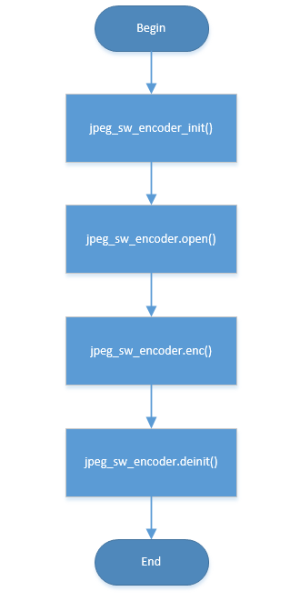

# JPEG软编码

## 1、JPEG软编码流程

JPEG软编码主要流程如下：

1. 输入数据格式转换(该步骤可选，输入格式必须为YVYU422，如果不是该格式需要进行格式转换)；
2. 初始化/申请压缩数据buffer/图像输出buffer；
3. 填充编码头部信息；
4. 以16x8像素的block为单位进行DCT/量化/哈夫曼编码，压缩后的数据填入图像输出buffer；
5. 重复4，直至出现异常或编码结束；

Figure 1\. jpeg soft encode process

## 2、内存需求

JPEG软编码对线程依赖在3K以内，主要需要的buffer及用途如下：

1. 一块512bytes的内部buffer，用于存储16x8 block压缩数据；
2. 一块64k大小的图像输出buffer（该大小可根据需要调整使用malloc动态分配），用于输出压缩后的图像；

## 3、JPEG软编码模块使用

1. 调用 jpeg\_sw\_encoder\_init ，初始化软编码模块,注册相关回调函数如：open/enc/deinit；
2. 调用 jpeg\_sw\_encoder.open ，完成软编码器内部参数初始化/内存申请；
3. 调用 jpeg\_sw\_encoder.enc ，执行软编码操作；
4. 调用 jpeg\_sw\_encoder.deinit ，关闭软编码模块，释放内部申请buffer；

函数参数请查看 [API Reference :](../api-reference/multi_media/bk_jpegenc_sw.md)

## 4、JPEG软编码例程

请参考 jpeg\_sw\_enc\_test.c

## 模块导航

- [快速入门](../get-started.md)
- [H/W 参考](../hw-reference.md)
- [API 参考](../api-reference.md)
- [支持外设](../support_peripherals.md)
- [摄像头](../camera.md)
- [DISPLAY](../display.md)
- [PSRAM内存分配](../psram_config.md)
- [视频编解码](../video_codec.md)
- [H264硬编码](h264_encoding_hw.md)
- [H264软解码](h264_decoding_sw.md)
- [JPEG硬编码](jpeg_encoding_hw.md)
- [JPEG硬解码](jpeg_decoding_hw.md)
- [JPEG软解码](jpeg_decoding_sw.md)
- [图形用户界面](../gui.md)
- [参考工程](../projects.md)
- [低功耗](../power_save.md)
- [音频算法](../audio_algorithms.md)
- [FAQ](../FAQ.md)
