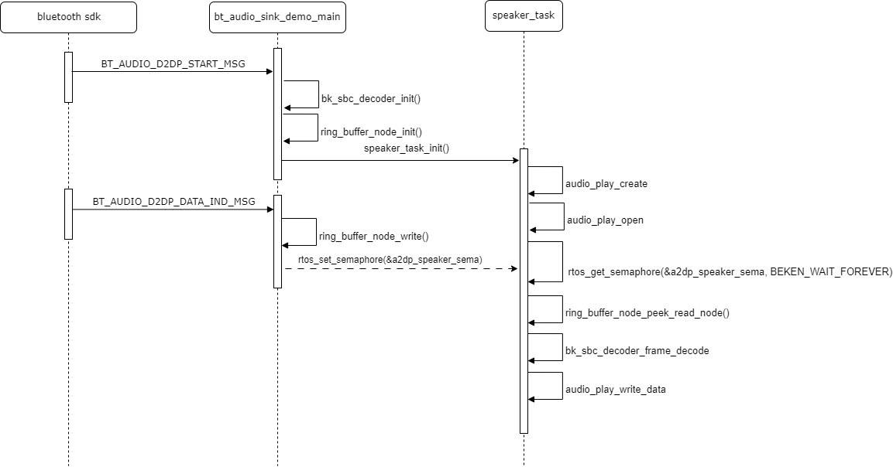

# a2dp\_sink 使用说明

a2dp\_sink\_demo.c 是一个蓝牙A2DP Sink功能的实现示例，主要功能包括：

1. A2DP SINK 支持，蓝牙音频接收与解码（支持SBC和AAC格式）；
2. AVRCP CT/TG 支持，音频播放控制（播放/暂停/音量调节/快进/快退等）；
3. GAP链路管理；
4. 音频播放；

A2DP 音频处理流程：

Figure 1\. a2dp stream processing flow

## Header File

- [a2dp\_sink\_demo.h](http://192.168.0.46/gerrit/plugins/gitiles/iot/wcn/projects/+/refs/heads/armino_main/components/a2dp_sink_demo.h)

## Functions

    int a2dp\_sink\_demo\_init(uint8\_t aac\_supported)

    int a2dp\_sink\_demo\_deinit(void)

    int32\_t bk\_bt\_app\_avrcp\_ct\_get\_attr(uint32\_t attr)

    void a2dp\_sink\_demo\_set\_mix(uint8\_t enable)

    void bk\_bt\_app\_a2dp\_audio\_spk\_enable(uint8\_t enable)

    void bk\_bt\_a2dp\_sink\_demo\_debug\_info(void)
