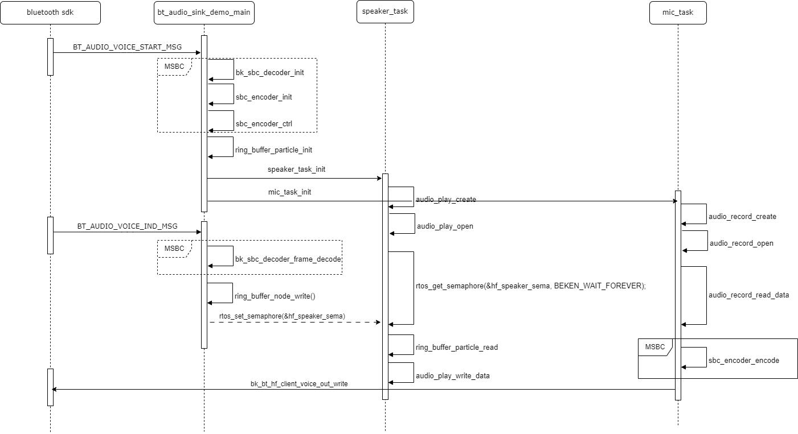

# HFP 使用说明

hfp\_hf\_demo.c 文件是HFP（Hands-Free Profile） HF端功能的实现示例，主要功能包括：

1.HF功能实现 ：

- 实现HFP HF端状态管理（空闲/连接/通话等状态）；
- HFP AT命令（音量控制、拨号、拒接等）处理；
- 支持SCO/eSCO 音频链路管理；

2.音频处理 ：

- 支持CVSD和mSBC两种语音编解码；
- 实现麦克风数据采集编码传输（ mic\_task ）；
- 实现SCO/eSCO数据解码扬声器播放（ speaker\_task ）；

音频处理流程：

Figure 1\. audio stream processing flow

## Header File

- [hfp\_hf\_demo.h](http://192.168.0.46/gerrit/plugins/gitiles/iot/wcn/projects/+/refs/heads/armino_main/components/hfp_hf_demo.h)

## Functions

    int hfp\_hf\_demo\_init(uint8\_t msbc\_supported)

    int hfp\_hf\_demo\_deinit(void)

    void hfp\_demo\_vr(uint8\_t enable)

    void hfp\_demo\_dial(uint8\_t enable, uint8\_t \*num)

    void hfp\_demo\_answer(uint8\_t accept)

    void hfp\_demo\_cust\_cmd(uint8\_t \*cmd)

    int32\_t hfp\_demo\_chld\_cmd(uint8\_t op)

    int32\_t hfp\_demo\_btrh\_cmd(uint8\_t op)
