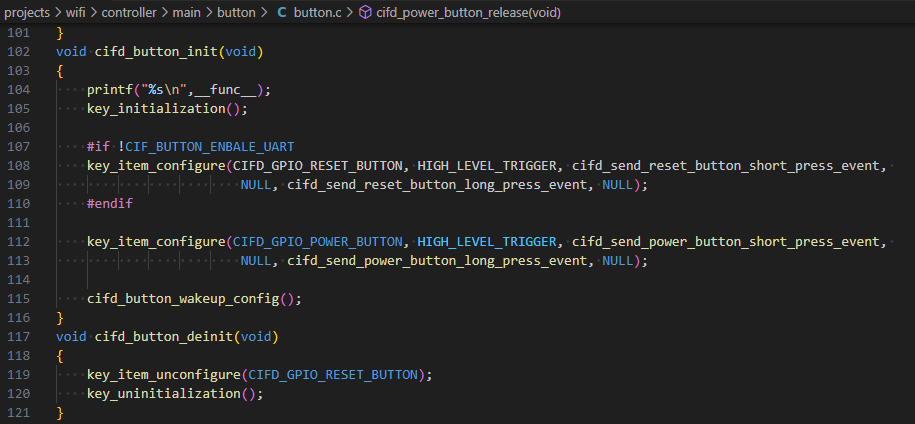

# 按键开发

Controller SDK提供了按键模块，可通过如下参考代码对相应GPIO进行注册，实现按键的短按、长按和两次短按，配合GPIO唤醒代码，可以实现按键唤醒系统，同时把主控唤醒。
相关实现请参考如下demo代码

## 模块导航

- [简介](../introduction.md)
- [快速入门](../get-started.md)
- [硬件设计指南](../hw-reference.md)
- [软件方案介绍](../sw-detail.md)
- [主控开发适配指南](../host-guide.md)
- [Controller开发指南](../controller-guide.md)
- [SDK下载及介绍](cntrl_sdk.md)
- [编译环境搭建](sdk_build.md)
- [demo工程介绍](demo_project.md)
- [创建新工程](new_project.md)
- [低功耗开发指南](low_power.md)
- [自定义Event发送](event_notify.md)
- [ble使用介绍](ble.md)
- [常见问题解答](../frequently-asked-questions.md)
