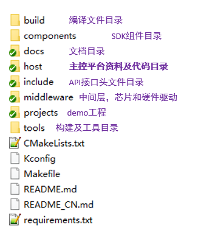

<a id="sdk"></a>

# SDK下载及介绍

<a id="id1"></a>

## **SDK下载**

BK Controller方案提供了完整的SDK开发包，可从gitlab或者github下载SDK开发包，下载方式如下：

您可从 gitlab 上下载 Armino AVDK SDK:

```
mkdir -p ~/armino
cd ~/armino
git clone http://gitlab.bekencorp.com/armino/bk_idk_controller.git
```

您也可从 github 上下载 Armino AVDK SDK:

```
mkdir -p ~/armino
cd ~/armino
git clone --recurse-submodules https://github.com/bekencorp/bk_idk_controller.git
```

<a id="id2"></a>

## **SDK目录介绍**



## 模块导航

- [简介](../introduction.md)
- [快速入门](../get-started.md)
- [硬件设计指南](../hw-reference.md)
- [软件方案介绍](../sw-detail.md)
- [主控开发适配指南](../host-guide.md)
- [Controller开发指南](../controller-guide.md)
- [编译环境搭建](sdk_build.md)
- [demo工程介绍](demo_project.md)
- [创建新工程](new_project.md)
- [低功耗开发指南](low_power.md)
- [按键开发](button.md)
- [自定义Event发送](event_notify.md)
- [ble使用介绍](ble.md)
- [常见问题解答](../frequently-asked-questions.md)
