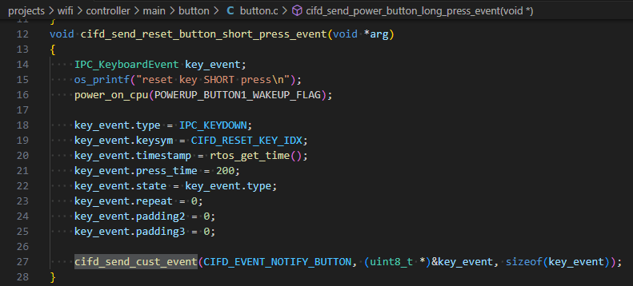

# 自定义Event发送

开发者可通过 `ctrl_if_send_customer_event` 接口向主控发送自定义Event消息，相关demo实现如下：

## 模块导航

- [简介](../introduction.md)
- [快速入门](../get-started.md)
- [硬件设计指南](../hw-reference.md)
- [软件方案介绍](../sw-detail.md)
- [主控开发适配指南](../host-guide.md)
- [Controller开发指南](../controller-guide.md)
- [SDK下载及介绍](cntrl_sdk.md)
- [编译环境搭建](sdk_build.md)
- [demo工程介绍](demo_project.md)
- [创建新工程](new_project.md)
- [低功耗开发指南](low_power.md)
- [按键开发](button.md)
- [ble使用介绍](ble.md)
- [常见问题解答](../frequently-asked-questions.md)
