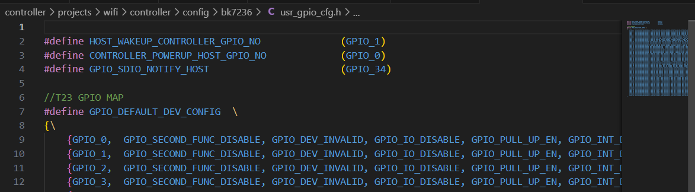
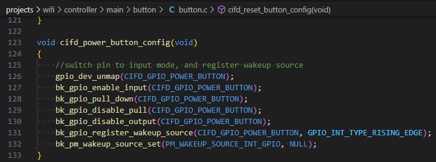
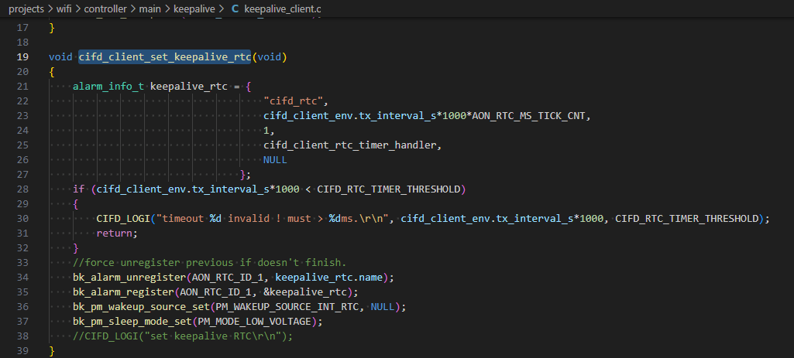
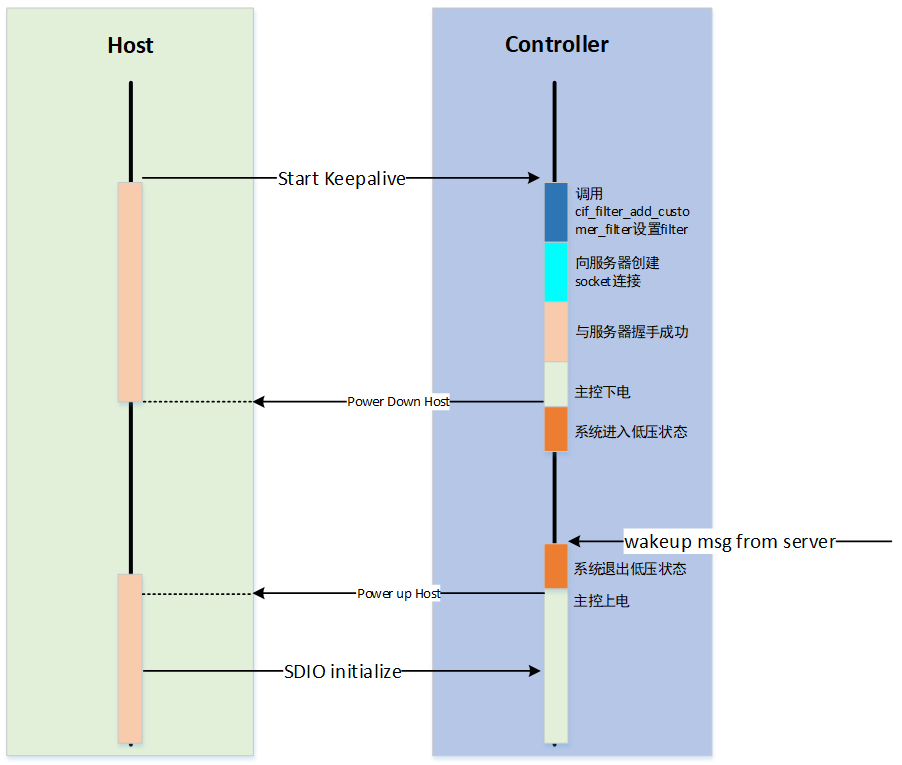

<a id="id1"></a>

# 低功耗开发指南

<a id="id2"></a>

## **低功耗状态介绍**

系统支持不同的睡眠模式:
:   - active
    - normal sleep
    - low voltage
    - deep sleep
    - super deep sleep
    - shut down

支持的唤醒方式：

> | #sleep mode | GPIO | RTC | WIFImac | BTdm | TOUCH |
> | --- | --- | --- | --- | --- | --- |
> | normal sleep | Y | Y | Y | Y | Y |
> | low voltage | Y | Y | Y | Y | Y |
> | deep sleep | Y | Y | N | N | Y |
> | super deep sleep | Y | Y | N | N | N |

<a id="active"></a>

### active(正常工作)

> - CPU处于工作状态和WIFI,BT可以正常收发数据。

<a id="normal-sleep"></a>

### normal sleep(普通睡眠)

> - RTOS没有任务需要处理时，系统进入IDLE任务中，在IDLE任务中，CPU会进入WFI睡眠；当有任何中断到来时，都能让系统退出WFI状态，进入正常工作。

<a id="low-voltage"></a>

### low voltage(低压睡眠)

> - 低压睡眠是一种相对比较节省功耗的睡眠模式。在该模式下系统只有32K时钟，此时只有部分硬件模块在工作，除了AON模块其他硬件模块在低压下暂停运行。
> - 低压睡眠模式AON的电压会减低，VDDDIG的电压也会减低。
> - 进入低压的条件:1)RTOS没有任务需要处理时，系统进入IDLE任务中;2)满足了进入低压的票（BT和WIFI进入sleep,多媒体关闭，APP的票置上）
>
> 当唤醒信号触发后，系统退出低压状态，AON,VDDDIG电压升级到正常电压。
> \- 处于低压状态下，以下唤醒源(GPIO,RTC,Touch,WIFI,BT)可以让系统退出低压。注意：WIFI,BT进入低压是根据WIFI，BT的业务场景来投票进入，比较特殊。
>
> - 该模式下32K的时钟源可以根据自己业务的场景选择。
> - 为了达到最优功耗，不需要的模块，进入低压前请关闭，退出低压后，可以再开启。

<a id="deep-sleep"></a>

### deep sleep(深度睡眠)

> - 深度睡眠是一种相对最节省功耗的睡眠模式。在该模式下系统只有32K时钟，此时只有部分硬件模块在工作，除了AON模块其他硬件模块都已经下电。
>
> 当唤醒信号触发后，系统退出深度睡眠状态，系统复位。
>
> - 处于深度睡眠状态下，以下唤醒源(GPIO,RTC,Touch)可以让系统退出深度睡眠。
> - 该模式下32K的时钟源默认是使用ROSC的32K。
> - 进入深度睡眠的条件:1)RTOS没有任务需要处理时，系统进入IDLE任务中;2)满足了进入深度睡眠的票（BT和WIFI进入sleep,多媒体关闭，APP的票置上）

<a id="super-deep-sleep"></a>

### super deep sleep(超深度睡眠)

> - 与deepsleep区别在于该模式下aon电压域也断电，仅部分模拟区域有电；数字唤醒源不起效，只能依靠模拟GPIO或RTC唤醒。

<a id="shut-down"></a>

### shut down(关机)

> - 整个系统都已经下电

<a id="id3"></a>

## **低功耗相关接口**

为了简化低功耗开发流程，SDK将低功耗操作封装为相关接口，主要接口说明如下

```
1 // 控制Controller进入低压休眠
2 void ctrl_if_start_lv_sleep(void);
3 // 控制Controller进入深度休眠
4 void ctrl_if_start_deep_sleep(void);
5 // 控制Controller退出sleep，低压休眠和深度休眠退出均使用此接口
6 bk_err_t ctrl_if_exit_sleep(void);
```

重要

*Controller休眠与主控关系密切，低功耗控制一定要使用上述接口控制，确保与主控通信不受影响*

<a id="id4"></a>

## **主控上下电控制**

为了简化主控上下电控制，SDK将主控上下电操作封装为相关接口，主要接口说明如下

```
1 // 控制主控上电
2 bk_err_t ctrl_if_power_up_host(void);
3 //控制主控下电
4 bk_err_t ctrl_if_power_down_host(void);
```

上述接口通过操作GPIO控制主控上下电，具体哪个GPIO需要修改CONTROLLER\_POWERUP\_HOST\_GPIO\_NO指定



重要

*主控上下电直接影响Controller与主控之间的交互，请确保主控上下电操作使用上述接口，而不是直接操作GPIO*

<a id="filter"></a>

## **数据Filter设置**

Controller Wi-Fi模块收到的TCP/IP数据默认转交给Host，而不是本地的TCP/IP协议栈。
在低功耗保活等场景下，由于主控处于下电状态，保活应用是运行在Controller侧的，此时Controller Wi-Fi模块收到的TCP/IP数据需要送到本地的TCP/IP协议栈。

为了区分哪些数据需要送到本地的TCIP/IP协议栈，Controller SDK提供了数据filter接口，
接口函数原型 `cif_filter_add_customer_filter(uint32_t ip, uint16_t port)` ，其中ip为数据的源IP地址，prot为数据源端口号。
需要注意的是：入参中的IP地址为网络序。例如，低功耗保活时通信的服务器地址为：111.222.111.123，端口号为：1234。
IP地址转换为网络序16进制32位无符号后为0x6FDE6F7B，可通过 `cif_filter_add_customer_filter(0x6FDE6F7B, 1234)` 可以将对应IP和端口号添加到filter中。

<a id="controller"></a>

## **Controller低功耗唤醒控制**

如上述低功耗状态介绍，系统进入低压休眠和深度休眠时，软件不会被执行。如果开发者希望在休眠期间执行某些流程，需要通过特定唤醒源将系统从休眠状态唤醒。

<a id="id5"></a>

### 低压休眠唤醒

在低压休眠时，常见的唤醒方式有：Wi-Fi(服务器保活唤醒)、GPIO（如按键）和RTC。Wi-Fi在低压休眠时如果与路由器保持连接，路由器发送数据给设备时会自动醒来接收数据并上报给相应的应用，因此Wi-Fi唤醒无需开发者特别关注。

- **GPIO唤醒**

GPIO做为做为唤醒源时，需要对GPIO做特定配置，同时注册GPIO中断，相关实现可参考demo工程中按键唤醒代码示例



- **RTC唤醒**

RTC唤醒需要配置RTC timer，相关实现可参考demo工程中如下代码：



<a id="id6"></a>

### 深度休眠唤醒

深度休眠下，Wi-Fi无法保持连接，因此也无法通过Wi-Fi唤醒系统。GPIO和RTC唤醒系统与低压休眠类似，可参考 **低压休眠唤醒** 中设置GPIO和RTC唤醒系统

<a id="id7"></a>

## **低功耗保活开发**

低功耗保活建立流程保活如下步骤:

- 通过 `cif_filter_add_customer_filter` 配置filter
- 与服务器创建socket连接
- 服务器握手成功，调用 `ctrl_if_power_down_host` 接口对主控下电
- 调用 `ctrl_if_start_lv_sleep` 让系统进入低压状态

退出保活流程步骤：

- 收到网络唤醒消息，调用 `ctrl_if_exit_sleep` 使系统退出低压
- 调用 `ctrl_if_power_up_host` 接口对主控上电
- Host与主控重新建立连接


