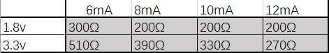
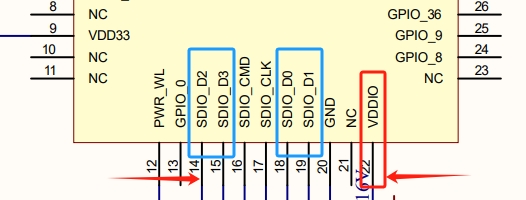

<a id="id1"></a>

# 常见问题解答

<a id="bk7236-1-4-sdio"></a>

## **BK7236 是否支持 1 线或 4 线 SDIO**

BK7236 支持 1 线和 4 线模式。可通过工程目录中的 CONFIG\_SDIO\_4LINES\_EN 宏来配置：

设置为 Y 表示使能 4 线模式。
设置为 N 表示使能 1 线模式。

<a id="bk7236-i-o-1-8v-3-3v"></a>

## **BK7236 的 I/O 供电是否支持 1.8V 和 3.3V**

BK7236 支持 1.8V 和 3.3V 供电。可通过工程目录中的 CONFIG\_GPIO\_1V8\_EN 和 CONFIG\_GPIO\_1V8\_SRC\_AUTO\_SWITCH\_EN 宏进行配置：

两个宏均置 Y 用于使能 1.8V。
两个宏均置 N 用于使能 3.3V。

<a id="bk7236-sdio"></a>

## **BK7236 SDIO 中断管脚如何配置**

BK7236使用GPIO外部中断，可通过工程目录下usr\_gpio\_cfg.h中的GPIO\_SDIO\_NOTIFY\_HOST来配置:

```
bk_idk/projects/wifi/controller/config/bk7236/usr_gpio_cfg.h
+ #define HOST_WAKEUP_CONTROLLER_GPIO_NO              (GPIO_1)
+ #define CONTROLLER_POWERUP_HOST_GPIO_NO             (GPIO_0)
+ #define GPIO_SDIO_NOTIFY_HOST                       (GPIO_34)
```

上述以wifi/controller（一线工程）为例子说明，具体所配GPIO根据不同的硬件需求以及原理图，以上仅供参考。

<a id="beken-netdrv-ko"></a>

## **beken\_netdrv.ko加载失败**

如果beken\_netdrv.ko驱动加载后，没有显示probe成功或者没有获取到mac address的打印。需要检查NOTIFY\_HOST的引脚对应的HOST侧的GPIO是否被配置为GPIO
中断，以及确认引脚两端的信号是否对齐。必要时，需要通过逻辑分析仪抓取信号。

<a id="crc"></a>

## **移植代码后，总是遇到CRC报错或者消息重发现象**

如遇到CRC的出错问题，需要检查模组侧的SDIO DATA0\~DATA3以及CMD的上拉电阻是否匹配，默认模组上的数据线与命令线可能没有上拉电阻。
不同客户可能根据具体MCU 的I/O的驱动电流和SDIO使用的电压（3.3v/1.8v）情况进行动态适配。
推荐阻值可以参考以下表格：

<a id="id2"></a>



Figure 1\. Voltage-current matching relationship with resistance

实际阻值需要万用表量取确认，方法如下：
电阻档分别量取VDDIO与各SDIO\_DATA之间的阻值。

<a id="id3"></a>



Figure 2\. SDIO GPIO \& VDDIO

<a id="gpio"></a>

## **GPIO的检查**

需要根据bk\_idk/projects/wifi/controller\_4wire/config/bk7236/usr\_gpio\_cfg.h
中的信息，检查GPIO是否配置为SDIO所需的四个引脚，以防止出现使用4线时，相应的引脚没有配置正确导致SLAVE侧没有获取到信号，影响CMD收发的正常工作。
