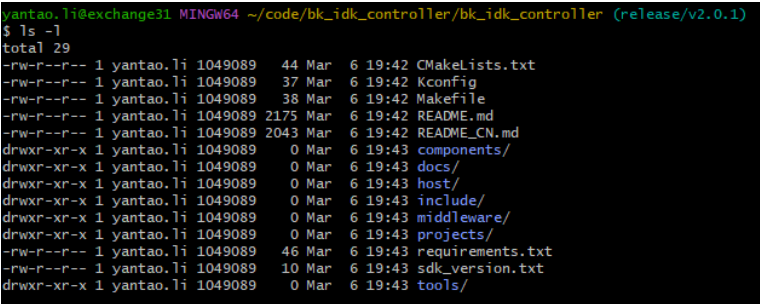

<a id="id1"></a>

# 快速入门

<a id="bk-controller-sdk"></a>

## **BK Controller SDK代码下载**

您可从 gitlab 上下载 BK Controller SDK:

```
mkdir -p ~/armino
cd ~/armino
git clone http://gitlab.bekencorp.com/armino/bk_idk_controller.git
```

您也可从 github 上下载 BK Controller SDK:

```
mkdir -p ~/armino
cd ~/armino
git clone --recurse-submodules https://github.com/bekencorp/bk_idk_controller.git
```

然后切换到稳定分支Tag节点, 如v2.0.1.8:

```
cd ~/armino/bk_idk_controller
git checkout -B your_branch_name v2.0.1.8
git submodule update --init --recursive
ls
```

<a id="id11"></a>



Figure 1\. BK Controller SDK Directiry structure

备注

从官网的gitlab下载的为最近的SDK代码，相关账号找项目上审核申请。

<a id="id2"></a>

## **构建编译环境**

备注

Armino，当前支持Linux环境下编译，本章节将以 Ubuntu 20.04 LTS 版本为例，介绍整个编译环境的搭建。

<a id="id3"></a>

### 安装工具链

点击 [下载](https://dl.bekencorp.com/tools/toolchain/arm/gcc-arm-none-eabi-10.3-2021.10-x86_64-linux.tar.bz2) 下载 BK7236 工具链。

工具包下载后，通过如下操作命令解压至 /opt/ 目录下:

```
$ sudo tar -xvjf gcc-arm-none-eabi-10.3-2021.10-x86_64-linux.tar.bz2 -C /opt/
```

备注

工具链默认路径在 middleware/soc/bk7236/bk7236.defconfig 文件中定义，您也可以在项目配置文件中更改工具链路径:

```
CONFIG_TOOLCHAIN_PATH="/opt/gcc-arm-none-eabi-10.3-2021.10/bin"
```

<a id="id5"></a>

### 安装依赖库

在终端输入下述命令安装 python3，CMake，Ninja 以及依赖库:

```
sudo dpkg --add-architecture i386
sudo apt-get update
sudo apt-get install build-essential cmake python3 python3-pip doxygen ninja-build libc6:i386 libstdc++6:i386 libncurses5-dev lib32z1 -y
sudo pip3 install pycrypto click
```

<a id="python"></a>

### 安装 python 依赖库

在 Armino 根目录下输入下述命令安装 python 依赖库:

```
sudo pip3 install sphinx_rtd_theme future breathe blockdiag sphinxcontrib-seqdiag sphinxcontrib-actdiag sphinxcontrib-nwdiag sphinxcontrib.blockdiag
```

如果您的 Python 默认为 Python2，请使用下述命令更改成 Python3:

```
sudo ln -s /usr/bin/python3 /usr/bin/python
```

<a id="id6"></a>

## **编译工程**

在终端下输入下述命令编译 BK Controller默认工程，PROJECT为可选参数，默认为app工程（不支持Controller）。
Controller工程可通过PROJECT参数指定编译工程

```
cd ~/armino/bk_idk_controller
make bk7236 PROJECT=wifi/controller
```

<a id="id7"></a>

## **配置工程**

您可以通过工程配置文件来进行更改默认配置或者针对不同芯片进行差异化配置:

```
工程配置文件 Override 芯片配置文件 Override 默认配置
如： config >> bk7236.defconfig >> KConfig
+ 工程配置文件示例：
    projects/wifi/controller/config/bk7236/config
+ 芯片配置文件示例：
    middleware/soc/bk7236/bk7236.defconfig
+ KConfig 配置文件示例：
    middleware/arch/cm33/Kconfig
    components/bk_cli/Kconfig
```

<a id="id8"></a>

## **新建工程**

新建工程可参考 projects/wifi/controller工程创建新工程

<a id="id9"></a>

## **烧录代码**

Armino 支持在 Windows/Linux 平台进行固件烧录, 烧录方法参考烧录工具中指导文档。
以Windows 平台为例， Armino 目前支持 UART 烧录。

具体 [烧录流程](../../bk_idk/BK7236/get-started.md) 请参考 [IDK](../../bk_idk/BK7236.md)
