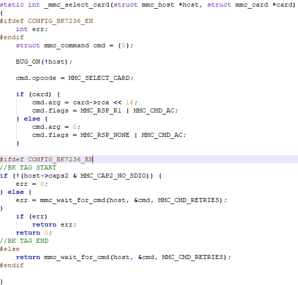
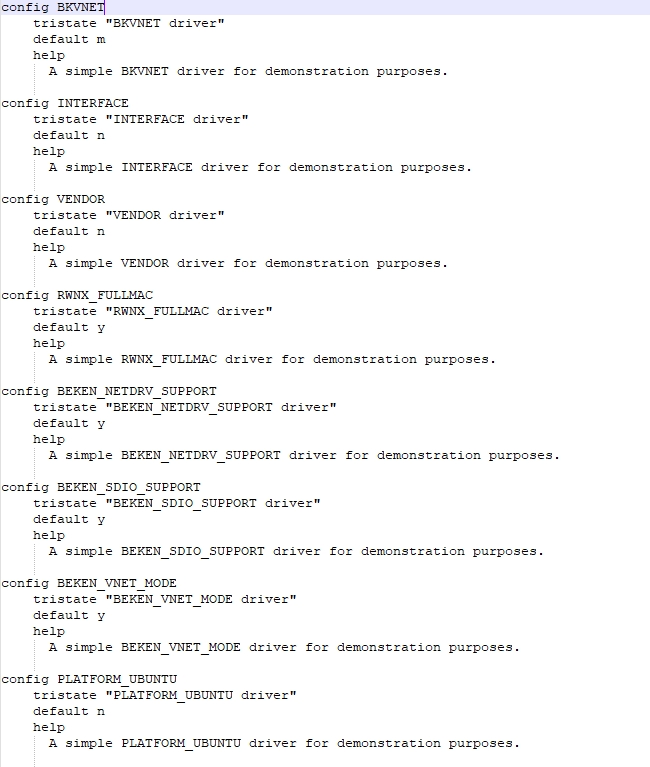
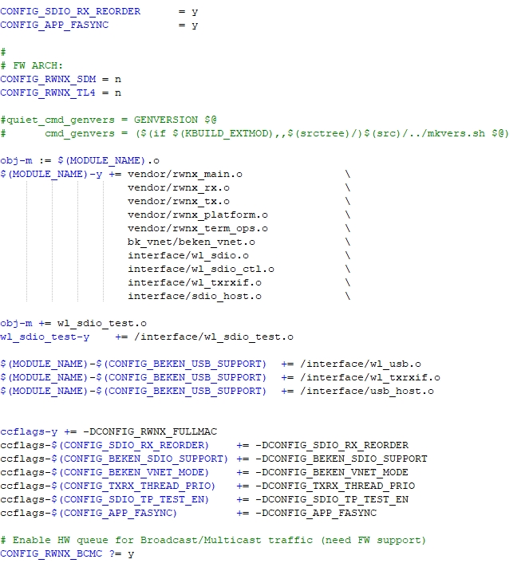

<a id="fullhan"></a>

# 富瀚微(Fullhan)主控适配指南

富瀚微(Fullhan)主控（以qm10xv为例）侧代码以patch形式发布，可将相关patch打入主控平台代码中参与编译，主要分为三部分：
\- 内核修改
\- 用户空间API接口
\- 编译工程增加

<a id="linux"></a>

## **Linux内核修改**

内核修改包含MMC驱动修改、WLAN驱动和板级修改等几个部分，详细介绍如下。

备注

内核相关文件以patch文件方式提供，相关文件路径 `/bk_idk_controller/host/docs/FH_BK7236_adapt_docs.zip`
fhv\_base\_e10c18c\_250225.diff为qm10xv原生SDK(bk7236\_qm10xv\_env版本)中base子仓库的patch
fhv\_userland\_250217.diff为io\_ctrl工具所需userland子仓库的patch

<a id="mmc"></a>

### MMC修改

MMC修改主要修改如下几个文件，相关修改均使用CONFIG\_BK7236\_EN包括，确保不影响非BK7236工程，为了使CONFIG\_BK7236\_EN生效，需要同时
在 `base/soc/qm10xv/linux/board_support/kernel/linux-4.9/drivers/mmc/core/Kconfig` 中定义 `BK7236_EN` 并置为y，宏包含代码如下图所示

- `base/soc/qm10xv/linux/board_support/kernel/linux-4.9/drivers/mmc/core/core.c`
- `base/soc/qm10xv/linux/board_support/kernel/linux-4.9/drivers/mmc/core/mmc_ops.c`
- `base/soc/qm10xv/linux/board_support/kernel/linux-4.9/drivers/mmc/core/sd_ops.c`
- `base/soc/qm10xv/linux/board_support/kernel/linux-4.9/drivers/mmc/core/sdio_io.c`
- `base/soc/qm10xv/linux/board_support/kernel/linux-4.9/drivers/mmc/core/sdio_ops.c`
- `base/soc/qm10xv/linux/board_support/kernel/linux-4.9/drivers/mmc/host/fhmci/fhmci.c`
- `base/soc/qm10xv/linux/board_support/kernel/linux-4.9/drivers/mmc/core/Kconfig`



<a id="bk7236"></a>

### BK7236驱动

beken\_vnet驱动是BK7236驱动的核心代码，放在 `/kernel/linux-4.9/drivers/net/wireless/beken_vnet`，源码参与编译需要修改相应的makefile和Kconfig，
具体修改如下图所示：




备注

beken\_vnet驱动以源码方式提供，相关文件目录 `bk_idk_controller/host/driver/linux/beken_vnet`
ko文件通过 `make all` 命令生成，工具链路径通过当前路径下的makefile相对位置索引

<a id="id1"></a>

### 其他修改

- PINCTRL子系统中新增GPIO2\_3中断接收引脚 `soc/qm10xv/linux/board_support/kernel/linux-4.9/arch/arm/mach-fh/include/mach/board_config.h`
- fh平台新增caps2数据结构 `soc/qm10xv/linux/board_support/kernel/linux-4.9/arch/arm/mach-fh/include/mach/fh_mci_plat.h`
- fh平台板级配置文件caps2结构体赋值 `soc/qm10xv/linux/board_support/kernel/linux-4.9/arch/arm/mach-fh/qm102v/bk7236/board.c`
- bk7236板级配置文件新增GPIO2\_3引脚信息 `soc/qm10xv/linux/board_support/kernel/linux-4.9/arch/arm/mach-fh/qm102v/bk7236/board_config.h`

<a id="id2"></a>

## **用户空间代码**

用户空间主要包含bk\_ioctl API接口和demo APP，相关代码路径： `/bk_idk_controller/host/demo_app/bk_ioctrl`

<a id="bk-ioctl-api"></a>

### bk\_ioctl API接口

为了方便应用开放，在Linux系统用户空间提供了API接口，这部分代码路径： `/bk_idk_controller/host/demo_app/bk_ioctrl/bk_ioctl_api.h`
SDK提供的基础API接口如下：

```
 1 /**************************WLAN API**************************/
 2 int bk_ioctl_scan_wifi(void);
 3 int bk_ioctl_set_sta(char *ssid, char *key);
 4 int bk_ioctl_disc_sta(void);
 5 int bk_ioctl_start_softap(char *ssid, char *pw);
 6 int bk_ioctl_stop_softap(void);
 7 int bk_ioctl_get_wlan_status(bk_ioctl_wlan_status_t *status);
 8 int bk_ioctl_wifi_multimedia_config(bool wifi_mmd_en);
 9 int bk_ioctl_set_net_info(struct bk_ioctl_net_info *info);
10 int bk_ioctl_get_net_info(bk_ioctl_net_info_t *net_info);
11 int bk_ioctl_get_rssi(int32_t *rssi);
12 int bk_ioctl_get_wifi_info(bk_wifi_info *info);
13 int bk_ioctl_set_auto_reconnect(bool auto_connect_en);
14
15 /**************************BLE API**************************/
16 int bk_ioctl_open_ble(void);
17 int bk_ioctl_close_ble(void);
18
19 /**************************SYSTEM API**************************/
20 int bk_ioctl_set_mac(uint8_t *mac);
21 int bk_ioctl_get_mac(uint8_t *mac, int len);
22 int bk_ioctl_enter_sleep(void);
23 int bk_ioctl_exit_sleep(void);
24 int bk_ioctl_send_at(char *at_str);
25 int bk_ioctl_keepalive_cfg(struct bk_ioctl_keepalive_cfg *cfg);
26 int bk_ioctl_set_time(uint32_t time);
27 int bk_ioctl_get_time(uint32_t *time);
28 int bk_ioctl_send_customer_data(uint8_t *data, uint16_t len, uint8_t *rsp_data, uint16_t rsp_len);
29 int bk_ioctl_start_ota(void);
30 int bk_ioctl_send_ota_pkt(bk_ioctl_ota_req_t *ota_info, uint16_t len);
31 int bk_ioctl_stop_ota(void);
32
33 /**************************Other API**************************/
34 void bk_ioctl_register_callback(bk_ioctl_callback_t callback);
35 int bk_ioctl_init(void);
36 void bk_ioctl_deinit(void);
```

备注

API接口具体含义请参考 `/bk_idk_controller/host/demo_app/bk_ioctrl/bk_ioctl_api.h`

<a id="demo-app"></a>

### demo APP

bk\_ioctrl目录提供了与beken\_vnet驱动对应的上层demo应用程序，分别是bk\_ioctrl和bk\_rx\_evt
用户可通过bk\_ioctrl中相关命令实现对BK7236的操作，如Wi-Fi的扫描和连接等，
通过 `bk_ioctl_register_callback` 完成接收消息注册，实现接收Controller主动上报的消息

bk\_ioctrl支持命令和bk\_rx\_evt支持的消息可参考 [主控软件介绍](../../sw-detail/host_sw.md)
