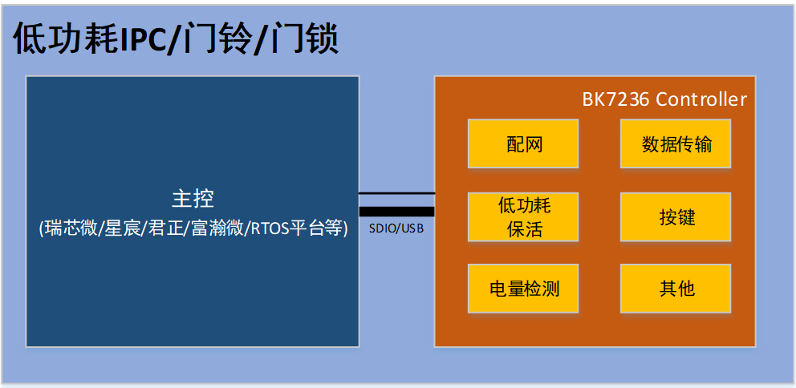

# 简介

## **Controller产品介绍**

Controller产品需要配合主控平台一起工作，主控平台需要开发相应的软件以完成对Controller的控制（比如WLAN扫描/连接）。
Controller产品通常有两种实现方式，分别是标准方案和私有方案。低功耗产品通常使用私有方案，本文档主要介绍BK私有Controller方案(BK Controller)。

## **BK Controller方案简介**

BK7236 Wi-Fi Controller可应用在低功耗IPC/门铃/门锁等产品，主控和Controller之间通过SDIO或者USB接口通信。
与标准的Controller产品相比，这类产品更关注功耗，要求Controller能够独立完成与服务器之间的保活，保活期间主控可能处于深度休眠甚至下电状态。

## 模块导航

- [快速入门](get-started.md)
- [硬件设计指南](hw-reference.md)
- [软件方案介绍](sw-detail.md)
- [主控开发适配指南](host-guide.md)
- [Controller开发指南](controller-guide.md)
- [常见问题解答](frequently-asked-questions.md)
