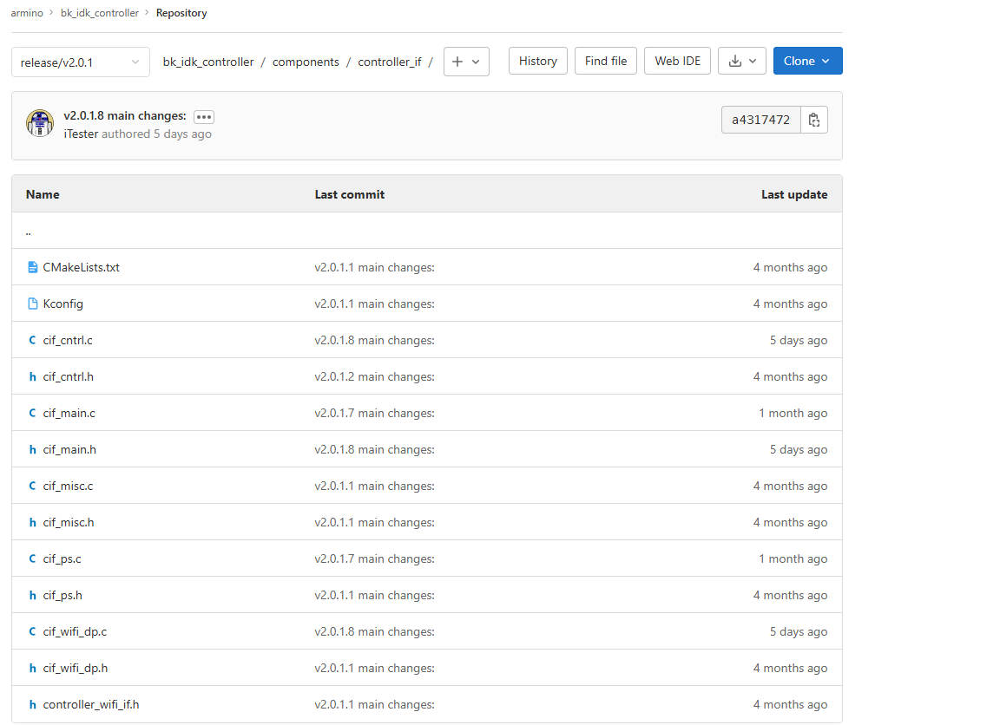
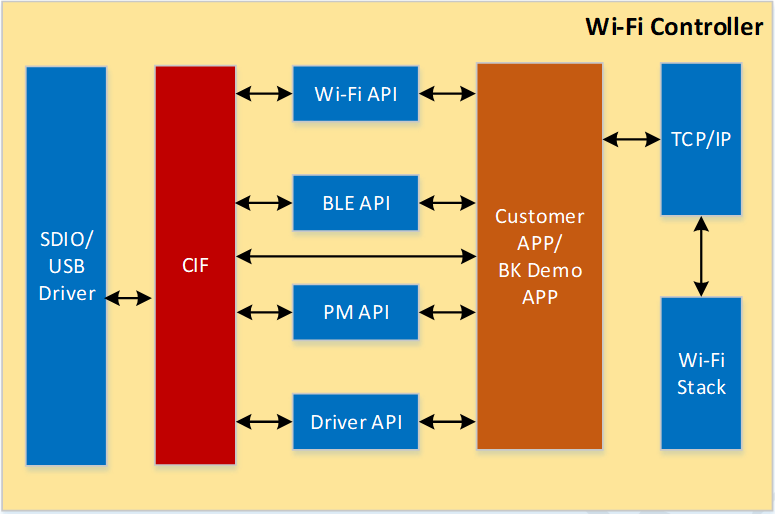
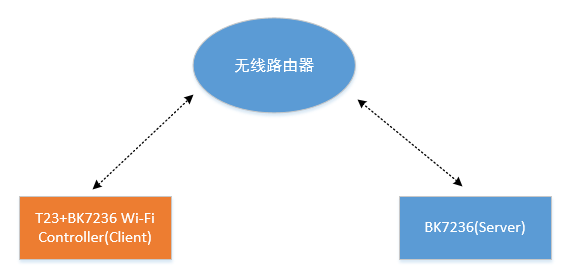

<a id="bk-controller"></a>

# BK Controller主要软件介绍

Controller部分软件主要需要关注controller\_if模块和相应的demo程序。

<a id="controller-if"></a>

## **controller\_if模块**

controller\_if模块是Controller侧与Host交互的核心模块，它提供了Host消息接收处理、数据接收转发和低功耗控制等核心功能。controller\_if模块在Controller SDK代码位置如下图所示：



controller\_if模块主要与SDIO/USB驱动通信，收到Host发送的消息和数据后转发给相应模块，同时该模块向其他业务模块提供接口，其他业务模块可以调用相应的接口完成与Host的通信。


<a id="cif-cntrl"></a>

### cif\_cntrl子模块

cif\_cntrl子模块负责处理与Host之间的消息交互，目前支持的Host请求消息如下表所示

> | CMD | Value | Common |
> | --- | --- | --- |
> | BK\_CMD\_SCAN\_WIFI | 0x1 | Wi-Fi扫描命令 |
> | BK\_CMD\_CONNECT | 0x2 | Wi-Fi连接命令 |
> | BK\_CMD\_DISCONNECT | 0x3 | Wi-Fi断开连接命令 |
> | BK\_CMD\_START\_AP | 0x4 | 启动SoftAP命令 |
> | BK\_CMD\_CHANGE\_AP\_MODE | 0x5 | 更换SoftAP模式命令 |
> | BK\_CMD\_STOP\_AP | 0x6 | 关闭SoftAP命令 |
> | BK\_CMD\_GET\_WLAN\_STATUS | 0x7 | 获取Wi-Fi状态命令 |
> | BK\_CMD\_WIFI\_MMD\_CONFIG | 0x8 | 启动Wi-Fi多媒体传输模式 |
> | BK\_CMD\_SET\_NET\_INFO | 0x9 | 配置Wi-Fi网络信息 |
> | BK\_CMD\_SET\_AUTOCONNECT | 0xA | 配置Wi-Fi自动连接 |
> | BK\_CMD\_OPEN\_BLE | 0x101 | 开启BLE命令 |
> | BK\_CMD\_CLOSE\_BLE | 0x102 | 关闭BLE命令 |
> | BK\_CMD\_SET\_MAC\_ADDR | 0x201 | 配置Controller MAC地址 |
> | BK\_CMD\_GET\_MAC\_ADDR | 0x202 | 获取Controller MAC地址 |
> | BK\_CMD\_ENTER\_SLEEP | 0x203 | 控制Controller进入Sleep |
> | BK\_CMD\_EXIT\_SLEEP | 0x204 | 要求Controller退出Sleep |
> | BK\_CMD\_CONTROLLER\_AT | 0x205 | 发送AT命令 |
> | BK\_CMD\_KEEPALIVE\_CFG | 0x206 | 开启低功耗保活demo |
> | BK\_CMD\_SET\_TIME | 0x207 | 配置系统时间 |
> | BK\_CMD\_GET\_TIME | 0x208 | 获取系统时间 |
> | BK\_CMD\_CUSTOMER\_DATA | 0x209 | 发送客户自定义消息 |
> | BK\_CMD\_START\_OTA | 0x20A | 开始通过Host进行OTA |
> | BK\_CMD\_SEND\_OTA\_PKT | 0x20B | 发送OTA数据包 |
> | BK\_CMD\_STOP\_OTA | 0x20C | 停止通过Host进行OTA |

备注

BK\_CMD\_EXIT\_SLEEP需要GPIO支持，默认不支持

Controller主动上报事件如下表所示

> | Event | Value | Common |
> | --- | --- | --- |
> | BK\_EVT\_CONNECT\_IND | 0x1 | Wi-Fi连接成功通知 |
> | BK\_EVT\_DISCONNECT\_IND | 0x2 | Wi-Fi断开连接通知 |
> | BK\_EVT\_START\_AP\_IND | 0x3 | SoftAP启动通知 |
> | BK\_EVT\_ASSOC\_AP\_IND | 0x4 | 设备连接SoftAP通知 |
> | BK\_EVT\_DISASSOC\_AP\_IND | 0x5 | 设备与SoftAP断开通知 |
> | BK\_EVT\_STOP\_AP\_IND | 0x6 | SoftAP停止通知 |
> | BK\_EVT\_SCAN\_WIFI\_IND | 0x7 | Wi-Fi扫描结果通知 |
> | BK\_EVT\_WIFI\_FAIL\_IND | 0x8 | Wi-Fi连接失败通知 |
> | //BK\_EVT\_BLE\_XX | 0x101 | xxx |
> | BK\_EVT\_CONTROLLER\_AT\_IND | 0x201 | AT命令响应 |
> | BK\_EVT\_CUSTOMER\_IND | 0x202 | 客户自定义事件 |

<a id="cif-ps"></a>

### cif\_ps子模块

cif\_ps模块主要实现Controller低功耗管理，包括Controller低功耗管理和主控模块上下电控制。为了简化低功耗开发复杂度，cif\_ps模块提供了如下接口用于对系统进行低功耗管理。
低压休眠和深度休眠差异请参考 [低功耗开发指南](../controller-guide/low_power.md)

```
 1 // 开始低压休眠
 2 void ctrl_if_start_lv_sleep(void);
 3 // 开始深度休眠
 4 void ctrl_if_start_deep_sleep(void);
 5 // 退出休眠模式
 6 bk_err_t ctrl_if_exit_sleep(void);
 7 // 主控上电
 8 bk_err_t ctrl_if_power_up_host(void);
 9 // 主控下电
10 bk_err_t ctrl_if_power_down_host(void);
```

<a id="demo"></a>

## **低功耗保活Demo**

由于服务器保活与特定服务器交互，而通常服务器建立又需要认证，为了简化流程，低功耗服务器保活demo实现，我们使用BK7236模拟服务器行为。
如下图所示，待测设备使用主控平台\+BK7236 Controller设备，辅助设备为无线路由器和BK7236单板，测试设备和辅助设备均连接无线路由器。



备注

也可将相关server demo代码移植到PC或者服务器上运行，相关代码请参考 `bk_idk_controller/project/wifi/controller/main/keepalive/keepalive_server.c` 实现

测试步骤

```
1. 辅助设备作为server，通过" sta [ssid] [password] "命令连接无线路由器
2. 待测设备通过主控侧发送" bk_ioctrl connect [ssid] [password] "命令连接无线路由器
3. 辅助设备输入命令" cifd server –p [port_no] "启动服务器模拟程序
4. 待测设备通过主控侧发送" bk_ioctrl keepalive_cfg [ip] [port] "开启与服务器保活
5. 辅助设备输入命令" cifd server -m exit_lvsleep "要求BK7236 Controller退出低压
6. 辅助设备输入命令" cifd server -m wakeup_host "要求BK7236 Controller唤醒主控
```
