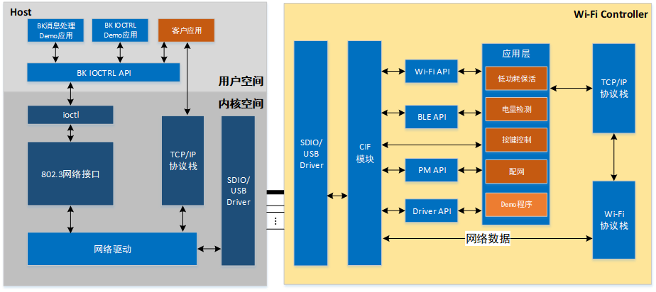

# 软件架构

BK7236 Controller软件包含Host部分和Controller部分，其中Host包含内核空间代码和用户空间APP接口；
Controller部分在原有SDK基础上增加CIF模块，该模块通过SDIO/USB与Host交互，提供基础的一些控制功能逻辑。
软件架构如下图所示：

## 模块导航

- [简介](../introduction.md)
- [快速入门](../get-started.md)
- [硬件设计指南](../hw-reference.md)
- [软件方案介绍](../sw-detail.md)
- [Host主要软件介绍](host_sw.md)
- [Controller主要软件介绍](controller_sw.md)
- [主控开发适配指南](../host-guide.md)
- [Controller开发指南](../controller-guide.md)
- [常见问题解答](../frequently-asked-questions.md)
