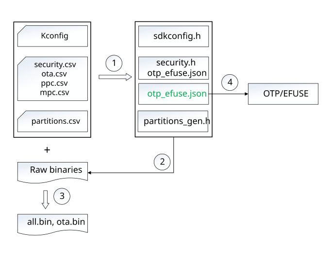

<a id="kconfig"></a>

<a id="bk-config-kconfig"></a>

# Kconfig 配置

<a id="id1"></a>

# 系统配置

Armino 系统配置主要指 Kconfig 配置，分区配置，安全配置等，处理过程如下图所示：



图中标号所对应的处理为：

> - 1. 代码生成，编译前构建系统先扫描配置文件，生成编译所需的头文件或者配置文件。
> - 2. 生成 BIN \- 编译，链接并生成原始二进制文件。
> - 3. 再次扫描配置文件，依据配置项打包，包括加 CRC，加密，加签等，最终生成 all-app.bin，all-app-no-bl.bin, ota.bin。
> - 4. 将生成的 OTP/EFUSE 配置文件部署到板子上。

<a id="id2"></a>

## 配置文件

Armino 支持下述几种配置文件：

> - Kconfig \- 组件配置，生成 sdkconfig.h。详情请参考 Kconfig 配置。
> - csv \- CSV 格式配置文件，包括:
>
>   - partitions.csv \- 分区配置表，用于生成 partitions\_gen.h。详情请参考 分区配置。
>   - mpc.csv \- 安全块外设配置表，用于生成 security.h。详情请参考 安全配置。
>   - ppc.csv \- 安全外设配置表，用于生成 security.h。详情请参考 安全配置。
>   - gpio.csv \- 外设与 GPIO 映射表，结合 ppc.csv 一起生成 GPIO 安全属性。详情请参考 安全配置。
>   - security.csv \- 安全配置，用于生成 security.h 与 otp\_efuse\_otp.json，也用于打包处理。详情请参考 安全配置。
>   - ota.csv \- 安全 OTA 配置，用于配置 OTA 策略，版本安全计数器等。详情请参考 安全配置。
> - key \- 配置安全相关的 KEY，如 FLASH AES KEY，安全启动公钥对等。详情请参考 安全配置。

<a id="id3"></a>

## 文件部署

配置文件在 Armino 中部署如下图所示：

```
- armino/
    - components/
        - c1/
            - Kconfig
    - middleware/
        - boards/
            - bk7239/
                - csv
                    - mpc.csv
                    - ppc.csv
                    - ota.csv
                    - partitions.csv
                    - security.csv
                - key
                    - root_ec256_pubkey.pem
                    - root_ec256_privkey.pem
        - soc/
            - bk7239/
                - bk7239.defconfig
    - projects/
        - my_project/
            - config/
                - common
                    - config
                - bk7239
                    - config
                    - mpc.csv
                    - ppc.csv
                    - ota.csv
                    - partitions.csv
                    - security.csv
                    - root_ec256_pubkey.pem
                    - root_ec256_privkey.pem
                - bk7258
                    - config
                    - partitions.csv
            - Kconfig.projbuild
            - main/
                - Kconfig
            - components/
                - c1/
                    - Kconfig
```

可以将这些文件归为两类：

> - 配置定义文件:
>
>   - Kconfig \- 通常定义在组件中。
>   - Kconfig.projbuild \- 定义在组件或者工程目录下。
> - 配置修改文件:
>
>   - middleware/soc/bk7239.defconfig \- Armino 提供的 BK7239 默认配置。
>   - my\_projects/config/common/config \- 工程中不同 BK72xx 共享的配置。
>   - my\_projects/config/bk7239/config \- 工程中 BK7239 专有配置。

对于同名配置文件或者配置项，优先级规则为：

> - 工程配置 \> Middleware 配置 \> 组件配置。
> - 对于同目录下配置文件：特定芯片配置项 \> 通用配置项。

备注

Kconfig 是使用高优先级文件中配置项取代低优先级配置文件中配置项；
其他配置文件是使用优先级高的配置文件取代优先级低的文件。

重要

配置项只有在 Kconfig 或 Kconfig.projbuild 中定义之后，才能通过配置修改文件去修改该配置，
如果偿试修改一个未定义的配置，则不会在 sdkconfig.h 中生成任何定义。

备注

Kconfig.projbuild 是针对 menuconfig 来设计的，当向 Kconfig.projbuild 中增加一项时，
会在 menuconfig 顶层菜单中显示该配置项。BK7239 不支持 menuconfig，因此 Kconfig.projbuild
与 Kconfig 作用相同。

备注

在Kconfig文件中定义的配置项名称，在config、defconfig和C代码中使用需要加上 `CONFIG_` 前缀。

在 Armino 工程中，Kconfig 配置优先级为:

> my\_projects/config/bk7239/config \> my\_projects/config/common/config \> bk7239.defconfig \> 配置定义文件

<a id="menuconfig"></a>

## menuconfig 支持

BK7239 Kconfig 配置不支持 menuconfig 配置。

<a id="id4"></a>

## 配置依赖

相互依赖的配置项自动更改成正确的值，仅发生在使用 menuconfig 配置时，
Armino 不支持 menuconfig 配置，因此，当通过配置修改文件更改某项配置时，
与该项配置相互依赖的配置不会自动更改。

重要

在 Armino 中所有配置项均需显式指定，或者使用默认值。

<a id="cmakelists-txt-kconfig"></a>

## CMakeLists.txt 中使用 Kconfig

在 CMakeLists.txt 中可直接使用 Kconfig 中定义的配置项，唯一要注意的问题不要将
armino\_component\_register() 放在任何配置条件中，可参考 通过 Kconfig 禁用组件。
