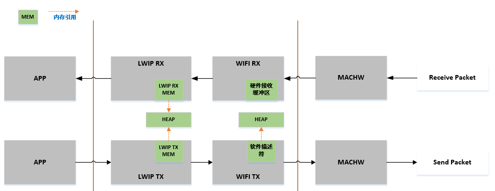

<a id="bk-controller-lwip"></a>

# BK Controller LwIP 开发指南

<a id="id1"></a>

## 前言

<a id="id2"></a>

### 概述

> 本文档介绍了lwIP（A Lightweight TCP/IP stack）的相关内容，包括lwIP简介、应用开发、网络安全和常见问题。本文档主要用于适配lwIP，同时也用于实现如DNS客户端、DHCP服务器等附加特性。

<a id="id3"></a>

### 产品版本

> 与本文档相对应的产品版本如下：
>
> | 产品名称 | 产品版本 |
> | --- | --- |
> | BK7239N | V1.0 |

<a id="id4"></a>

### 读者对象

> 本文档主要适用于以下对象：
>
> - 测试工程师
> - 软件开发工程师

<a id="id5"></a>

### 符号约定

> 在本文中可能出现下列标志，它们所代表的含义如下：
>
> | 符号 | 说明 |
> | --- | --- |
> |  | 表示如不避免则将会导致死亡或严重伤害的具有高等级风险的危害。 |
> |  | 表示如不避免则可能导致死亡或严重伤害的具有中等级风险的危害。 |
> |  | 表示如不避免则可能导致轻微或中度伤害的具有低等级风险的危害。 |
> |  | 用于传递设备或环境安全警示信息。如不避免则可能会导致设备损坏、数据丢失、设备性能降低或其它不可预知的结果。”须知”不涉及人身伤害。 |
> |  | 对正文中重点信息的补充说明。”说明”不是安全警示信息，不涉及人身、设备及环境伤害信息。 |

<a id="id6"></a>

### 修改记录

> | 文档版本 | 发布日期 | 修改说明 |
> | --- | --- | --- |
> | 01 | 2025-10-17 | 第一次正式版本发布。 |

<a id="id7"></a>

## 1 概述

<a id="id8"></a>

### 1.1 背景介绍

> 本章节介绍了BEKEN Controller LwIP 开发指南的背景介绍、第三方参考、RFC (Request For Comments) 遵从等内容。

<a id="rfc-request-for-comments"></a>

### 1.2 RFC (Request For Comments) 遵从

> lwIP遵从如下RFC协议标准：
>
> - RFC 791 (IPv4 Standard)
> - RFC 2460 (IPv6 Standard)
> - RFC 768 (UDP) User Datagram Protocol
> - RFC 793 (TCP) Transmission Control Protocol
> - RFC 792 (ICMP) Internet Control Message Protocol
> - RFC 826 (ARP) Address Resolution Protocol
> - RFC 1035（ DNS） DOMAIN NAMES \- IMPLEMENTATION AND SPECIFICATION
> - RFC 2030（ SNTP） Simple Network Timer Protocal（ SNTP） Version 4 for
>   IPv4， IPv6 and OSI
> - RFC 2131 (DHCP) Dynamic Host Configuration Protocol
> - RFC 768 (UDP) User Datagram Protocol
> - RFC 2018 (SACK) TCP Selective Acknowledgment Options
> - RFC 7323 (Window Scaling)
> - RFC 6675 (SACK for TCP) RFC 3927 (Autoip) Dynamic Configuration of IPv4
> - Link-Local Addresses
> - RFC 2236 (IGMP) Internet Group Management Protocol, Version 2
> - RFC4861 (ND for IPv6) Neighbor Discovery for IP version 6 (IPv6)
> - RFC4443 Internet Control Message Protocol (ICMPv6) for the Internet
> - Protocol Version 6 (IPv6) Specification
> - RFC4862 IPv6 Stateless Address Autoconfiguration
> - RFC2710 Multicast Listener Discovery (MLD) for IPv6

<a id="id9"></a>

## 2 功能特性

<a id="id10"></a>

### 2.1 支持的特性

> BEKEN Controller lwIP 使用 **lwIP-2.1.2** 版本，后续除非特殊说明，默认使用该版本。BEKEN Controller lwIP支持如下特性：
>
> - 网际协议版本4（ IPv4： Internet Protocol version 4）
> - 网际协议版本6（ IPv6： Internet Protocol version 6）
> - 互联网控制消息协议（ ICMP： Internet Control Message Protocol）
> - 用户数据报协议（ UDP： User Datagram Protocol）
> - 传输控制协议（ TCP： Transmission Control Protocol）
> - 域名解析器（ DNS： Domain Name System）客户端
> - 动态主机配置协议（ DHCP）客户端和服务器
> - 以太网地址解析协议（ ARP： Address Resolution Protocol）
> - 因特网组管理协议（ IGMP： Internet Group Management Protocol）
> - 邻居发现协议（ ND： Neighbor Discovery）
> - 多播侦听者发现协议（ MLD： Multicast Listener Discovery）

<a id="id11"></a>

## 3 开发指引

<a id="id12"></a>

### 3.1 前提条件

> lwIP的开发需要满足以下条件：
>
> - 使用lwIP前，基于lwIP相关配置更新驱动代码。

<a id="id13"></a>

### 3.2 依赖关系

> lwIP的依赖关系如下：
>
> - 依赖RTOS系统调用。
> - 需要通过Wi-Fi驱动模块完成物理层数据的发送和接收。

<a id="lwip"></a>

### 3.3 lwIP 的使用

> lwIP提供了BSD TCP/IP套接字接口，应用可通过该接口进行连接。lwIP的优势在于：
>
> - 轻量级：lwIP的代码量较小，适合资源有限的嵌入式系统。
> - 易于移植：lwIP的代码结构清晰，易于移植到不同的硬件平台。
> - 易于使用：lwIP提供了丰富的API接口，易于使用。
> - 易于维护：lwIP的代码结构清晰，易于维护。
> - 易于调试：lwIP的代码结构清晰，易于调试。

<a id="id14"></a>

### 3.4 移植方法

<a id="id15"></a>

#### 3.4.1 lwIP 初始化

> lwIP 支持两种运行模式：
>
> - `NO_SYS=1`: 无操作系统模式，直接调用 lwip\_init()
> - `NO_SYS=0`: 有操作系统模式，使用 tcpip\_init() 创建 TCP/IP 线程
>
> 正确的lwIP初始化方式如下：
>
> - 系统初始化: `sys_init()` (如果有操作系统)
> - 内存管理: `mem_init()`, `memp_init()`, `pbuf_init()`
> - 网络接口: `netif_init()`
> - 协议栈: `ip_init()`, `arp_init()`, `tcp_init()`, `udp_init()`
> - 应用协议: `dns_init()`, `dhcp_init()`
> - 定时器: `sys_timeouts_init()`

<a id="netif"></a>

#### 3.4.2 添加 netif 接口及驱动功能

> 初始化完成后，应用必须至少添加一个 `Netif` 接口用于通信。
>
> 应用需要根据驱动类型实现相关回调函数。相关链路层类型、 `MAC` 地址和发送回调函数使用前必须完成注册。如果需要支持原始套接字接口的混杂模式，则还需要在驱动中注册实现该功能的回调函数。
>
> Wi-Fi网口示例代码如下：
>
> ```
> int net_wlan_add_netif(uint8_t *mac)
> {
>   struct iface *wlan_if = NULL;
>   netif_if_t netif_if;
>   void *vif = NULL;
>   int vifid = 0;
>   err_t err;
>   /* 根据MAC地址获取网口类型 */
>   vifid = wifi_netif_mac_to_vifid(mac);
>   vif = wifi_netif_mac_to_vif(mac);
>   netif_if = wifi_netif_vif_to_netif_type(vif);
>   if (netif_if == NETIF_IF_AP) {
>     wlan_if = &g_uap;
>   } else if (netif_if == NETIF_IF_STA) {
>     wlan_if = &g_mlan;
>   } else {
>     LWIP_LOGE("unknown netif(%d)\n", netif_if);
>     return ERR_ARG;
>   }
>   /* 设置IP地址 */
>   ip_addr_set_ip4_u32(&wlan_if->ipaddr, INADDR_ANY);
>   /* 添加网口到lwIP协议栈 */
>   err = netifapi_netif_add(&wlan_if->netif,
>     ip_2_ip4(&wlan_if->ipaddr),
>     ip_2_ip4(&wlan_if->ipaddr),
>     ip_2_ip4(&wlan_if->ipaddr),
>     vif,
>     wlanif_init, /* 网口初始化回调函数 */
>     tcpip_input); /* 输入回调函数 */
>   LWIP_LOGV("add vif%d\n", vifid);
>   return ERR_OK;
> }
> ```

<a id="wi-filwip"></a>

### 3.5 Wi-Fi缓冲区内存和lwIP缓冲区内存

> - Wi-Fi内存块使用情况：主要为硬件接收缓冲区，软件发送描述符。硬件接收缓冲区为芯片硬件侧设计，默认配置大小，软件侧不可进行更改。软件发送描述符所使用内存、SKB内存块均通过 **动态** 方式Fi内存块使用情况：主要为硬件接收缓冲区，软件发送描述符。硬件接收缓冲区为芯片硬件侧设计，默认配置大小，软件侧不可进行更改从 SRAM 内申请使用。
> - LwIP内存块使用：lwIP内存属于软件侧可配，通过宏定义的形式从SRAM HEAP中 **动态** 取出一定大小的MEM供lwIP使用。

<a id="id16"></a>

#### 3.5.1 lwIP内存使用

> <a id="id28"></a>
> 
>
>
> Controller Wi-Fi 数据路径
>
> Controller Wi-Fi数据流通路大概分为三层，分别为应用层、Wi-Fi层和硬件层，其中Wi-Fi层包括lwIP层与MAC层以及相关接口层。
>
> - RX 方向：数据在接收过程中，硬件将接收到的数据包传送到Wi-Fi的接收数据缓冲区、lwIP的接收数据缓冲区进行相关协议处理，最后上传到应用层。Wi-Fi的接收数据缓冲区和lwIP的接收数据缓冲区默认共享同一个缓冲区。Wi-Fi的接收数据缓冲区和lwIP的接收数据缓冲区的大小都是从SRAM HEAP中申请而来。lwIP的接收数据缓冲区的大小（LWIP\_MEM\_SIZE）可以针对不同场景下的需求进行配置。
> - TX 方向：数据在发送过程中，应用程序首先将要发送的消息通过lwIP数据接口将数据拷贝到lwIP的MEM(已动态申请的内存)中，进行TCP/IP封装，然后将消息发送到Wi-Fi层的发送数据缓冲区进行MAC封装处理，最后等待发送。为节省SRAM HEAP空间，Controller 在上层应用中数据传输拷贝使的是PSRAM空间，同时缓解了SRAM内存压力且不会减少应用程序的可用内存。

<a id="id17"></a>

<a id="id18"></a>

#### 3.5.2 优化吞吐量

> Controller Wi-Fi的性能受诸多参数的影响，各配置参数之间存在关联并相互制约。如果配置参数合理且最优，不仅可以提高性能，还可以增加应用程序的可用内存，提高稳定性。
>
> 在本节中，我们将简单介绍Wi-Fi/lwIP协议栈的工作模式，并说明各个参数的作用。我们将推荐相应的参数配置，您可以根据使用的场景从而选择最合适的配置，适当调节上述各层中MEM大小或数量，可以提高Wi-Fi性能。下面我们将介绍您需要配置的参数。

<a id="rx"></a>

#### 3.5.2.1 接收数据方向(RX)相关参数

> 表 3-1 接收数据方向(RX)相关参数
>
> | **参数** | **描述** |
> | --- | --- |
> | CONFIG\_LWIP\_MEM\_MAX\_RX\_SIZE | 该参数表示lwIP层配置接收数据缓冲区的大小。提高该参数可以增强数据包的接收性能。该参数需要与mac层处理接收数据缓冲区大小相匹配。该参数最大不能超过LWIP\_MEM\_SIZE的大小，默认配置为（LWIP\_MEM\_SIZE\*3）/4。 |
> | CONFIG\_LWIP\_UDP\_RECVMBOX\_SIZE | 该参数表示UDP RX时，lwIP内核会首先将数据包发送到UDP接收邮箱，然后应用程序再从邮箱中获取数据包。这意味着lwIP可以为每个UDP套接字缓存最大UDP\_RECVMBOX\_SIZE数据包，因此所有UDP套接字可能缓存的最大UDP数据包是UDP\_RECVMBOX\_SIZE与最大UDP套接字数量的倍数。UDP\_RECVMBOX\_SIZE越大意味着内存越大。如果接收邮件箱太小，邮件箱可能已满，因此需要确保UDP接收信箱足够大，以避免lwIP核心与应用程序之间出现丢包现象。 |
> | CONFIG\_LWIP\_TCP\_WND | 该参数表示LwIP层用于每个TCP流的接收数据缓冲区大小，默认配置为29200(B)（20 \* default MSS的值），设置较小的默认接收窗口大小可以节省一些内存，但是会大大降低性能。同时，在有多个流的情况下，应相应降低该参数值。 |

<a id="tx"></a>

#### 3.5.2.2 发送数据方向(TX)相关参数

> 表 3-2 发送数据方向(TX)相关参数
>
> | **参数** | **描述** |
> | --- | --- |
> | CONFIG\_LWIP\_MEM\_MAX\_TX\_SIZE | 该参数表示LwIP层配置发送数据缓冲区的大小，该参数最大不能超过LWIP\_MEM\_SIZE的大小，默认配置为（LWIP\_MEM\_SIZE\*5）/6。如果应用程序将发送大量需要拷贝的数据时，提高该参数可以增强数据包发送的性能。 |
> | CONFIG\_LWIP\_TCP\_SND\_BUF | 该参数表示LwIP层用于每个TCP流的发送数据缓冲区大小。该值必须至少是MSS大小的2倍，Controller上默认值是MSS大小的20倍。设置较小的默认SND BUF大小可以节省一些RAM，但会降低性能。 |

<a id="trx"></a>

#### 3.5.2.3 接收数据与发送数据方向(TRX)高度相关参数

> 表 3-3 接收数据与发送数据方向(TRX)高度相关参数
>
> | **参数** | **描述** |
> | --- | --- |
> | CONFIG\_LWIP\_MEM\_SIZE | 该参数表示LwIP层堆内存大小，从系统堆内存中申请。该参数默认配置大小为51200（50K），如果需要发送或接收大量数据，提高该参数可以提高整体吞吐性能。 |
> | CONFIG\_LWIP\_TCP\_MSS | 该参数表示TCP最大报文长度，是TCP协议定义的一个选项，MSS（Maximum Segment Size，最大报文长度）选项用于在TCP连接建立时，收发双方协商通信时每一个报文段所能承载的最大数据长度。该参数可以设置得更低以节省RAM，默认值为1460(ipv4)/1440(ipv6)以获得最佳吞吐量。IPv4 TCP\_MSS范围：576 \<\= TCP\_MSS \<\= 1460；IPv6 TCP\_MSS范围：1220 \<\= TCP\_MSS \<\= 1440。 |
> | CONFIG\_LWIP\_MEMP\_NUM\_NETBUF | 该参数表示NetBuf结构体数量。使用netconn和socket编程时，该值设置太小，可能导致接收数据时分配内存失败，从而不能同时为几个连接的数据收发服务。Armino上最小配置为16，最大为32。这里建议默认配置最大32。 |
> | CONFIG\_LWIP\_PBUF\_POOL\_SIZE | 该参数表示pbuf池中缓冲区的数量，参数可配置，最大配置为20，Armino上建议默认配置大小为10。 |
> | CONFIG\_LWIP\_TCP\_SND\_QUEUELEN | 该参数表示TCP发送缓冲空间，该参数限制发送缓冲区中pbuf的数量。该参数默认设置40，且至少要等于（2 \* TCP\_SND\_BUF/TCP\_MSS）才能正常工作。 |
> | CONFIG\_LWIP\_MEMP\_NUM\_TCP\_SEG | 该参数表示能够同时在队列里的TCP的网段数量，默认参数设置大小为80，且至少等于（2 \* LWIP\_TCP\_SND\_QUEUELEN）才能正常工作。 |

<a id="id19"></a>

#### 3.5.3 lwIP 宏

> lwIP提供了丰富的宏定义，本章节主要介绍一些常用的宏定义，lwIP 2.1.2的宏配置非常多，受篇幅限制未能全部介绍，后续如有需要，请参考lwIP官方文档。
>
> 
>
> - lwIP宏的默认值在opt.h和lwipopts.h头文件中都有定义。
> - lwipopts.h头文件中的宏定义会覆盖opt.h头文件中的宏定义，因此用户可以修改lwipopts.h头文件中的宏定义来满足自己的需求。
>
> 表 3-4 lwIP 宏列表
>
> | **宏** | **描述** |
> | --- | --- |
> | LWIP\_AUTOIP | 该宏用于启用或禁用AUTOIP模块。 |
> | MEM\_SIZE | lwIP可维护堆内存（包括mem\_malloc和mem\_free）管理模块，该模块用于动态内存分配。该宏用于定义lwIP中堆内存管理模块的大小。 |
> | MEM\_LIBC\_MALLOC | 如果该宏被启用，那么系统将调用malloc()和free()进行所有动态内存分配，而且lwIP中的堆内存管理模块代码将会被禁用。 |
> | MEMP\_MEM\_MALLOC | lwIP为频繁使用的结构提供池内存（包括memp\_malloc和memp\_free）管理模块。 |
> | MEM\_ALIGNMENT | 该宏的值需要基于架构进行设置。例如，如果是32位架构，那么需要设置该宏的值为4。 |
> | MEMP\_NUM\_TCP\_PCB | 该宏用于设置同一时间内所需的TCP连接数。 |
> | MEMP\_NUM\_UDP\_PCB | 该宏用于设置同一时间内所需UDP连接数。设置该宏的值时，用户须考虑lwIP内部模块如DNS模块和DHCP模块。DHCP模块会创建UDP连接用于自身通信。 |
> | MEMP\_NUM\_RAW\_PCB | 该宏用于设置同一时间内所需RAW连接数。 |
> | MEMP\_NUM\_NETCONN | 该宏用于设置TCP、UDP和RAW连接总数。该宏的值必须是MEMP\_NUM\_TCP\_PCB、MEMP\_NUM\_UDP\_PCB和MEMP\_NUM\_RAW\_PCB宏的值之和。 |
> | MEMP\_NUM\_TCP\_PCB\_LISTEN | 该宏用于设置同时监听所需TCP连接数。 |
> | MEMP\_NUM\_REASSDATA | 该宏用于设置同时排队等待重组的IP报文数（完整报文，而不是分片报文）。 |
> | MEMP\_NUM\_FRAG\_PBUF | 该宏用于设置同时发出的IP报文数（分片报文，而不是完整报文）。 |
> | ARP\_TABLE\_SIZE | 该宏用于设置ARP缓存表的大小。 |
> | ARP\_QUEUEING | Enable 表示在ARP解析过程中会有多个出报文在排队。Disable 表示每个目的地址保留最近由上层发送的报文。 |
> | MEMP\_NUM\_ARP\_QUEUE | 该宏用于设置同时排队的出报文（pbuf）的数量。这些出报文正在等待ARP响应以解析目的地址。该宏仅在ARP\_QUEUEING被启用时适用。 |
> | IP\_REASSEMBLY | 该宏支持重组IP分片报文。 |
> | IP\_FRAG | Enable 表示启用IP分片功能。Disable 表示禁用IP分片功能。 |
> | IP\_REASS\_MAX\_PBUFS | 该宏用于设置任何一个IP入报文允许的最大分片数。 |
> | IP\_DEFAULT\_TTL | 传输层数据报文存活时间的默认值。 |
> | LWIP\_ICMP | 该宏用于启用ICMP模块。 |
> | ICMP\_TTL | 该宏用于设置ICMP消息的TTL值。 |
> | LWIP\_RAW | 该宏支持在lwIP中启用原始套接字支持功能。 |
> | RAW\_TTL | 该宏用于设置原始套接字消息的TTL值。 |
> | LWIP\_UDP | 该宏支持在lwIP中启用UDP连接支持功能。 |
> | UDP\_TTL | 该宏用于设置UDP套接字消息的TTL值。 |
> | LWIP\_TCP | 该宏支持在lwIP中启用TCP连接支持功能。 |
> | TCP\_TTL | 该宏用于设置TCP套接字消息的TTL值。 |
> | TCP\_WND | 该宏用于设置TCP窗口大小。 |
> | TCP\_MAXRTX | 该宏用于设置TCP数据报文的最大重传次数。 |
> | TCP\_SYNMAXRTX | 该宏用于设置TCP SYN数据报文的最大重传次数。 |
> | TCP\_QUEUE\_OOSEQ | 该宏支持缓存接收到的乱序数据报文。如果用户设备内存低，设置该宏的值为0。 |
> | TCP\_MSS | 该宏用于设置TCP连接的最大分段大小。 |
> | TCP\_SND\_BUF | 该宏用于设置TCP的发送数据缓冲区大小。 |
> | TCP\_SND\_QUEUELEN | 该宏用于设置TCP的发送队列长度。 |
> | TCP\_OOSEQ\_MAX\_BYTES | 该宏用于设置每个pcb的ooseq上排队的最大字节数。默认值为0（无限制）。仅适用于TCP\_QUEUE\_OOSEQ\=0。 |
> | TCP\_OOSEQ\_MAX\_PBUFS | 该宏用于设置每个pcb的ooseq上排队的最大pbuf数。默认值为0（无限制）。仅适用于TCP\_QUEUE\_OOSEQ\=0。 |
> | TCP\_LISTEN\_BACKLOG | 该宏支持启用TCP监听时的backlog支持功能。 |
> | LWIP\_DHCP | 该宏用于启用DHCP客户端模块。 |
> | LWIP\_IGMP | 该宏用于启用IGMP模块。 |
> | LWIP\_DNS | 该宏用于启用DNS客户端模块。 |
> | DNS\_TABLE\_SIZE | 该宏用于设置DNS缓存表的大小。 |
> | DNS\_MAX\_NAME\_LENGTH | 该宏用于设置域名支持的最大长度。根据DNS RFC，域名长度设置为255。不建议修改。 |
> | DNS\_MAX\_SERVERS | 该宏用于设置DNS服务器数量。 |
> | PBUF\_LINK\_HLEN | 该宏用于设置必须分配给链路级报头的字节数，应该包括实际长度和ETH\_PAD\_SIZE。 |
> | LWIP\_NETIF\_API | 该宏用于启用线程安全netif接口模块（netiapi\_\*）。 |
> | TCPIP\_THREAD\_NAME | 该宏用于设置TCP IP线程的名称。 |
> | DEFAULT\_RAW\_RECVMBOX\_SIZE | 每个RAW连接维持一个入报文队列，用于入报文缓存，直至应用层发出接收通知。该宏用于设置接收消息盒子队列的大小。 |
> | DEFAULT\_UDP\_RECVMBOX\_SIZE | 每个UDP连接维持一个入报文队列，用于入报文缓存，直至应用层发出接收通知。该宏用于设置接收消息盒子队列的大小。 |
> | DEFAULT\_TCP\_RECVMBOX\_SIZE | 每个TCP维持一个入报文队列，用于入报文缓存，直至应用层发出接收通知。该宏用于设置接收消息盒子队列的大小。 |
> | DEFAULT\_ACCEPTMBOX\_SIZE | 该宏用于设置消息盒子队列的大小，以维持接入的TCP连接。 |
> | TCPIP\_MBOX\_SIZE | 该宏用于设置TCP IP线程的消息盒子队列。该队列可以维护应用线程和驱动线程发出的所有操作请求。 |
> | LWIP\_TCPIP\_TIMEOUT | 此宏支持启用运行lwIP tcpip线程上任意自定义计时器处理函数这一特性。 |
> | LWIP\_COMPAT\_SOCKETS | 该宏可以为所有套接字接口创建一个Linux BSD宏。 |
> | LWIP\_STATS | 该宏用于统计所有在线连接。 |

<a id="id20"></a>

### 3.6 示例代码

> 本节列出了部分lwIP示例代码，对lwIP的用途进行了简要阐述。这些示例包含一段伪代码，用于说明在驱动（以太网或 Wi‑Fi）模块上需要完成的接口对接与更改。
>
> 
>
> - 该示例代码仅用于学习与评估，客户在实际使用时，需要根据实际情况进行修改。

<a id="id21"></a>

#### 3.6.1 应用示例代码

<a id="udp"></a>

##### 3.6.1.1 UDP示例代码

> ```
> #include "udp_client_demo.h"
> #include <common/bk_include.h>
> #include <os/os.h>
> #include "lwip/sockets.h"
> #include "Error.h"
> #include "lwip/sockets.h"
> #include "lwip/ip_addr.h"
> #include "lwip/inet.h"
> #include "string.h"
> #include "Wlan_ui_pub.h"
> #include "stdio.h"
> #include "stdlib.h"
> #include <components/netif.h>
> beken_timer_t *udp_client_connect_timer = NULL;
> int check_connect_wifi(void)
> {
>     netif_ip4_config_t ipStatus;
>     bk_err_t ret = kNoErr;
>     os_memset(&ipStatus, 0x0, sizeof(netif_ip4_config_t));
>     ret = bk_netif_get_ip4_config(NETIF_IF_STA, &ipStatus);
>     if(strcmp(ipStatus.ip, "0.0.0.0") != 0)
>     {
>         BK_LOGD(NULL, "ip:%s \r\n", ipStatus.ip);
>         return 0;
>     }
>     return 1;
> }
> void udp_client_demo_thread( beken_thread_arg_t arg )
> {
>     bk_err_t err = kNoErr;
>     struct sockaddr_in server_addr;
>     socklen_t sockaddr_t_size = sizeof(server_addr);
>     int SkFd = -1;
>     unsigned int count = 0;
>     char *buf = NULL;
>     int len = 0;
>     fd_set readfds;
>     buf = (char *) os_malloc( 1024 );
>     if(buf == NULL)
>     {
>         BK_LOGD(NULL, "buf == NULL\r\n");
>         goto exit;
>     }
>     SkFd = socket( AF_INET, SOCK_DGRAM, IPPROTO_UDP );//Make UDP socket
>     if(SkFd == -1)
>     {
>         BK_LOGD(NULL, "SkFd == -1\r\n");
>         goto exit;
>     }
>     server_addr.sin_family = AF_INET;
>     server_addr.sin_addr.s_addr = IPADDR_BROADCAST;
>     //server_addr.sin_addr.s_addr = inet_addr("192.168.5.103");
>     server_addr.sin_port = htons(UDP_Client_Port);
>     BK_LOGD(NULL, "UDP Client Run\r\n");
>     while ( 1 )
>     {
>         sprintf(buf, "UDP Client Count:%d\r\n", count);
>         count++;
>         len = strlen(buf);
>         len = sendto( SkFd, buf, len, 0 , (struct sockaddr *) &server_addr, sizeof(server_addr));
>         rtos_delay_milliseconds( 500 );
>     }
> exit:
>     if ( err != kNoErr )
>         BK_LOGD(NULL, "udp client thread exit with err: %d", err );
>     if(SkFd)
>         close( SkFd );
>     if(buf)
>         os_free(buf);
>     rtos_start_timer(udp_client_connect_timer);
>     rtos_delete_thread( NULL );
> }
> void udp_client_check_net_timer_alarm( void *arg )
> {
>     bk_err_t err = kNoErr;
>     (void)arg;
>     if(!check_connect_wifi())
>     {
>         rtos_stop_timer( udp_client_connect_timer );
>         err = rtos_create_thread( NULL, BEKEN_APPLICATION_PRIORITY,
>                                   "udp_client",
>                                   (beken_thread_function_t)udp_client_demo_thread,
>                                   0x800,
>                                   (beken_thread_arg_t)0 );
>         if(err != kNoErr)
>         {
>             rtos_start_timer(udp_client_connect_timer);
>         }
>     }
> }
> int create_udp_client_check_net_timer(void)
> {
>     bk_err_t err;
>     if(udp_client_connect_timer == NULL)
>     {
>         udp_client_connect_timer = (beken_timer_t *) os_malloc( sizeof(beken_timer_t) );
>     }
>     if(udp_client_connect_timer == NULL)
>     {
>         BK_LOGD(NULL, "tcp_connect_timer error!\r\n");
>         return kGeneralErr;
>     }
>     err = rtos_init_timer(udp_client_connect_timer, 500, udp_client_check_net_timer_alarm, 0);
>     if(kNoErr != err)
>     {
>         if(udp_client_connect_timer)
>         {
>             os_free(udp_client_connect_timer);
>             udp_client_connect_timer = NULL;
>         }
>         BK_LOGD(NULL, "tcp_connect_timer error!\r\n");
>     }
>     return err;
> }
> void udp_client_connect_timer_destroy( void )
> {
>     rtos_deinit_timer( udp_client_connect_timer );
>     if(udp_client_connect_timer)
>     {
>         os_free(udp_client_connect_timer);
>         udp_client_connect_timer = NULL;
>     }
> }
> int demo_start( void )
> {
>     bk_err_t err;
>     err = create_udp_client_check_net_timer();
>     if(kNoErr != err)
>     {
>         return err;
>     }
>     err = rtos_start_timer(udp_client_connect_timer);
>     if(kNoErr != err)
>     {
>         udp_client_connect_timer_destroy();
>         BK_LOGD(NULL, "timer start failed!\r\n");
>         return err;
>     }
>     return kNoErr;
> }
> ```

<a id="tcp"></a>

##### 3.6.1.2 TCP客户端示例代码

> ```
> #include "tcp_client_demo.h"
> #include <os/os.h>
> #include "lwip/sockets.h"
> #include "Error.h"
> #include "lwip/sockets.h"
> #include "lwip/ip_addr.h"
> #include "lwip/inet.h"
> #include "Common.h"
> struct ip_port_msg
> {
>     ip4_addr_t IP;
>     in_port_t  sin_port;
> };
> void tcp_connect_server_thread( beken_thread_arg_t arg )
> {
>     int SkFd = -1;
>     int len = 0;
>     char *buf = NULL;
>     bk_err_t err = kNoErr;
>     struct ip_port_msg *i_pMsg;
>     struct sockaddr_in server_addr;
>     socklen_t sockaddr_t_size = sizeof(server_addr);
>     i_pMsg = (struct ip_port_msg *)arg;
>     if(i_pMsg == NULL)
>     {
>         BK_LOGD(NULL, "arg err!\r\n" );
>         goto exit;
>     }
>     SkFd = socket( AF_INET, SOCK_STREAM, IPPROTO_TCP );
>     server_addr.sin_family = AF_INET;
>     server_addr.sin_addr.s_addr = i_pMsg->IP.addr;    //0x0728a8c0 /*192.168.40.7*/
>     server_addr.sin_port = htons(i_pMsg->sin_port);   //htons( 12345 );
>     if(i_pMsg)
>         os_free(i_pMsg);
>     err = connect(SkFd, (struct sockaddr *) &server_addr, sizeof(server_addr));
>     if(err < 0)
>     {
>         BK_LOGD(NULL, "connect err: %d\r\n", err );
>         goto exit;
>     }
>     buf = (char *) os_malloc( 1024 );
>     if(buf == NULL)
>     {
>         BK_LOGD(NULL, "buf == NULL\r\n");
>         goto exit;
>     }
>     while ( 1 )
>     {
>         len = recv(SkFd, buf, 1024, 0 );
>         if ( len <= 0 )
>         {
>             BK_LOGD(NULL, "TCP Client is disconnected, fd: %d\r\n", SkFd );
>             goto exit;
>         }
>         len = send( SkFd, buf, len, 0 );
>     }
> exit:
>     if ( err != kNoErr )
>         BK_LOGD(NULL, "tcp_connect_server_thread exit with err: %d\r\n", err );
>     if ( buf != NULL )
>         os_free( buf );
>     close( SkFd );
>     rtos_delete_thread( NULL );
> }
> void tcp_make_connect_server_command(char *pcWriteBuffer, int xWriteBufferLen, int argc, char **argv)
> {
>     bk_err_t err = kNoErr;
>     struct ip_port_msg *i_pMsg = NULL;
>     int i;
>     int port;
>     i_pMsg = (struct ip_port_msg *) os_malloc( sizeof(struct ip_port_msg) );
>     if(i_pMsg == NULL)
>     {
>         BK_LOGD(NULL, "i_pMsg Failed\r\n");
>         return;
>     }
>     if(!inet_aton(argv[1], &i_pMsg->IP.addr))
>     {
>         BK_LOGD(NULL, "inet_aton Failed\r\n");
>         goto exit;
>     }
>     port = num_string2uint16num(argv[2]);
>     if(port < 0)
>     {
>         BK_LOGD(NULL, "port err:%d\r\n", port);
>     }
>     i_pMsg->sin_port = port;
>     err = rtos_create_thread( NULL,
>                               BEKEN_APPLICATION_PRIORITY,
>                               "connt_Server",
>                               tcp_connect_server_thread,
>                               0x600,
>                               i_pMsg );
>     if(kNoErr != err)
>     {
>         BK_LOGD(NULL, "rtos_create_thread Failed(%d)\r\n", err);
>         goto exit;
>     }
>     return;
> exit:
>     if(i_pMsg)
>         os_free(i_pMsg);
> }
> ```

<a id="id22"></a>

#### 3.6.2 驱动相关示例代码

> ```
> #include <lwip/opt.h>
> #include <string.h>
> static struct iface g_mlan = {{0}, .name = "sta"};  //Station接口描述
> static struct iface g_uap = {{0}, .name = "ap"};    //Soft-AP接口描述
> int host_wlan_add_netif(uint8_t *mac)
> {
>   struct iface *wlan_if = NULL;
>   err_t err;
>   u8 sta_mac[6], ap_mac[6];
>   bk_wifi_sta_get_mac(sta_mac);  //获取STA MAC地址
>   bk_wifi_ap_get_mac(ap_mac);    //获取AP MAC地址
>   if (memcmp(mac, sta_mac, 6) == 0) {
>     wlan_if = &g_mlan;          //根据当前的MAC地址选择STA接口还是Soft-AP接口
>   } else if (memcmp(mac, ap_mac, 6) == 0) {
>     wlan_if = &g_uap;
>   } else {
>     LWIP_LOGE("unknown netif\r\n");
>     return ERR_ARG;
>   }
>   ip_addr_set_ip4_u32(&wlan_if->ipaddr, INADDR_ANY);  //将IP地址设置为0.0.0.0
>   err = netifapi_netif_add(&wlan_if->netif,           //注册netif
>     ip_2_ip4(&wlan_if->ipaddr),                       //IP地址
>     ip_2_ip4(&wlan_if->ipaddr),                       //子网掩码
>     ip_2_ip4(&wlan_if->ipaddr),                       //网关
>     NULL,                                             //私有数据
>     wlanif_init,                                      //底层网口初始化回调
>     tcpip_input);                                     //数据输入回调
>   if (err) {
>     LWIP_LOGE("net_wlan_add_netif failed(%d)\n", err);
>     return err;
>   }
>   return ERR_OK;
> }
> bk_err_t bk_wifi_init(void)
> {
>     WDRV_LOGD("%s, %d\r\n", __func__, __LINE__);
>     uint8_t mac[ETH_ALEN];
>     if (wifi_is_inited())
>     {
>         WDRV_LOGD("wifi already init!\n");
>         host_wlan_remove_netif();
>     }
>     bk_wifi_sta_get_mac((uint8_t *)mac);
>     host_wlan_add_netif(mac);
>     bk_wifi_ap_get_mac((uint8_t *)mac);
>     host_wlan_add_netif(mac);
>     wifi_set_state_bit(WIFI_INIT_BIT);
>     WDRV_LOGD("wifi inited(%x)\n", s_wifi_state_bits);
>     return BK_OK;
> }
> int main(void)
> {
>     BK_LOG_ON_ERR(bk_event_init());  // 初始化系统事件模块
>     BK_LOG_ON_ERR(bk_netif_init());  // 初始化lwIP网络模块
>     BK_LOG_ON_ERR(bk_wifi_init());   // 初始化Wi-Fi网口驱动并创建netif
>     return BK_OK;                    // 返回成功
> }
> ```

<a id="id23"></a>

### 3.7 lwIP问题定位指南

<a id="lwiplog"></a>

#### 3.7.1 lwIP相关log介绍

> lwIP模块目前支持ICMP、IP和TCP子模块输出发送和接收关键log，如果需要查看相关Log，需要按照如下步骤操作:
>
> - 首先需要在相应工程中通过CONFIG\_LWIP\_DEBUG\_LOG功能宏开启lwIP debug log代码编译，比如在/project/app/bk\*\*\*\*/config文件中将CONFIG\_LWIP\_DEBUG\_LOG\=y，即可在bk\*\*\*芯片app工程开启lwIP debug log代码编译。
> - 可通过void lwip\_set\_pkt\_trx\_dbg\_cfg(uint32\_t cfg\_bit)接口针对性开启lwIP子模块的log。
>
> 表 3-5 lwIP子模块log cfg\_bit参数说明
>
> | **宏定义** | **数值** | **描述** |
> | --- | --- | --- |
> | LWIP\_TX\_DBG\_LOG\_SOCKET | 1\<\<16 | 开启 lwip\_send 函数中 log |
> | LWIP\_TX\_DBG\_LOG\_IP | 1\<\<17 | 开启 IP TX log |
> | LWIP\_TX\_DBG\_LOG\_TCP | 1\<\<18 | 开启 TCP TX log |
> | LWIP\_RX\_DBG\_LOG\_SOCKET | 1\<\<20 | 开启 lwip\_recvfrom 函数中 log |
> | LWIP\_RX\_DBG\_LOG\_IP | 1\<\<21 | 开启 IP RX log |
> | LWIP\_RX\_DBG\_LOG\_TCP | 1\<\<22 | 开启 TCP RX log |
> | LWIP\_TX\_DBG\_LOG\_PING | 1\<\<24 | 开启 ICMP TX log |
> | LWIP\_RX\_DBG\_LOG\_PING | 1\<\<25 | 开启 ICMP RX log |

<a id="lwip-debug"></a>

#### 3.7.2 lwIP Debug命令

> BEKEN Controller lwIP目前支持lwip\_mem和lwip\_stats定位TCP/IP相关问题。
>
> lwip\_mem \- 查看与lwIP相关的内存使用情况，该命令返回如下：
>
> ```
> $lwip_mem
>
> Name             total used addr       size  err      comment
> ---------------------------------------------------------------
> RAW_PCB          4     0    0x2804ebbf 28    0     # 原始协议控制块，用于直接访问IP层
> UDP_PCB          10    1    0x2804fc07 40    0     # UDP协议控制块，管理UDP连接
> TCP_PCB          8     0    0x2804f0a1 164   0     # TCP协议控制块，管理TCP连接状态
> TCP_PCB_LISTEN   4     0    0x2804f01e 32    0     # TCP监听控制块，用于监听TCP连接
> TCP_SEG          80    0    0x2804f5c4 20    0     # TCP分段结构，管理TCP数据分段
> REASSDATA        5     0    0x2804ec32 32    0     # IP分片重组数据结构
> FRAG_PBUF        15    0    0x28049c2a 24    0     # 分片缓冲区，存储IP分片数据
> NETBUF           32    0    0x28049e18 16    0     # 网络缓冲区，用于数据包传输
> NETCONN          20    0    0x2804a01b 52    0     # 网络连接抽象，应用程序接口
> TCPIP_MSG_API    8     0    0x2804ed98 16    0     # TCP/IP API消息结构
> TCPIP_MSG_INPKT  32    0    0x2804ee1b 16    0     # 输入数据包消息结构
> ARP_QUEUE        4     0    0x28049c07 8     0     # ARP请求队列
> IGMP_GROUP       8     1    0x28049d95 16    0     # IGMP组管理结构
> SYS_TIMEOUT      12    6    0x2804ecd5 16    0     # 系统超时结构
> NETDB            4     0    0x2804a42e 308   0     # 网络数据库结构
> PBUF_REF/ROM     10    0    0x2804eb1c 16    0     # 引用/只读数据缓冲区
> PBUF_POOL        10    0    0x2804a901 1692  0     # 数据缓冲池
> ===== MEMP_PBUF_POOL ======
> avail 10, used 0, max 0, err 0
> ========== MEM ============
> avail 51200, used 60, max 1124, err 0
> tx avail 42666, rx avail 38400, tx used 60, rx used 0, tx max 544, rx max 1064, tx err 0, rx err 0
> ```
>
> lwip\_stats \- 查看与lwIP收发统计信息，该命令返回如下：
>
> ```
> $lwip_stats
>
> ETHARP
> xmit:     2
> recv:     5
> fw:       0
> drop:     0
>
> chkerr:   0
> lenerr:   0
> memerr:   0
> rterr:    0
> proterr:  0
> opterr:   0
> err:      0
> cachehit: 5
> IP
> xmit:     10
> recv:     16
> fw:       0
> drop:     5
> chkerr:   0
> lenerr:   0
> memerr:   0
> rterr:    0
> proterr:  0
> opterr:   0
> err:      0
> cachehit: 0
> UDP
> xmit:     4
> recv:     5
> fw:       0
> drop:     0
> chkerr:   0
> lenerr:   0
> memerr:   0
> rterr:    0
> proterr:  0
> opterr:   0
> err:      0
> cachehit: 4
> TCP
> xmit:     0
> recv:     0
> fw:       0
> drop:     0
> chkerr:   0
> lenerr:   0
> memerr:   0
> rterr:    0
> proterr:  0
> opterr:   0
> err:      0
> cachehit: 0
> ```
>
> 
>
> - 使用lwip\_mem和lwip\_stats命令需要确保cli\_lwip.c模块参与编译。

<a id="id24"></a>

## 4 网络安全

<a id="id25"></a>

### 4.1 网络安全声明

> 为避免敏感信息泄露，用户须关注以下安全注意事项：
>
> 调试日志：通过配置lwipopts.h头文件中的宏LWIP\_DEBUG，可启用或禁用DebugFlag。该宏默认关闭。
>
> 表 4-1 调试关闭选项
>
> | **选择码** | **建议值** | **影响** |
> | --- | --- | --- |
> | LWIP\_DEBUG | LWIP\_DBG\_OFF | 当LWIP\_DBG\_ON被启用时，如果该值设为1，则部分用户敏感信息可能被泄露。 |

<a id="id26"></a>

## 5 常见问题

**问题1：lwIP支持route命令吗？**

> 答：lwIP不支持route命令。

**问题2：lwIP的路由机制是什么？**

> 答：lwIP不支持路由选择，但如果启用了IP\_FORWARD标记，则lwIP支持转发报文是通过路由发送。

**问题3：未添加netif时，lwIP是否可能正常运行？**

> 答：不可能。必须添加Netif，并执行回调。

**问题4：lwIP支持IPv4组播？**

> 答：是的。通过设置LWIP\_IGMP为1，并使用setsockopt()设置IP\_ADD\_MEMBERSHIP和IP\_DROP\_MEMBERSHIP等，可以启用该功能。

**问题5：IP地址变化对TCP连接有什么影响？**

> 答：现有的TCP连接都将被丢弃，并且任何TCP连接操作都将返回ECONNABORTED。所有绑定的地址都修改为新的IP地址。如果有一个监听套接字，它将接受新IP地址上的连接。

**问题6：IP地址变化对UDP连接有什么影响？**

> 答：所有套接字的IP地址被修改为新的IP地址。在新的IP地址上继续通信。

**问题7：调整lwIP接收窗口相关配置？**

> 答：可以参考 [3.5.2 优化吞吐量](#id17) 章节，关于调整lwIP接收窗口相关配置。

<a id="id27"></a>

## 6 术语

> | **缩写** | **术语** | **描述** |
> | --- | --- | --- |
> | ARP | 地址解析协议 | 地址解析协议是一种将IP地址转换为物理地址的网络协议。 |
> | DHCP | 动态主机配置协议 | 动态主机配置协议是IP网络上使用的一种标准化组网协议，用于为接口和业务动态分配IP地址等网络配置参数。 |
> | lwIP | 轻量级TCP/IP协议栈 | lwIP是一款广泛应用于嵌入式系统的轻量级开源TCP/IP协议栈。 |
> | RTOS | Real-Time Operating System | Real-Time Operating System是一种实时操作系统，用于为嵌入式系统提供实时性。 |
> | ICMP | 互联网控制消息协议 | 互联网控制消息协议是路由器等网络设备发送错误消息使用的协议，用以说明请求的服务不可用或无法到达主机。 |
> | IP | 互联网协议 | TCP/IP协议簇中的一种协议，控制将分割的数据报文封装入包中、从发送站到目的网络和站点的包的路由选择以及在目标站组合成原始数据信息。IP协议运行在TCP/IP模型的互联网层，对应于ISO/OSI模型的网络层。 |
> | IoT | 物联网 | 是互联网、传统电信网等信息承载体，让所有能行使独立功能的普通物体实现互联互通的网络。 |
> | TCP | 传输控制协议 | TCP/IP中的协议，用于将数据信息分解成信息包，使之经过IP协议发送；并对利用IP协议接收来的信息包进行校验并将其重新装配成完整的信息。TCP是面向连接的可靠协议，能够确保信息的无误发送，它与ISO/OSI基准模型中的传输层相对应。 |
> | UDP | 用户数据报协议 | TCP/IP标准协议，允许一个设备上的应用程序向另一个设备上的应用程序发送数据报。UDP使用IP传送数据报，为应用程序提供不可靠的无连接报文传送服务。即UDP消息可能丢失、重复、延迟或乱序。目的设备不主动确认是否收到正确的数据包。 |

文档版本 01 (2025-10-17) 版权所有 © 博通集成电路（上海）有限公司
