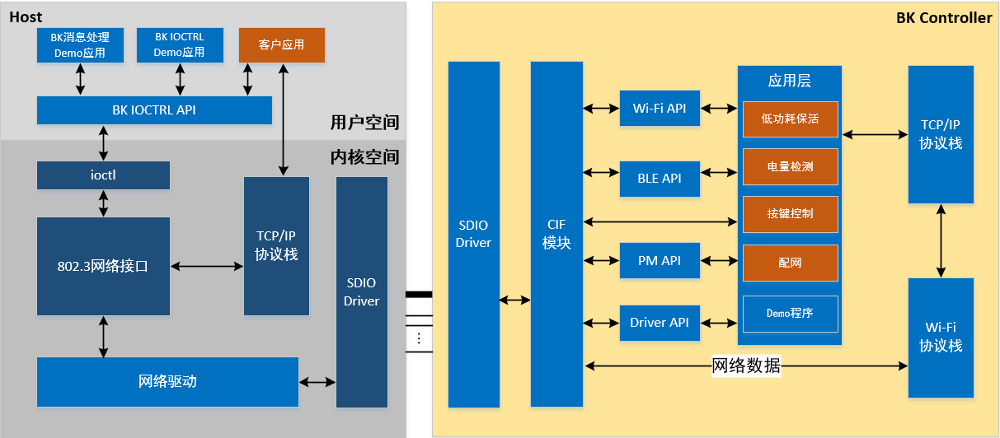
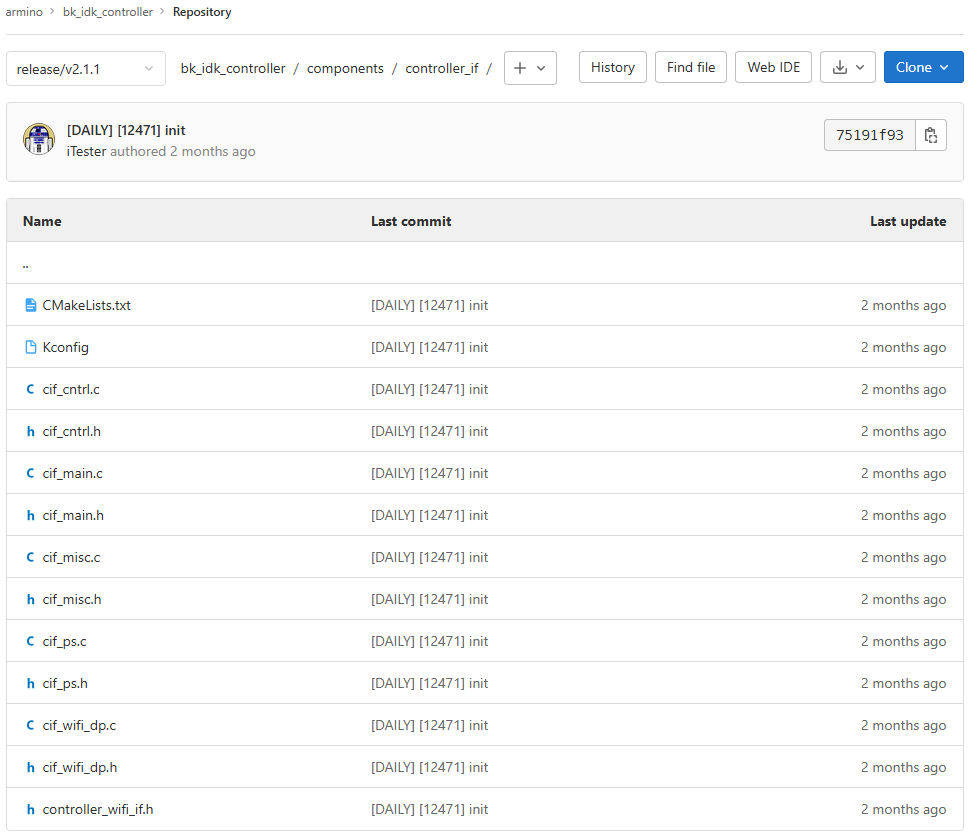
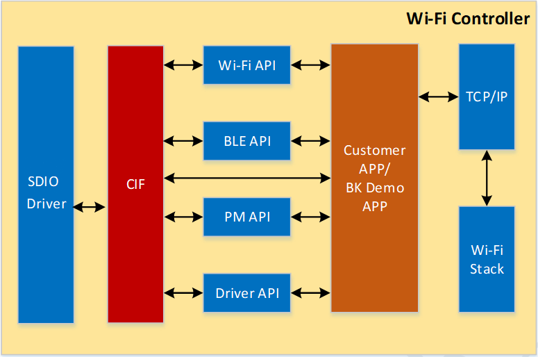

# 软件架构

BK7239N Controller软件包含Host部分和Controller部分，其中Host包含内核空间代码和用户空间APP接口；
Controller部分在原有SDK基础上增加controller\_if模块，该模块通过SDIO/USB与Host交互，提供基础的一些控制功能逻辑。
软件架构如下图所示：

## **controller\_if模块**

controller\_if模块是Controller侧与Host交互的核心模块，它提供了Host消息接收处理、数据接收转发和低功耗控制等核心功能。controller\_if模块在Controller SDK代码位置如下图所示：

controller\_if模块主要与SDIO/USB驱动通信，收到Host发送的消息和数据后转发给相应模块，同时该模块向其他业务模块提供接口，其他业务模块可以调用相应的接口完成与Host的通信。

## 模块导航

- [简介](../introduction.md)
- [快速入门](../get-started.md)
- [硬件开发指南](../hw-reference.md)
- [Controller软件开发指南](../controller-guide.md)
- [配置与构建](config_and_build.md)
- [API参考手册](api-reference.md)
- [平台开发指南](platform_guide.md)
- [Wi-Fi开发指南](wifi_guide.md)
- [蓝牙开发指南](bluetooth_guide.md)
- [网络协议开发指南](network_protocol_guide.md)
- [低功耗开发指南](low_power_guide.md)
- [外设开发指南](peripheral_guide.md)
- [主控平台软件开发指南](../host-guide.md)
- [工程与示例](../project-example.md)
- [开发工具介绍](../dev-tool.md)
- [调测指导](../debug-guide.md)
- [产测指导](../production-test-guide.md)
- [常见问题解答](../faq.md)
