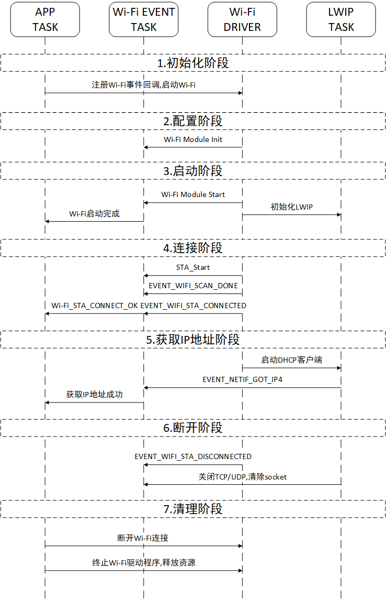
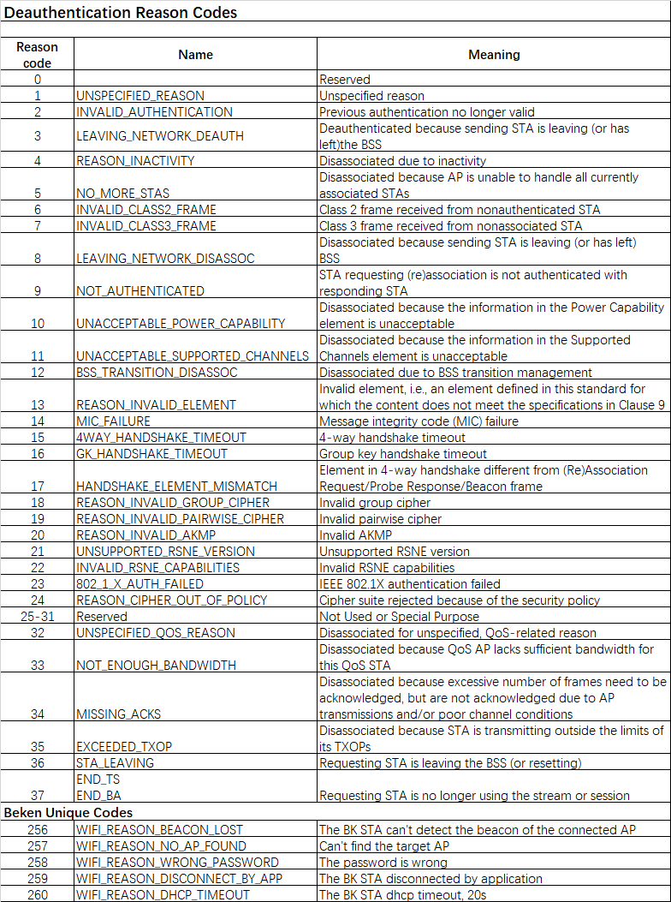

<a id="wi-fi"></a>

# Wi-Fi 基础指南

本文档对 Beken 平台的 Wi-Fi 能力进行整体说明,围绕常见的 STA(Station) 与 AP(SoftAP) 两种工作模式,介绍编程模型、典型事件、工作流程、命令示例、故障定位、扫描配置和 MAC 地址配置方式,帮助开发者快速构建稳定的无线联网能力。

<a id="id1"></a>

## 总体架构与编程模型


Wi-Fi 驱动位于系统网络协议栈与应用之间,主要职责如下:

- 由开发者的应用代码调用 Wi-Fi 初始化 API,完成事件系统、网络接口、驱动本体的创建。
- 接收应用发起的 API 请求(扫描、连接、配网、断开等)并执行,同时将异步事件回调给应用。
- 在需要时与 LwIP、wpa\_supplicant 等组件协同,完成 IP 网络的初始化以及安全连接的建立。

<a id="id2"></a>

## Wi-Fi 关键事件

Wi-Fi 驱动通过事件上报重要状态,应用应在回调中进行相应处理:

- `EVENT_WIFI_SCAN_DONE`: 扫描流程结束。常见于 STA 连接时的信道扫描,可调用 `bk_wifi_scan_get_result` 获取结果。
- `EVENT_WIFI_STA_CONNECTED`: STA 成功关联至目标 AP。根据业务逻辑选择启动 DHCP 客户端或设置静态 IP。
- `EVENT_WIFI_STA_DISCONNECTED`: STA 与 AP 断开。应关闭依赖网络的业务连接,必要时触发重连。

<a id="sta"></a>

## STA 模式工作流程



一个典型的 STA 连接包含以下阶段:

<a id="id3"></a>

### 初始化阶段

- 应用任务调用 `app_wifi_init` 完成 `bk_event_init`、`bk_netif_init`、`bk_wifi_init` 等基础模块启动。

<a id="id4"></a>

### 配置阶段

- 初始化工作队列、MAC/PHY 等底层资源,并根据实际需求设定速率、工作模式等参数。

<a id="id5"></a>

### 启动阶段

- 调用 `bk_wifi_sta_start` 启动 STA。
- 完成 LwIP 协议栈与 wpa\_supplicant 初始化,为后续安全连接做准备。

<a id="id6"></a>

### 连接阶段

- 按照配置(SSID/密码/加密方式等)执行扫描与关联。
- 扫描完成后触发 `EVENT_WIFI_SCAN_DONE`;关联成功后触发 `EVENT_WIFI_STA_CONNECTED`。
- 应用在事件回调中将连接结果传递给业务任务。

<a id="ip"></a>

### 获取 IP 阶段

- 启动 DHCP 客户端,等待 IP 分配。
- 当 DHCP 成功后,驱动发送 `SM_DHCP_DONE_IND` 通知,应用即可创建 TCP/UDP 套接字与服务器交互。

<a id="id7"></a>

### 断开与关闭阶段

- 调用 `bk_wifi_sta_disconnect` 主动断开,或由 AP 离线、RSSI 弱等被动触发 `EVENT_WIFI_STA_DISCONNECTED`。
- 在收到断开事件后,释放网络资源并视情况发起重连。
- 若需要彻底关闭 STA,可在断开后停止相关任务与驱动。

<a id="id8"></a>

### STA 常用命令示例

```
{"sta", "sta ssid [password][bssid][channel]", cli_wifi_sta_cmd}
{"state", "state - show STA/AP state", cli_wifi_state_cmd}
{"stop", "stop {sta|ap}", cli_wifi_stop_cmd}
```

代码路径: `components\bk_cli\cli_wifi.c` 使用前需使能宏 `CLI_CFG_WIFI=1`。

<a id="ap"></a>

## AP 模式工作流程

SoftAP 典型步骤如下:

- 调用 `bk_wifi_ap_start` 配置 SSID、信道、安全模式及最大连接数等。
- 根据业务需要设置 DHCP 服务器、IP 地址池以及网络路由。
- 借助 `bk_wifi_ap_get_sta_list` 获取已连接 STA 信息,用于状态展示或访问控制。
- 当 SoftAP 关闭时,释放网络资源并通知已连接终端。

<a id="id9"></a>

### AP 常用命令示例

```
{"ap", "ap ssid [password] [channel[1:14]]", cli_wifi_ap_cmd}
{"state", "state - show STA/AP state", cli_wifi_state_cmd}
{"stop", "stop {sta|ap}", cli_wifi_stop_cmd}
```

代码路径: `components\bk_cli\cli_wifi.c` 使用前需使能宏 `CLI_CFG_WIFI=1`。

<a id="id10"></a>

## 常见连接失败与诊断



常见故障与处理建议:

- 认证失败: 检查密码或加密方式是否匹配,必要时确认 wpa\_supplicant 配置。
- 信道受限或冲突: 确认目标信道是否被监管域限制,或尝试调整信道/频段。
- RSSI 过弱: 调整终端与 AP 的距离,或优化天线、发射功率。
- DHCP 超时: 若网络无 DHCP 服务,需要配置静态 IP;确认上游网络是否正常。
- MAC 地址未写入: 若使用随机 MAC 导致绑定失败,请检查 MAC 配置章节。

<a id="id11"></a>

## 扫描配置

- 调用事件回调函数 `bk_event_register_cb`
- 调用函数 `bk_wifi_scan_start` 开始扫描
- 调用函数 `show_scan_ap_result` 上报扫描结果包括AP Num、SSID、BSSID、RSSI、Channel、加密方式等

<a id="id12"></a>

### 扫描命令示例

```
{"scan", "scan [ssid]", cli_wifi_scan_cmd}
```

代码路径: `components\bk_cli\cli_wifi.c` 使用前需使能宏 `CLI_CFG_WIFI=1`。

<a id="mac"></a>

## MAC 地址配置

Wi-Fi MAC 地址实现位于 `bk_system/mac.c` ,默认包含 base MAC、STA MAC、AP MAC 三组地址。整体策略如下:

- `CONFIG_NEW_MAC_POLICY` (默认 y): 优先从 NET\_Param 分区前 6 字节读取 MAC,如果为空时使用随机地址。
- `CONFIG_RANDOM_MAC_ADDR` (默认 y): 在 NET\_Param 为空时生成随机地址,并写回 FLASH,保证符合 `CONFIG_BK_MAC_ADDR_CHECK` 规则(前缀 C8:47:8C)。
- `CONFIG_BK_MAC_ADDR_CHECK` (默认 y): 校验客户自定义 MAC 是否符合规范,如不需要可在 `middleware/soc/bk7239/bk7239.defconfig` 中关闭。

写入 MAC 的常用方式:

- 使用 BK Writer 工具将合法 MAC 烧录到 FLASH;注意整片擦除会导致 MAC 丢失。
- 通过命令行写入:

```
mac c8478caabbcc
```
