

# 概述

射频测试采用WiFi\_Test\_Tool工具，支持WiFi和Bluetooth的测试。

# 硬件连接说明

## 被测模块硬件连接

> [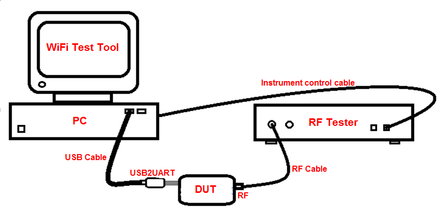](../../../_assets/1e36cb5fc2b72e7e18ea-image1.png)
> [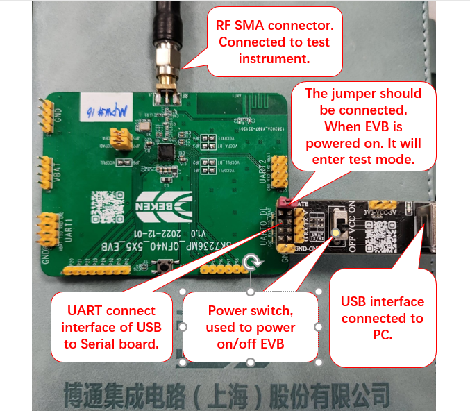](../../../_assets/4c0f8ea901854ba0d05a-image2.png)
> [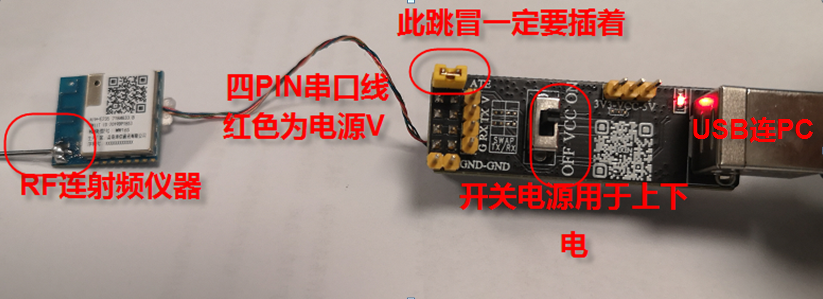](../../../_assets/d244f631cb9a8ea4a34e-image3.png)

硬件连接如图所示：最左边是RF线连射频仪器，中间四根线为串口通信线，其中红色的为电源，在测试接口上有标注V(电源)和G（地），对应串口板上的V和G。另外串口板上的黄色跳帽必须插着（标注ATE），如果掉了，需找线短接；如果不是这个串口板，需要在这个UART的TX脚上加下拉1K电阻到地。1K电阻到地的原理是：当上电的时候UART\_TX处于输入上拉状态(内部上拉电阻大概几十K)，发现外部接1K电阻到地时就判断为输入低电平，芯片直接进入测试模式用于测射频性能，进入模式后，端口又设置为正常的UART功能，1K下拉电阻不会影响UART正常通信。

串口板上开关用于模块的上下电，如果发现串口连接不成功，可尝试拨动开关重新上电。最右边USB接口连接电脑PC。

您可以通过在上电时查看WiFi Test Tool的日志窗口打印来判断是否进入ATE模式，如下图所示。不同产品会打印”ate start”或”ATE enabled \= 1”等信息，这意味着已进入ATE模式，可以用于测量射频性能。
如果没有打印信息，请确保1K电阻已连接到地，或与软件工程师确认芯片是否真正进入了ATE模式。

> [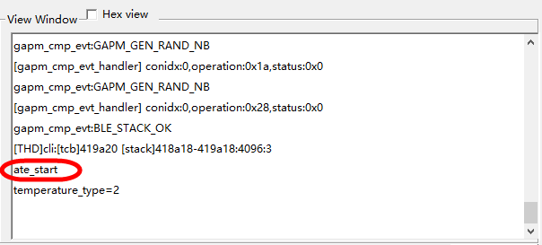](../../../_assets/c8fe12df683ca1039d9a-image4.png)
> [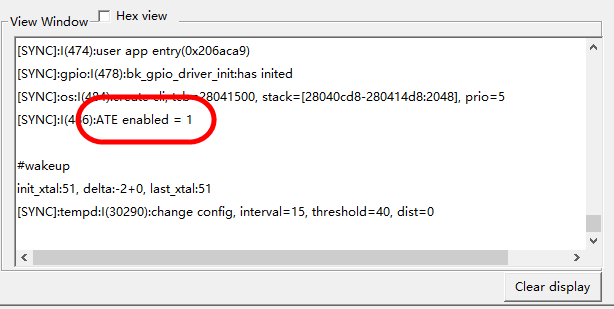](../../../_assets/102a44bbbb4e342ef62a-image5.png)

# WIFI测试介绍

## 1、串口连接

[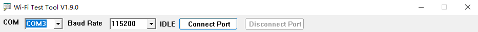](../../../_assets/f9985ed7ced93d938611-image6.png)

实时检测连接的USB COM PORT,选择你需要的COM口，

Baud Rate 默认115200，

点击 Connect Port 按钮连接待测板子

## 2、选择模式

选择板子的发射与接受模式，默认为发射，即WiFi-Tx.

## 3、选择测试频域

[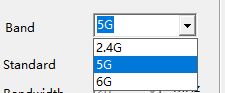](../../../_assets/a68a0df5402a7087cff2-image8.png)

如图，需要测试2.4G的发射接收则选择2.4G,需要测5G发射接收选5G,板子具体支持哪个频段的测试需要看固件有没有做支持.

## 4、选择发包的协议标准

[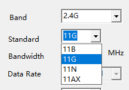](../../../_assets/64cc15a633899bc73eec-image9.png)[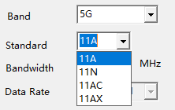](../../../_assets/255272f8f5ec1f9af64a-image10.png)

2.4G频带含有11B、11G、11N、11AX发射/接收支持，

5G频带含有11A、11N、11AC、11AX发射/接收支持。

## 5、带宽选择

[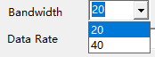](../../../_assets/9e7792b0f79c5b19f6e3-image12.png)

目前所有产品仅支持20M与40M带宽

## 6、发射速率与信道选择

[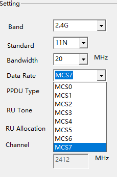](../../../_assets/bb89339d497c9bb67b20-image13.png) [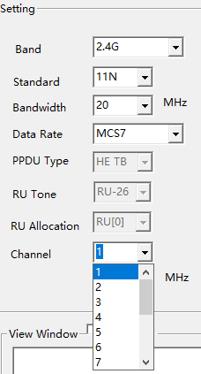](../../../_assets/41a227e274fcbc0f0de3-image14.png)

每个协议的所有速率都支持，每个频带的所有信道都支持

## 7、 HE-TB RU选择

[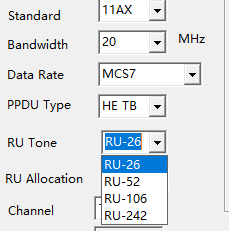](../../../_assets/0b6eddc818e6799cfc9f-image15.png)

当Standard选择为11AX

且PPDU Type 为 HE TB 时

RU tone 与index 复选框才会起作用，

其中RU Tone 可选择RU-26、RU-52、RU-106、RU-242四种RU

RU Allocation代表该RU在频带内被分配的位置。

## 8、开始发射/接收

[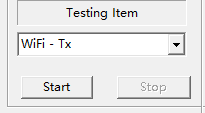](../../../_assets/763b7adec66b6ac95be9-image16.png)

Start 开始 Stop 接收（仅当连接上待测板时才有效）

## 9、发射设置栏介绍

[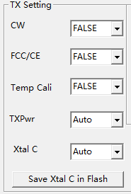](../../../_assets/692e7a41b4f8103305fe-image17.png)

如图

CW 为TRUE时发射单载波，为FALSE时根据小结1\~6介绍的配置发射正常WiFi信号.

FCC 为TRUE
进入连续发WiFi信号的模式，占空比99%;为FALSE时不连续发射，占空比10%

也可以手动输入0\~99的任意数字指定任意百分比.

Temp Cali 为FALSE
时不开启温度校准，常温下不启用，仅当高低温测试时才设置为True.

TXPower 0\~127 发射功率的档位调节，Auto 则使用校准值，默认为Auto.

Xtal C 0\~255 调整电容修改发射中心频点的频偏,Auto
则使用校准值，默认为Auto.

Save Xtal C in Flash 将TXPower 与 Xtal C
当前值存为校准值，保存到flash内，下次上电默认为校准的功率与频偏.

## 10、接收设置栏介绍

[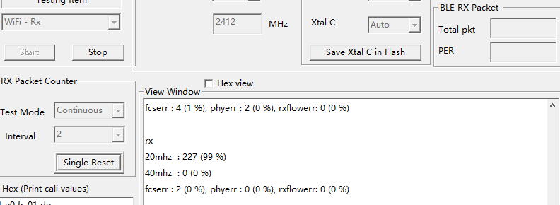](../../../_assets/dd0541c02c050c3c116b-image18.png)

“RX Packet Counter”：WiFi 非信令接收测试，需要在“Testing Item”中选”WiFi
-Rx”。

“Test Mode”包括连续接收测试”Continous”和单次接收测试”Single”模式。
“Continous”模式：仪器连续发射，芯片持续接收，在”View
Window”框打印收到包的正确率，注意在这个
模式下芯片对丢掉的包是不计算在内的，只计算收到包中的正确率，所以看到的包正确率
99%(下图中括号内) 不可信，但上图中括号前收到的正确包个数 227
是可信的，可以用信号源发大信号统计仪器总共发了多少个包，然后两者相除来获得总的误包率
PER。 上图中 227为间隔 Interval 2
秒收到的正确包个数；99%为收到包中的正确包率，而非全部包的正确率，
因为板子统计不了丢失的包数.

# Bluetooth测试介绍

## 选择模式

[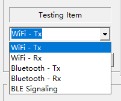](../../../_assets/57a9d841edb1b72a82e5-image28.png)

选择Bluetooth-Tx 即可

## 速率选择

[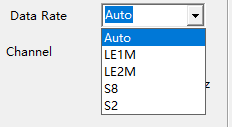](../../../_assets/cfbc1e738a556906927e-image29.png)

如图，可以选择Bluetooth 的各种速率，Auto
默认LE1M，用的是老版本的命令，适用于只有LE1M的产品；如果是支持LE2M及LE
long range的产品，Auto 与 LE1M都适用。

## 信道选择

[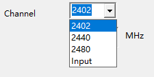](../../../_assets/86aacb4a9a2f45f47d61-image30.png)[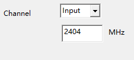](../../../_assets/8158dcea92dc6635ffbe-image31.png)

支持高中低三个常用信道以及自定义信道输入。

## 发射设置栏介绍

> [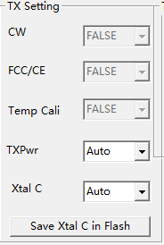](../../../_assets/be2a49fd99829233fde0-image32.png)
>
> 只有TXpwr 是调功率的，Xtal
> C是调电容（频偏的）其余三个是wifi相关配置，与Bluetooth无关。

## BLE Pattern 栏介绍

> [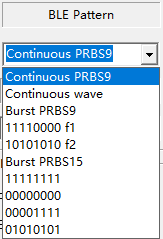](../../../_assets/7991b3c97e352eff1358-image33.png)
>
> 仅当模式选为Bluetooth-Tx时才有效
>
> Continuous PRBS9 以及 Continuous
> wave是发占空比为100%的连续PN9波形以及单载波，其余皆为非连续brust（占空比默认为10%）
>
> 11110000 f1 与 10101010 f2用于测试发射的Modulation
> Characteristics，如果Data Rate选择为LE1M,则发射速率为LE
> 1MBps的波形。其余速率和Pattern类似。

## BLE RX Packet

[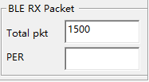](../../../_assets/0ccc993e3be4b5c00749-image34.png)

在BLE接收测试时，Total
pkt需要改为信号源单次发射的包的数量，信号源发射结束，点击界面的
Stop后会自动计算PER显示到PER栏里

# 发射/接收界面总览

发射界面

[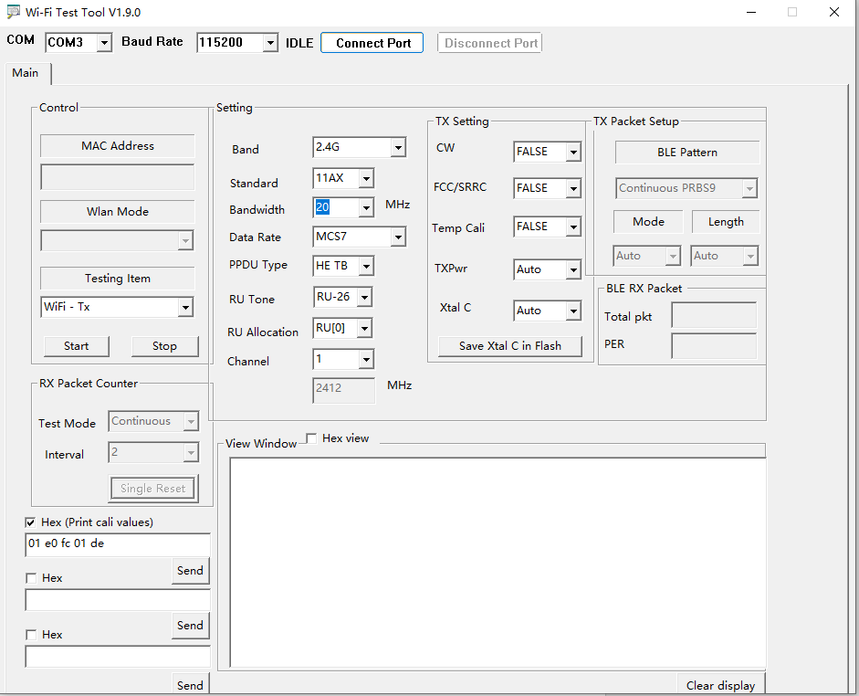](../../../_assets/d40b2bb12c55533481d0-image40.png)

接收界面

[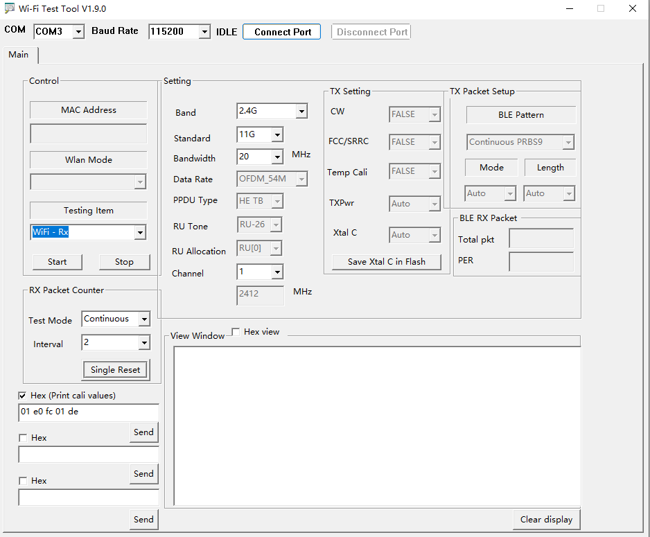](../../../_assets/28064be920fd424d9d60-image41.png)
